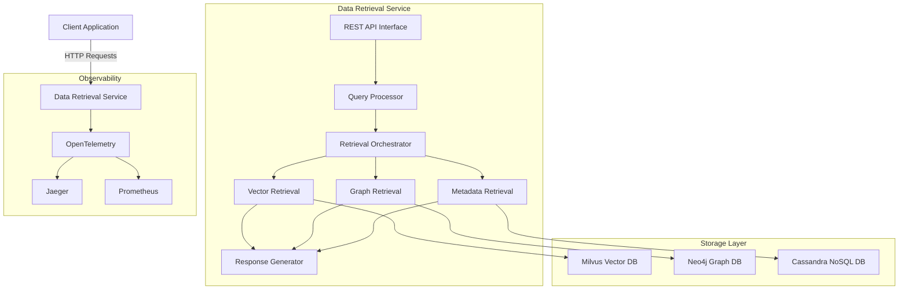
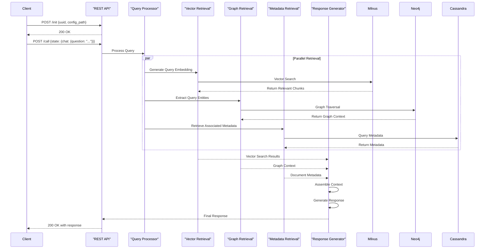
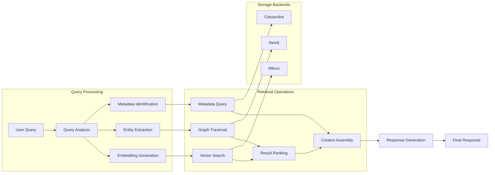
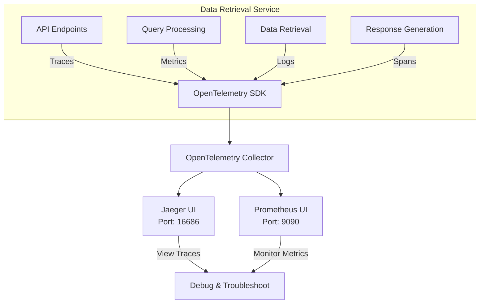

<!-- source: DeepWiki mcp.deepwiki.com · repo NVIDIA/context-aware-rag · page 2.2 Data Retrieval Service · fetched 2026-10-26 -->

# Data Retrieval Service

<details>
<summary>Relevant source files</summary>

The following files were used as context for generating this wiki page:

- [README.md](README.md)

</details>


## Purpose and Scope

The Data Retrieval Service is a core component of the Context-Aware RAG system responsible for processing natural language queries, retrieving relevant information from the storage backends, and generating contextually appropriate responses. This document covers the architecture, functionality, and integration capabilities of the Data Retrieval Service.

For information about how data is initially processed and stored in the system, see the [Data Ingestion Service](#2.1). For details about the storage systems used by the Data Retrieval Service, see [Storage Backend Systems](#2.3).

## Architecture Overview

The Data Retrieval Service is designed as a microservice that handles query processing, information retrieval from multiple storage backends, and context assembly for generating responses. It communicates with clients via a RESTful API and integrates with the observability stack for monitoring and troubleshooting.



Sources: [README.md:27-31]()

## Query Processing Workflow

The Data Retrieval Service follows a structured workflow for processing user queries and generating contextually relevant responses.



Sources: [README.md:195-219]()

## API Endpoints

The Data Retrieval Service exposes two primary RESTful API endpoints:

| Endpoint | Method | Purpose | Request Payload | Response |
|----------|--------|---------|-----------------|----------|
| `/init`  | POST   | Initialize the service with a configuration and UUID | `{"uuid": "string", "config_path": "string"}` or `{"uuid": "string", "context_config": {}}` | 200 OK |
| `/call`  | POST   | Process a query and return a response | `{"state": {"chat": {"question": "string"}}}` | `{"result": "string"}` |

### `/init` Endpoint

The `/init` endpoint initializes the Data Retrieval Service with a specific configuration and a unique identifier (UUID). The UUID must match the one used by the Data Ingestion Service to ensure that the retrieval service accesses the correct data.

### `/call` Endpoint

The `/call` endpoint processes natural language queries and returns contextually relevant responses. The request payload must include a state object with a question field.

Sources: [README.md:194-219]()

## Integration with Storage Systems

The Data Retrieval Service integrates with three distinct storage backends, each serving a specific role in the retrieval process:

### Vector Retrieval with Milvus

The service uses Milvus to perform semantic similarity searches. When a query is received:

1. The query text is converted into an embedding vector
2. The vector is used to search for semantically similar document chunks in Milvus
3. The most relevant chunks are retrieved for context assembly

### Graph-Based Retrieval with Neo4j

The service leverages Neo4j for knowledge graph querying:

1. Key entities are extracted from the user query
2. Graph traversal algorithms find related information in the knowledge graph
3. Connected entities and relationships provide additional context

### Metadata Retrieval with Cassandra

Cassandra is used for retrieving structured metadata about documents:

1. Document identifiers from vector and graph searches are used to query Cassandra
2. Associated metadata enhances the context with additional structured information
3. Temporal or hierarchical information can be leveraged for ordering content



Sources: [README.md:117-142]()

## Configuration Options

The Data Retrieval Service can be configured in several ways:

1. Using a YAML configuration file specified via the `config_path` parameter
2. Providing a configuration object directly via the `context_config` parameter
3. Using environment variables

### Environment Variables

| Variable | Description | Example |
|----------|-------------|---------|
| `VSS_CTX_PORT_RET` | Port for the Data Retrieval Service | `8001` |
| `NVIDIA_API_KEY` | API key for NVIDIA services (if using) | `<key>` |
| `OPENAI_API_KEY` | API key for OpenAI services (if using) | `<key>` |
| `NVIDIA_VISIBLE_DEVICES` | GPU ID to use | `0` |

Sources: [README.md:93-101]()

## Example Usage

Below is a typical workflow for using the Data Retrieval Service:

1. **Initialize the service with the same UUID as used in data ingestion:**

```python
import requests
import json

base_url = "http://<HOST>:<VSS_CTX_PORT_RET>"
headers = {"Content-Type": "application/json"}

init_data = {"config_path": "/app/config/config.yaml", "uuid": "1"}
response = requests.post(
    f"{base_url}/init", headers=headers, data=json.dumps(init_data)
)
```

2. **Send a query to retrieve information:**

```python
call_data = {"chat": {"question": "What happens in this situation?"}}
request_data = {"state": call_data}

response = requests.post(
    f"{base_url}/call", headers=headers, data=json.dumps(request_data)
)
print(response.json()["result"])
```

Sources: [README.md:194-219]()

## Integration with Observability Stack

The Data Retrieval Service is fully integrated with the system's observability stack, enabling comprehensive monitoring and troubleshooting:



Key observability features:

- **Distributed Tracing**: Track queries as they flow through the system
- **Metrics Collection**: Monitor performance and resource usage
- **Error Logging**: Capture and analyze failures
- **Request/Response Monitoring**: Observe the entire request lifecycle

Sources: [README.md:134-140]()

## Deployment

The Data Retrieval Service is typically deployed as part of the full Context-Aware RAG system using Docker Compose. When deployed, the service is available at `http://<HOST>:<VSS_CTX_PORT_RET>`.

For detailed deployment instructions, see [Docker Deployment](#4.1).

Sources: [README.md:109-144]()

---

