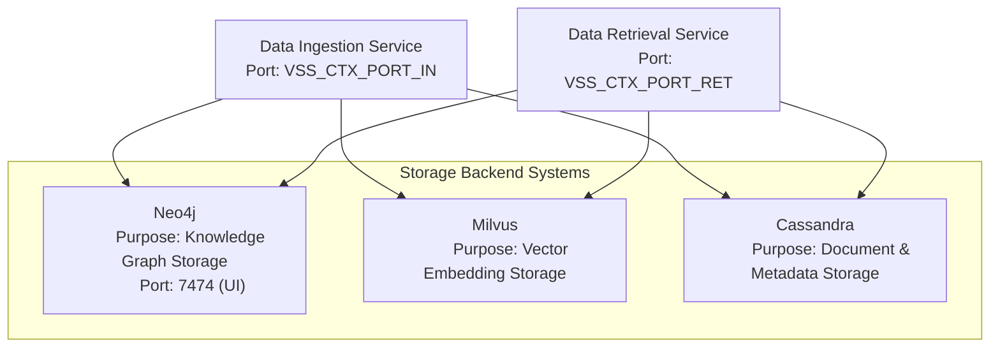
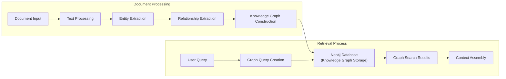
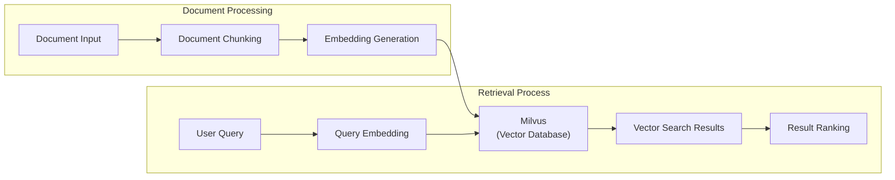
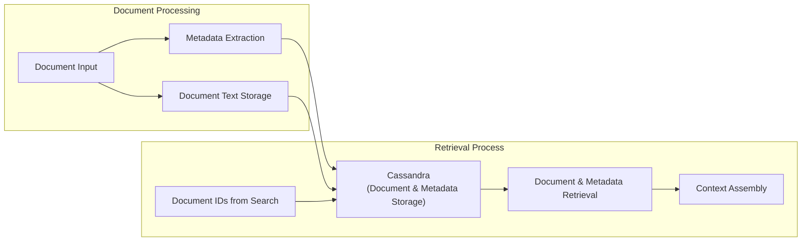
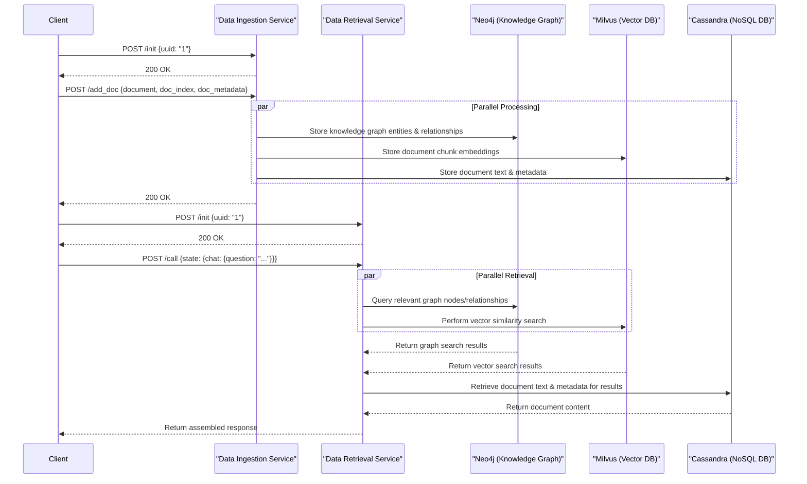
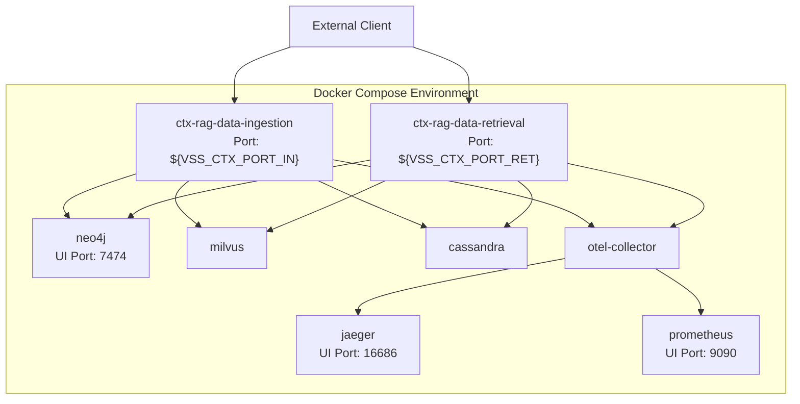

<!-- source: DeepWiki mcp.deepwiki.com · repo NVIDIA/context-aware-rag · page 2.3 Storage Backend Systems · fetched 2026-10-26 -->

# Storage Backend Systems

Relevant source files

The following files were used as context for generating this wiki page:

- [README.md](README.md)

## Purpose and Scope

This document describes the three primary storage backend systems used in the Context-Aware RAG architecture: Neo4j, Milvus, and Cassandra. Each storage system serves a specific purpose in the architecture, handling different types of data and supporting different retrieval mechanisms. This page covers the role of each storage system, how they interact with the Data Ingestion Service [Data Ingestion Service](#2.1) and Data Retrieval Service [Data Retrieval Service](#2.2), and their deployment configurations.

## Storage Systems Overview

The Context-Aware RAG system utilizes a multi-database approach to store different types of information effectively:

Sources: [README.md:116-142]()

## Neo4j: Knowledge Graph Storage

Neo4j serves as the graph database for storing knowledge graphs extracted from documents. It enables relationship-based queries that enhances the context-aware capabilities of the RAG system.

### Key Features and Role

- Stores entities and relationships extracted from documents
- Supports graph-based searches and traversals
- Enables context-aware retrieval by leveraging relationship information
- Web interface available at port 7474 for visualization and manual queries

### Integration with RAG Pipeline

Sources: [README.md:30](), [README.md:126-128]()

## Milvus: Vector Database

Milvus is used as the vector database for storing and retrieving document embeddings. It enables semantic search capabilities by finding documents with similar meaning through vector similarity.

### Key Features and Role

- Stores vector embeddings of document chunks
- Supports fast similarity search for vectors
- Enables semantic retrieval based on the meaning of content rather than keyword matching
- Optimized for high-dimensional vector operations

### Integration with RAG Pipeline

Sources: [README.md:130]()

## Cassandra: Document and Metadata Storage

Cassandra serves as the NoSQL database for storing document text and associated metadata. It provides a robust, scalable storage solution for the structured data elements in the RAG system.

### Key Features and Role

- Stores full document text and document metadata
- Provides efficient key-value retrieval for document information
- Enables scalable storage for large document collections
- Supports metadata filtering during retrieval operations

### Integration with RAG Pipeline

Sources: [README.md:142]()

## Data Flow Between Storage Systems

The following diagram illustrates how data flows between the different storage systems during ingestion and retrieval operations:

Sources: [README.md:148-218]()

## Docker Deployment Configuration

All storage backends are deployed as Docker containers as part of the Context-Aware RAG system. The following diagram shows the deployment architecture:

Sources: [README.md:103-142]()

## Storage Configuration

The storage volumes for the databases can be customized by setting the `DOCKER_VOLUME_DIRECTORY` environment variable to the desired directory path. This allows for persistent storage across container restarts.

Sources: [README.md:144]()

## Integration with Data Services

### Data Ingestion Integration

During data ingestion, documents are processed and stored across all three database systems:

| Database | What Gets Stored | Purpose |
|----------|------------------|---------|
| Neo4j    | Entities and relationships extracted from documents | Enable graph-based context retrieval |
| Milvus   | Vector embeddings of document chunks | Enable semantic similarity search |
| Cassandra | Original document text and metadata | Provide document content and filtering capabilities |

### Data Retrieval Integration

During data retrieval, the system performs the following operations with the storage backends:

1. Converts the query into both a vector embedding and graph query parameters
2. Searches Milvus for semantically similar document chunks
3. Searches Neo4j for relevant graph entities and relationships
4. Retrieves the original document content and metadata from Cassandra
5. Combines the results to assemble comprehensive context for the response

The multi-database approach enables the Context-Aware RAG system to leverage both semantic similarity (vector search) and relational context (graph search) when retrieving information, resulting in more accurate and contextually relevant responses.

Sources: [README.md:148-218]()

---

