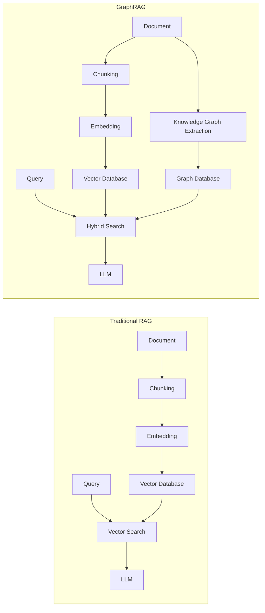
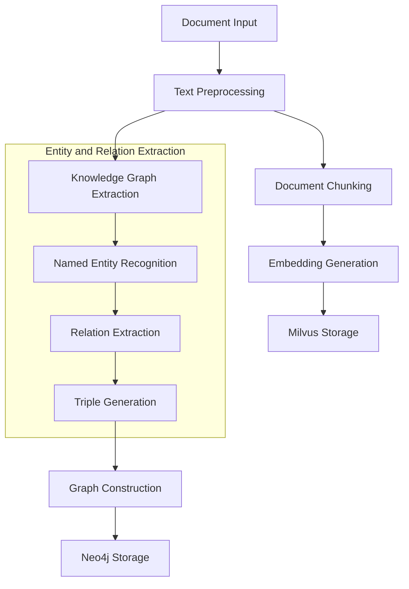
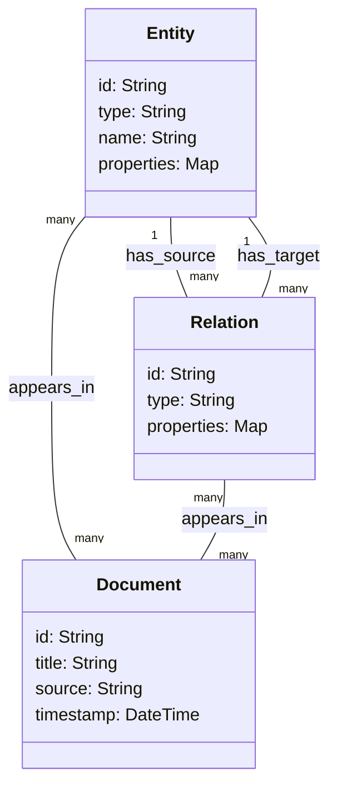
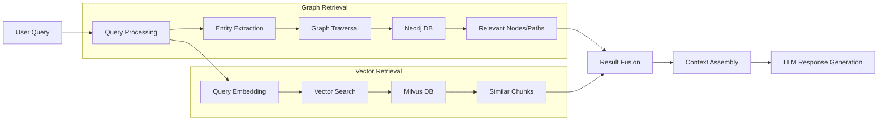
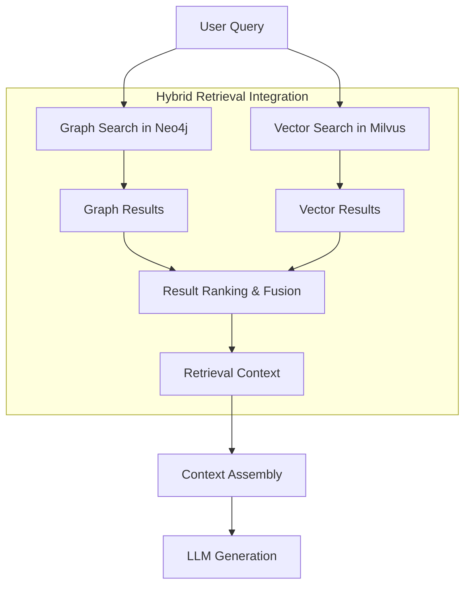
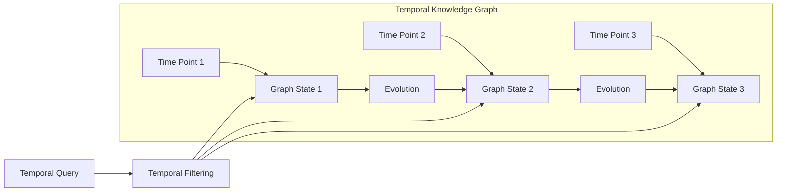
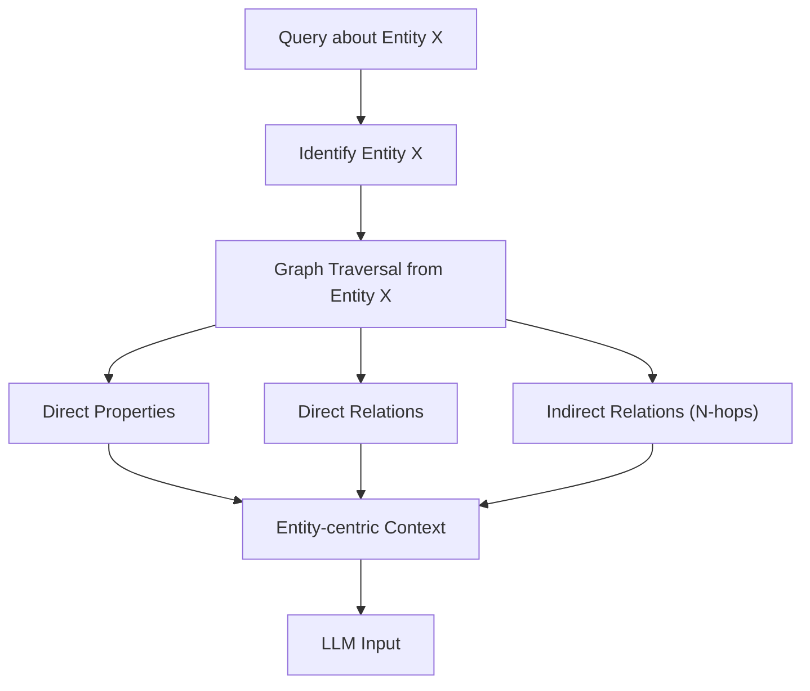
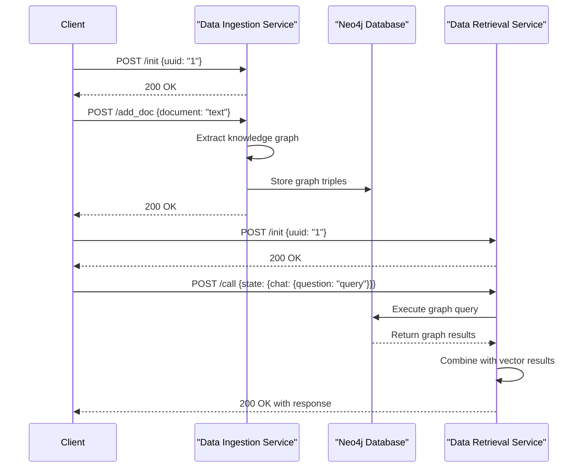

<!-- source: DeepWiki mcp.deepwiki.com · repo NVIDIA/context-aware-rag · page 2.4 GraphRAG Capabilities · fetched 2026-10-26 -->

# GraphRAG Capabilities

Relevant source files

The following files were used as context for generating this wiki page:

- [README.md](README.md)

## Purpose and Scope

This document details the knowledge graph extraction features in NVIDIA's Context-Aware RAG system and explains how these graph-based capabilities enhance the retrieval process. GraphRAG combines traditional vector retrieval with knowledge graph operations to provide more contextually relevant and accurate retrieval results. For information about the overall retrieval service, see [Data Retrieval Service](#2.2), and for details on the underlying storage systems, see [Storage Backend Systems](#2.3).

## Overview of GraphRAG

GraphRAG extends traditional RAG (Retrieval Augmented Generation) by incorporating graph structures to represent relationships between entities in the source documents. This approach allows for more nuanced retrieval by leveraging the contextual connections between pieces of information.

Sources: [README.md:29-30]()

## Knowledge Graph Extraction Process

During the data ingestion process, the Context-Aware RAG system extracts structured knowledge from unstructured documents. This extraction occurs in parallel with the traditional document chunking and embedding pipeline.

Sources: [README.md:21-22]()

The extraction process involves several key steps:

1. **Text Preprocessing**: The incoming document is cleaned and normalized.
2. **Named Entity Recognition**: Identifies entities (people, places, organizations, concepts) in the text.
3. **Relation Extraction**: Determines the relationships between identified entities.
4. **Triple Generation**: Creates subject-predicate-object triples that represent the knowledge.
5. **Graph Construction**: Organizes the triples into a coherent knowledge graph structure.
6. **Neo4j Storage**: Persists the knowledge graph in the Neo4j database.

## Graph Storage in Neo4j

The extracted knowledge graphs are stored in Neo4j, a graph database designed specifically for efficient storage and retrieval of graph-structured data.

### Graph Schema Example

Sources: [README.md:126-128]()

## Graph-Based Retrieval

During retrieval, the Context-Aware RAG system leverages the knowledge graph to enhance the search process beyond simple vector similarity.

Sources: [README.md:19-34]()

### Graph Retrieval Techniques

The system employs several graph-based retrieval techniques:

| Technique | Description | Advantage |
|-----------|-------------|-----------|
| Entity Linking | Identifies entities in the query and links them to the knowledge graph | Anchors the search to relevant entities |
| Path-based Retrieval | Finds paths between entities mentioned in the query | Reveals relationships not explicit in the text |
| Subgraph Extraction | Extracts relevant subgraphs around entities of interest | Provides contextual information |
| Graph Spreading Activation | Propagates relevance scores through the graph | Discovers related but not directly mentioned information |

## Integration with Vector Search

GraphRAG combines the strengths of both graph-based and vector-based retrieval to provide more comprehensive results.

Sources: [README.md:127-130]()

### Hybrid Retrieval Benefits

The integration of graph and vector search offers several advantages:

1. **Complementary Coverage**: Vector search excels at semantic similarity, while graph search captures structured relationships.
2. **Contextual Awareness**: The graph provides relational context between chunks that might be missed in pure vector search.
3. **Multi-hop Reasoning**: Graph traversal enables finding information that requires following multiple connections.
4. **Query Disambiguation**: Entity linking through the graph helps disambiguate queries with multiple potential interpretations.

## Advanced GraphRAG Capabilities

### Temporal Graph Analysis

The Context-Aware RAG system can track how entities and relationships evolve over time by associating graph elements with document timestamps.

Sources: [README.md:174-182]()

### Entity-centric Context Assembly

The system can assemble context based on entity relationships rather than just document proximity, providing more coherent information to the LLM.

Sources: [README.md:212-218]()

## Performance and Scaling Considerations

| Aspect | Consideration | Mitigation |
|--------|--------------|------------|
| Graph Complexity | Large knowledge graphs can result in slow traversal | Efficient indexing and query optimization in Neo4j |
| Extraction Quality | LLM-based extraction may introduce errors | Use confidence scores and validation mechanisms |
| Query Performance | Complex graph queries can be computationally expensive | Query caching and precomputed views for common patterns |
| Storage Requirements | Graph representations add storage overhead | Selective extraction of relevant entities and relations |

Sources: [README.md:126-142]()

## Integration with the Data Pipeline

GraphRAG is fully integrated into both the data ingestion and retrieval services of the Context-Aware RAG system.

Sources: [README.md:146-219]()

## Conclusion

GraphRAG capabilities in the Context-Aware RAG system enable more sophisticated retrieval by leveraging the structured relationships between entities in the source documents. By combining traditional vector search with knowledge graph operations, the system can provide more contextually accurate and comprehensive information to the LLM, resulting in better-generated responses. The integration of knowledge graphs offers a powerful mechanism for capturing and utilizing the semantic connections within the data, going beyond simple similarity measures to include explicit relationship structures.

---

