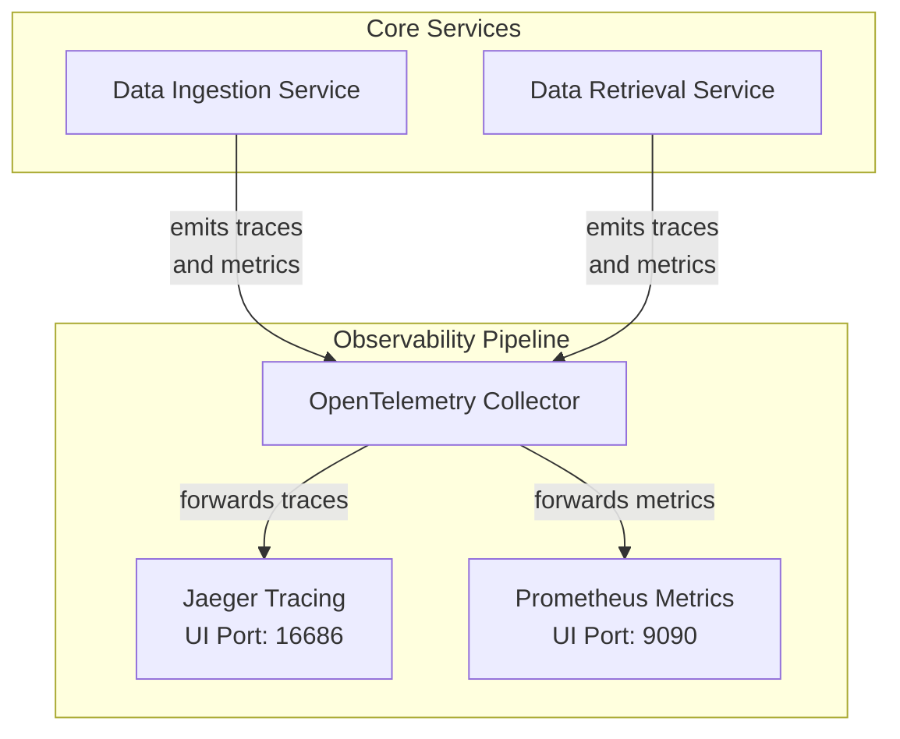
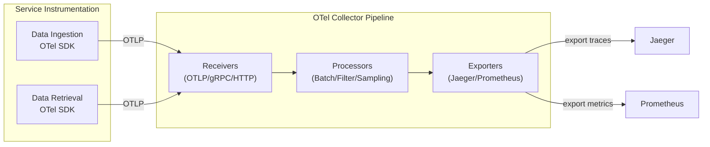
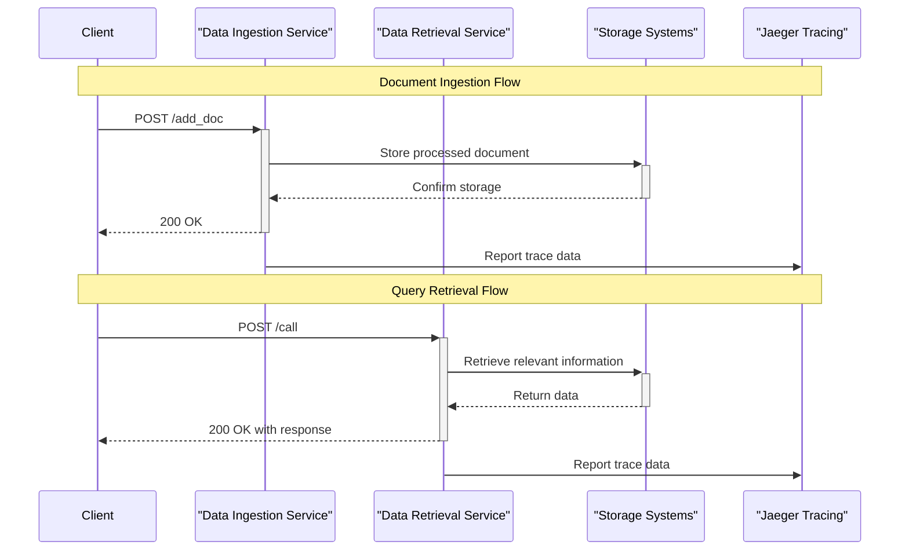
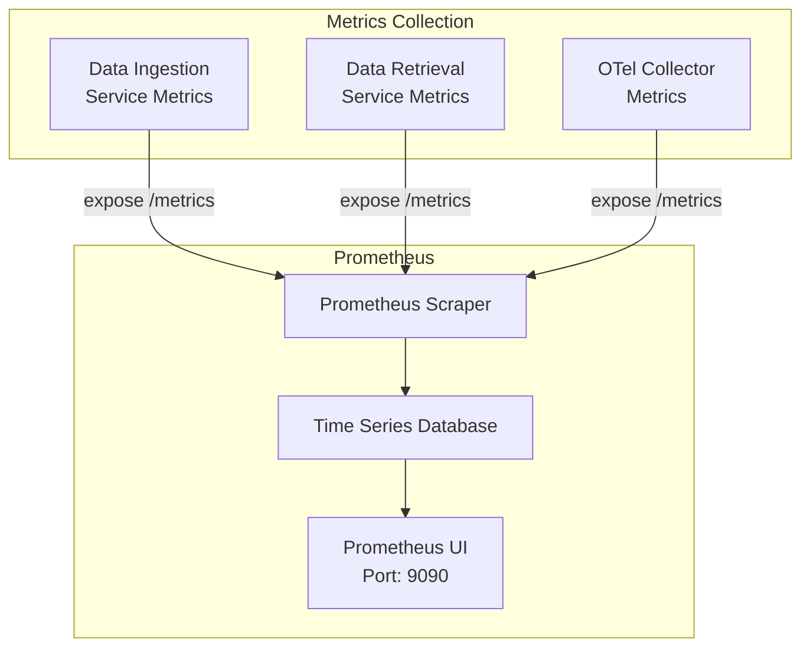
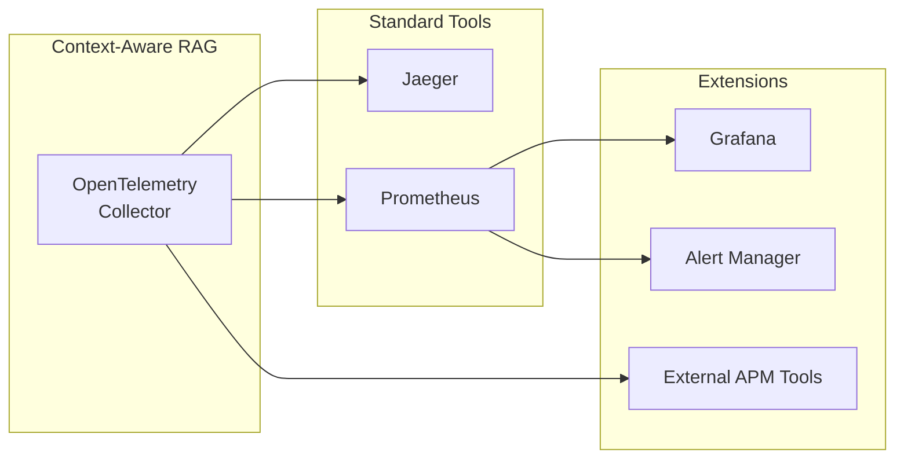

<!-- source: DeepWiki mcp.deepwiki.com · repo NVIDIA/context-aware-rag · page 2.5 Observability Features · fetched 2026-10-26 -->

# Observability Features

<details>
<summary>Relevant source files</summary>

The following files were used as context for generating this wiki page:

- [README.md](README.md)

</details>


This document provides a comprehensive overview of the observability capabilities in the NVIDIA Context-Aware RAG system. It details how you can monitor, trace, and collect metrics from your RAG pipelines using built-in OpenTelemetry integration, Jaeger, and Prometheus. For information about the overall system architecture, see [System Architecture](#2).

## Overview of Observability Architecture

The Context-Aware RAG system includes a robust observability stack that enables monitoring, debugging, and performance analysis of your data ingestion and retrieval workflows. This observability architecture is built on industry-standard tools that provide comprehensive visibility into the system's operation.



Sources: [README.md:132-140]()

## OpenTelemetry Integration

The system leverages OpenTelemetry as the foundation for its observability features. OpenTelemetry provides a standardized way to collect, process, and export telemetry data (traces, metrics, and logs) from the Context-Aware RAG services.

### Key Benefits

- **Vendor-neutral monitoring**: OpenTelemetry's vendor-neutral approach allows you to use any compatible monitoring tool
- **Comprehensive telemetry**: Collects traces, metrics, and logs in a standardized format
- **Low overhead**: Designed for efficient data collection with minimal impact on performance
- **Extensibility**: Can be customized to collect additional data points as needed

The OpenTelemetry Collector serves as the central aggregation point for all telemetry data generated by the Data Ingestion and Data Retrieval services.



Sources: [README.md:132-140]()

## Distributed Tracing with Jaeger

Jaeger provides distributed tracing capabilities, allowing you to trace requests as they flow through the different components of the Context-Aware RAG system.

### Trace Visualization

The Jaeger UI is accessible at `http://<HOST>:16686` when running the system with Docker Compose. This interface allows you to:

1. Search for traces by service, operation, duration, and tags
2. View detailed trace timelines showing the flow of requests
3. Analyze the timing and dependencies between services
4. Identify performance bottlenecks in your RAG pipelines

### Key Trace Points

| Service | Trace Points | Purpose |
|---------|--------------|---------|
| Data Ingestion | Document processing | Track document chunking, embedding generation, and storage operations |
| Data Ingestion | Knowledge graph extraction | Monitor the efficiency of graph node and relationship creation |
| Data Retrieval | Query processing | Follow the query from reception through embedding generation to storage search |
| Data Retrieval | Context assembly | Track how retrieved information is assembled into context for the LLM |



Sources: [README.md:132-140]()

## Metrics Collection with Prometheus

Prometheus collects and stores time-series metrics from the Context-Aware RAG services, providing insights into system performance, resource utilization, and business metrics.

### Prometheus UI

The Prometheus UI is accessible at `http://<HOST>:9090` when running the system with Docker Compose. This interface allows you to:

1. Query metrics using PromQL (Prometheus Query Language)
2. Visualize metric trends over time
3. Set up alerts based on metric thresholds
4. Monitor system health and performance

### Key Metrics Collected

| Metric Category | Examples | Purpose |
|-----------------|----------|---------|
| Service Health | Service uptime, error rates | Monitor overall service health |
| Request Performance | Request duration, throughput | Track API performance |
| Document Processing | Documents processed, processing time | Monitor ingestion pipeline performance |
| Query Performance | Query latency, result count | Analyze retrieval performance |
| Storage Operations | Storage operation latency, size | Track database performance |
| Resource Utilization | CPU usage, memory consumption | Monitor resource efficiency |



Sources: [README.md:132-140]()

## Integrating Observability into Workflows

### Monitoring Service Health

To ensure your Context-Aware RAG services are functioning properly, you can set up dashboards to monitor:

1. **Service availability**: Track uptime and response codes for both Data Ingestion and Data Retrieval services
2. **Error rates**: Monitor the frequency and types of errors occurring in each service
3. **Performance trends**: Observe processing times over extended periods to identify degradation

### Debugging Failed Requests

When a document ingestion or query retrieval operation fails:

1. Locate the trace ID from the response headers or logs
2. Look up the trace in Jaeger to see where the failure occurred
3. Use the contextual information in the trace to identify the root cause
4. Check related metrics in Prometheus to see if there are broader system issues

### Performance Optimization

The observability features can help identify performance bottlenecks:

1. Use Jaeger to identify which operations take the longest time
2. Look for patterns in slow operations (e.g., specific document types, query patterns)
3. Check resource utilization metrics in Prometheus during periods of poor performance
4. Optimize the identified bottlenecks based on the collected data

## Docker Compose Setup

The observability stack is preconfigured in the Docker Compose setup provided with the Context-Aware RAG system. When you start the system using the provided command, all observability components are automatically deployed:

```bash
make -C docker start_compose
```

This command starts the following observability services:

- **otel-collector**: The OpenTelemetry Collector service
- **jaeger**: The Jaeger tracing service (UI available at `http://<HOST>:16686`)
- **prometheus**: The Prometheus metrics service (UI available at `http://<HOST>:9090`)

Sources: [README.md:111-142]()

## Accessing Observability UIs

Once the system is running, you can access the observability UIs through your web browser:

| Service | URL | Purpose |
|---------|-----|---------|
| Jaeger UI | `http://<HOST>:16686` | View and analyze distributed traces |
| Prometheus UI | `http://<HOST>:9090` | Query and visualize metrics |

Replace `<HOST>` with your host address (typically `localhost` when running locally).

Sources: [README.md:132-140]()

## Extending Observability

The Context-Aware RAG system's observability features can be extended in several ways:

1. **Custom metrics**: Define additional metrics specific to your use case
2. **External monitoring tools**: Connect other OpenTelemetry-compatible monitoring tools
3. **Alerting**: Set up alerts based on metrics or trace patterns
4. **Dashboard creation**: Create custom dashboards using Grafana or other visualization tools



Sources: [README.md:31-31](), [README.md:227-231]()

## Troubleshooting Observability Issues

### Common Issues and Solutions

| Issue | Possible Cause | Solution |
|-------|---------------|----------|
| Missing traces | Sampling configuration | Check OTel collector sampling configuration |
| Missing metrics | Scrape configuration | Verify Prometheus scrape configuration |
| High cardinality metrics | Too many unique labels | Reduce the number of unique label combinations |
| Performance impact | Too much instrumentation | Adjust sampling rate or reduce instrumentation points |
| Connectivity issues | Network configuration | Check network connectivity between services |

### Verifying Observability Setup

To verify that your observability stack is functioning correctly:

1. Check that the OpenTelemetry Collector is receiving data
2. Confirm that traces are appearing in Jaeger
3. Verify that metrics are being collected in Prometheus
4. Ensure that all services are properly connected to the observability pipeline

Sources: [README.md:31-31]()

---

