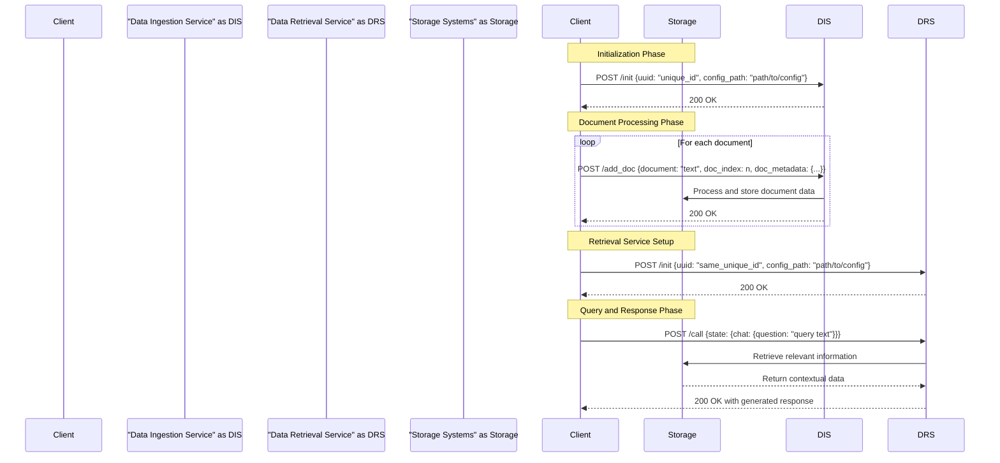
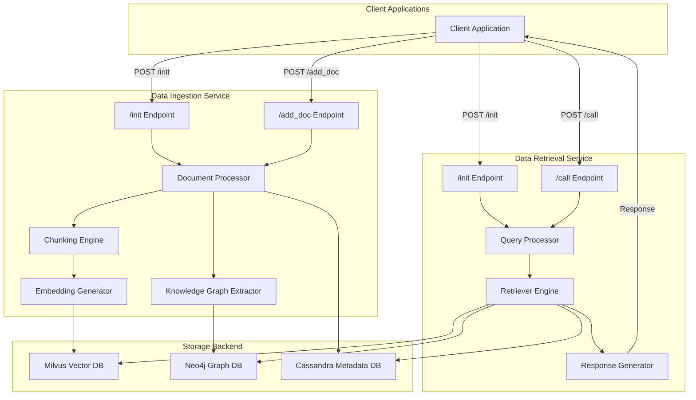
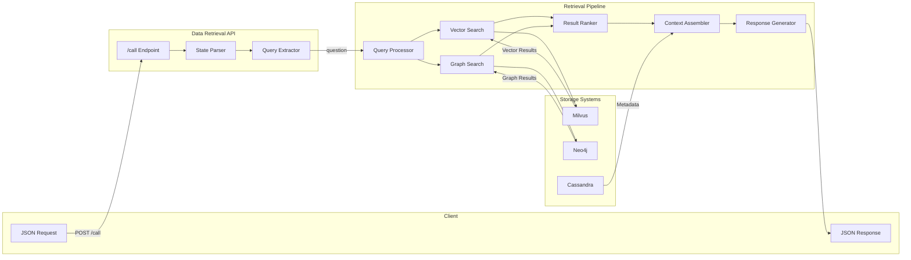

<!-- source: DeepWiki mcp.deepwiki.com · repo NVIDIA/context-aware-rag · page 3 API Reference · fetched 2026-10-26 -->

# API Reference

<details>
<summary>Relevant source files</summary>

The following files were used as context for generating this wiki page:

- [README.md](README.md)

</details>


This document provides a comprehensive reference for the Context-Aware RAG system's API endpoints, covering both the Data Ingestion Service and Data Retrieval Service. For information about the system architecture and components, see [System Architecture](#2), and for deployment details, see [Deployment Guide](#4).

## Overview of Services

The Context-Aware RAG system exposes two primary REST API services:

1. **Data Ingestion Service** - Processes and stores documents in the various backend storage systems
2. **Data Retrieval Service** - Retrieves relevant information and generates responses based on user queries

Both services expose HTTP endpoints that accept and return JSON data.

## API Communication Flow

Below is a sequence diagram illustrating the typical communication flow between client applications and the Context-Aware RAG services:



Sources: [README.md:146-219]()

## Common Concepts

### UUID

Both services use a **UUID** to associate data between ingestion and retrieval operations. The UUID must be the same when initializing both services to ensure they operate on the same data.

### Configuration

Services can be initialized with configuration parameters in one of the following ways:
- Providing a `config_path` pointing to a YAML configuration file
- Directly providing a `context_config` object with configuration settings

## Data Ingestion API

The Data Ingestion Service provides endpoints for initializing the service and adding documents to the system.

### Endpoint: `/init`

Initializes the Data Ingestion Service with a unique identifier and optional configuration.

**Method**: POST

**Parameters**:

| Parameter | Type | Required | Description |
|-----------|------|----------|-------------|
| uuid | string | Yes | Unique identifier for the data context |
| config_path | string | No | Path to configuration YAML file |
| context_config | object | No | Direct configuration object (alternative to config_path) |

**Example Request**:
```json
{
  "uuid": "1",
  "config_path": "/app/config/config.yaml"
}
```

**Example Response**:
```json
{
  "status": "success"
}
```

### Endpoint: `/add_doc`

Adds a document to the data ingestion pipeline for processing and storage.

**Method**: POST

**Parameters**:

| Parameter | Type | Required | Description |
|-----------|------|----------|-------------|
| document | string | Yes | Text content of the document |
| doc_index | integer | Yes | Sequential index for ordering documents |
| doc_metadata | object | No | Additional metadata for the document |

**Example Request**:
```json
{
  "document": "User1: I went hiking to Mission Peak",
  "doc_index": 4,
  "doc_metadata": {
    "is_last": false
  }
}
```

**Example Response**:
```json
{
  "status": "success"
}
```

Sources: [README.md:146-191]()

## Data Retrieval API

The Data Retrieval Service provides endpoints for initializing the service and querying the stored data.

### Endpoint: `/init`

Initializes the Data Retrieval Service with the same unique identifier used with the Data Ingestion Service.

**Method**: POST

**Parameters**:

| Parameter | Type | Required | Description |
|-----------|------|----------|-------------|
| uuid | string | Yes | Unique identifier (same as used with Data Ingestion) |
| config_path | string | No | Path to configuration YAML file |
| context_config | object | No | Direct configuration object (alternative to config_path) |

**Example Request**:
```json
{
  "uuid": "1",
  "config_path": "/app/config/config.yaml"
}
```

**Example Response**:
```json
{
  "status": "success"
}
```

### Endpoint: `/call`

Processes a retrieval request, finding relevant information and generating a response.

**Method**: POST

**Parameters**:

| Parameter | Type | Required | Description |
|-----------|------|----------|-------------|
| state | object | Yes | Contains query parameters |
| state.chat.question | string | Yes | The query text to be processed |

**Example Request**:
```json
{
  "state": {
    "chat": {
      "question": "What happens in this situation?"
    }
  }
}
```

**Example Response**:
```json
{
  "result": "Based on the conversation, User1 and User2 were having a friendly chat. User1 mentioned going hiking to Mission Peak over the weekend. Then User3 suddenly warned about a fire and suggested that everyone evacuate immediately.",
  "status": "success"
}
```

Sources: [README.md:192-219]()

## Component Relationships

The following diagram illustrates how the API endpoints relate to the internal components of the system:



Sources: [README.md:19-141]()

## Request and Response Data Flow

The following diagram shows the data flow for a typical query through the Data Retrieval Service:



Sources: [README.md:19-219]()

## Error Handling

Both services follow standard HTTP status code conventions for error responses:

| Status Code | Description |
|-------------|-------------|
| 200 | Success |
| 400 | Bad Request - Invalid parameters |
| 404 | Not Found - Resource not found |
| 500 | Internal Server Error |

Error responses include a JSON object with error details:

```json
{
  "error": "Error message description",
  "status": "error"
}
```

## Additional Resources

For detailed implementation and usage examples, refer to:
- [Data Ingestion API](#3.1) - Detailed documentation of the Data Ingestion Service API
- [Data Retrieval API](#3.2) - Detailed documentation of the Data Retrieval Service API
- [Configuration Options](#4.2) - Available configuration options for both services

---

