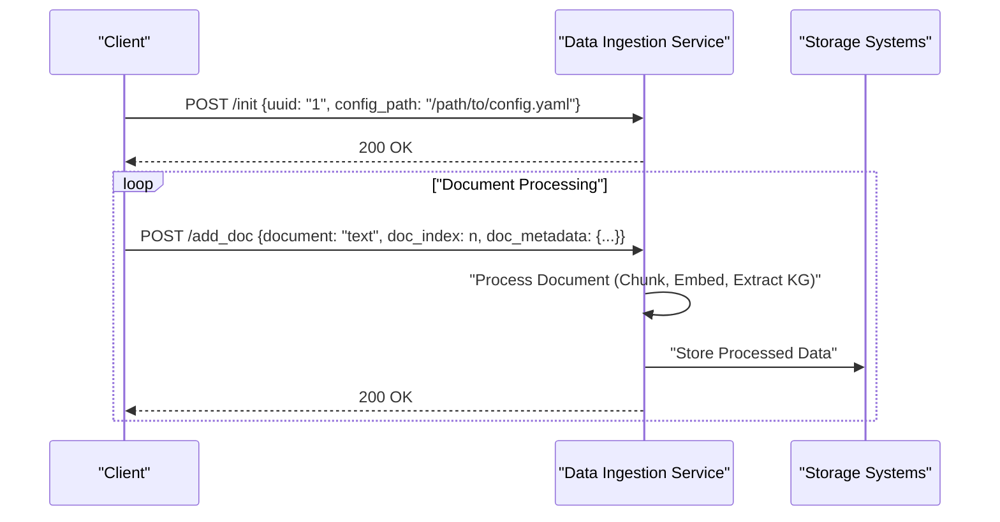
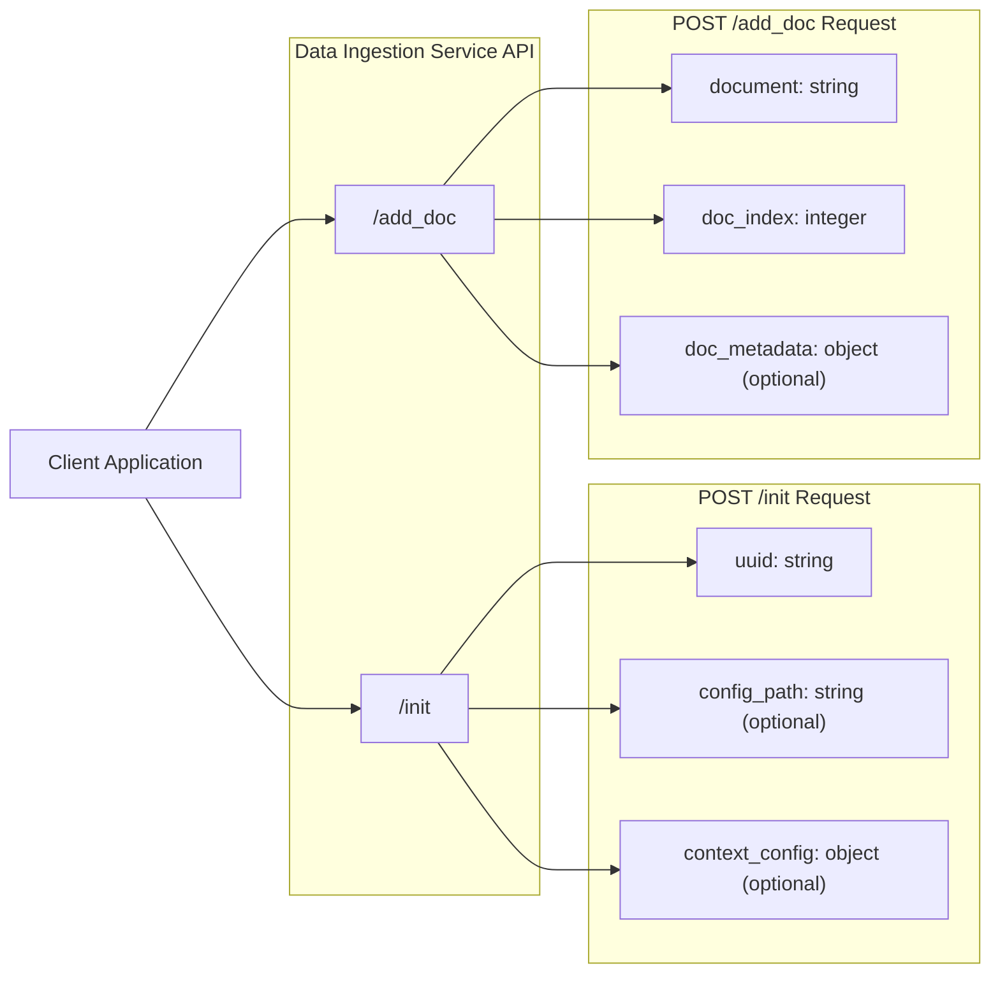
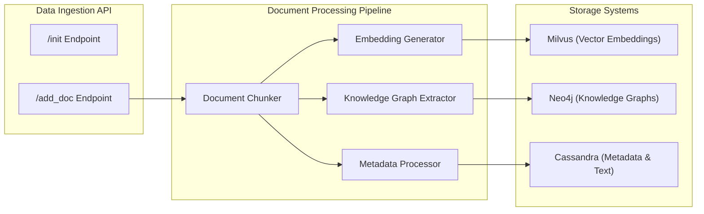

<!-- source: DeepWiki mcp.deepwiki.com · repo NVIDIA/context-aware-rag · page 3.1 Data Ingestion API · fetched 2026-10-26 -->

# Data Ingestion API

<details>
<summary>Relevant source files</summary>

The following files were used as context for generating this wiki page:

- [README.md](README.md)

</details>


This documentation covers the API endpoints provided by the Data Ingestion Service in the Context-Aware RAG system. This service handles document processing, transformation, and storage for later retrieval by the Data Retrieval Service. For information about retrieving processed data, see the [Data Retrieval API](#3.2).

## Overview

The Data Ingestion API provides a RESTful interface for:
- Initializing a data ingestion pipeline with a unique identifier
- Adding documents to be processed and stored
- Supporting metadata attachment to documents for enhanced context

Documents ingested through this API undergo processing steps including chunking, embedding generation, knowledge graph extraction, and metadata processing before being stored in multiple backend databases.

## API Endpoints

### `/init` Endpoint

Initializes the data ingestion service with a unique identifier and optional configuration.

**HTTP Method**: POST

**Request Parameters**:

| Parameter | Type | Required | Description |
|-----------|------|----------|-------------|
| uuid | string | Yes | Unique identifier for the dataset being ingested |
| config_path | string | No | Path to a YAML configuration file |
| context_config | object | No | Direct configuration object (alternative to config_path) |

**Request Examples**:

Basic initialization:
```json
{
  "uuid": "1"
}
```

Initialization with config path:
```json
{
  "uuid": "1",
  "config_path": "/app/config/config.yaml"
}
```

**Response**: Status code 200 on success

Sources: [README.md:157-165]()

### `/add_doc` Endpoint

Adds a document to the data ingestion service for processing and storage.

**HTTP Method**: POST

**Request Parameters**:

| Parameter | Type | Required | Description |
|-----------|------|----------|-------------|
| document | string | Yes | Text content of the document |
| doc_index | integer | Yes | Numeric index for the document (for ordering) |
| doc_metadata | object | No | Additional metadata associated with the document |

**Request Examples**:

Basic document addition:
```json
{
  "document": "User1: I went hiking to Mission Peak",
  "doc_index": 4
}
```

Document with metadata:
```json
{
  "document": "User1: Hi how are you?",
  "doc_index": 0,
  "doc_metadata": {
    "is_first": true
  }
}
```

**Response**: Status code 200 on success

Sources: [README.md:168-183]()

## Data Ingestion Flow

The following diagram illustrates the interaction between a client and the Data Ingestion API:



Sources: [README.md:146-191]()

## API Structure and Request Parameters



Sources: [README.md:148-191]()

## Document Processing Pipeline

The following diagram shows how documents added through the API are processed and stored:



Sources: [README.md:21-23]()

## Complete Usage Example

The following example demonstrates initializing the service and adding a series of documents representing a conversation:

```python
import requests
import json

# Define the base URL for the Data Ingestion Service
base_url = "http://<HOST>:<VSS_CTX_PORT_IN>"
headers = {"Content-Type": "application/json"}

# Step 1: Initialize the service with a unique UUID
init_data = {"uuid": "1"}
response = requests.post(
    f"{base_url}/init", headers=headers, data=json.dumps(init_data)
)

# Step 2: Add documents to the service
add_doc_data_list = [
    # First message in conversation with is_first metadata flag
    {
        "document": "User1: Hi how are you?",
        "doc_index": 0,
        "doc_metadata": {"is_first": True}
    },
    # Subsequent messages in conversation order
    {"document": "User2: I am good. How are you?", "doc_index": 1},
    {"document": "User1: I am great too. Thanks for asking", "doc_index": 2},
    {"document": "User2: So what did you do over the weekend?", "doc_index": 3},
    {"document": "User1: I went hiking to Mission Peak", "doc_index": 4},
    # Last message with is_last metadata flag
    {
        "document": "User3: Guys there is a fire. Let us get out of here",
        "doc_index": 5,
        "doc_metadata": {"is_last": True}
    },
]

# Send POST requests for each document in sequence
for add_doc_data in add_doc_data_list:
    response = requests.post(
        f"{base_url}/add_doc", headers=headers, data=json.dumps(add_doc_data)
    )
```

Sources: [README.md:148-191]()

## Configuration Options

When initializing the Data Ingestion Service, you can provide configuration settings through a YAML file or direct configuration object. These settings control how documents are processed and stored.

Example initialization with configuration:

```python
# Using a config file
init_data = {"config_path": "/app/config/config.yaml", "uuid": "1"}
response = requests.post(
    f"{base_url}/init", headers=headers, data=json.dumps(init_data)
)

# Using a direct configuration object
import yaml
config = yaml.safe_load(open("/app/config/config.yaml"))
init_data = {"context_config": config, "uuid": "1"}
response = requests.post(
    f"{base_url}/init", headers=headers, data=json.dumps(init_data)
)
```

Sources: [README.md:157-162]()

## Document Metadata

The Data Ingestion API supports attaching metadata to documents through the `doc_metadata` field. This metadata can be used for filtering and context enrichment during retrieval.

Example metadata usage in the API:

```json
{
  "document": "User1: Hi how are you?",
  "doc_index": 0,
  "doc_metadata": {
    "is_first": true,
    "speaker": "User1",
    "timestamp": "2023-06-15T14:30:00Z"
  }
}
```

As shown in the examples, you can use metadata to indicate special properties of documents, such as whether they are the first (`is_first`) or last (`is_last`) in a sequence.

Sources: [README.md:170-174](), [README.md:179-183]()

## Service Deployment

The Data Ingestion Service is typically deployed as a Docker container, accessible at:

```
http://<HOST>:<VSS_CTX_PORT_IN>
```

Where:
- `<HOST>` is the hostname or IP address where the service is running
- `<VSS_CTX_PORT_IN>` is the port specified in your environment configuration

When running the full system via docker compose, the Data Ingestion Service is available at this endpoint and connects automatically to the required backend storage services (Neo4j, Milvus, and Cassandra).

Sources: [README.md:94-101](), [README.md:118-121]()

---

