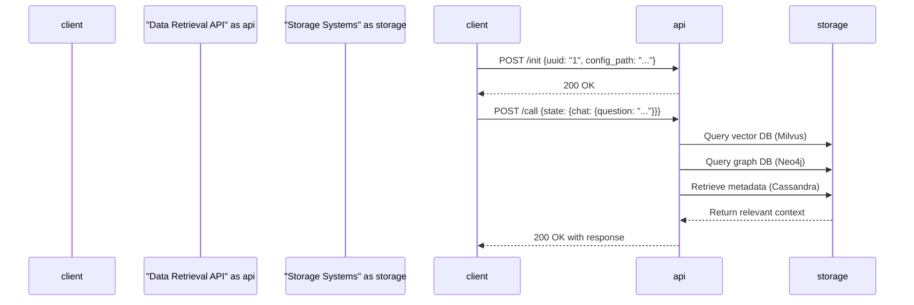
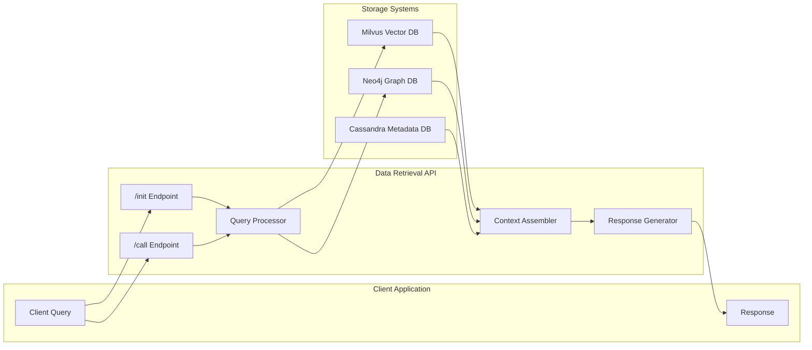
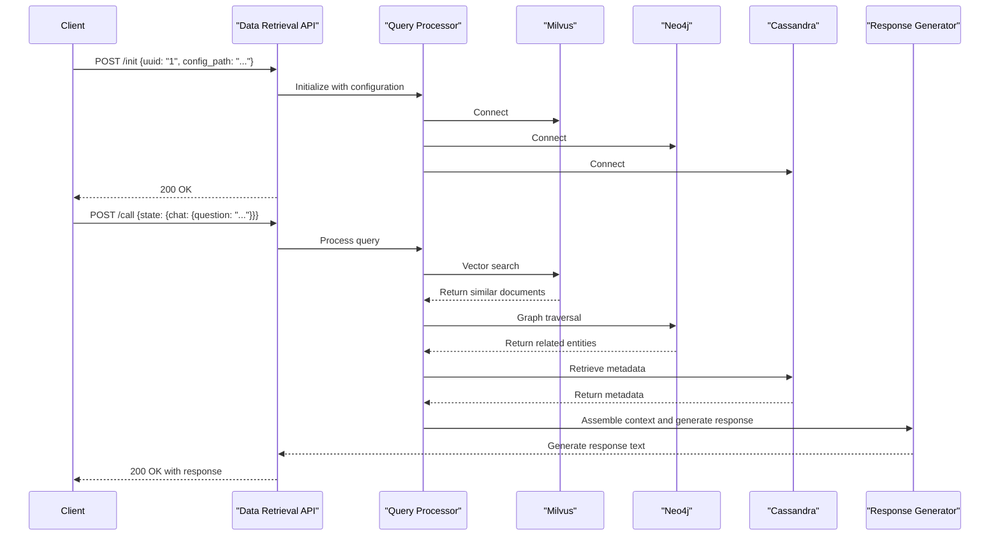
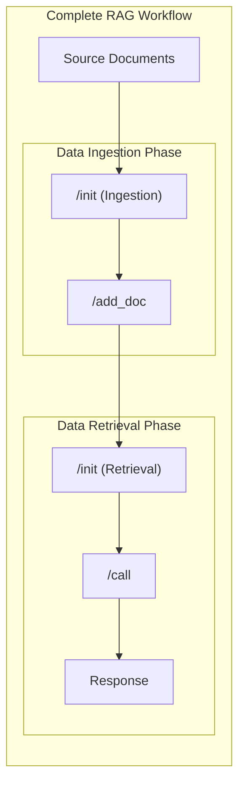

<!-- source: DeepWiki mcp.deepwiki.com · repo NVIDIA/context-aware-rag · page 3.2 Data Retrieval API · fetched 2026-10-26 -->

# Data Retrieval API

<details>
<summary>Relevant source files</summary>

The following files were used as context for generating this wiki page:

- [README.md](README.md)

</details>


The Data Retrieval API provides endpoints for retrieving contextually relevant information from your ingested data using natural language queries. This interface allows client applications to submit queries and receive responses enhanced with relevant context from stored documents. For information about adding documents to the system, see [Data Ingestion API](#3.1).

## Overview

The Data Retrieval Service exposes a REST API that processes client queries by searching through vector and graph databases, retrieving relevant context, and generating responses. The service must be initialized with the same UUID as used in the Data Ingestion Service to access the corresponding data.



Sources: [README.md:198-218]()

## API Endpoints

The Data Retrieval API consists of two primary endpoints:

| Endpoint | Method | Purpose |
|----------|--------|---------|
| `/init`  | POST   | Initialize the retrieval service with a specific UUID and configuration |
| `/call`  | POST   | Submit a query and receive a response with relevant context |

Sources: [README.md:206-218]()

### Endpoint: `/init`

Initializes the Data Retrieval Service with configuration settings and a UUID that matches data previously processed by the Data Ingestion Service.

#### Request Parameters

| Parameter      | Type   | Required | Description |
|----------------|--------|----------|-------------|
| `uuid`         | String | Yes      | Unique identifier matching data ingested by the Data Ingestion Service |
| `config_path`  | String | No       | Path to configuration file (server-side) |
| `context_config` | Object | No    | Direct configuration object (alternative to `config_path`) |

#### Example Request

```json
{
  "config_path": "/app/config/config.yaml",
  "uuid": "1"
}
```

#### Response

Returns a 200 OK status code upon successful initialization.

Sources: [README.md:204-208]()

### Endpoint: `/call`

Submits a query to the retrieval service and receives a response with relevant context.

#### Request Parameters

| Parameter | Type   | Required | Description |
|-----------|--------|----------|-------------|
| `state`   | Object | Yes      | Contains the query information |

The `state` object contains:
- `chat`: Object containing the user query
  - `question`: String representing the user's question

#### Example Request

```json
{
  "state": {
    "chat": {
      "question": "What happens in this situation?"
    }
  }
}
```

#### Response

Returns a JSON object containing:
- `result`: The generated response
- Additional context information (if configured)

#### Example Response

```json
{
  "result": "In this situation, User1 and User2 are having a conversation where they're greeting each other and discussing their weekend activities. User1 mentions hiking to Mission Peak. Then User3 interrupts to warn them about a fire and suggests they evacuate.",
  "source_documents": [...]
}
```

Sources: [README.md:211-218]()

## Data Flow Architecture

The following diagram illustrates how the Data Retrieval API interacts with various components in the Context-Aware RAG system:



Sources: [README.md:198-218]()

## Request-Response Flow

The detailed sequence of operations when using the Data Retrieval API:



Sources: [README.md:211-218]()

## Usage Example

Below is a complete Python example demonstrating how to use the Data Retrieval API:

```python
import requests
import json

# Base URL for the Data Retrieval Service
base_url = "http://<HOST>:<VSS_CTX_PORT_RET>"

# Set headers for JSON content
headers = {"Content-Type": "application/json"}

# Initialize the service with the same UUID used for data ingestion
init_data = {"config_path": "/app/config/config.yaml", "uuid": "1"}
response = requests.post(
    f"{base_url}/init", headers=headers, data=json.dumps(init_data)
)

# Send a retrieval request to the service
call_data = {"chat": {"question": "What happens in this situation?"}}
request_data = {"state": call_data}

response = requests.post(
    f"{base_url}/call", headers=headers, data=json.dumps(request_data)
)
print(response.json()["result"])
```

Sources: [README.md:196-219]()

## Integration with Complete Workflow

To use the Data Retrieval API effectively, you typically need to:

1. First ingest documents using the Data Ingestion API
2. Initialize the Data Retrieval Service with the same UUID
3. Submit queries to retrieve context-enhanced responses



Sources: [README.md:148-218]()

## API Parameter Details

### UUID Parameter

The `uuid` parameter is critical as it links the Data Retrieval Service to the correct dataset in the storage systems. The same UUID must be used for both ingestion and retrieval services to ensure the query is performed against the intended dataset.

### Configuration Options

When initializing the Data Retrieval API, you can provide configuration in two ways:

1. **config_path**: Path to a YAML configuration file on the server
2. **context_config**: Direct configuration object in the request

The configuration determines:
- Which embedding models to use
- How to rank and process the results
- Retrieval strategies (vector search, graph search, or hybrid)
- Response generation parameters

Sources: [README.md:204-208]()

## Connection to Storage Systems

The Data Retrieval API connects to three storage backends to provide comprehensive retrieval capabilities:

1. **Milvus**: Vector database for semantic similarity search
2. **Neo4j**: Graph database for relationship-based retrieval
3. **Cassandra**: NoSQL database for document metadata storage

For more details on the storage systems, see [Storage Backend Systems](#2.3).

## Observability

The Data Retrieval API integrates with OpenTelemetry to provide tracing and metrics. For more information on monitoring and troubleshooting the API, see [Observability Features](#2.5).

---

