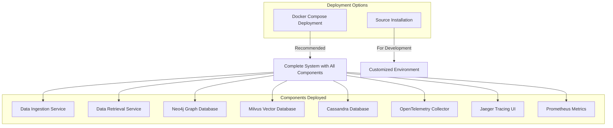
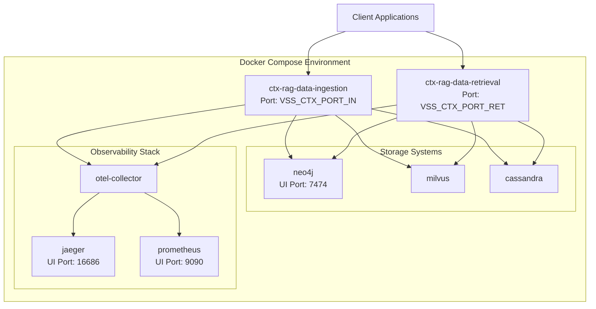
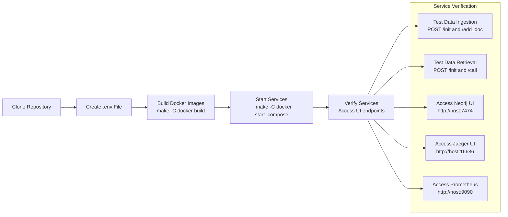
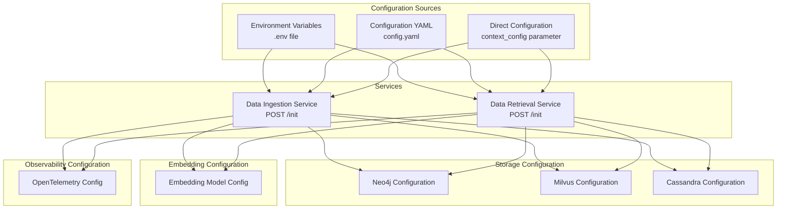

<!-- source: DeepWiki mcp.deepwiki.com · repo NVIDIA/context-aware-rag · page 4 Deployment Guide · fetched 2026-10-26 -->

# Deployment Guide

<details>
<summary>Relevant source files</summary>

The following files were used as context for generating this wiki page:

- [README.md](README.md)

</details>


This guide provides comprehensive instructions for deploying the NVIDIA Context-Aware RAG system in your environment. It covers deployment methods, configuration options, and verification steps to ensure the system is properly operational.

For detailed API specifications, see [API Reference](#3). For information about the system architecture and components, see [System Architecture](#2).

## Deployment Options Overview

The Context-Aware RAG system can be deployed using Docker Compose (recommended) or installed from source. This guide primarily focuses on the Docker-based deployment method, which simplifies setting up all required services.



Sources: [README.md:108-143]()

## Prerequisites

Before deploying the Context-Aware RAG system, ensure you have the following prerequisites:

1. **Docker and Docker Compose**: Required for containerized deployment
2. **Git**: For cloning the repository
3. **uv**: For Python package management if installing from source
4. **Environment Variables**: API keys for LLM services and port configurations

Sources: [README.md:47-53]()

## Docker Deployment

### Setting Up Environment Variables

Create a `.env` file in the repository root directory with the following variables:

| Variable | Description | Example |
|----------|-------------|---------|
| `NVIDIA_API_KEY` | API key for NVIDIA services (if using) | `your-nvidia-api-key` |
| `NVIDIA_VISIBLE_DEVICES` | GPU ID to use for NVIDIA services | `0` |
| `OPENAI_API_KEY` | API key for OpenAI services (if using) | `your-openai-api-key` |
| `VSS_CTX_PORT_RET` | Port for the Data Retrieval Service | `8001` |
| `VSS_CTX_PORT_IN` | Port for the Data Ingestion Service | `8000` |

Sources: [README.md:91-101]()

### Building Docker Images

Execute the following command to build the required Docker images:

```bash
make -C docker build
```

This builds the images for both the Data Ingestion and Data Retrieval services.

Sources: [README.md:103-107]()

### Starting the Docker Compose Stack

Launch the full service stack with:

```bash
make -C docker start_compose
```

This command starts all services defined in the Docker Compose configuration.

Sources: [README.md:109-111]()

### Deployed Services

The Docker Compose deployment provides the following services:

| Service | Description | Access URL |
|---------|-------------|------------|
| ctx-rag-data-ingestion | Data Ingestion Service | `http://<HOST>:<VSS_CTX_PORT_IN>` |
| ctx-rag-data-retrieval | Data Retrieval Service | `http://<HOST>:<VSS_CTX_PORT_RET>` |
| neo4j | Graph database for knowledge graph storage | `http://<HOST>:7474` (UI) |
| milvus | Vector database for embeddings | N/A |
| cassandra | NoSQL database for metadata storage | N/A |
| otel-collector | OpenTelemetry collector | N/A |
| jaeger | Distributed tracing system | `http://<HOST>:16686` (UI) |
| prometheus | Metrics and monitoring system | `http://<HOST>:9090` (UI) |

To change the storage volumes location, you can export the `DOCKER_VOLUME_DIRECTORY` environment variable to your desired directory before starting the services.

Sources: [README.md:115-144]()

## Deployment Architecture



Sources: [README.md:114-142]()

## Deployment Workflow



Sources: [README.md:59-144]()

## Installation from Source

If you prefer to install and run the services without Docker, follow these steps:

1. Clone the repository:
```bash
git clone git@github.com:NVIDIA/context-aware-rag.git
cd context-aware-rag/
```

2. Create a virtual environment:
```bash
uv venv --seed .venv
source .venv/bin/activate
```

3. Install the package:
```bash
uv pip install -e .
```

4. Alternatively, build and install the wheel file:
```bash
uv build
uv pip install vss_ctx_rag-0.5.0-py3-none-any.whl
```

When installing from source, you'll need to separately set up Neo4j, Milvus, Cassandra, and the observability stack.

Sources: [README.md:57-82]()

## Verification and Testing

After deploying the services, you can verify their functionality with the provided example code.

### Testing Data Ingestion Service

Use the following Python code to test the Data Ingestion Service:

```python
import requests
import json

base_url = "http://<HOST>:<VSS_CTX_PORT_IN>"
headers = {"Content-Type": "application/json"}

# Initialize the service with a unique uuid
init_data = {"uuid": "1"}
# Optional: Initialize with config file or context config
# init_data = {"config_path": "/app/config/config.yaml", "uuid": "1"}

response = requests.post(
    f"{base_url}/init", headers=headers, data=json.dumps(init_data)
)

# Add documents to the service
add_doc_data = {"document": "User1: I went hiking to Mission Peak", "doc_index": 4}
response = requests.post(
    f"{base_url}/add_doc", headers=headers, data=json.dumps(add_doc_data)
)
```

Sources: [README.md:146-191]()

### Testing Data Retrieval Service

Use the following Python code to test the Data Retrieval Service:

```python
import requests
import json

base_url = "http://<HOST>:<VSS_CTX_PORT_RET>"
headers = {"Content-Type": "application/json"}

# Initialize the service with the same uuid as the data ingestion service
init_data = {"config_path": "/app/config/config.yaml", "uuid": "1"}
response = requests.post(
    f"{base_url}/init", headers=headers, data=json.dumps(init_data)
)

# Send a retrieval request
call_data = {"chat": {"question": "What happens in this situation?"}}
request_data = {"state": call_data}

response = requests.post(
    f"{base_url}/call", headers=headers, data=json.dumps(request_data)
)
print(response.json()["result"])
```

Sources: [README.md:193-220]()

## Configuration Reference

### Service Initialization Configuration

When initializing services, the following configuration options are available:

| Parameter | Service | Description |
|-----------|---------|-------------|
| `uuid` | Both | Unique identifier to associate ingestion and retrieval services |
| `config_path` | Both | Path to a YAML configuration file |
| `context_config` | Both | Direct YAML configuration object |

Using the same `uuid` for both services ensures they operate on the same dataset.

### Configuration Flow



Sources: [README.md:153-165](), [README.md:204-208]()

## Troubleshooting

### Common Issues

1. **Services not starting**: Verify Docker and Docker Compose are installed correctly and that ports are not already in use.

2. **Connection errors**: Ensure that environment variables are set correctly, especially the port numbers for services.

3. **Database connectivity issues**: Check that the storage services (Neo4j, Milvus, Cassandra) are running properly. You can verify Neo4j through its UI at `http://<HOST>:7474`.

4. **API errors**: Verify that the initialization requests are properly formatted and include a valid `uuid`.

For more detailed troubleshooting information, see the [project documentation](https://nvidia.github.io/context-aware-rag/troubleshooting.html) referenced in the README.

Sources: [README.md:36-42]()

## Related Documentation

For more information on the Context-Aware RAG system, refer to the following wiki pages:

- [System Architecture](#2): Overview of the system components
- [API Reference](#3): Detailed API documentation
- [Docker Deployment](#4.1): Specific details on Docker deployment
- [Configuration Options](#4.2): Complete configuration reference

Sources: [README.md:36-42]()

---

