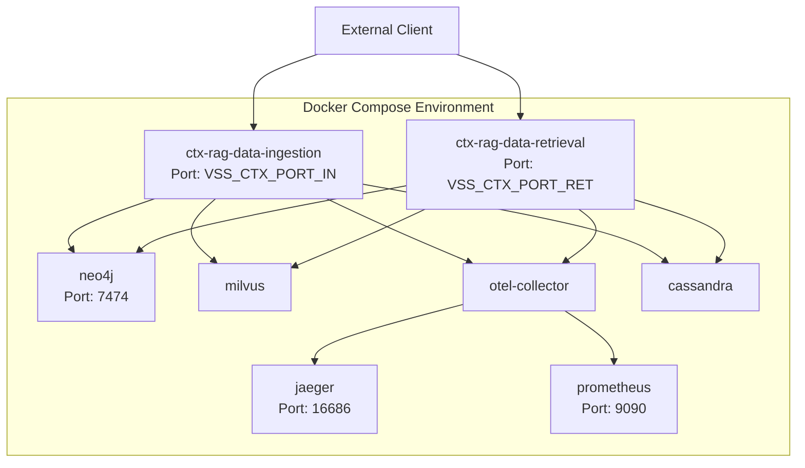
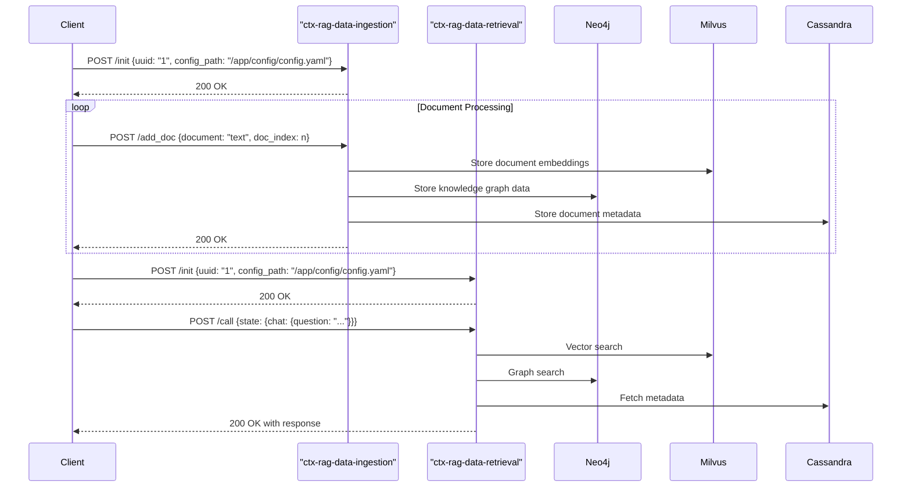

<!-- source: DeepWiki mcp.deepwiki.com · repo NVIDIA/context-aware-rag · page 4.1 Docker Deployment · fetched 2026-10-26 -->

# Docker Deployment

<details>
<summary>Relevant source files</summary>

The following files were used as context for generating this wiki page:

- [README.md](README.md)

</details>


This document details the process for deploying the Context-Aware RAG system using Docker Compose. It covers environment setup, building Docker images, launching services, and accessing the deployed components. For information about specific configuration options within these containers, see [Configuration Options](#4.2).

## Prerequisites

Before deploying the Context-Aware RAG system with Docker, ensure you have:

1. Docker and Docker Compose installed on your host system
2. Git installed (for repository cloning)
3. Appropriate API keys if using LLM services (NVIDIA or OpenAI)
4. Sufficient system resources to run all containers

Sources: [README.md:47-53]()

## Environment Setup

The Context-Aware RAG system requires several environment variables to be configured before deployment. These variables control service ports, API access, and GPU allocation.

### Setting up Environment Variables

Create a `.env` file in the root directory of the project with the following variables:

| Variable | Description | Example |
|----------|-------------|---------|
| `NVIDIA_API_KEY` | API key for NVIDIA NIM services (if using) | `abc123xyz` |
| `NVIDIA_VISIBLE_DEVICES` | GPU ID to be used by the containers | `0` |
| `OPENAI_API_KEY` | API key for OpenAI services (if using) | `sk-abc123xyz` |
| `VSS_CTX_PORT_RET` | Port for the Data Retrieval Service | `8001` |
| `VSS_CTX_PORT_IN` | Port for the Data Ingestion Service | `8000` |

Sources: [README.md:88-101]()

## Building Docker Images

Before deploying the system, you need to build the Docker images for the Context-Aware RAG services.

```bash
make -C docker build
```

This command builds the necessary Docker images for the data ingestion and retrieval services.

Sources: [README.md:103-107]()

## Docker Compose Deployment

Once the Docker images are built, you can deploy the entire system using Docker Compose:

```bash
make -C docker start_compose
```

This command launches all the necessary services defined in the Docker Compose file.

### Docker Deployment Architecture



Sources: [README.md:109-144]()

## Deployed Services Overview

The Docker Compose deployment starts the following services:

| Service | Description | Access URL | 
|---------|-------------|------------|
| `ctx-rag-data-ingestion` | Service for ingesting and processing documents | `http://<HOST>:<VSS_CTX_PORT_IN>` |
| `ctx-rag-data-retrieval` | Service for retrieving information based on queries | `http://<HOST>:<VSS_CTX_PORT_RET>` |
| `neo4j` | Graph database for storing knowledge graphs | `http://<HOST>:7474` (UI) |
| `milvus` | Vector database for storing document embeddings | Internal only |
| `cassandra` | NoSQL database for metadata storage | Internal only |
| `otel-collector` | OpenTelemetry collector for observability | Internal only |
| `jaeger` | Distributed tracing system | `http://<HOST>:16686` (UI) |
| `prometheus` | Metrics collection and monitoring system | `http://<HOST>:9090` (UI) |

Sources: [README.md:114-142]()

## Service Communication Flow



Sources: [README.md:146-220]()

## Data Volume Configuration

By default, Docker Compose creates volumes for data persistence. To customize the storage location, you can export the `DOCKER_VOLUME_DIRECTORY` environment variable before starting the services:

```bash
export DOCKER_VOLUME_DIRECTORY=/path/to/your/data
make -C docker start_compose
```

This configuration allows you to specify where data from Neo4j, Milvus, Cassandra, and other services will be stored on the host machine.

Sources: [README.md:144]()

## Accessing the Services

### Data Ingestion Service

The Data Ingestion Service exposes an API for adding documents to the system. You can interact with it via HTTP requests to the endpoint specified by the `VSS_CTX_PORT_IN` environment variable.

Example Python code to initialize the service and add documents:

```python
import requests
import json

base_url = "http://<HOST>:<VSS_CTX_PORT_IN>"
headers = {"Content-Type": "application/json"}

# Initialize the service
init_data = {"uuid": "1", "config_path": "/app/config/config.yaml"}
response = requests.post(f"{base_url}/init", headers=headers, data=json.dumps(init_data))

# Add documents
add_doc_data = {"document": "User1: I went hiking to Mission Peak", "doc_index": 4}
response = requests.post(f"{base_url}/add_doc", headers=headers, data=json.dumps(add_doc_data))
```

### Data Retrieval Service

The Data Retrieval Service exposes an API for querying information from the system. You can interact with it via HTTP requests to the endpoint specified by the `VSS_CTX_PORT_RET` environment variable.

Example Python code to initialize the service and retrieve data:

```python
import requests
import json

base_url = "http://<HOST>:<VSS_CTX_PORT_RET>"
headers = {"Content-Type": "application/json"}

# Initialize the service (using same UUID as ingestion service)
init_data = {"uuid": "1", "config_path": "/app/config/config.yaml"}
response = requests.post(f"{base_url}/init", headers=headers, data=json.dumps(init_data))

# Send a retrieval request
call_data = {"state": {"chat": {"question": "What happens in this situation?"}}}
response = requests.post(f"{base_url}/call", headers=headers, data=json.dumps(call_data))
result = response.json()["result"]
```

Sources: [README.md:146-220]()

## Observability and Monitoring

The Docker deployment includes several tools for observability and monitoring:

1. **Jaeger** - For distributed tracing
   - Access the UI at `http://<HOST>:16686`
   - View trace data for both ingestion and retrieval services

2. **Prometheus** - For metrics collection
   - Access the UI at `http://<HOST>:9090`
   - View system and application metrics

3. **OpenTelemetry Collector** - For collecting and distributing telemetry data
   - Collects traces and metrics from services
   - Forwards data to Jaeger and Prometheus

These tools provide comprehensive monitoring of the entire Context-Aware RAG system.

Sources: [README.md:132-140]()

## Stopping the Services

To stop the running services, you can use:

```bash
make -C docker stop_compose
```

To completely remove the containers, networks, and volumes:

```bash
make -C docker clean_compose
```

This ensures proper cleanup of all Docker resources created during deployment.

---

