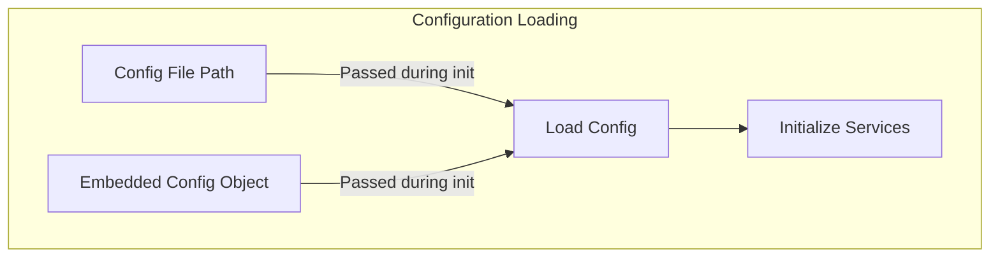
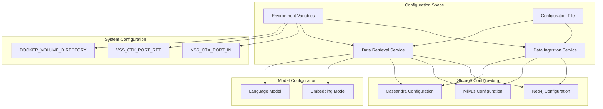
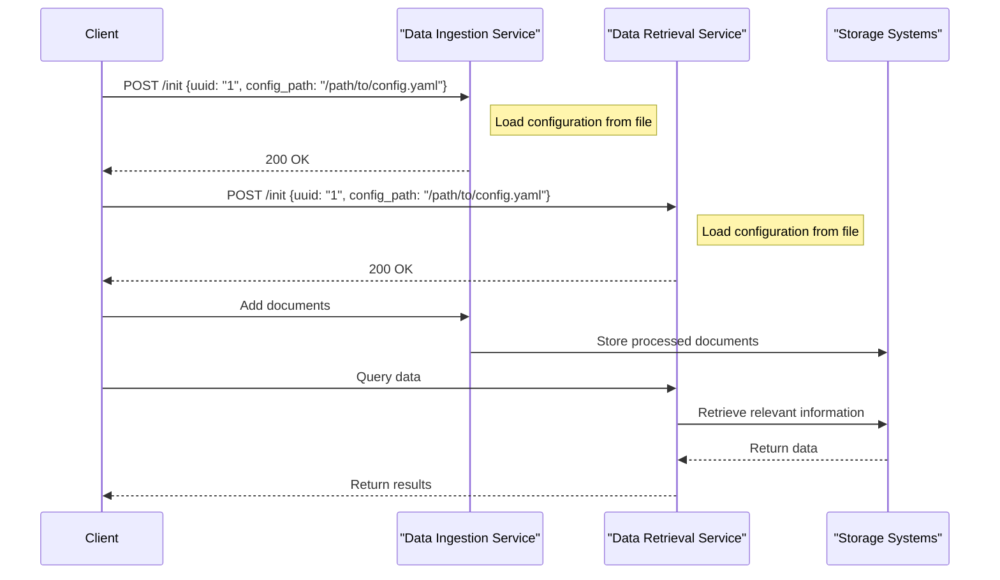
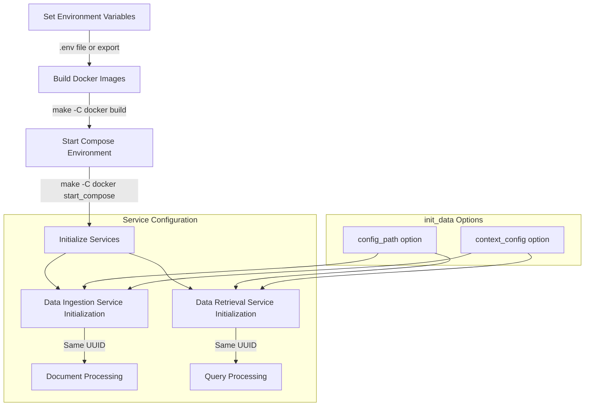

<!-- source: DeepWiki mcp.deepwiki.com · repo NVIDIA/context-aware-rag · page 4.2 Configuration Options · fetched 2026-10-26 -->

# Configuration Options

<details>
<summary>Relevant source files</summary>

The following files were used as context for generating this wiki page:

- [README.md](README.md)

</details>


This document provides a comprehensive guide to the configuration options available in the Context-Aware RAG system. It covers environment variables, configuration files, and service-specific settings that allow you to customize the behavior of the data ingestion and retrieval services. For information about deploying the system using Docker, see [Docker Deployment](#4.1).

## Environment Variables

Environment variables provide a way to configure the Context-Aware RAG system without modifying configuration files. These can be set in a `.env` file in the root directory or passed directly to your environment.

| Variable | Description | Required | Default |
|----------|-------------|----------|---------|
| `NVIDIA_API_KEY` | API key for NVIDIA services | Yes (if using NVIDIA) | None |
| `NVIDIA_VISIBLE_DEVICES` | GPU ID to use for acceleration | No | None |
| `OPENAI_API_KEY` | API key for OpenAI services | Yes (if using OpenAI) | None |
| `VSS_CTX_PORT_RET` | Port for Data Retrieval Service | Yes | None |
| `VSS_CTX_PORT_IN` | Port for Data Ingestion Service | Yes | None |
| `DOCKER_VOLUME_DIRECTORY` | Directory for storage volumes | No | Default Docker volume location |

Sources: [README.md:93-100](), [README.md:144]()

## Configuration File Structure

The Context-Aware RAG system uses YAML configuration files to define the behavior of both the data ingestion and retrieval services. These configuration files can be specified at initialization time.



Sources: [README.md:159-162]()

### Configuration Loading Methods

There are two ways to provide configuration to the Context-Aware RAG services:

1. **Config Path Method**: Provide the path to a YAML configuration file.
   ```python
   init_data = {"config_path": "/app/config/config.yaml", "uuid": "1"}
   ```

2. **Embedded Config Method**: Provide the configuration object directly.
   ```python
   init_data = {"context_config": yaml.safe_load(open("/app/config/config.yaml")), "uuid": "1"}
   ```

The `uuid` parameter is required in both cases and must be consistent between data ingestion and retrieval services to ensure they operate on the same dataset.

Sources: [README.md:157-165](), [README.md:204-208]()

## Service Configuration Relationship

The diagram below illustrates how configuration options relate to different components of the Context-Aware RAG system:



Sources: [README.md:93-100](), [README.md:144](), [README.md:159-162]()

## Service Initialization Configuration

Both the Data Ingestion Service and Data Retrieval Service are initialized with configuration parameters. The following diagram shows the initialization flow:



Sources: [README.md:157-165](), [README.md:204-208]()

## Configuration Components

A typical configuration file for Context-Aware RAG includes these main sections:

### 1. Storage Configurations

| Component | Configuration Options |
|-----------|------------------------|
| Neo4j | Connection URI, username, password, database name |
| Milvus | Host, port, collection settings, dimension settings |
| Cassandra | Contact points, port, keyspace, credential settings |

### 2. Model Configurations

| Component | Configuration Options |
|-----------|------------------------|
| Embedding Models | Model type, API key, dimensions, batch size |
| LLM Models | Model provider (NVIDIA, OpenAI), model name, temperature, max tokens |

### 3. Processing Configurations

| Component | Configuration Options |
|-----------|------------------------|
| Chunking | Chunk size, chunk overlap, separator |
| Knowledge Graph | Entity extraction settings, relationship extraction settings |
| Retrieval | Number of results, reranking settings, source filters |

## Docker Volume Configuration

The storage volumes used by the Context-Aware RAG system can be customized by exporting the `DOCKER_VOLUME_DIRECTORY` environment variable to your desired directory:

```bash
export DOCKER_VOLUME_DIRECTORY=/path/to/storage/volumes
make -C docker start_compose
```

This configuration affects where the persistent data for Neo4j, Milvus, and Cassandra is stored.

Sources: [README.md:144]()

## Configuration Workflow

The following diagram illustrates the configuration workflow when setting up and using the Context-Aware RAG system:



Sources: [README.md:91-101](), [README.md:157-165](), [README.md:204-208]()

## Example Configuration Usage

Here's how the configuration is used in practice when initializing the services:

1. **Data Ingestion Service Initialization**:
   ```python
   init_data = {"uuid": "1"}  # Minimal configuration
   # OR
   init_data = {"config_path": "/app/config/config.yaml", "uuid": "1"}  # With config file
   # OR
   init_data = {"context_config": yaml.safe_load(open("/app/config/config.yaml")), "uuid": "1"}  # With direct config
   
   response = requests.post(f"{base_url}/init", headers=headers, data=json.dumps(init_data))
   ```

2. **Data Retrieval Service Initialization**:
   ```python
   init_data = {"config_path": "/app/config/config.yaml", "uuid": "1"}
   response = requests.post(f"{base_url}/init", headers=headers, data=json.dumps(init_data))
   ```

It's important to use the same `uuid` value for both services to ensure they operate on the same dataset.

Sources: [README.md:157-165](), [README.md:204-208]()

## Runtime Configuration

In addition to initialization configuration, some configuration can be provided at runtime through API calls:

1. **Document Metadata Configuration**: When adding documents, you can provide metadata that affects how the document is processed and stored:
   ```python
   add_doc_data = {
       "document": "Document content",
       "doc_index": 1,
       "doc_metadata": {
           "is_first": True,  # Indicates this is the first document in a sequence
           "custom_field": "value"  # Custom metadata fields
       }
   }
   ```

2. **Query Configuration**: When making retrieval requests, you can configure how the query is processed:
   ```python
   call_data = {"chat": {"question": "What happens in this situation?"}}
   ```

Sources: [README.md:168-183](), [README.md:211-213]()

## Best Practices

1. **Environment Variables**: Store sensitive information like API keys in environment variables rather than in configuration files.
2. **UUID Management**: Use consistent UUIDs across services for the same dataset.
3. **Volume Configuration**: Configure storage volumes appropriately for production environments to ensure data persistence.
4. **Service Communication**: Ensure the ports configured via environment variables are accessible between services.

## Summary

The Context-Aware RAG system offers multiple configuration options through environment variables and configuration files. The system requires specific environment variables for API keys and service ports, while detailed behavior is configured through YAML configuration files. Both the Data Ingestion Service and Data Retrieval Service need to be initialized with the same UUID to ensure they operate on the same dataset.

---

