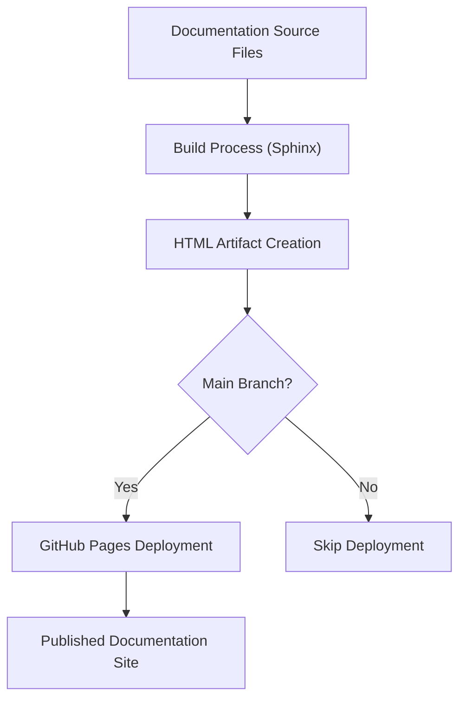
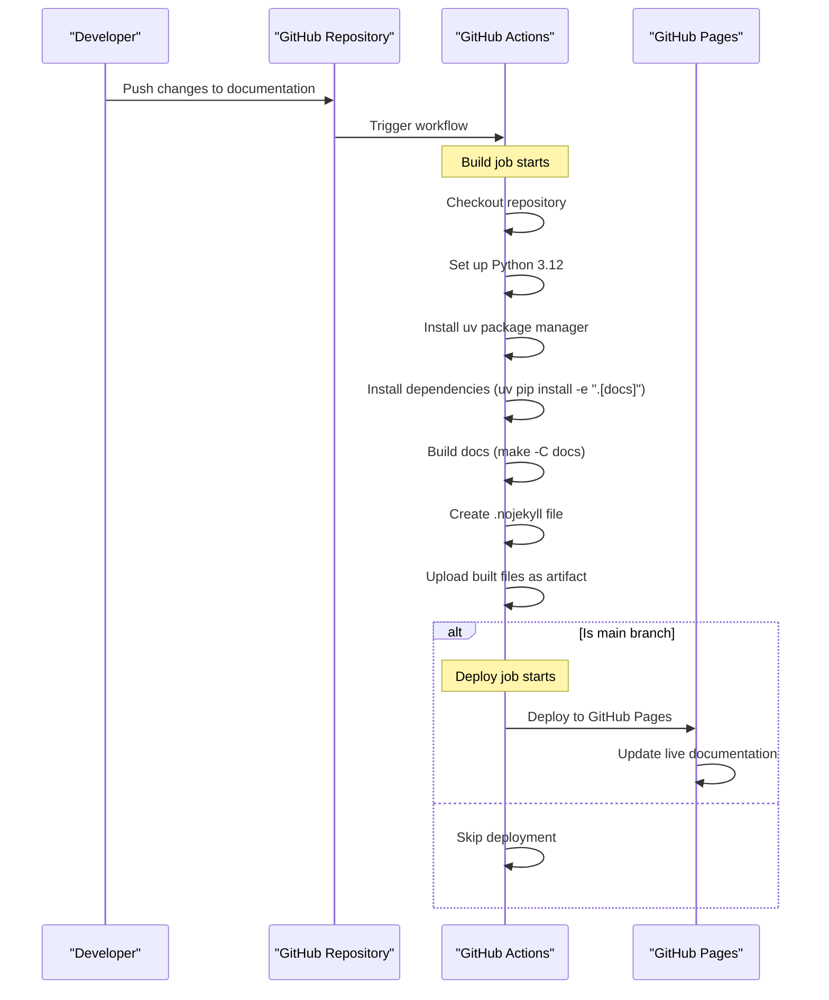
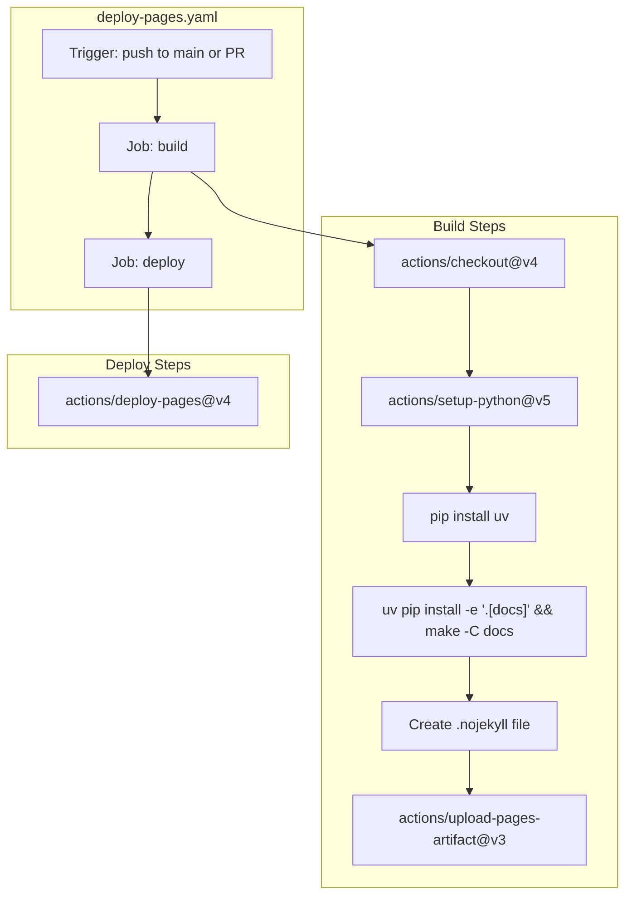
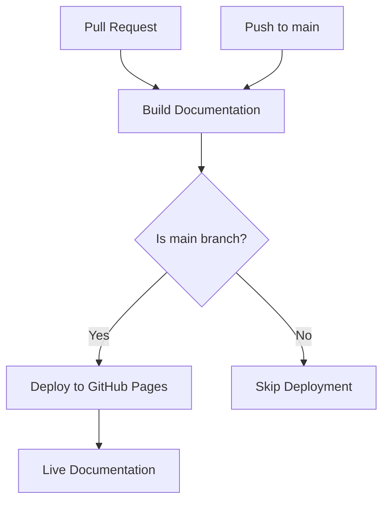
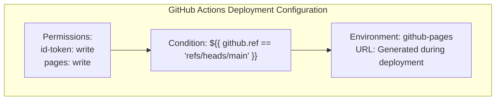
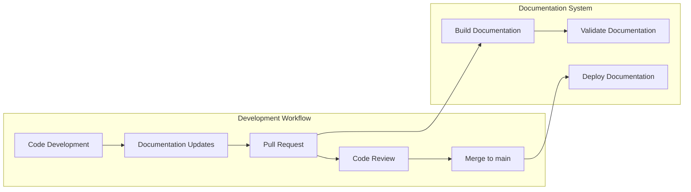

<!-- source: DeepWiki mcp.deepwiki.com · repo NVIDIA/context-aware-rag · page 5 Documentation System · fetched 2026-10-26 -->

# Documentation System

<details>
<summary>Relevant source files</summary>

The following files were used as context for generating this wiki page:

- [.github/workflows/deploy-pages.yaml](.github/workflows/deploy-pages.yaml)

</details>


This document explains how the documentation for the Context-Aware RAG system is built and deployed. The documentation system automates the process of generating up-to-date, comprehensive documentation from source files and deploying it to GitHub Pages.

## Documentation System Overview

The Context-Aware RAG project employs an automated documentation system that builds documentation from source files and publishes it to GitHub Pages. This ensures that users always have access to current documentation that accurately reflects the state of the codebase.



Sources: [.github/workflows/deploy-pages.yaml:1-55]()

## Documentation Build and Deployment Workflow

The documentation system uses GitHub Actions to automate the build and deployment process. When changes are pushed to the repository, a workflow is triggered that builds the documentation and, if the changes are on the main branch, deploys it to GitHub Pages.



Sources: [.github/workflows/deploy-pages.yaml:11-54]()

## GitHub Actions Configuration

The documentation build and deployment process is defined in a GitHub Actions workflow file. This workflow is configured to run when changes are pushed to the main branch or when pull requests are submitted.



Sources: [.github/workflows/deploy-pages.yaml:3-54]()

## Documentation Build Process Details

The documentation build process consists of several key steps that transform source documentation files into a publishable HTML website.

| Step | Description | Implementation |
|------|-------------|----------------|
| Repository Checkout | Retrieves the latest version of the codebase | `actions/checkout@v4` |
| Python Setup | Configures Python 3.12 environment | `actions/setup-python@v5` |
| Package Management | Installs uv for dependency management | `pip install uv` |
| Documentation Dependencies | Installs required documentation packages | `uv pip install -e ".[docs]" --system` |
| Documentation Build | Executes the Sphinx build process | `make -C docs` |
| Jekyll Bypass | Creates .nojekyll file to prevent GitHub Pages from using Jekyll | `touch docs/build/html/.nojekyll` |
| Artifact Creation | Packages the built documentation for deployment | `actions/upload-pages-artifact@v3` |
| Deployment | Publishes the documentation to GitHub Pages | `actions/deploy-pages@v4` |

Sources: [.github/workflows/deploy-pages.yaml:15-54]()

## Conditional Deployment Logic

The deployment part of the workflow only executes when changes are pushed to the main branch. This ensures that documentation is only published from the main branch, maintaining consistency and quality.



Sources: [.github/workflows/deploy-pages.yaml:41-46]()

## Local Documentation Development

Developers can build and preview the documentation locally before pushing changes. This process mirrors the automated build process but is executed on the developer's machine.

1. Install the documentation dependencies:
   ```
   uv pip install -e ".[docs]"
   ```

2. Build the documentation:
   ```
   make -C docs
   ```

3. Open the generated HTML files in `docs/build/html/` in a web browser to preview the documentation.

Sources: [.github/workflows/deploy-pages.yaml:26-29]()

## Documentation Deployment Environment

The documentation is deployed to the GitHub Pages environment, which is configured in the GitHub repository settings. This provides a stable URL for accessing the documentation.



Sources: [.github/workflows/deploy-pages.yaml:41-48]()

## Integration with Repository Workflow

The documentation system is integrated into the repository's development workflow, ensuring that documentation and code stay synchronized.



Sources: [.github/workflows/deploy-pages.yaml:3-9]()

## Documentation System Benefits

The automated documentation system provides several key benefits:

1. **Consistency**: Documentation is built in a standardized environment, ensuring consistent results
2. **Timeliness**: Documentation is automatically updated when code changes
3. **Quality Assurance**: Documentation builds are validated on pull requests
4. **Developer Efficiency**: Reduces manual steps in the documentation process
5. **Accessibility**: Provides a central location for up-to-date documentation

Sources: [.github/workflows/deploy-pages.yaml:1-55]()

---

