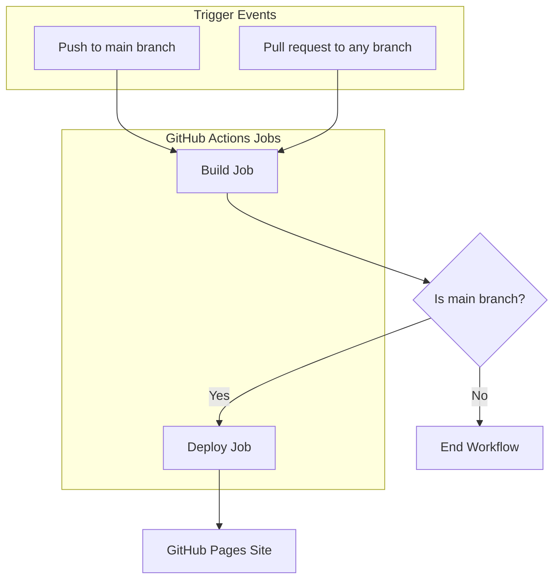
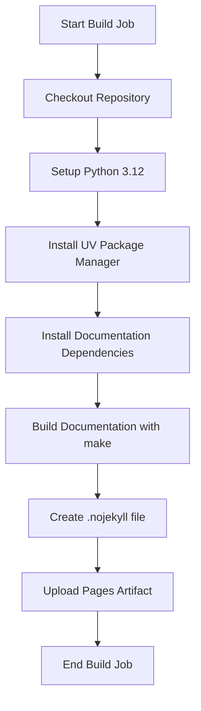
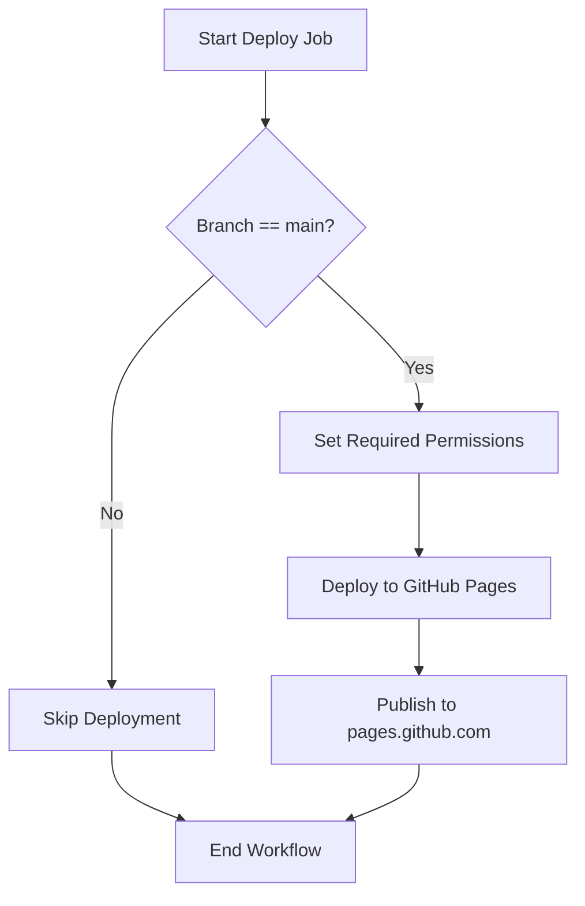
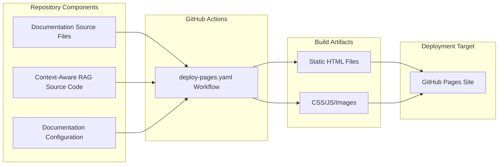

<!-- source: DeepWiki mcp.deepwiki.com · repo NVIDIA/context-aware-rag · page 5.1 GitHub Actions Workflow · fetched 2026-10-26 -->

# GitHub Actions Workflow

<details>
<summary>Relevant source files</summary>

The following files were used as context for generating this wiki page:

- [.github/workflows/deploy-pages.yaml](.github/workflows/deploy-pages.yaml)

</details>


## Purpose and Scope

This document details the GitHub Actions workflow used to automatically build and deploy the Context-Aware RAG system's documentation to GitHub Pages. This workflow handles the continuous integration and deployment (CI/CD) process specifically for documentation, ensuring that the latest documentation is always available to users when changes are merged to the main branch.

For information about the overall documentation system architecture, see [Documentation System](#5).

## Workflow Overview

The Context-Aware RAG system uses GitHub Actions to automate the documentation build and deployment process. This workflow is triggered on two events:

1. Any push to the `main` branch (which builds and deploys the documentation)
2. Any pull request to any branch (which builds the documentation as a validation step)



Sources: [.github/workflows/deploy-pages.yaml:3-9]()

## Build Job Configuration

The build job runs on Ubuntu and is responsible for generating the static HTML documentation from the source files.



Sources: [.github/workflows/deploy-pages.yaml:12-39]()

### Build Steps Detailed

1. **Environment Setup**: The job runs on Ubuntu and uses Python 3.12.
2. **Repository Checkout**: Uses `actions/checkout@v4` to fetch the repository code.
3. **Python Configuration**: Sets up Python 3.12 using `actions/setup-python@v5`.
4. **Package Management**: Installs the UV package manager (a modern Python package installer).
5. **Documentation Building**:
   - Installs the project with documentation dependencies (`-e ".[docs]"`)
   - Runs `make -C docs` to generate the documentation
6. **GitHub Pages Configuration**: Creates a `.nojekyll` file to disable Jekyll processing on GitHub Pages.
7. **Artifact Creation**: Uploads the built documentation as a GitHub Pages artifact.

| Step | Action | Purpose |
|------|--------|---------|
| Checkout | `actions/checkout@v4` | Clone repository code |
| Setup Python | `actions/setup-python@v5` | Configure Python 3.12 environment |
| Install UV | `pip install uv` | Add modern package manager |
| Build Docs | `uv pip install -e ".[docs]"` and `make -C docs` | Install dependencies and build documentation |
| Disable Jekyll | Create `.nojekyll` file | Prevent Jekyll processing |
| Upload Artifact | `actions/upload-pages-artifact@v3` | Package documentation for deployment |

Sources: [.github/workflows/deploy-pages.yaml:14-39]()

## Deployment Job Configuration

The deployment job only runs when changes are pushed to the main branch. It takes the artifact produced by the build job and deploys it to GitHub Pages.



Sources: [.github/workflows/deploy-pages.yaml:41-54]()

### Deployment Requirements and Configuration

The deployment job has specific requirements and configurations:

1. **Conditional Execution**: Only runs when the trigger is a push to the main branch
   ```yaml
   if: ${{ github.ref == 'refs/heads/main' }}
   ```

2. **Required Permissions**:
   - `id-token: write` - For security authentication
   - `pages: write` - To publish to GitHub Pages

3. **Environment Configuration**:
   - Uses the `github-pages` environment
   - Sets the deployment URL

4. **Dependencies**:
   - Depends on the successful completion of the build job

5. **Deployment Action**:
   - Uses `actions/deploy-pages@v4` to publish the documentation

Sources: [.github/workflows/deploy-pages.yaml:42-54]()

## Workflow Integration with Documentation System

The GitHub Actions workflow is a crucial component of the Context-Aware RAG documentation system. It automates the process of building and deploying documentation, ensuring that users always have access to up-to-date information.



The workflow ensures that:

1. Documentation is automatically validated on all pull requests
2. The latest documentation is deployed whenever changes are merged to main
3. Static site files are properly configured for GitHub Pages hosting

Sources: [.github/workflows/deploy-pages.yaml]()

## Implementation Details

The workflow is implemented in a YAML file located at `.github/workflows/deploy-pages.yaml`. This file defines the complete CI/CD pipeline for documentation.

### Key Technical Components

1. **Documentation Build System**:
   - The command `make -C docs` suggests the documentation is built using a Makefile
   - The project appears to use a documentation generation system compatible with Python projects

2. **Dependency Management**:
   - Uses `uv` as a modern alternative to pip for Python package management
   - Installs the project in development mode with documentation extras (`-e ".[docs]"`)

3. **GitHub Pages Configuration**:
   - Creates a `.nojekyll` file to prevent Jekyll processing
   - Uses GitHub's official Pages deployment actions

Sources: [.github/workflows/deploy-pages.yaml:26-33]()

## Security and Permissions

The workflow includes specific security configurations:

1. **Limited Permissions**:
   - The deploy job explicitly sets only the required permissions:
     - `id-token: write` for authentication
     - `pages: write` for publishing

2. **Environment Isolation**:
   - Uses a dedicated `github-pages` environment for deployment
   - Only triggered for the main branch

This security model follows the principle of least privilege, ensuring the workflow has only the permissions it needs to function correctly.

Sources: [.github/workflows/deploy-pages.yaml:42-45]()