# Page: Context-Aware RAG Overview

# Context-Aware RAG Overview

<details>
<summary>Relevant source files</summary>

The following files were used as context for generating this wiki page:

- [README.md](README.md)

</details>


## Purpose and Scope

Context-Aware RAG is a flexible library designed by NVIDIA to build customized data ingestion and retrieval pipelines for Retrieval Augmented Generation (RAG). This document provides a high-level overview of the system's architecture, components, and data flow. For detailed information about specific components, please refer to their respective documentation pages:

- For system architecture details, see [System Architecture](#2)
- For data ingestion specifics, see [Data Ingestion Service](#2.1)
- For data retrieval specifics, see [Data Retrieval Service](#2.2)
- For GraphRAG capabilities, see [GraphRAG Capabilities](#2.4)

Sources: [README.md:19-34]()

## Key Components

Context-Aware RAG consists of several core components that work together to provide a complete RAG solution:

| Component | Description | Wiki Reference |
|-----------|-------------|---------------|
| Data Ingestion Service | Processes and stores documents from various sources | [#2.1](#2.1) |
| Data Retrieval Service | Handles queries and generates context-aware responses | [#2.2](#2.2) |
| Storage Backend Systems | Includes Neo4j, Milvus, and Cassandra for different data storage needs | [#2.3](#2.3) |
| GraphRAG Capabilities | Extracts knowledge graphs from documents to enhance retrieval | [#2.4](#2.4) |
| Observability Features | Provides monitoring via OpenTelemetry, Jaeger, and Prometheus | [#2.5](#2.5) |

Sources: [README.md:25-31]()

## System Architecture

The system follows a microservices architecture pattern with dedicated services for data ingestion and retrieval, supported by specialized storage backends and comprehensive observability.

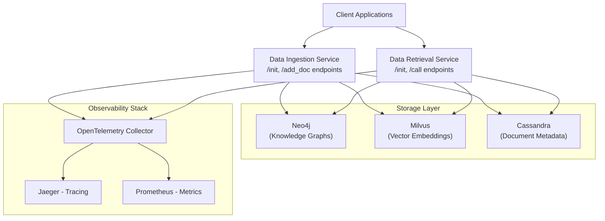

Sources: [README.md:113-142]()

## Data Processing Workflow

The following diagram illustrates the data flow through the Context-Aware RAG system, from document ingestion to query response generation:

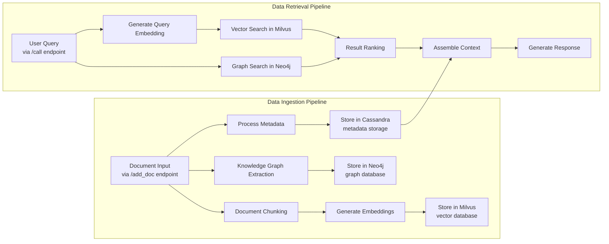

Sources: [README.md:146-219]()

## API Communication Pattern

The Context-Aware RAG services follow a consistent API pattern for initialization and data processing:

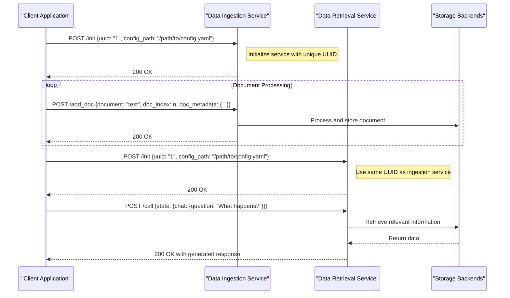

Sources: [README.md:156-218]()

## Codebase Organization to System Component Mapping

The following diagram maps the conceptual components of the Context-Aware RAG system to their actual implementation in the codebase:

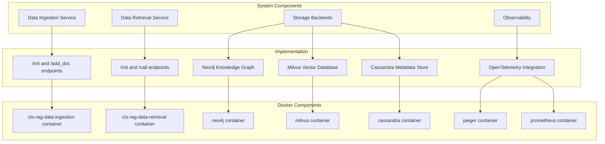

Sources: [README.md:113-142]()

## System Deployment Overview

Context-Aware RAG is designed to be deployed as a set of Docker containers, managed via Docker Compose:

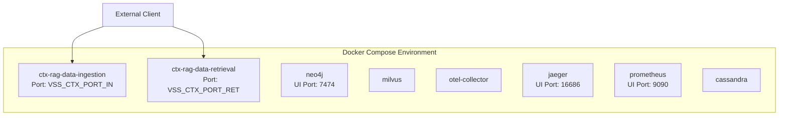

Sources: [README.md:85-144]()

## Getting Started

To begin using Context-Aware RAG, you'll need to:

1. Install prerequisites (Git, uv)
2. Clone the repository
3. Set up a virtual environment
4. Install the package
5. Configure environment variables
6. Deploy using Docker Compose

For detailed deployment instructions, see the [Deployment Guide](#4) and [Docker Deployment](#4.1) pages.

Examples for using the Data Ingestion and Data Retrieval services are provided in the README:

- Data Ingestion: Initialize the service and add documents
- Data Retrieval: Initialize the service with the same UUID and send queries

Sources: [README.md:45-219]()

## Key Features and Benefits

Context-Aware RAG provides several advantages for building RAG pipelines:

1. **Flexible Integration**: Seamlessly integrates with existing data processing workflows
2. **Customizable Pipelines**: Build tailored data ingestion and retrieval pipelines
3. **Knowledge Graph Enhanced Retrieval**: Leverages graph relationships for better context understanding
4. **Comprehensive Observability**: Monitor and troubleshoot with OpenTelemetry-compatible tools
5. **Containerized Deployment**: Easy deployment using Docker Compose

Sources: [README.md:25-34]()

---

# Page: System Architecture

# System Architecture

<details>
<summary>Relevant source files</summary>

The following files were used as context for generating this wiki page:

- [README.md](README.md)

</details>


This document describes the high-level architecture of the NVIDIA Context-Aware RAG system, presenting the core components and their interactions. For detailed information about specific components, please refer to the dedicated pages for [Data Ingestion Service](#2.1), [Data Retrieval Service](#2.2), [Storage Backend Systems](#2.3), [GraphRAG Capabilities](#2.4), and [Observability Features](#2.5).

## Core Architecture Overview

The Context-Aware RAG system follows a microservices architecture designed for scalability, flexibility, and maintainability. The system consists of two primary services that interact with a multi-modal storage layer and are monitored through a comprehensive observability stack.

### System Components Diagram

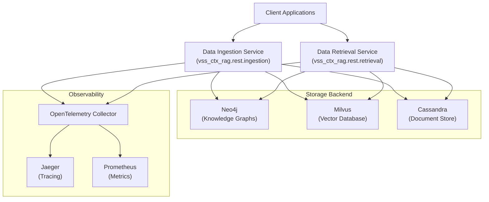

Sources: [README.md:115-142]()

## Key Components

The system architecture consists of these principal components:

1. **Data Ingestion Service**: Processes and stores documents in the appropriate storage systems.
2. **Data Retrieval Service**: Retrieves relevant information based on user queries.
3. **Storage Backend**:
   - Neo4j: Stores knowledge graphs for semantic connections
   - Milvus: Manages vector embeddings for semantic search
   - Cassandra: Stores document content and metadata
4. **Observability Stack**:
   - OpenTelemetry: Collects telemetry data
   - Jaeger: Provides distributed tracing capabilities
   - Prometheus: Monitors system metrics

Sources: [README.md:27-31](), [README.md:118-142]()

## Data Processing Workflow

The system operates through two main workflows: ingestion and retrieval. Both services coordinate to provide an efficient RAG (Retrieval Augmented Generation) pipeline.

### Data Flow Diagram

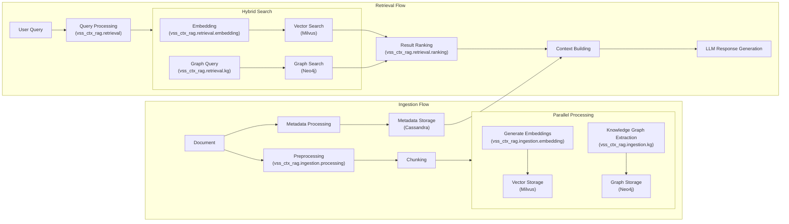

Sources: [README.md:27-31]()

## Service Communication

The services in Context-Aware RAG communicate through REST APIs, with both the Data Ingestion and Data Retrieval services exposing endpoints for client applications to interact with.

### Service Interaction Diagram

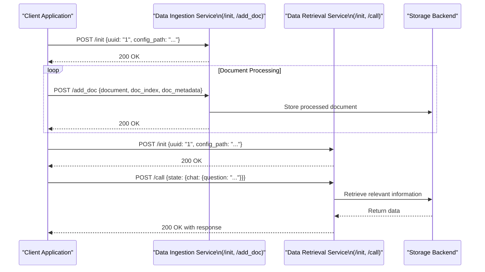

Sources: [README.md:147-219]()

## API Structure

Both services expose REST APIs with similar initialization patterns but different operational endpoints:

| Service | Endpoint | Purpose | Parameters |
|---------|----------|---------|------------|
| Data Ingestion | `/init` | Initialize service with configuration | `uuid`, `config_path` or `context_config` |
| Data Ingestion | `/add_doc` | Add document to the system | `document`, `doc_index`, `doc_metadata` (optional) |
| Data Retrieval | `/init` | Initialize service with configuration | `uuid`, `config_path` or `context_config` |
| Data Retrieval | `/call` | Process query and retrieve relevant information | `state` containing query information |

Sources: [README.md:154-191](), [README.md:204-218]()

## Deployment Architecture

The system is designed for containerized deployment using Docker and Docker Compose, with each component running in its own container.

### Deployment Diagram

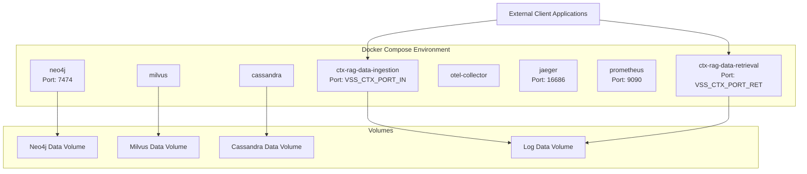

Sources: [README.md:103-144]()

## Configuration Management

The system uses a configuration file approach that allows customizing both services. Configuration can be provided in two ways:

1. **File-based configuration**: Using the `config_path` parameter
2. **Inline configuration**: Using the `context_config` parameter

Both services must be initialized with the same UUID to ensure they operate on the same data context.

### Configuration Flow

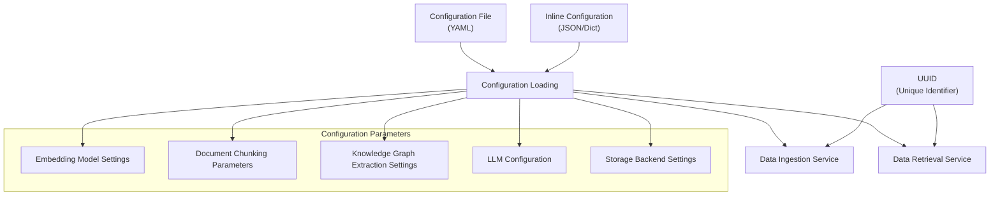

Sources: [README.md:156-162](), [README.md:205]()

## Integration Points

The Context-Aware RAG system is designed to integrate with existing workflows through these key integration points:

1. **Client Applications**: Connect via REST APIs
2. **Storage Systems**: Leverage standard clients for Neo4j, Milvus, and Cassandra
3. **LLM Providers**: Support for multiple LLM providers (NVIDIA, OpenAI)
4. **Observability**: Integration with OpenTelemetry-compatible monitoring tools

### Environment Configuration

The system requires setting environment variables for proper operation:

```
NVIDIA_API_KEY         # If using NVIDIA LLMs
NVIDIA_VISIBLE_DEVICES # GPU device ID
OPENAI_API_KEY         # If using OpenAI LLMs
VSS_CTX_PORT_RET       # Data Retrieval Service port
VSS_CTX_PORT_IN        # Data Ingestion Service port
```

Sources: [README.md:93-101]()

## Summary

The NVIDIA Context-Aware RAG architecture provides a comprehensive framework for building customized data ingestion and retrieval pipelines. The microservices-based design, coupled with a multi-modal storage approach and robust observability features, enables flexible and powerful RAG implementations for various use cases.

Each component in the architecture plays a specific role, from processing and storing documents to retrieving relevant information based on user queries. The system's modular design allows for easy customization and extension to meet specific requirements.

---

# Page: Data Ingestion Service

# Data Ingestion Service

<details>
<summary>Relevant source files</summary>

The following files were used as context for generating this wiki page:

- [README.md](README.md)

</details>


## Purpose and Scope

The Data Ingestion Service is a core component of the Context-Aware RAG system responsible for processing documents, extracting knowledge, and storing information in the system's storage backends. This service enables users to add data from various sources into the RAG pipeline, making it available for subsequent retrieval operations. For information about retrieving data from the system, see [Data Retrieval Service](#2.2).

Sources: [README.md:26-28]()

## Architecture Overview

The Data Ingestion Service functions as a standalone microservice that exposes HTTP endpoints for clients to submit documents. It transforms raw documents into structured data and distributes this information across multiple specialized storage systems to support different query patterns and retrieval strategies.

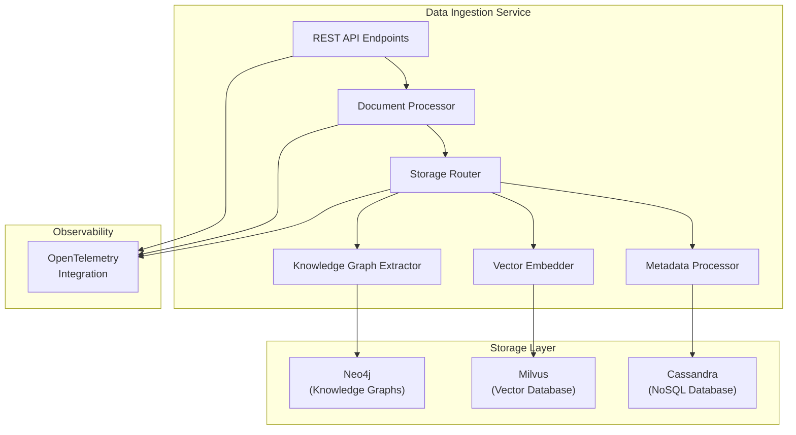

Sources: [README.md:21-31]()

## Document Processing Pipeline

The Data Ingestion Service processes documents through a series of steps before storing them in the appropriate backends:

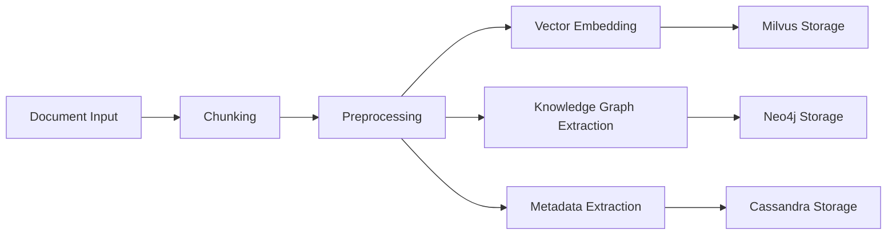

Sources: [README.md:19-23]()

## API Endpoints

The Data Ingestion Service exposes two primary REST API endpoints:

### 1. Initialization Endpoint

The `/init` endpoint initializes the service with a unique identifier and optional configuration.

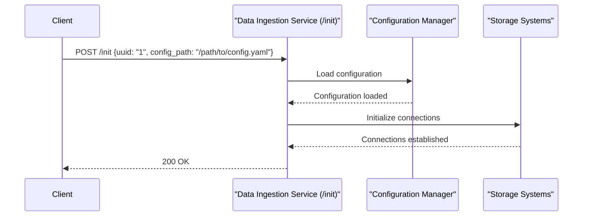

**Request Parameters:**
- `uuid` (required): A unique identifier for the session
- `config_path` (optional): Path to a configuration file
- `context_config` (optional): Configuration provided directly in the request

**Example Request:**
```json
{
  "uuid": "1",
  "config_path": "/app/config/config.yaml"
}
```

Sources: [README.md:156-165]()

### 2. Document Addition Endpoint

The `/add_doc` endpoint accepts documents for processing and storage.

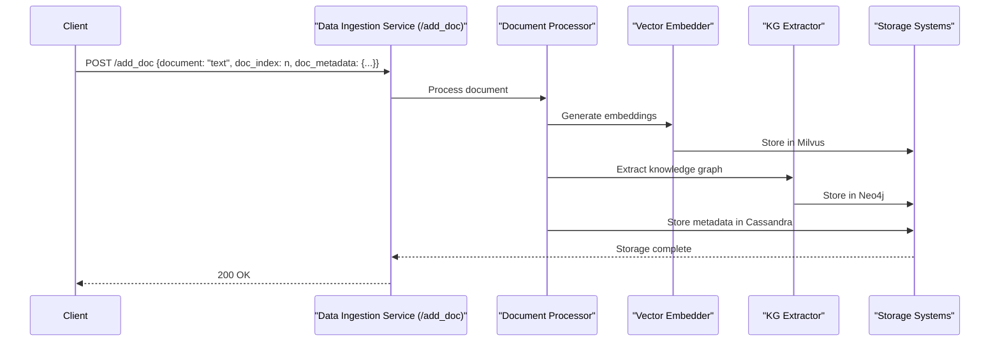

**Request Parameters:**
- `document` (required): The text content to be processed
- `doc_index` (required): A sequential index for the document
- `doc_metadata` (optional): Additional metadata about the document

**Example Request:**
```json
{
  "document": "User1: I went hiking to Mission Peak",
  "doc_index": 4,
  "doc_metadata": {"is_last": false, "timestamp": "2023-05-20T14:30:00Z"}
}
```

Sources: [README.md:168-190]()

## Storage Integration

The Data Ingestion Service writes to three primary storage backends, each serving a specific purpose in the retrieval pipeline:

| Storage System | Purpose | Data Stored |
|----------------|---------|-------------|
| Milvus | Vector database for similarity search | Document chunk embeddings |
| Neo4j | Graph database for knowledge relationships | Entities, relationships, and attributes |
| Cassandra | NoSQL database for structured metadata | Document metadata and indexes |

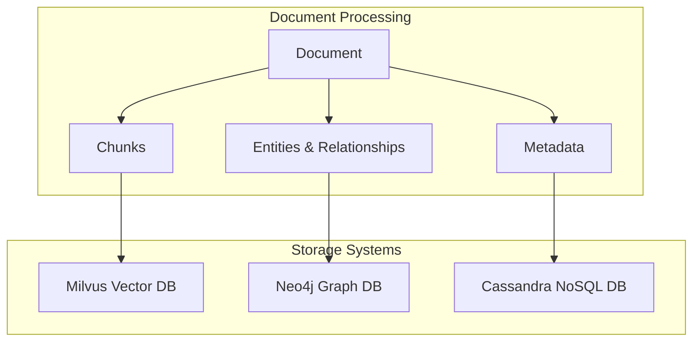

Sources: [README.md:126-142]()

## Configuration Options

The Data Ingestion Service can be configured through a YAML configuration file or direct context configuration. The configuration controls:

1. Document chunking strategies
2. Embedding model selection and parameters
3. Knowledge graph extraction settings
4. Storage backend connection parameters
5. Preprocessing pipelines

The configuration can be provided in three ways:
- Through the `config_path` parameter in the `/init` endpoint
- Directly through the `context_config` parameter in the `/init` endpoint
- Via environment variables

Sources: [README.md:156-162]()

## Integration with Observability

The Data Ingestion Service integrates with OpenTelemetry to provide comprehensive observability:

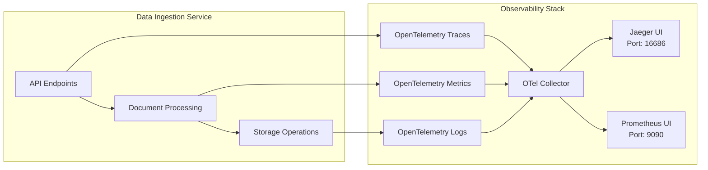

The service emits metrics, traces, and logs that can be viewed through:
- Jaeger UI for distributed tracing visualization (port 16686)
- Prometheus UI for metrics monitoring (port 9090)

Sources: [README.md:132-140]()

## Deployment

The Data Ingestion Service can be deployed using Docker and is typically run alongside other Context-Aware RAG components using Docker Compose.

### Docker Container

The service is containerized as `ctx-rag-data-ingestion` and exposes the port defined by the `VSS_CTX_PORT_IN` environment variable.

### Environment Variables

Key environment variables for the Data Ingestion Service include:

- `VSS_CTX_PORT_IN`: The port on which the service listens
- `NVIDIA_API_KEY`: Required if using NVIDIA AI models
- `OPENAI_API_KEY`: Required if using OpenAI models

Sources: [README.md:93-101](), [README.md:116-120]()

## Usage Example

The following example demonstrates initializing the Data Ingestion Service and adding documents:

1. Initialize the service with a unique UUID:
```
POST /init
{
  "uuid": "1",
  "config_path": "/app/config/config.yaml"
}
```

2. Add documents to be processed:
```
POST /add_doc
{
  "document": "User1: I went hiking to Mission Peak",
  "doc_index": 4,
  "doc_metadata": {"is_last": false}
}
```

Sources: [README.md:146-190]()

## Client Communication Flow

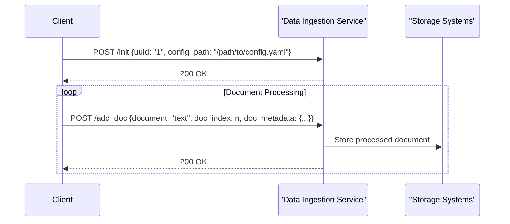

Sources: [README.md:146-190]()

---

# Page: Data Retrieval Service

# Data Retrieval Service

<details>
<summary>Relevant source files</summary>

The following files were used as context for generating this wiki page:

- [README.md](README.md)

</details>


## Purpose and Scope

The Data Retrieval Service is a core component of the Context-Aware RAG system responsible for processing natural language queries, retrieving relevant information from the storage backends, and generating contextually appropriate responses. This document covers the architecture, functionality, and integration capabilities of the Data Retrieval Service.

For information about how data is initially processed and stored in the system, see the [Data Ingestion Service](#2.1). For details about the storage systems used by the Data Retrieval Service, see [Storage Backend Systems](#2.3).

## Architecture Overview

The Data Retrieval Service is designed as a microservice that handles query processing, information retrieval from multiple storage backends, and context assembly for generating responses. It communicates with clients via a RESTful API and integrates with the observability stack for monitoring and troubleshooting.

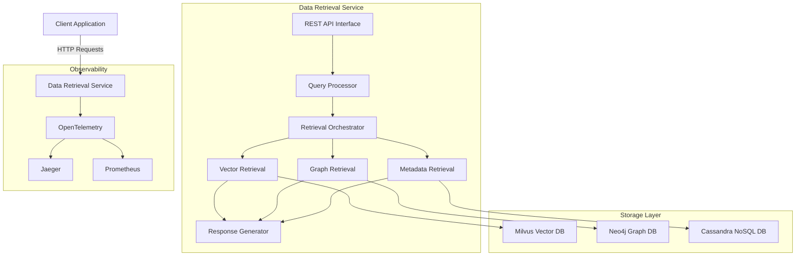

Sources: [README.md:27-31]()

## Query Processing Workflow

The Data Retrieval Service follows a structured workflow for processing user queries and generating contextually relevant responses.

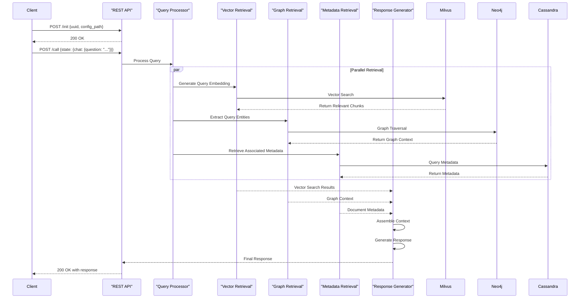

Sources: [README.md:195-219]()

## API Endpoints

The Data Retrieval Service exposes two primary RESTful API endpoints:

| Endpoint | Method | Purpose | Request Payload | Response |
|----------|--------|---------|-----------------|----------|
| `/init`  | POST   | Initialize the service with a configuration and UUID | `{"uuid": "string", "config_path": "string"}` or `{"uuid": "string", "context_config": {}}` | 200 OK |
| `/call`  | POST   | Process a query and return a response | `{"state": {"chat": {"question": "string"}}}` | `{"result": "string"}` |

### `/init` Endpoint

The `/init` endpoint initializes the Data Retrieval Service with a specific configuration and a unique identifier (UUID). The UUID must match the one used by the Data Ingestion Service to ensure that the retrieval service accesses the correct data.

### `/call` Endpoint

The `/call` endpoint processes natural language queries and returns contextually relevant responses. The request payload must include a state object with a question field.

Sources: [README.md:194-219]()

## Integration with Storage Systems

The Data Retrieval Service integrates with three distinct storage backends, each serving a specific role in the retrieval process:

### Vector Retrieval with Milvus

The service uses Milvus to perform semantic similarity searches. When a query is received:

1. The query text is converted into an embedding vector
2. The vector is used to search for semantically similar document chunks in Milvus
3. The most relevant chunks are retrieved for context assembly

### Graph-Based Retrieval with Neo4j

The service leverages Neo4j for knowledge graph querying:

1. Key entities are extracted from the user query
2. Graph traversal algorithms find related information in the knowledge graph
3. Connected entities and relationships provide additional context

### Metadata Retrieval with Cassandra

Cassandra is used for retrieving structured metadata about documents:

1. Document identifiers from vector and graph searches are used to query Cassandra
2. Associated metadata enhances the context with additional structured information
3. Temporal or hierarchical information can be leveraged for ordering content

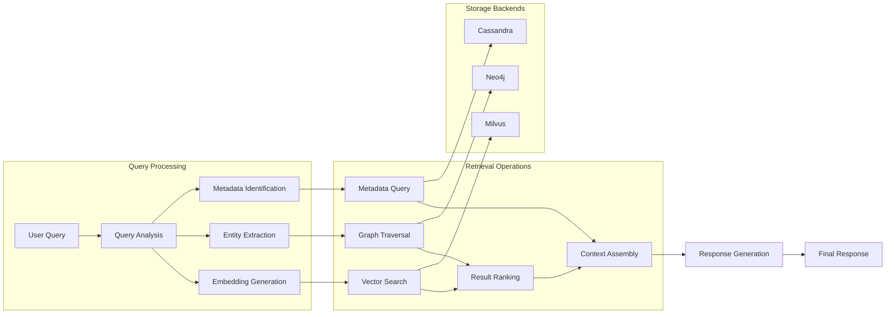

Sources: [README.md:117-142]()

## Configuration Options

The Data Retrieval Service can be configured in several ways:

1. Using a YAML configuration file specified via the `config_path` parameter
2. Providing a configuration object directly via the `context_config` parameter
3. Using environment variables

### Environment Variables

| Variable | Description | Example |
|----------|-------------|---------|
| `VSS_CTX_PORT_RET` | Port for the Data Retrieval Service | `8001` |
| `NVIDIA_API_KEY` | API key for NVIDIA services (if using) | `<key>` |
| `OPENAI_API_KEY` | API key for OpenAI services (if using) | `<key>` |
| `NVIDIA_VISIBLE_DEVICES` | GPU ID to use | `0` |

Sources: [README.md:93-101]()

## Example Usage

Below is a typical workflow for using the Data Retrieval Service:

1. **Initialize the service with the same UUID as used in data ingestion:**

```python
import requests
import json

base_url = "http://<HOST>:<VSS_CTX_PORT_RET>"
headers = {"Content-Type": "application/json"}

init_data = {"config_path": "/app/config/config.yaml", "uuid": "1"}
response = requests.post(
    f"{base_url}/init", headers=headers, data=json.dumps(init_data)
)
```

2. **Send a query to retrieve information:**

```python
call_data = {"chat": {"question": "What happens in this situation?"}}
request_data = {"state": call_data}

response = requests.post(
    f"{base_url}/call", headers=headers, data=json.dumps(request_data)
)
print(response.json()["result"])
```

Sources: [README.md:194-219]()

## Integration with Observability Stack

The Data Retrieval Service is fully integrated with the system's observability stack, enabling comprehensive monitoring and troubleshooting:

```mermaid
flowchart TB
    subgraph "Data Retrieval Service"
        Endpoints["API Endpoints"]
        Processing["Query Processing"]
        Retrieval["Data Retrieval"]
        Response["Response Generation"]
        
        Endpoints --> |"Traces"| OtelSDK["OpenTelemetry SDK"]
        Processing --> |"Metrics"| OtelSDK
        Retrieval --> |"Logs"| OtelSDK
        Response --> |"Spans"| OtelSDK
    end
    
    OtelSDK --> OtelCollector["OpenTelemetry Collector"]
    
    OtelCollector --> Jaeger["Jaeger UI<br>Port: 16686"]
    OtelCollector --> Prometheus["Prometheus UI<br>Port: 9090"]
    
    Jaeger --> |"View Traces"| Debug["Debug & Troubleshoot"]
    Prometheus --> |"Monitor Metrics"| Debug
```

Key observability features:

- **Distributed Tracing**: Track queries as they flow through the system
- **Metrics Collection**: Monitor performance and resource usage
- **Error Logging**: Capture and analyze failures
- **Request/Response Monitoring**: Observe the entire request lifecycle

Sources: [README.md:134-140]()

## Deployment

The Data Retrieval Service is typically deployed as part of the full Context-Aware RAG system using Docker Compose. When deployed, the service is available at `http://<HOST>:<VSS_CTX_PORT_RET>`.

For detailed deployment instructions, see [Docker Deployment](#4.1).

Sources: [README.md:109-144]()

---

# Page: Storage Backend Systems

# Storage Backend Systems

<details>
<summary>Relevant source files</summary>

The following files were used as context for generating this wiki page:

- [README.md](README.md)

</details>


## Purpose and Scope

This document describes the three primary storage backend systems used in the Context-Aware RAG architecture: Neo4j, Milvus, and Cassandra. Each storage system serves a specific purpose in the architecture, handling different types of data and supporting different retrieval mechanisms. This page covers the role of each storage system, how they interact with the Data Ingestion Service [Data Ingestion Service](#2.1) and Data Retrieval Service [Data Retrieval Service](#2.2), and their deployment configurations.

## Storage Systems Overview

The Context-Aware RAG system utilizes a multi-database approach to store different types of information effectively:

```mermaid
graph TD
    subgraph "Storage Backend Systems"
        Neo4j["Neo4j
        Purpose: Knowledge Graph Storage
        Port: 7474 (UI)"]
        
        Milvus["Milvus
        Purpose: Vector Embedding Storage"]
        
        Cassandra["Cassandra
        Purpose: Document & Metadata Storage"]
    end
    
    DIS["Data Ingestion Service
    Port: VSS_CTX_PORT_IN"] --> Neo4j
    DIS --> Milvus
    DIS --> Cassandra
    
    DRS["Data Retrieval Service
    Port: VSS_CTX_PORT_RET"] --> Neo4j
    DRS --> Milvus
    DRS --> Cassandra
```

Sources: [README.md:116-142]()

## Neo4j: Knowledge Graph Storage

Neo4j serves as the graph database for storing knowledge graphs extracted from documents. It enables relationship-based queries that enhances the context-aware capabilities of the RAG system.

### Key Features and Role

- Stores entities and relationships extracted from documents
- Supports graph-based searches and traversals
- Enables context-aware retrieval by leveraging relationship information
- Web interface available at port 7474 for visualization and manual queries

### Integration with RAG Pipeline

```mermaid
flowchart LR
    subgraph "Document Processing"
        Input["Document Input"] --> TextProcessing["Text Processing"]
        TextProcessing --> EntityExtraction["Entity Extraction"]
        EntityExtraction --> RelationshipExtraction["Relationship Extraction"]
        RelationshipExtraction --> GraphConstruction["Knowledge Graph Construction"]
    end
    
    GraphConstruction --> Neo4j["Neo4j Database
    (Knowledge Graph Storage)"]
    
    subgraph "Retrieval Process"
        Query["User Query"] --> GraphQuery["Graph Query Creation"]
        GraphQuery --> Neo4j
        Neo4j --> GraphResults["Graph Search Results"]
        GraphResults --> ContextAssembly["Context Assembly"]
    end
```

Sources: [README.md:30](), [README.md:126-128]()

## Milvus: Vector Database

Milvus is used as the vector database for storing and retrieving document embeddings. It enables semantic search capabilities by finding documents with similar meaning through vector similarity.

### Key Features and Role

- Stores vector embeddings of document chunks
- Supports fast similarity search for vectors
- Enables semantic retrieval based on the meaning of content rather than keyword matching
- Optimized for high-dimensional vector operations

### Integration with RAG Pipeline

```mermaid
flowchart LR
    subgraph "Document Processing"
        Input["Document Input"] --> Chunking["Document Chunking"]
        Chunking --> EmbeddingGeneration["Embedding Generation"]
    end
    
    EmbeddingGeneration --> Milvus["Milvus
    (Vector Database)"]
    
    subgraph "Retrieval Process"
        Query["User Query"] --> QueryEmbedding["Query Embedding"]
        QueryEmbedding --> Milvus
        Milvus --> VectorResults["Vector Search Results"]
        VectorResults --> Ranking["Result Ranking"]
    end
```

Sources: [README.md:130]()

## Cassandra: Document and Metadata Storage

Cassandra serves as the NoSQL database for storing document text and associated metadata. It provides a robust, scalable storage solution for the structured data elements in the RAG system.

### Key Features and Role

- Stores full document text and document metadata
- Provides efficient key-value retrieval for document information
- Enables scalable storage for large document collections
- Supports metadata filtering during retrieval operations

### Integration with RAG Pipeline

```mermaid
flowchart LR
    subgraph "Document Processing"
        Input["Document Input"] --> MetadataExtraction["Metadata Extraction"]
        Input --> TextStorage["Document Text Storage"]
    end
    
    MetadataExtraction --> Cassandra["Cassandra
    (Document & Metadata Storage)"]
    TextStorage --> Cassandra
    
    subgraph "Retrieval Process"
        DocIDs["Document IDs from Search"] --> Cassandra
        Cassandra --> DocumentRetrieval["Document & Metadata Retrieval"]
        DocumentRetrieval --> ContextAssembly["Context Assembly"]
    end
```

Sources: [README.md:142]()

## Data Flow Between Storage Systems

The following diagram illustrates how data flows between the different storage systems during ingestion and retrieval operations:

```mermaid
sequenceDiagram
    participant Client
    participant DIS as "Data Ingestion Service"
    participant DRS as "Data Retrieval Service"
    participant Neo4j as "Neo4j (Knowledge Graph)"
    participant Milvus as "Milvus (Vector DB)"
    participant Cassandra as "Cassandra (NoSQL DB)"
    
    %% Ingestion Flow
    Client->>DIS: POST /init {uuid: "1"}
    DIS-->>Client: 200 OK
    
    Client->>DIS: POST /add_doc {document, doc_index, doc_metadata}
    
    par Parallel Processing
        DIS->>Neo4j: Store knowledge graph entities & relationships
        DIS->>Milvus: Store document chunk embeddings
        DIS->>Cassandra: Store document text & metadata
    end
    
    DIS-->>Client: 200 OK
    
    %% Retrieval Flow
    Client->>DRS: POST /init {uuid: "1"}
    DRS-->>Client: 200 OK
    
    Client->>DRS: POST /call {state: {chat: {question: "..."}}}
    
    par Parallel Retrieval
        DRS->>Neo4j: Query relevant graph nodes/relationships
        DRS->>Milvus: Perform vector similarity search
    end
    
    Neo4j-->>DRS: Return graph search results
    Milvus-->>DRS: Return vector search results
    
    DRS->>Cassandra: Retrieve document text & metadata for results
    Cassandra-->>DRS: Return document content
    
    DRS-->>Client: Return assembled response
```

Sources: [README.md:148-218]()

## Docker Deployment Configuration

All storage backends are deployed as Docker containers as part of the Context-Aware RAG system. The following diagram shows the deployment architecture:

```mermaid
graph TD
    subgraph "Docker Compose Environment"
        DIS["ctx-rag-data-ingestion
        Port: ${VSS_CTX_PORT_IN}"]
        
        DRS["ctx-rag-data-retrieval
        Port: ${VSS_CTX_PORT_RET}"]
        
        Neo4j["neo4j
        UI Port: 7474"]
        
        Milvus["milvus"]
        
        Cassandra["cassandra"]
        
        OTEL["otel-collector"]
        
        Jaeger["jaeger
        UI Port: 16686"]
        
        Prometheus["prometheus
        UI Port: 9090"]
    end
    
    Client["External Client"] --> DIS
    Client --> DRS
    
    DIS --> Neo4j
    DIS --> Milvus
    DIS --> Cassandra
    
    DRS --> Neo4j
    DRS --> Milvus
    DRS --> Cassandra
    
    DIS --> OTEL
    DRS --> OTEL
    
    OTEL --> Jaeger
    OTEL --> Prometheus
```

Sources: [README.md:103-142]()

## Storage Configuration

The storage volumes for the databases can be customized by setting the `DOCKER_VOLUME_DIRECTORY` environment variable to the desired directory path. This allows for persistent storage across container restarts.

Sources: [README.md:144]()

## Integration with Data Services

### Data Ingestion Integration

During data ingestion, documents are processed and stored across all three database systems:

| Database | What Gets Stored | Purpose |
|----------|------------------|---------|
| Neo4j    | Entities and relationships extracted from documents | Enable graph-based context retrieval |
| Milvus   | Vector embeddings of document chunks | Enable semantic similarity search |
| Cassandra | Original document text and metadata | Provide document content and filtering capabilities |

### Data Retrieval Integration

During data retrieval, the system performs the following operations with the storage backends:

1. Converts the query into both a vector embedding and graph query parameters
2. Searches Milvus for semantically similar document chunks
3. Searches Neo4j for relevant graph entities and relationships
4. Retrieves the original document content and metadata from Cassandra
5. Combines the results to assemble comprehensive context for the response

The multi-database approach enables the Context-Aware RAG system to leverage both semantic similarity (vector search) and relational context (graph search) when retrieving information, resulting in more accurate and contextually relevant responses.

Sources: [README.md:148-218]()

---

# Page: GraphRAG Capabilities

# GraphRAG Capabilities

<details>
<summary>Relevant source files</summary>

The following files were used as context for generating this wiki page:

- [README.md](README.md)

</details>


## Purpose and Scope

This document details the knowledge graph extraction features in NVIDIA's Context-Aware RAG system and explains how these graph-based capabilities enhance the retrieval process. GraphRAG combines traditional vector retrieval with knowledge graph operations to provide more contextually relevant and accurate retrieval results. For information about the overall retrieval service, see [Data Retrieval Service](#2.2), and for details on the underlying storage systems, see [Storage Backend Systems](#2.3).

## Overview of GraphRAG

GraphRAG extends traditional RAG (Retrieval Augmented Generation) by incorporating graph structures to represent relationships between entities in the source documents. This approach allows for more nuanced retrieval by leveraging the contextual connections between pieces of information.

```mermaid
flowchart LR
    subgraph "Traditional RAG"
        Document1["Document"] --> Chunking1["Chunking"]
        Chunking1 --> Embedding1["Embedding"]
        Embedding1 --> VectorDB["Vector Database"]
        Query1["Query"] --> VectorSearch["Vector Search"]
        VectorDB --> VectorSearch
        VectorSearch --> LLM1["LLM"]
    end

    subgraph "GraphRAG"
        Document2["Document"] --> Chunking2["Chunking"]
        Document2 --> GraphExtraction["Knowledge Graph Extraction"]
        Chunking2 --> Embedding2["Embedding"]
        Embedding2 --> VectorDB2["Vector Database"]
        GraphExtraction --> GraphDB["Graph Database"]
        
        Query2["Query"] --> HybridSearch["Hybrid Search"]
        VectorDB2 --> HybridSearch
        GraphDB --> HybridSearch
        HybridSearch --> LLM2["LLM"]
    end
```

Sources: [README.md:29-30]()

## Knowledge Graph Extraction Process

During the data ingestion process, the Context-Aware RAG system extracts structured knowledge from unstructured documents. This extraction occurs in parallel with the traditional document chunking and embedding pipeline.

```mermaid
flowchart TD
    Document["Document Input"] --> TextPreprocessing["Text Preprocessing"]
    
    TextPreprocessing --> Chunking["Document Chunking"]
    TextPreprocessing --> KGExtraction["Knowledge Graph Extraction"]
    
    subgraph "Entity and Relation Extraction"
        KGExtraction --> NamedEntityRecognition["Named Entity Recognition"]
        NamedEntityRecognition --> RelationExtraction["Relation Extraction"]
        RelationExtraction --> TripleGeneration["Triple Generation"]
    end
    
    TripleGeneration --> GraphConstruction["Graph Construction"]
    GraphConstruction --> Neo4jStorage["Neo4j Storage"]
    
    Chunking --> EmbeddingGeneration["Embedding Generation"]
    EmbeddingGeneration --> MilvusStorage["Milvus Storage"]
```

Sources: [README.md:21-22]()

The extraction process involves several key steps:

1. **Text Preprocessing**: The incoming document is cleaned and normalized.
2. **Named Entity Recognition**: Identifies entities (people, places, organizations, concepts) in the text.
3. **Relation Extraction**: Determines the relationships between identified entities.
4. **Triple Generation**: Creates subject-predicate-object triples that represent the knowledge.
5. **Graph Construction**: Organizes the triples into a coherent knowledge graph structure.
6. **Neo4j Storage**: Persists the knowledge graph in the Neo4j database.

## Graph Storage in Neo4j

The extracted knowledge graphs are stored in Neo4j, a graph database designed specifically for efficient storage and retrieval of graph-structured data.

### Graph Schema Example

```mermaid
classDiagram
    class Entity {
        id: String
        type: String
        name: String
        properties: Map
    }
    
    class Relation {
        id: String
        type: String
        properties: Map
    }
    
    class Document {
        id: String
        title: String
        source: String
        timestamp: DateTime
    }
    
    Entity "1" -- "many" Relation : has_source
    Entity "1" -- "many" Relation : has_target
    Entity "many" -- "many" Document : appears_in
    Relation "many" -- "many" Document : appears_in
```

Sources: [README.md:126-128]()

## Graph-Based Retrieval

During retrieval, the Context-Aware RAG system leverages the knowledge graph to enhance the search process beyond simple vector similarity.

```mermaid
flowchart LR
    Query["User Query"] --> QueryProcessing["Query Processing"]
    
    subgraph "Graph Retrieval"
        QueryProcessing --> EntityExtraction["Entity Extraction"]
        EntityExtraction --> GraphTraversal["Graph Traversal"]
        GraphTraversal --> Neo4j["Neo4j DB"]
        Neo4j --> RelevantNodes["Relevant Nodes/Paths"]
    end
    
    subgraph "Vector Retrieval"
        QueryProcessing --> QueryEmbedding["Query Embedding"]
        QueryEmbedding --> VectorSearch["Vector Search"]
        VectorSearch --> Milvus["Milvus DB"]
        Milvus --> SimilarChunks["Similar Chunks"]
    end
    
    RelevantNodes --> ResultFusion["Result Fusion"]
    SimilarChunks --> ResultFusion
    ResultFusion --> ContextAssembly["Context Assembly"]
    ContextAssembly --> LLMResponse["LLM Response Generation"]
```

Sources: [README.md:19-34]()

### Graph Retrieval Techniques

The system employs several graph-based retrieval techniques:

| Technique | Description | Advantage |
|-----------|-------------|-----------|
| Entity Linking | Identifies entities in the query and links them to the knowledge graph | Anchors the search to relevant entities |
| Path-based Retrieval | Finds paths between entities mentioned in the query | Reveals relationships not explicit in the text |
| Subgraph Extraction | Extracts relevant subgraphs around entities of interest | Provides contextual information |
| Graph Spreading Activation | Propagates relevance scores through the graph | Discovers related but not directly mentioned information |

## Integration with Vector Search

GraphRAG combines the strengths of both graph-based and vector-based retrieval to provide more comprehensive results.

```mermaid
flowchart TD
    Query["User Query"] --> GraphSearch["Graph Search in Neo4j"]
    Query --> VectorSearch["Vector Search in Milvus"]
    
    subgraph "Hybrid Retrieval Integration"
        GraphSearch --> GraphResults["Graph Results"]
        VectorSearch --> VectorResults["Vector Results"]
        
        GraphResults --> ResultRanking["Result Ranking & Fusion"]
        VectorResults --> ResultRanking
        
        ResultRanking --> RetrievalContext["Retrieval Context"]
    end
    
    RetrievalContext --> ContextAssembly["Context Assembly"]
    ContextAssembly --> LLMGeneration["LLM Generation"]
```

Sources: [README.md:127-130]()

### Hybrid Retrieval Benefits

The integration of graph and vector search offers several advantages:

1. **Complementary Coverage**: Vector search excels at semantic similarity, while graph search captures structured relationships.
2. **Contextual Awareness**: The graph provides relational context between chunks that might be missed in pure vector search.
3. **Multi-hop Reasoning**: Graph traversal enables finding information that requires following multiple connections.
4. **Query Disambiguation**: Entity linking through the graph helps disambiguate queries with multiple potential interpretations.

## Advanced GraphRAG Capabilities

### Temporal Graph Analysis

The Context-Aware RAG system can track how entities and relationships evolve over time by associating graph elements with document timestamps.

```mermaid
flowchart LR
    subgraph "Temporal Knowledge Graph"
        T1["Time Point 1"] --> G1["Graph State 1"]
        T2["Time Point 2"] --> G2["Graph State 2"]
        T3["Time Point 3"] --> G3["Graph State 3"]
        
        G1 --> Evolution1["Evolution"]
        Evolution1 --> G2
        G2 --> Evolution2["Evolution"]
        Evolution2 --> G3
    end
    
    Query["Temporal Query"] --> TemporalFiltering["Temporal Filtering"]
    TemporalFiltering --> G1
    TemporalFiltering --> G2
    TemporalFiltering --> G3
```

Sources: [README.md:174-182]()

### Entity-centric Context Assembly

The system can assemble context based on entity relationships rather than just document proximity, providing more coherent information to the LLM.

```mermaid
flowchart TD
    Query["Query about Entity X"] --> EntityIdentification["Identify Entity X"]
    EntityIdentification --> GraphTraversal["Graph Traversal from Entity X"]
    
    GraphTraversal --> DirectProperties["Direct Properties"]
    GraphTraversal --> DirectRelations["Direct Relations"]
    GraphTraversal --> IndirectRelations["Indirect Relations (N-hops)"]
    
    DirectProperties --> EntityContext["Entity-centric Context"]
    DirectRelations --> EntityContext
    IndirectRelations --> EntityContext
    
    EntityContext --> LLMInput["LLM Input"]
```

Sources: [README.md:212-218]()

## Performance and Scaling Considerations

| Aspect | Consideration | Mitigation |
|--------|--------------|------------|
| Graph Complexity | Large knowledge graphs can result in slow traversal | Efficient indexing and query optimization in Neo4j |
| Extraction Quality | LLM-based extraction may introduce errors | Use confidence scores and validation mechanisms |
| Query Performance | Complex graph queries can be computationally expensive | Query caching and precomputed views for common patterns |
| Storage Requirements | Graph representations add storage overhead | Selective extraction of relevant entities and relations |

Sources: [README.md:126-142]()

## Integration with the Data Pipeline

GraphRAG is fully integrated into both the data ingestion and retrieval services of the Context-Aware RAG system.

```mermaid
sequenceDiagram
    participant Client
    participant DIS as "Data Ingestion Service"
    participant Neo4j as "Neo4j Database"
    participant DRS as "Data Retrieval Service"
    
    Client->>DIS: POST /init {uuid: "1"}
    DIS-->>Client: 200 OK
    
    Client->>DIS: POST /add_doc {document: "text"}
    DIS->>DIS: Extract knowledge graph
    DIS->>Neo4j: Store graph triples
    DIS-->>Client: 200 OK
    
    Client->>DRS: POST /init {uuid: "1"}
    DRS-->>Client: 200 OK
    
    Client->>DRS: POST /call {state: {chat: {question: "query"}}}
    DRS->>Neo4j: Execute graph query
    Neo4j-->>DRS: Return graph results
    DRS->>DRS: Combine with vector results
    DRS-->>Client: 200 OK with response
```

Sources: [README.md:146-219]()

## Conclusion

GraphRAG capabilities in the Context-Aware RAG system enable more sophisticated retrieval by leveraging the structured relationships between entities in the source documents. By combining traditional vector search with knowledge graph operations, the system can provide more contextually accurate and comprehensive information to the LLM, resulting in better-generated responses. The integration of knowledge graphs offers a powerful mechanism for capturing and utilizing the semantic connections within the data, going beyond simple similarity measures to include explicit relationship structures.

---

# Page: Observability Features

# Observability Features

<details>
<summary>Relevant source files</summary>

The following files were used as context for generating this wiki page:

- [README.md](README.md)

</details>


This document provides a comprehensive overview of the observability capabilities in the NVIDIA Context-Aware RAG system. It details how you can monitor, trace, and collect metrics from your RAG pipelines using built-in OpenTelemetry integration, Jaeger, and Prometheus. For information about the overall system architecture, see [System Architecture](#2).

## Overview of Observability Architecture

The Context-Aware RAG system includes a robust observability stack that enables monitoring, debugging, and performance analysis of your data ingestion and retrieval workflows. This observability architecture is built on industry-standard tools that provide comprehensive visibility into the system's operation.

```mermaid
flowchart TD
    subgraph "Core Services"
        DIS["Data Ingestion Service"]
        DRS["Data Retrieval Service"]
    end

    subgraph "Observability Pipeline"
        OTel["OpenTelemetry Collector"]
        Jaeger["Jaeger Tracing\nUI Port: 16686"]
        Prometheus["Prometheus Metrics\nUI Port: 9090"]
    end

    DIS -->|"emits traces\nand metrics"| OTel
    DRS -->|"emits traces\nand metrics"| OTel
    OTel -->|"forwards traces"| Jaeger
    OTel -->|"forwards metrics"| Prometheus
```

Sources: [README.md:132-140]()

## OpenTelemetry Integration

The system leverages OpenTelemetry as the foundation for its observability features. OpenTelemetry provides a standardized way to collect, process, and export telemetry data (traces, metrics, and logs) from the Context-Aware RAG services.

### Key Benefits

- **Vendor-neutral monitoring**: OpenTelemetry's vendor-neutral approach allows you to use any compatible monitoring tool
- **Comprehensive telemetry**: Collects traces, metrics, and logs in a standardized format
- **Low overhead**: Designed for efficient data collection with minimal impact on performance
- **Extensibility**: Can be customized to collect additional data points as needed

The OpenTelemetry Collector serves as the central aggregation point for all telemetry data generated by the Data Ingestion and Data Retrieval services.

```mermaid
flowchart LR
    subgraph "Service Instrumentation"
        DISInst["Data Ingestion\nOTel SDK"]
        DRSInst["Data Retrieval\nOTel SDK"]
    end

    subgraph "OTel Collector Pipeline"
        Receivers["Receivers\n(OTLP/gRPC/HTTP)"]
        Processors["Processors\n(Batch/Filter/Sampling)"]
        Exporters["Exporters\n(Jaeger/Prometheus)"]
    end

    DISInst -->|"OTLP"| Receivers
    DRSInst -->|"OTLP"| Receivers
    Receivers --> Processors
    Processors --> Exporters
    Exporters -->|"export traces"| Jaeger["Jaeger"]
    Exporters -->|"export metrics"| Prometheus["Prometheus"]
```

Sources: [README.md:132-140]()

## Distributed Tracing with Jaeger

Jaeger provides distributed tracing capabilities, allowing you to trace requests as they flow through the different components of the Context-Aware RAG system.

### Trace Visualization

The Jaeger UI is accessible at `http://<HOST>:16686` when running the system with Docker Compose. This interface allows you to:

1. Search for traces by service, operation, duration, and tags
2. View detailed trace timelines showing the flow of requests
3. Analyze the timing and dependencies between services
4. Identify performance bottlenecks in your RAG pipelines

### Key Trace Points

| Service | Trace Points | Purpose |
|---------|--------------|---------|
| Data Ingestion | Document processing | Track document chunking, embedding generation, and storage operations |
| Data Ingestion | Knowledge graph extraction | Monitor the efficiency of graph node and relationship creation |
| Data Retrieval | Query processing | Follow the query from reception through embedding generation to storage search |
| Data Retrieval | Context assembly | Track how retrieved information is assembled into context for the LLM |

```mermaid
sequenceDiagram
    participant Client
    participant DIS as "Data Ingestion Service"
    participant DRS as "Data Retrieval Service"
    participant Storage as "Storage Systems"
    participant Jaeger as "Jaeger Tracing"

    Note over Client,Jaeger: Document Ingestion Flow
    Client->>+DIS: POST /add_doc
    DIS->>+Storage: Store processed document
    Storage-->>-DIS: Confirm storage
    DIS-->>-Client: 200 OK
    DIS->>Jaeger: Report trace data

    Note over Client,Jaeger: Query Retrieval Flow
    Client->>+DRS: POST /call
    DRS->>+Storage: Retrieve relevant information
    Storage-->>-DRS: Return data
    DRS-->>-Client: 200 OK with response
    DRS->>Jaeger: Report trace data
```

Sources: [README.md:132-140]()

## Metrics Collection with Prometheus

Prometheus collects and stores time-series metrics from the Context-Aware RAG services, providing insights into system performance, resource utilization, and business metrics.

### Prometheus UI

The Prometheus UI is accessible at `http://<HOST>:9090` when running the system with Docker Compose. This interface allows you to:

1. Query metrics using PromQL (Prometheus Query Language)
2. Visualize metric trends over time
3. Set up alerts based on metric thresholds
4. Monitor system health and performance

### Key Metrics Collected

| Metric Category | Examples | Purpose |
|-----------------|----------|---------|
| Service Health | Service uptime, error rates | Monitor overall service health |
| Request Performance | Request duration, throughput | Track API performance |
| Document Processing | Documents processed, processing time | Monitor ingestion pipeline performance |
| Query Performance | Query latency, result count | Analyze retrieval performance |
| Storage Operations | Storage operation latency, size | Track database performance |
| Resource Utilization | CPU usage, memory consumption | Monitor resource efficiency |

```mermaid
flowchart TD
    subgraph "Metrics Collection"
        DISMetrics["Data Ingestion\nService Metrics"]
        DRSMetrics["Data Retrieval\nService Metrics"]
        OTelMetrics["OTel Collector\nMetrics"]
    end

    subgraph "Prometheus"
        Scraper["Prometheus Scraper"]
        TSDB["Time Series Database"]
        PromUI["Prometheus UI\nPort: 9090"]
    end

    DISMetrics -->|"expose /metrics"| Scraper
    DRSMetrics -->|"expose /metrics"| Scraper
    OTelMetrics -->|"expose /metrics"| Scraper
    Scraper --> TSDB
    TSDB --> PromUI
```

Sources: [README.md:132-140]()

## Integrating Observability into Workflows

### Monitoring Service Health

To ensure your Context-Aware RAG services are functioning properly, you can set up dashboards to monitor:

1. **Service availability**: Track uptime and response codes for both Data Ingestion and Data Retrieval services
2. **Error rates**: Monitor the frequency and types of errors occurring in each service
3. **Performance trends**: Observe processing times over extended periods to identify degradation

### Debugging Failed Requests

When a document ingestion or query retrieval operation fails:

1. Locate the trace ID from the response headers or logs
2. Look up the trace in Jaeger to see where the failure occurred
3. Use the contextual information in the trace to identify the root cause
4. Check related metrics in Prometheus to see if there are broader system issues

### Performance Optimization

The observability features can help identify performance bottlenecks:

1. Use Jaeger to identify which operations take the longest time
2. Look for patterns in slow operations (e.g., specific document types, query patterns)
3. Check resource utilization metrics in Prometheus during periods of poor performance
4. Optimize the identified bottlenecks based on the collected data

## Docker Compose Setup

The observability stack is preconfigured in the Docker Compose setup provided with the Context-Aware RAG system. When you start the system using the provided command, all observability components are automatically deployed:

```bash
make -C docker start_compose
```

This command starts the following observability services:

- **otel-collector**: The OpenTelemetry Collector service
- **jaeger**: The Jaeger tracing service (UI available at `http://<HOST>:16686`)
- **prometheus**: The Prometheus metrics service (UI available at `http://<HOST>:9090`)

Sources: [README.md:111-142]()

## Accessing Observability UIs

Once the system is running, you can access the observability UIs through your web browser:

| Service | URL | Purpose |
|---------|-----|---------|
| Jaeger UI | `http://<HOST>:16686` | View and analyze distributed traces |
| Prometheus UI | `http://<HOST>:9090` | Query and visualize metrics |

Replace `<HOST>` with your host address (typically `localhost` when running locally).

Sources: [README.md:132-140]()

## Extending Observability

The Context-Aware RAG system's observability features can be extended in several ways:

1. **Custom metrics**: Define additional metrics specific to your use case
2. **External monitoring tools**: Connect other OpenTelemetry-compatible monitoring tools
3. **Alerting**: Set up alerts based on metrics or trace patterns
4. **Dashboard creation**: Create custom dashboards using Grafana or other visualization tools

```mermaid
flowchart LR
    subgraph "Context-Aware RAG"
        OTel["OpenTelemetry\nCollector"]
    end

    subgraph "Standard Tools"
        Jaeger["Jaeger"]
        Prometheus["Prometheus"]
    end

    subgraph "Extensions"
        Grafana["Grafana"]
        AlertManager["Alert Manager"]
        ExternalAPM["External APM Tools"]
    end

    OTel --> Jaeger
    OTel --> Prometheus
    Prometheus --> Grafana
    Prometheus --> AlertManager
    OTel --> ExternalAPM
```

Sources: [README.md:31-31](), [README.md:227-231]()

## Troubleshooting Observability Issues

### Common Issues and Solutions

| Issue | Possible Cause | Solution |
|-------|---------------|----------|
| Missing traces | Sampling configuration | Check OTel collector sampling configuration |
| Missing metrics | Scrape configuration | Verify Prometheus scrape configuration |
| High cardinality metrics | Too many unique labels | Reduce the number of unique label combinations |
| Performance impact | Too much instrumentation | Adjust sampling rate or reduce instrumentation points |
| Connectivity issues | Network configuration | Check network connectivity between services |

### Verifying Observability Setup

To verify that your observability stack is functioning correctly:

1. Check that the OpenTelemetry Collector is receiving data
2. Confirm that traces are appearing in Jaeger
3. Verify that metrics are being collected in Prometheus
4. Ensure that all services are properly connected to the observability pipeline

Sources: [README.md:31-31]()

---

# Page: API Reference

# API Reference

<details>
<summary>Relevant source files</summary>

The following files were used as context for generating this wiki page:

- [README.md](README.md)

</details>


This document provides a comprehensive reference for the Context-Aware RAG system's API endpoints, covering both the Data Ingestion Service and Data Retrieval Service. For information about the system architecture and components, see [System Architecture](#2), and for deployment details, see [Deployment Guide](#4).

## Overview of Services

The Context-Aware RAG system exposes two primary REST API services:

1. **Data Ingestion Service** - Processes and stores documents in the various backend storage systems
2. **Data Retrieval Service** - Retrieves relevant information and generates responses based on user queries

Both services expose HTTP endpoints that accept and return JSON data.

## API Communication Flow

Below is a sequence diagram illustrating the typical communication flow between client applications and the Context-Aware RAG services:

```mermaid
sequenceDiagram
    participant "Client" as Client
    participant "Data Ingestion Service" as DIS
    participant "Data Retrieval Service" as DRS
    participant "Storage Systems" as Storage

    Note over Client, Storage: Initialization Phase
    Client->>DIS: POST /init {uuid: "unique_id", config_path: "path/to/config"}
    DIS-->>Client: 200 OK

    Note over Client, Storage: Document Processing Phase
    loop For each document
        Client->>DIS: POST /add_doc {document: "text", doc_index: n, doc_metadata: {...}}
        DIS->>Storage: Process and store document data
        DIS-->>Client: 200 OK
    end

    Note over Client, Storage: Retrieval Service Setup
    Client->>DRS: POST /init {uuid: "same_unique_id", config_path: "path/to/config"}
    DRS-->>Client: 200 OK

    Note over Client, Storage: Query and Response Phase
    Client->>DRS: POST /call {state: {chat: {question: "query text"}}}
    DRS->>Storage: Retrieve relevant information
    Storage-->>DRS: Return contextual data
    DRS-->>Client: 200 OK with generated response
```

Sources: [README.md:146-219]()

## Common Concepts

### UUID

Both services use a **UUID** to associate data between ingestion and retrieval operations. The UUID must be the same when initializing both services to ensure they operate on the same data.

### Configuration

Services can be initialized with configuration parameters in one of the following ways:
- Providing a `config_path` pointing to a YAML configuration file
- Directly providing a `context_config` object with configuration settings

## Data Ingestion API

The Data Ingestion Service provides endpoints for initializing the service and adding documents to the system.

### Endpoint: `/init`

Initializes the Data Ingestion Service with a unique identifier and optional configuration.

**Method**: POST

**Parameters**:

| Parameter | Type | Required | Description |
|-----------|------|----------|-------------|
| uuid | string | Yes | Unique identifier for the data context |
| config_path | string | No | Path to configuration YAML file |
| context_config | object | No | Direct configuration object (alternative to config_path) |

**Example Request**:
```json
{
  "uuid": "1",
  "config_path": "/app/config/config.yaml"
}
```

**Example Response**:
```json
{
  "status": "success"
}
```

### Endpoint: `/add_doc`

Adds a document to the data ingestion pipeline for processing and storage.

**Method**: POST

**Parameters**:

| Parameter | Type | Required | Description |
|-----------|------|----------|-------------|
| document | string | Yes | Text content of the document |
| doc_index | integer | Yes | Sequential index for ordering documents |
| doc_metadata | object | No | Additional metadata for the document |

**Example Request**:
```json
{
  "document": "User1: I went hiking to Mission Peak",
  "doc_index": 4,
  "doc_metadata": {
    "is_last": false
  }
}
```

**Example Response**:
```json
{
  "status": "success"
}
```

Sources: [README.md:146-191]()

## Data Retrieval API

The Data Retrieval Service provides endpoints for initializing the service and querying the stored data.

### Endpoint: `/init`

Initializes the Data Retrieval Service with the same unique identifier used with the Data Ingestion Service.

**Method**: POST

**Parameters**:

| Parameter | Type | Required | Description |
|-----------|------|----------|-------------|
| uuid | string | Yes | Unique identifier (same as used with Data Ingestion) |
| config_path | string | No | Path to configuration YAML file |
| context_config | object | No | Direct configuration object (alternative to config_path) |

**Example Request**:
```json
{
  "uuid": "1",
  "config_path": "/app/config/config.yaml"
}
```

**Example Response**:
```json
{
  "status": "success"
}
```

### Endpoint: `/call`

Processes a retrieval request, finding relevant information and generating a response.

**Method**: POST

**Parameters**:

| Parameter | Type | Required | Description |
|-----------|------|----------|-------------|
| state | object | Yes | Contains query parameters |
| state.chat.question | string | Yes | The query text to be processed |

**Example Request**:
```json
{
  "state": {
    "chat": {
      "question": "What happens in this situation?"
    }
  }
}
```

**Example Response**:
```json
{
  "result": "Based on the conversation, User1 and User2 were having a friendly chat. User1 mentioned going hiking to Mission Peak over the weekend. Then User3 suddenly warned about a fire and suggested that everyone evacuate immediately.",
  "status": "success"
}
```

Sources: [README.md:192-219]()

## Component Relationships

The following diagram illustrates how the API endpoints relate to the internal components of the system:

```mermaid
graph TD
    subgraph "Client Applications"
        ClientApp["Client Application"]
    end

    subgraph "Data Ingestion Service"
        InitEndpointIN["/init Endpoint"]
        AddDocEndpoint["/add_doc Endpoint"]
        DocProcessor["Document Processor"]
        ChunkingEngine["Chunking Engine"]
        EmbeddingGenerator["Embedding Generator"]
        KGExtractor["Knowledge Graph Extractor"]
    end

    subgraph "Data Retrieval Service"
        InitEndpointRET["/init Endpoint"]
        CallEndpoint["/call Endpoint"]
        QueryProcessor["Query Processor"]
        RetrieverEngine["Retriever Engine"]
        ResponseGenerator["Response Generator"]
    end

    subgraph "Storage Backend"
        Milvus["Milvus Vector DB"]
        Neo4j["Neo4j Graph DB"]
        Cassandra["Cassandra Metadata DB"]
    end

    ClientApp -->|"POST /init"| InitEndpointIN
    ClientApp -->|"POST /add_doc"| AddDocEndpoint
    ClientApp -->|"POST /init"| InitEndpointRET
    ClientApp -->|"POST /call"| CallEndpoint
    
    InitEndpointIN --> DocProcessor
    AddDocEndpoint --> DocProcessor
    DocProcessor --> ChunkingEngine
    DocProcessor --> KGExtractor
    ChunkingEngine --> EmbeddingGenerator
    
    EmbeddingGenerator --> Milvus
    KGExtractor --> Neo4j
    DocProcessor --> Cassandra
    
    InitEndpointRET --> QueryProcessor
    CallEndpoint --> QueryProcessor
    QueryProcessor --> RetrieverEngine
    RetrieverEngine --> Milvus
    RetrieverEngine --> Neo4j
    RetrieverEngine --> Cassandra
    RetrieverEngine --> ResponseGenerator
    ResponseGenerator -->|"Response"| ClientApp
```

Sources: [README.md:19-141]()

## Request and Response Data Flow

The following diagram shows the data flow for a typical query through the Data Retrieval Service:

```mermaid
flowchart LR
    subgraph "Client"
        ClientRequest["JSON Request"]
        ClientResponse["JSON Response"]
    end
    
    subgraph "Data Retrieval API"
        CallEndpoint["/call Endpoint"]
        StateParser["State Parser"]
        QueryExtractor["Query Extractor"]
    end
    
    subgraph "Retrieval Pipeline"
        QueryProcessor["Query Processor"]
        VectorSearch["Vector Search"]
        GraphSearch["Graph Search"]
        ResultRanker["Result Ranker"]
        ContextAssembler["Context Assembler"]
        ResponseGen["Response Generator"]
    end
    
    subgraph "Storage Systems"
        Milvus["Milvus"]
        Neo4j["Neo4j"]
        Cassandra["Cassandra"]
    end
    
    ClientRequest -->|"POST /call"| CallEndpoint
    CallEndpoint --> StateParser
    StateParser --> QueryExtractor
    QueryExtractor -->|"question"| QueryProcessor
    
    QueryProcessor --> VectorSearch
    QueryProcessor --> GraphSearch
    
    VectorSearch --> Milvus
    Milvus -->|"Vector Results"| VectorSearch
    
    GraphSearch --> Neo4j
    Neo4j -->|"Graph Results"| GraphSearch
    
    VectorSearch --> ResultRanker
    GraphSearch --> ResultRanker
    
    ResultRanker --> ContextAssembler
    
    Cassandra -->|"Metadata"| ContextAssembler
    
    ContextAssembler --> ResponseGen
    ResponseGen --> ClientResponse
```

Sources: [README.md:19-219]()

## Error Handling

Both services follow standard HTTP status code conventions for error responses:

| Status Code | Description |
|-------------|-------------|
| 200 | Success |
| 400 | Bad Request - Invalid parameters |
| 404 | Not Found - Resource not found |
| 500 | Internal Server Error |

Error responses include a JSON object with error details:

```json
{
  "error": "Error message description",
  "status": "error"
}
```

## Additional Resources

For detailed implementation and usage examples, refer to:
- [Data Ingestion API](#3.1) - Detailed documentation of the Data Ingestion Service API
- [Data Retrieval API](#3.2) - Detailed documentation of the Data Retrieval Service API
- [Configuration Options](#4.2) - Available configuration options for both services

---

# Page: Data Ingestion API

# Data Ingestion API

<details>
<summary>Relevant source files</summary>

The following files were used as context for generating this wiki page:

- [README.md](README.md)

</details>


This documentation covers the API endpoints provided by the Data Ingestion Service in the Context-Aware RAG system. This service handles document processing, transformation, and storage for later retrieval by the Data Retrieval Service. For information about retrieving processed data, see the [Data Retrieval API](#3.2).

## Overview

The Data Ingestion API provides a RESTful interface for:
- Initializing a data ingestion pipeline with a unique identifier
- Adding documents to be processed and stored
- Supporting metadata attachment to documents for enhanced context

Documents ingested through this API undergo processing steps including chunking, embedding generation, knowledge graph extraction, and metadata processing before being stored in multiple backend databases.

## API Endpoints

### `/init` Endpoint

Initializes the data ingestion service with a unique identifier and optional configuration.

**HTTP Method**: POST

**Request Parameters**:

| Parameter | Type | Required | Description |
|-----------|------|----------|-------------|
| uuid | string | Yes | Unique identifier for the dataset being ingested |
| config_path | string | No | Path to a YAML configuration file |
| context_config | object | No | Direct configuration object (alternative to config_path) |

**Request Examples**:

Basic initialization:
```json
{
  "uuid": "1"
}
```

Initialization with config path:
```json
{
  "uuid": "1",
  "config_path": "/app/config/config.yaml"
}
```

**Response**: Status code 200 on success

Sources: [README.md:157-165]()

### `/add_doc` Endpoint

Adds a document to the data ingestion service for processing and storage.

**HTTP Method**: POST

**Request Parameters**:

| Parameter | Type | Required | Description |
|-----------|------|----------|-------------|
| document | string | Yes | Text content of the document |
| doc_index | integer | Yes | Numeric index for the document (for ordering) |
| doc_metadata | object | No | Additional metadata associated with the document |

**Request Examples**:

Basic document addition:
```json
{
  "document": "User1: I went hiking to Mission Peak",
  "doc_index": 4
}
```

Document with metadata:
```json
{
  "document": "User1: Hi how are you?",
  "doc_index": 0,
  "doc_metadata": {
    "is_first": true
  }
}
```

**Response**: Status code 200 on success

Sources: [README.md:168-183]()

## Data Ingestion Flow

The following diagram illustrates the interaction between a client and the Data Ingestion API:

```mermaid
sequenceDiagram
    participant Client as "Client"
    participant DIS as "Data Ingestion Service"
    participant Storage as "Storage Systems"
    
    Client->>DIS: POST /init {uuid: "1", config_path: "/path/to/config.yaml"}
    DIS-->>Client: 200 OK
    
    loop "Document Processing"
        Client->>DIS: POST /add_doc {document: "text", doc_index: n, doc_metadata: {...}}
        DIS->>DIS: "Process Document (Chunk, Embed, Extract KG)"
        DIS->>Storage: "Store Processed Data"
        DIS-->>Client: 200 OK
    end
```

Sources: [README.md:146-191]()

## API Structure and Request Parameters

```mermaid
flowchart LR
    Client["Client Application"]
    
    subgraph DataIngestionAPI["Data Ingestion Service API"]
        InitEndpoint["/init"]
        AddDocEndpoint["/add_doc"]
    end
    
    subgraph InitRequest["POST /init Request"]
        UUID["uuid: string"]
        ConfigPath["config_path: string (optional)"]
        ContextConfig["context_config: object (optional)"]
    end
    
    subgraph AddDocRequest["POST /add_doc Request"]
        Document["document: string"]
        DocIndex["doc_index: integer"]
        DocMetadata["doc_metadata: object (optional)"]
    end
    
    Client --> InitEndpoint
    Client --> AddDocEndpoint
    
    InitEndpoint --> UUID
    InitEndpoint --> ConfigPath
    InitEndpoint --> ContextConfig
    
    AddDocEndpoint --> Document
    AddDocEndpoint --> DocIndex
    AddDocEndpoint --> DocMetadata
```

Sources: [README.md:148-191]()

## Document Processing Pipeline

The following diagram shows how documents added through the API are processed and stored:

```mermaid
flowchart LR
    subgraph DataIngestionAPI["Data Ingestion API"]
        Init["/init Endpoint"]
        AddDoc["/add_doc Endpoint"]
    end
    
    subgraph DocumentProcessingPipeline["Document Processing Pipeline"]
        Chunking["Document Chunker"]
        Embedding["Embedding Generator"]
        KGExtraction["Knowledge Graph Extractor"]
        Metadata["Metadata Processor"]
    end
    
    subgraph StorageSystems["Storage Systems"]
        Milvus["Milvus (Vector Embeddings)"]
        Neo4j["Neo4j (Knowledge Graphs)"]
        Cassandra["Cassandra (Metadata & Text)"]
    end
    
    AddDoc --> Chunking
    Chunking --> Embedding
    Chunking --> KGExtraction
    Chunking --> Metadata
    
    Embedding --> Milvus
    KGExtraction --> Neo4j
    Metadata --> Cassandra
```

Sources: [README.md:21-23]()

## Complete Usage Example

The following example demonstrates initializing the service and adding a series of documents representing a conversation:

```python
import requests
import json

# Define the base URL for the Data Ingestion Service
base_url = "http://<HOST>:<VSS_CTX_PORT_IN>"
headers = {"Content-Type": "application/json"}

# Step 1: Initialize the service with a unique UUID
init_data = {"uuid": "1"}
response = requests.post(
    f"{base_url}/init", headers=headers, data=json.dumps(init_data)
)

# Step 2: Add documents to the service
add_doc_data_list = [
    # First message in conversation with is_first metadata flag
    {
        "document": "User1: Hi how are you?",
        "doc_index": 0,
        "doc_metadata": {"is_first": True}
    },
    # Subsequent messages in conversation order
    {"document": "User2: I am good. How are you?", "doc_index": 1},
    {"document": "User1: I am great too. Thanks for asking", "doc_index": 2},
    {"document": "User2: So what did you do over the weekend?", "doc_index": 3},
    {"document": "User1: I went hiking to Mission Peak", "doc_index": 4},
    # Last message with is_last metadata flag
    {
        "document": "User3: Guys there is a fire. Let us get out of here",
        "doc_index": 5,
        "doc_metadata": {"is_last": True}
    },
]

# Send POST requests for each document in sequence
for add_doc_data in add_doc_data_list:
    response = requests.post(
        f"{base_url}/add_doc", headers=headers, data=json.dumps(add_doc_data)
    )
```

Sources: [README.md:148-191]()

## Configuration Options

When initializing the Data Ingestion Service, you can provide configuration settings through a YAML file or direct configuration object. These settings control how documents are processed and stored.

Example initialization with configuration:

```python
# Using a config file
init_data = {"config_path": "/app/config/config.yaml", "uuid": "1"}
response = requests.post(
    f"{base_url}/init", headers=headers, data=json.dumps(init_data)
)

# Using a direct configuration object
import yaml
config = yaml.safe_load(open("/app/config/config.yaml"))
init_data = {"context_config": config, "uuid": "1"}
response = requests.post(
    f"{base_url}/init", headers=headers, data=json.dumps(init_data)
)
```

Sources: [README.md:157-162]()

## Document Metadata

The Data Ingestion API supports attaching metadata to documents through the `doc_metadata` field. This metadata can be used for filtering and context enrichment during retrieval.

Example metadata usage in the API:

```json
{
  "document": "User1: Hi how are you?",
  "doc_index": 0,
  "doc_metadata": {
    "is_first": true,
    "speaker": "User1",
    "timestamp": "2023-06-15T14:30:00Z"
  }
}
```

As shown in the examples, you can use metadata to indicate special properties of documents, such as whether they are the first (`is_first`) or last (`is_last`) in a sequence.

Sources: [README.md:170-174](), [README.md:179-183]()

## Service Deployment

The Data Ingestion Service is typically deployed as a Docker container, accessible at:

```
http://<HOST>:<VSS_CTX_PORT_IN>
```

Where:
- `<HOST>` is the hostname or IP address where the service is running
- `<VSS_CTX_PORT_IN>` is the port specified in your environment configuration

When running the full system via docker compose, the Data Ingestion Service is available at this endpoint and connects automatically to the required backend storage services (Neo4j, Milvus, and Cassandra).

Sources: [README.md:94-101](), [README.md:118-121]()

---

# Page: Data Retrieval API

# Data Retrieval API

<details>
<summary>Relevant source files</summary>

The following files were used as context for generating this wiki page:

- [README.md](README.md)

</details>


The Data Retrieval API provides endpoints for retrieving contextually relevant information from your ingested data using natural language queries. This interface allows client applications to submit queries and receive responses enhanced with relevant context from stored documents. For information about adding documents to the system, see [Data Ingestion API](#3.1).

## Overview

The Data Retrieval Service exposes a REST API that processes client queries by searching through vector and graph databases, retrieving relevant context, and generating responses. The service must be initialized with the same UUID as used in the Data Ingestion Service to access the corresponding data.

```mermaid
sequenceDiagram
    participant "Client" as client
    participant "Data Retrieval API" as api
    participant "Storage Systems" as storage
    
    client->>api: POST /init {uuid: "1", config_path: "..."}
    api-->>client: 200 OK
    
    client->>api: POST /call {state: {chat: {question: "..."}}}
    api->>storage: Query vector DB (Milvus)
    api->>storage: Query graph DB (Neo4j)
    api->>storage: Retrieve metadata (Cassandra)
    storage-->>api: Return relevant context
    api-->>client: 200 OK with response
```

Sources: [README.md:198-218]()

## API Endpoints

The Data Retrieval API consists of two primary endpoints:

| Endpoint | Method | Purpose |
|----------|--------|---------|
| `/init`  | POST   | Initialize the retrieval service with a specific UUID and configuration |
| `/call`  | POST   | Submit a query and receive a response with relevant context |

Sources: [README.md:206-218]()

### Endpoint: `/init`

Initializes the Data Retrieval Service with configuration settings and a UUID that matches data previously processed by the Data Ingestion Service.

#### Request Parameters

| Parameter      | Type   | Required | Description |
|----------------|--------|----------|-------------|
| `uuid`         | String | Yes      | Unique identifier matching data ingested by the Data Ingestion Service |
| `config_path`  | String | No       | Path to configuration file (server-side) |
| `context_config` | Object | No    | Direct configuration object (alternative to `config_path`) |

#### Example Request

```json
{
  "config_path": "/app/config/config.yaml",
  "uuid": "1"
}
```

#### Response

Returns a 200 OK status code upon successful initialization.

Sources: [README.md:204-208]()

### Endpoint: `/call`

Submits a query to the retrieval service and receives a response with relevant context.

#### Request Parameters

| Parameter | Type   | Required | Description |
|-----------|--------|----------|-------------|
| `state`   | Object | Yes      | Contains the query information |

The `state` object contains:
- `chat`: Object containing the user query
  - `question`: String representing the user's question

#### Example Request

```json
{
  "state": {
    "chat": {
      "question": "What happens in this situation?"
    }
  }
}
```

#### Response

Returns a JSON object containing:
- `result`: The generated response
- Additional context information (if configured)

#### Example Response

```json
{
  "result": "In this situation, User1 and User2 are having a conversation where they're greeting each other and discussing their weekend activities. User1 mentions hiking to Mission Peak. Then User3 interrupts to warn them about a fire and suggests they evacuate.",
  "source_documents": [...]
}
```

Sources: [README.md:211-218]()

## Data Flow Architecture

The following diagram illustrates how the Data Retrieval API interacts with various components in the Context-Aware RAG system:

```mermaid
flowchart LR
    subgraph "Client Application"
        Query["Client Query"]
        Response["Response"]
    end
    
    subgraph "Data Retrieval API"
        InitEndpoint["/init Endpoint"]
        CallEndpoint["/call Endpoint"]
        QueryProcessor["Query Processor"]
        ContextAssembler["Context Assembler"]
        ResponseGenerator["Response Generator"]
    end
    
    subgraph "Storage Systems"
        Milvus["Milvus Vector DB"]
        Neo4j["Neo4j Graph DB"]
        Cassandra["Cassandra Metadata DB"]
    end
    
    Query --> InitEndpoint
    Query --> CallEndpoint
    InitEndpoint --> QueryProcessor
    CallEndpoint --> QueryProcessor
    QueryProcessor --> Milvus
    QueryProcessor --> Neo4j
    Milvus --> ContextAssembler
    Neo4j --> ContextAssembler
    Cassandra --> ContextAssembler
    ContextAssembler --> ResponseGenerator
    ResponseGenerator --> Response
```

Sources: [README.md:198-218]()

## Request-Response Flow

The detailed sequence of operations when using the Data Retrieval API:

```mermaid
sequenceDiagram
    participant Client
    participant API as "Data Retrieval API"
    participant Processor as "Query Processor"
    participant VectorDB as "Milvus"
    participant GraphDB as "Neo4j"
    participant MetadataDB as "Cassandra"
    participant Generator as "Response Generator"
    
    Client->>API: POST /init {uuid: "1", config_path: "..."}
    API->>Processor: Initialize with configuration
    Processor->>VectorDB: Connect
    Processor->>GraphDB: Connect
    Processor->>MetadataDB: Connect
    API-->>Client: 200 OK
    
    Client->>API: POST /call {state: {chat: {question: "..."}}}
    API->>Processor: Process query
    Processor->>VectorDB: Vector search
    VectorDB-->>Processor: Return similar documents
    Processor->>GraphDB: Graph traversal
    GraphDB-->>Processor: Return related entities
    Processor->>MetadataDB: Retrieve metadata
    MetadataDB-->>Processor: Return metadata
    Processor->>Generator: Assemble context and generate response
    Generator-->>API: Generate response text
    API-->>Client: 200 OK with response
```

Sources: [README.md:211-218]()

## Usage Example

Below is a complete Python example demonstrating how to use the Data Retrieval API:

```python
import requests
import json

# Base URL for the Data Retrieval Service
base_url = "http://<HOST>:<VSS_CTX_PORT_RET>"

# Set headers for JSON content
headers = {"Content-Type": "application/json"}

# Initialize the service with the same UUID used for data ingestion
init_data = {"config_path": "/app/config/config.yaml", "uuid": "1"}
response = requests.post(
    f"{base_url}/init", headers=headers, data=json.dumps(init_data)
)

# Send a retrieval request to the service
call_data = {"chat": {"question": "What happens in this situation?"}}
request_data = {"state": call_data}

response = requests.post(
    f"{base_url}/call", headers=headers, data=json.dumps(request_data)
)
print(response.json()["result"])
```

Sources: [README.md:196-219]()

## Integration with Complete Workflow

To use the Data Retrieval API effectively, you typically need to:

1. First ingest documents using the Data Ingestion API
2. Initialize the Data Retrieval Service with the same UUID
3. Submit queries to retrieve context-enhanced responses

```mermaid
flowchart TB
    subgraph "Complete RAG Workflow"
        direction TB
        
        subgraph "Data Ingestion Phase"
            IngestInit["/init (Ingestion)"]
            AddDocs["/add_doc"]
        end
        
        subgraph "Data Retrieval Phase"
            RetInit["/init (Retrieval)"]
            Query["/call"]
            Response["Response"]
        end
        
        Documents["Source Documents"] --> IngestInit
        IngestInit --> AddDocs
        AddDocs --> RetInit
        RetInit --> Query
        Query --> Response
    end
```

Sources: [README.md:148-218]()

## API Parameter Details

### UUID Parameter

The `uuid` parameter is critical as it links the Data Retrieval Service to the correct dataset in the storage systems. The same UUID must be used for both ingestion and retrieval services to ensure the query is performed against the intended dataset.

### Configuration Options

When initializing the Data Retrieval API, you can provide configuration in two ways:

1. **config_path**: Path to a YAML configuration file on the server
2. **context_config**: Direct configuration object in the request

The configuration determines:
- Which embedding models to use
- How to rank and process the results
- Retrieval strategies (vector search, graph search, or hybrid)
- Response generation parameters

Sources: [README.md:204-208]()

## Connection to Storage Systems

The Data Retrieval API connects to three storage backends to provide comprehensive retrieval capabilities:

1. **Milvus**: Vector database for semantic similarity search
2. **Neo4j**: Graph database for relationship-based retrieval
3. **Cassandra**: NoSQL database for document metadata storage

For more details on the storage systems, see [Storage Backend Systems](#2.3).

## Observability

The Data Retrieval API integrates with OpenTelemetry to provide tracing and metrics. For more information on monitoring and troubleshooting the API, see [Observability Features](#2.5).

---

# Page: Deployment Guide

# Deployment Guide

<details>
<summary>Relevant source files</summary>

The following files were used as context for generating this wiki page:

- [README.md](README.md)

</details>


This guide provides comprehensive instructions for deploying the NVIDIA Context-Aware RAG system in your environment. It covers deployment methods, configuration options, and verification steps to ensure the system is properly operational.

For detailed API specifications, see [API Reference](#3). For information about the system architecture and components, see [System Architecture](#2).

## Deployment Options Overview

The Context-Aware RAG system can be deployed using Docker Compose (recommended) or installed from source. This guide primarily focuses on the Docker-based deployment method, which simplifies setting up all required services.

```mermaid
flowchart TD
    subgraph "Deployment Options"
        Docker["Docker Compose Deployment"]
        Source["Source Installation"]
    end
    
    Docker -->|"Recommended"| Complete["Complete System with All Components"]
    Source -->|"For Development"| Custom["Customized Environment"]
    
    subgraph "Components Deployed"
        DataIngestion["Data Ingestion Service"]
        DataRetrieval["Data Retrieval Service"]
        Neo4j["Neo4j Graph Database"]
        Milvus["Milvus Vector Database"]
        Cassandra["Cassandra Database"]
        OTel["OpenTelemetry Collector"]
        Jaeger["Jaeger Tracing UI"]
        Prometheus["Prometheus Metrics"]
    end
    
    Complete --> DataIngestion
    Complete --> DataRetrieval
    Complete --> Neo4j
    Complete --> Milvus
    Complete --> Cassandra
    Complete --> OTel
    Complete --> Jaeger
    Complete --> Prometheus
```

Sources: [README.md:108-143]()

## Prerequisites

Before deploying the Context-Aware RAG system, ensure you have the following prerequisites:

1. **Docker and Docker Compose**: Required for containerized deployment
2. **Git**: For cloning the repository
3. **uv**: For Python package management if installing from source
4. **Environment Variables**: API keys for LLM services and port configurations

Sources: [README.md:47-53]()

## Docker Deployment

### Setting Up Environment Variables

Create a `.env` file in the repository root directory with the following variables:

| Variable | Description | Example |
|----------|-------------|---------|
| `NVIDIA_API_KEY` | API key for NVIDIA services (if using) | `your-nvidia-api-key` |
| `NVIDIA_VISIBLE_DEVICES` | GPU ID to use for NVIDIA services | `0` |
| `OPENAI_API_KEY` | API key for OpenAI services (if using) | `your-openai-api-key` |
| `VSS_CTX_PORT_RET` | Port for the Data Retrieval Service | `8001` |
| `VSS_CTX_PORT_IN` | Port for the Data Ingestion Service | `8000` |

Sources: [README.md:91-101]()

### Building Docker Images

Execute the following command to build the required Docker images:

```bash
make -C docker build
```

This builds the images for both the Data Ingestion and Data Retrieval services.

Sources: [README.md:103-107]()

### Starting the Docker Compose Stack

Launch the full service stack with:

```bash
make -C docker start_compose
```

This command starts all services defined in the Docker Compose configuration.

Sources: [README.md:109-111]()

### Deployed Services

The Docker Compose deployment provides the following services:

| Service | Description | Access URL |
|---------|-------------|------------|
| ctx-rag-data-ingestion | Data Ingestion Service | `http://<HOST>:<VSS_CTX_PORT_IN>` |
| ctx-rag-data-retrieval | Data Retrieval Service | `http://<HOST>:<VSS_CTX_PORT_RET>` |
| neo4j | Graph database for knowledge graph storage | `http://<HOST>:7474` (UI) |
| milvus | Vector database for embeddings | N/A |
| cassandra | NoSQL database for metadata storage | N/A |
| otel-collector | OpenTelemetry collector | N/A |
| jaeger | Distributed tracing system | `http://<HOST>:16686` (UI) |
| prometheus | Metrics and monitoring system | `http://<HOST>:9090` (UI) |

To change the storage volumes location, you can export the `DOCKER_VOLUME_DIRECTORY` environment variable to your desired directory before starting the services.

Sources: [README.md:115-144]()

## Deployment Architecture

```mermaid
graph TD
    subgraph "Docker Compose Environment"
        DIS["ctx-rag-data-ingestion
        Port: VSS_CTX_PORT_IN"]
        DRS["ctx-rag-data-retrieval
        Port: VSS_CTX_PORT_RET"]
        
        subgraph "Storage Systems"
            Neo4j["neo4j
            UI Port: 7474"]
            Milvus["milvus"]
            Cassandra["cassandra"]
        end
        
        subgraph "Observability Stack"
            OTel["otel-collector"]
            Jaeger["jaeger
            UI Port: 16686"]
            Prometheus["prometheus
            UI Port: 9090"]
        end
    end
    
    Client["Client Applications"] --> DIS
    Client --> DRS
    
    DIS --> Neo4j
    DIS --> Milvus
    DIS --> Cassandra
    
    DRS --> Neo4j
    DRS --> Milvus
    DRS --> Cassandra
    
    DIS --> OTel
    DRS --> OTel
    
    OTel --> Jaeger
    OTel --> Prometheus
```

Sources: [README.md:114-142]()

## Deployment Workflow

```mermaid
flowchart LR
    Clone["Clone Repository"] --> SetupEnv["Create .env File"]
    SetupEnv --> BuildDocker["Build Docker Images
    make -C docker build"]
    BuildDocker --> StartServices["Start Services
    make -C docker start_compose"]
    StartServices --> VerifyServices["Verify Services
    Access UI endpoints"]
    
    subgraph "Service Verification"
        CheckIngestion["Test Data Ingestion
        POST /init and /add_doc"]
        CheckRetrieval["Test Data Retrieval
        POST /init and /call"]
        CheckNeo4j["Access Neo4j UI
        http://host:7474"]
        CheckJaeger["Access Jaeger UI
        http://host:16686"]
        CheckPrometheus["Access Prometheus
        http://host:9090"]
    end
    
    VerifyServices --> CheckIngestion
    VerifyServices --> CheckRetrieval
    VerifyServices --> CheckNeo4j
    VerifyServices --> CheckJaeger
    VerifyServices --> CheckPrometheus
```

Sources: [README.md:59-144]()

## Installation from Source

If you prefer to install and run the services without Docker, follow these steps:

1. Clone the repository:
```bash
git clone git@github.com:NVIDIA/context-aware-rag.git
cd context-aware-rag/
```

2. Create a virtual environment:
```bash
uv venv --seed .venv
source .venv/bin/activate
```

3. Install the package:
```bash
uv pip install -e .
```

4. Alternatively, build and install the wheel file:
```bash
uv build
uv pip install vss_ctx_rag-0.5.0-py3-none-any.whl
```

When installing from source, you'll need to separately set up Neo4j, Milvus, Cassandra, and the observability stack.

Sources: [README.md:57-82]()

## Verification and Testing

After deploying the services, you can verify their functionality with the provided example code.

### Testing Data Ingestion Service

Use the following Python code to test the Data Ingestion Service:

```python
import requests
import json

base_url = "http://<HOST>:<VSS_CTX_PORT_IN>"
headers = {"Content-Type": "application/json"}

# Initialize the service with a unique uuid
init_data = {"uuid": "1"}
# Optional: Initialize with config file or context config
# init_data = {"config_path": "/app/config/config.yaml", "uuid": "1"}

response = requests.post(
    f"{base_url}/init", headers=headers, data=json.dumps(init_data)
)

# Add documents to the service
add_doc_data = {"document": "User1: I went hiking to Mission Peak", "doc_index": 4}
response = requests.post(
    f"{base_url}/add_doc", headers=headers, data=json.dumps(add_doc_data)
)
```

Sources: [README.md:146-191]()

### Testing Data Retrieval Service

Use the following Python code to test the Data Retrieval Service:

```python
import requests
import json

base_url = "http://<HOST>:<VSS_CTX_PORT_RET>"
headers = {"Content-Type": "application/json"}

# Initialize the service with the same uuid as the data ingestion service
init_data = {"config_path": "/app/config/config.yaml", "uuid": "1"}
response = requests.post(
    f"{base_url}/init", headers=headers, data=json.dumps(init_data)
)

# Send a retrieval request
call_data = {"chat": {"question": "What happens in this situation?"}}
request_data = {"state": call_data}

response = requests.post(
    f"{base_url}/call", headers=headers, data=json.dumps(request_data)
)
print(response.json()["result"])
```

Sources: [README.md:193-220]()

## Configuration Reference

### Service Initialization Configuration

When initializing services, the following configuration options are available:

| Parameter | Service | Description |
|-----------|---------|-------------|
| `uuid` | Both | Unique identifier to associate ingestion and retrieval services |
| `config_path` | Both | Path to a YAML configuration file |
| `context_config` | Both | Direct YAML configuration object |

Using the same `uuid` for both services ensures they operate on the same dataset.

### Configuration Flow

```mermaid
flowchart TD
    subgraph "Configuration Sources"
        EnvVars["Environment Variables
        .env file"]
        ConfigYAML["Configuration YAML
        config.yaml"]
        DirectConfig["Direct Configuration
        context_config parameter"]
    end
    
    subgraph "Services"
        IngestionSvc["Data Ingestion Service
        POST /init"]
        RetrievalSvc["Data Retrieval Service
        POST /init"]
    end
    
    subgraph "Storage Configuration"
        Neo4jConfig["Neo4j Configuration"]
        MilvusConfig["Milvus Configuration"]
        CassandraConfig["Cassandra Configuration"]
    end
    
    subgraph "Embedding Configuration"
        EmbModelConfig["Embedding Model Config"]
    end
    
    subgraph "Observability Configuration"
        OTelConfig["OpenTelemetry Config"]
    end
    
    EnvVars --> IngestionSvc
    EnvVars --> RetrievalSvc
    ConfigYAML --> IngestionSvc
    ConfigYAML --> RetrievalSvc
    DirectConfig --> IngestionSvc
    DirectConfig --> RetrievalSvc
    
    IngestionSvc --> Neo4jConfig
    IngestionSvc --> MilvusConfig
    IngestionSvc --> CassandraConfig
    IngestionSvc --> EmbModelConfig
    IngestionSvc --> OTelConfig
    
    RetrievalSvc --> Neo4jConfig
    RetrievalSvc --> MilvusConfig
    RetrievalSvc --> CassandraConfig
    RetrievalSvc --> EmbModelConfig
    RetrievalSvc --> OTelConfig
```

Sources: [README.md:153-165](), [README.md:204-208]()

## Troubleshooting

### Common Issues

1. **Services not starting**: Verify Docker and Docker Compose are installed correctly and that ports are not already in use.

2. **Connection errors**: Ensure that environment variables are set correctly, especially the port numbers for services.

3. **Database connectivity issues**: Check that the storage services (Neo4j, Milvus, Cassandra) are running properly. You can verify Neo4j through its UI at `http://<HOST>:7474`.

4. **API errors**: Verify that the initialization requests are properly formatted and include a valid `uuid`.

For more detailed troubleshooting information, see the [project documentation](https://nvidia.github.io/context-aware-rag/troubleshooting.html) referenced in the README.

Sources: [README.md:36-42]()

## Related Documentation

For more information on the Context-Aware RAG system, refer to the following wiki pages:

- [System Architecture](#2): Overview of the system components
- [API Reference](#3): Detailed API documentation
- [Docker Deployment](#4.1): Specific details on Docker deployment
- [Configuration Options](#4.2): Complete configuration reference

Sources: [README.md:36-42]()

---

# Page: Docker Deployment

# Docker Deployment

<details>
<summary>Relevant source files</summary>

The following files were used as context for generating this wiki page:

- [README.md](README.md)

</details>


This document details the process for deploying the Context-Aware RAG system using Docker Compose. It covers environment setup, building Docker images, launching services, and accessing the deployed components. For information about specific configuration options within these containers, see [Configuration Options](#4.2).

## Prerequisites

Before deploying the Context-Aware RAG system with Docker, ensure you have:

1. Docker and Docker Compose installed on your host system
2. Git installed (for repository cloning)
3. Appropriate API keys if using LLM services (NVIDIA or OpenAI)
4. Sufficient system resources to run all containers

Sources: [README.md:47-53]()

## Environment Setup

The Context-Aware RAG system requires several environment variables to be configured before deployment. These variables control service ports, API access, and GPU allocation.

### Setting up Environment Variables

Create a `.env` file in the root directory of the project with the following variables:

| Variable | Description | Example |
|----------|-------------|---------|
| `NVIDIA_API_KEY` | API key for NVIDIA NIM services (if using) | `abc123xyz` |
| `NVIDIA_VISIBLE_DEVICES` | GPU ID to be used by the containers | `0` |
| `OPENAI_API_KEY` | API key for OpenAI services (if using) | `sk-abc123xyz` |
| `VSS_CTX_PORT_RET` | Port for the Data Retrieval Service | `8001` |
| `VSS_CTX_PORT_IN` | Port for the Data Ingestion Service | `8000` |

Sources: [README.md:88-101]()

## Building Docker Images

Before deploying the system, you need to build the Docker images for the Context-Aware RAG services.

```bash
make -C docker build
```

This command builds the necessary Docker images for the data ingestion and retrieval services.

Sources: [README.md:103-107]()

## Docker Compose Deployment

Once the Docker images are built, you can deploy the entire system using Docker Compose:

```bash
make -C docker start_compose
```

This command launches all the necessary services defined in the Docker Compose file.

### Docker Deployment Architecture

```mermaid
graph TD
    subgraph "Docker Compose Environment"
        DIS["ctx-rag-data-ingestion<br>Port: VSS_CTX_PORT_IN"]
        DRS["ctx-rag-data-retrieval<br>Port: VSS_CTX_PORT_RET"]
        Neo4j["neo4j<br>Port: 7474"]
        Milvus["milvus"]
        OTel["otel-collector"]
        Jaeger["jaeger<br>Port: 16686"]
        Prometheus["prometheus<br>Port: 9090"]
        Cassandra["cassandra"]
    end
    
    Client["External Client"] --> DIS
    Client --> DRS
    
    DIS --> Neo4j
    DIS --> Milvus
    DIS --> Cassandra
    DRS --> Neo4j
    DRS --> Milvus
    DRS --> Cassandra
    
    DIS --> OTel
    DRS --> OTel
    OTel --> Jaeger
    OTel --> Prometheus
```

Sources: [README.md:109-144]()

## Deployed Services Overview

The Docker Compose deployment starts the following services:

| Service | Description | Access URL | 
|---------|-------------|------------|
| `ctx-rag-data-ingestion` | Service for ingesting and processing documents | `http://<HOST>:<VSS_CTX_PORT_IN>` |
| `ctx-rag-data-retrieval` | Service for retrieving information based on queries | `http://<HOST>:<VSS_CTX_PORT_RET>` |
| `neo4j` | Graph database for storing knowledge graphs | `http://<HOST>:7474` (UI) |
| `milvus` | Vector database for storing document embeddings | Internal only |
| `cassandra` | NoSQL database for metadata storage | Internal only |
| `otel-collector` | OpenTelemetry collector for observability | Internal only |
| `jaeger` | Distributed tracing system | `http://<HOST>:16686` (UI) |
| `prometheus` | Metrics collection and monitoring system | `http://<HOST>:9090` (UI) |

Sources: [README.md:114-142]()

## Service Communication Flow

```mermaid
sequenceDiagram
    participant Client
    participant DI as "ctx-rag-data-ingestion"
    participant DR as "ctx-rag-data-retrieval"
    participant Neo4j
    participant Milvus
    participant Cassandra
    
    Client->>DI: POST /init {uuid: "1", config_path: "/app/config/config.yaml"}
    DI-->>Client: 200 OK
    
    loop Document Processing
        Client->>DI: POST /add_doc {document: "text", doc_index: n}
        DI->>Milvus: Store document embeddings
        DI->>Neo4j: Store knowledge graph data
        DI->>Cassandra: Store document metadata
        DI-->>Client: 200 OK
    end
    
    Client->>DR: POST /init {uuid: "1", config_path: "/app/config/config.yaml"}
    DR-->>Client: 200 OK
    
    Client->>DR: POST /call {state: {chat: {question: "..."}}}
    DR->>Milvus: Vector search
    DR->>Neo4j: Graph search
    DR->>Cassandra: Fetch metadata
    DR-->>Client: 200 OK with response
```

Sources: [README.md:146-220]()

## Data Volume Configuration

By default, Docker Compose creates volumes for data persistence. To customize the storage location, you can export the `DOCKER_VOLUME_DIRECTORY` environment variable before starting the services:

```bash
export DOCKER_VOLUME_DIRECTORY=/path/to/your/data
make -C docker start_compose
```

This configuration allows you to specify where data from Neo4j, Milvus, Cassandra, and other services will be stored on the host machine.

Sources: [README.md:144]()

## Accessing the Services

### Data Ingestion Service

The Data Ingestion Service exposes an API for adding documents to the system. You can interact with it via HTTP requests to the endpoint specified by the `VSS_CTX_PORT_IN` environment variable.

Example Python code to initialize the service and add documents:

```python
import requests
import json

base_url = "http://<HOST>:<VSS_CTX_PORT_IN>"
headers = {"Content-Type": "application/json"}

# Initialize the service
init_data = {"uuid": "1", "config_path": "/app/config/config.yaml"}
response = requests.post(f"{base_url}/init", headers=headers, data=json.dumps(init_data))

# Add documents
add_doc_data = {"document": "User1: I went hiking to Mission Peak", "doc_index": 4}
response = requests.post(f"{base_url}/add_doc", headers=headers, data=json.dumps(add_doc_data))
```

### Data Retrieval Service

The Data Retrieval Service exposes an API for querying information from the system. You can interact with it via HTTP requests to the endpoint specified by the `VSS_CTX_PORT_RET` environment variable.

Example Python code to initialize the service and retrieve data:

```python
import requests
import json

base_url = "http://<HOST>:<VSS_CTX_PORT_RET>"
headers = {"Content-Type": "application/json"}

# Initialize the service (using same UUID as ingestion service)
init_data = {"uuid": "1", "config_path": "/app/config/config.yaml"}
response = requests.post(f"{base_url}/init", headers=headers, data=json.dumps(init_data))

# Send a retrieval request
call_data = {"state": {"chat": {"question": "What happens in this situation?"}}}
response = requests.post(f"{base_url}/call", headers=headers, data=json.dumps(call_data))
result = response.json()["result"]
```

Sources: [README.md:146-220]()

## Observability and Monitoring

The Docker deployment includes several tools for observability and monitoring:

1. **Jaeger** - For distributed tracing
   - Access the UI at `http://<HOST>:16686`
   - View trace data for both ingestion and retrieval services

2. **Prometheus** - For metrics collection
   - Access the UI at `http://<HOST>:9090`
   - View system and application metrics

3. **OpenTelemetry Collector** - For collecting and distributing telemetry data
   - Collects traces and metrics from services
   - Forwards data to Jaeger and Prometheus

These tools provide comprehensive monitoring of the entire Context-Aware RAG system.

Sources: [README.md:132-140]()

## Stopping the Services

To stop the running services, you can use:

```bash
make -C docker stop_compose
```

To completely remove the containers, networks, and volumes:

```bash
make -C docker clean_compose
```

This ensures proper cleanup of all Docker resources created during deployment.

---

# Page: Configuration Options

# Configuration Options

<details>
<summary>Relevant source files</summary>

The following files were used as context for generating this wiki page:

- [README.md](README.md)

</details>


This document provides a comprehensive guide to the configuration options available in the Context-Aware RAG system. It covers environment variables, configuration files, and service-specific settings that allow you to customize the behavior of the data ingestion and retrieval services. For information about deploying the system using Docker, see [Docker Deployment](#4.1).

## Environment Variables

Environment variables provide a way to configure the Context-Aware RAG system without modifying configuration files. These can be set in a `.env` file in the root directory or passed directly to your environment.

| Variable | Description | Required | Default |
|----------|-------------|----------|---------|
| `NVIDIA_API_KEY` | API key for NVIDIA services | Yes (if using NVIDIA) | None |
| `NVIDIA_VISIBLE_DEVICES` | GPU ID to use for acceleration | No | None |
| `OPENAI_API_KEY` | API key for OpenAI services | Yes (if using OpenAI) | None |
| `VSS_CTX_PORT_RET` | Port for Data Retrieval Service | Yes | None |
| `VSS_CTX_PORT_IN` | Port for Data Ingestion Service | Yes | None |
| `DOCKER_VOLUME_DIRECTORY` | Directory for storage volumes | No | Default Docker volume location |

Sources: [README.md:93-100](), [README.md:144]()

## Configuration File Structure

The Context-Aware RAG system uses YAML configuration files to define the behavior of both the data ingestion and retrieval services. These configuration files can be specified at initialization time.

```mermaid
graph TD
    subgraph "Configuration Loading"
        A["Config File Path"] -->|"Passed during init"| B["Load Config"]
        C["Embedded Config Object"] -->|"Passed during init"| B
        B --> D["Initialize Services"]
    end
```

Sources: [README.md:159-162]()

### Configuration Loading Methods

There are two ways to provide configuration to the Context-Aware RAG services:

1. **Config Path Method**: Provide the path to a YAML configuration file.
   ```python
   init_data = {"config_path": "/app/config/config.yaml", "uuid": "1"}
   ```

2. **Embedded Config Method**: Provide the configuration object directly.
   ```python
   init_data = {"context_config": yaml.safe_load(open("/app/config/config.yaml")), "uuid": "1"}
   ```

The `uuid` parameter is required in both cases and must be consistent between data ingestion and retrieval services to ensure they operate on the same dataset.

Sources: [README.md:157-165](), [README.md:204-208]()

## Service Configuration Relationship

The diagram below illustrates how configuration options relate to different components of the Context-Aware RAG system:

```mermaid
graph TD
    subgraph "Configuration Space"
        ENV["Environment Variables"] --> DIS["Data Ingestion Service"]
        ENV --> DRS["Data Retrieval Service"]
        CONFIG["Configuration File"] --> DIS
        CONFIG --> DRS
    end

    subgraph "Storage Configuration"
        DIS --> NEO["Neo4j Configuration"]
        DIS --> MIL["Milvus Configuration"]
        DIS --> CAS["Cassandra Configuration"]
        DRS --> NEO
        DRS --> MIL
        DRS --> CAS
    end

    subgraph "Model Configuration"
        DRS --> EMB["Embedding Model"]
        DRS --> LLM["Language Model"]
    end

    subgraph "System Configuration"
        ENV --> PORT_IN["VSS_CTX_PORT_IN"]
        ENV --> PORT_RET["VSS_CTX_PORT_RET"]
        ENV --> VOL_DIR["DOCKER_VOLUME_DIRECTORY"]
    end
```

Sources: [README.md:93-100](), [README.md:144](), [README.md:159-162]()

## Service Initialization Configuration

Both the Data Ingestion Service and Data Retrieval Service are initialized with configuration parameters. The following diagram shows the initialization flow:

```mermaid
sequenceDiagram
    participant Client
    participant DIS as "Data Ingestion Service"
    participant DRS as "Data Retrieval Service"
    participant Storage as "Storage Systems"

    Client->>DIS: POST /init {uuid: "1", config_path: "/path/to/config.yaml"}
    Note right of DIS: Load configuration from file
    DIS-->>Client: 200 OK

    Client->>DRS: POST /init {uuid: "1", config_path: "/path/to/config.yaml"}
    Note right of DRS: Load configuration from file
    DRS-->>Client: 200 OK

    Client->>DIS: Add documents
    DIS->>Storage: Store processed documents
    
    Client->>DRS: Query data
    DRS->>Storage: Retrieve relevant information
    Storage-->>DRS: Return data
    DRS-->>Client: Return results
```

Sources: [README.md:157-165](), [README.md:204-208]()

## Configuration Components

A typical configuration file for Context-Aware RAG includes these main sections:

### 1. Storage Configurations

| Component | Configuration Options |
|-----------|------------------------|
| Neo4j | Connection URI, username, password, database name |
| Milvus | Host, port, collection settings, dimension settings |
| Cassandra | Contact points, port, keyspace, credential settings |

### 2. Model Configurations

| Component | Configuration Options |
|-----------|------------------------|
| Embedding Models | Model type, API key, dimensions, batch size |
| LLM Models | Model provider (NVIDIA, OpenAI), model name, temperature, max tokens |

### 3. Processing Configurations

| Component | Configuration Options |
|-----------|------------------------|
| Chunking | Chunk size, chunk overlap, separator |
| Knowledge Graph | Entity extraction settings, relationship extraction settings |
| Retrieval | Number of results, reranking settings, source filters |

## Docker Volume Configuration

The storage volumes used by the Context-Aware RAG system can be customized by exporting the `DOCKER_VOLUME_DIRECTORY` environment variable to your desired directory:

```bash
export DOCKER_VOLUME_DIRECTORY=/path/to/storage/volumes
make -C docker start_compose
```

This configuration affects where the persistent data for Neo4j, Milvus, and Cassandra is stored.

Sources: [README.md:144]()

## Configuration Workflow

The following diagram illustrates the configuration workflow when setting up and using the Context-Aware RAG system:

```mermaid
flowchart TD
    A["Set Environment Variables"] -->|".env file or export"| B["Build Docker Images"]
    B -->|"make -C docker build"| C["Start Compose Environment"]
    C -->|"make -C docker start_compose"| D["Initialize Services"]
    
    subgraph "Service Configuration"
        D --> E["Data Ingestion Service Initialization"]
        D --> F["Data Retrieval Service Initialization"]
        E -->|"Same UUID"| G["Document Processing"]
        F -->|"Same UUID"| H["Query Processing"]
    end

    subgraph "init_data Options"
        I["config_path option"] --> E
        J["context_config option"] --> E
        I --> F
        J --> F
    end
```

Sources: [README.md:91-101](), [README.md:157-165](), [README.md:204-208]()

## Example Configuration Usage

Here's how the configuration is used in practice when initializing the services:

1. **Data Ingestion Service Initialization**:
   ```python
   init_data = {"uuid": "1"}  # Minimal configuration
   # OR
   init_data = {"config_path": "/app/config/config.yaml", "uuid": "1"}  # With config file
   # OR
   init_data = {"context_config": yaml.safe_load(open("/app/config/config.yaml")), "uuid": "1"}  # With direct config
   
   response = requests.post(f"{base_url}/init", headers=headers, data=json.dumps(init_data))
   ```

2. **Data Retrieval Service Initialization**:
   ```python
   init_data = {"config_path": "/app/config/config.yaml", "uuid": "1"}
   response = requests.post(f"{base_url}/init", headers=headers, data=json.dumps(init_data))
   ```

It's important to use the same `uuid` value for both services to ensure they operate on the same dataset.

Sources: [README.md:157-165](), [README.md:204-208]()

## Runtime Configuration

In addition to initialization configuration, some configuration can be provided at runtime through API calls:

1. **Document Metadata Configuration**: When adding documents, you can provide metadata that affects how the document is processed and stored:
   ```python
   add_doc_data = {
       "document": "Document content",
       "doc_index": 1,
       "doc_metadata": {
           "is_first": True,  # Indicates this is the first document in a sequence
           "custom_field": "value"  # Custom metadata fields
       }
   }
   ```

2. **Query Configuration**: When making retrieval requests, you can configure how the query is processed:
   ```python
   call_data = {"chat": {"question": "What happens in this situation?"}}
   ```

Sources: [README.md:168-183](), [README.md:211-213]()

## Best Practices

1. **Environment Variables**: Store sensitive information like API keys in environment variables rather than in configuration files.
2. **UUID Management**: Use consistent UUIDs across services for the same dataset.
3. **Volume Configuration**: Configure storage volumes appropriately for production environments to ensure data persistence.
4. **Service Communication**: Ensure the ports configured via environment variables are accessible between services.

## Summary

The Context-Aware RAG system offers multiple configuration options through environment variables and configuration files. The system requires specific environment variables for API keys and service ports, while detailed behavior is configured through YAML configuration files. Both the Data Ingestion Service and Data Retrieval Service need to be initialized with the same UUID to ensure they operate on the same dataset.

---

# Page: Documentation System

# Documentation System

<details>
<summary>Relevant source files</summary>

The following files were used as context for generating this wiki page:

- [.github/workflows/deploy-pages.yaml](.github/workflows/deploy-pages.yaml)

</details>


This document explains how the documentation for the Context-Aware RAG system is built and deployed. The documentation system automates the process of generating up-to-date, comprehensive documentation from source files and deploying it to GitHub Pages.

## Documentation System Overview

The Context-Aware RAG project employs an automated documentation system that builds documentation from source files and publishes it to GitHub Pages. This ensures that users always have access to current documentation that accurately reflects the state of the codebase.

```mermaid
flowchart TD
    docSource["Documentation Source Files"] --> buildProcess["Build Process (Sphinx)"]
    buildProcess --> artifactCreation["HTML Artifact Creation"]
    artifactCreation --> deploymentCheck{"Main Branch?"}
    deploymentCheck -->|"Yes"| ghPages["GitHub Pages Deployment"]
    deploymentCheck -->|"No"| skipDeploy["Skip Deployment"]
    ghPages --> publishedDocs["Published Documentation Site"]
```

Sources: [.github/workflows/deploy-pages.yaml:1-55]()

## Documentation Build and Deployment Workflow

The documentation system uses GitHub Actions to automate the build and deployment process. When changes are pushed to the repository, a workflow is triggered that builds the documentation and, if the changes are on the main branch, deploys it to GitHub Pages.

```mermaid
sequenceDiagram
    participant Dev as "Developer"
    participant Repo as "GitHub Repository"
    participant GA as "GitHub Actions"
    participant Pages as "GitHub Pages"
    
    Dev->>Repo: Push changes to documentation
    Repo->>GA: Trigger workflow
    Note over GA: Build job starts
    GA->>GA: Checkout repository
    GA->>GA: Set up Python 3.12
    GA->>GA: Install uv package manager
    GA->>GA: Install dependencies (uv pip install -e ".[docs]")
    GA->>GA: Build docs (make -C docs)
    GA->>GA: Create .nojekyll file
    GA->>GA: Upload built files as artifact
    
    alt Is main branch
        Note over GA: Deploy job starts
        GA->>Pages: Deploy to GitHub Pages
        Pages->>Pages: Update live documentation
    else
        GA->>GA: Skip deployment
    end
```

Sources: [.github/workflows/deploy-pages.yaml:11-54]()

## GitHub Actions Configuration

The documentation build and deployment process is defined in a GitHub Actions workflow file. This workflow is configured to run when changes are pushed to the main branch or when pull requests are submitted.

```mermaid
graph TD
    subgraph "deploy-pages.yaml"
        trigger["Trigger: push to main or PR"]
        build["Job: build"]
        deploy["Job: deploy"]
        
        trigger --> build
        build --> deploy
    end
    
    subgraph "Build Steps"
        checkout["actions/checkout@v4"]
        setupPython["actions/setup-python@v5"]
        installUV["pip install uv"]
        buildDocs["uv pip install -e '.[docs]' && make -C docs"]
        disableJekyll["Create .nojekyll file"]
        uploadArtifact["actions/upload-pages-artifact@v3"]
    end
    
    subgraph "Deploy Steps"
        deployPages["actions/deploy-pages@v4"]
    end
    
    build --> checkout
    checkout --> setupPython
    setupPython --> installUV
    installUV --> buildDocs
    buildDocs --> disableJekyll
    disableJekyll --> uploadArtifact
    
    deploy --> deployPages
```

Sources: [.github/workflows/deploy-pages.yaml:3-54]()

## Documentation Build Process Details

The documentation build process consists of several key steps that transform source documentation files into a publishable HTML website.

| Step | Description | Implementation |
|------|-------------|----------------|
| Repository Checkout | Retrieves the latest version of the codebase | `actions/checkout@v4` |
| Python Setup | Configures Python 3.12 environment | `actions/setup-python@v5` |
| Package Management | Installs uv for dependency management | `pip install uv` |
| Documentation Dependencies | Installs required documentation packages | `uv pip install -e ".[docs]" --system` |
| Documentation Build | Executes the Sphinx build process | `make -C docs` |
| Jekyll Bypass | Creates .nojekyll file to prevent GitHub Pages from using Jekyll | `touch docs/build/html/.nojekyll` |
| Artifact Creation | Packages the built documentation for deployment | `actions/upload-pages-artifact@v3` |
| Deployment | Publishes the documentation to GitHub Pages | `actions/deploy-pages@v4` |

Sources: [.github/workflows/deploy-pages.yaml:15-54]()

## Conditional Deployment Logic

The deployment part of the workflow only executes when changes are pushed to the main branch. This ensures that documentation is only published from the main branch, maintaining consistency and quality.

```mermaid
flowchart TD
    pr["Pull Request"] --> build["Build Documentation"]
    push["Push to main"] --> build
    build --> check{"Is main branch?"}
    check -->|"Yes"| deploy["Deploy to GitHub Pages"]
    check -->|"No"| skip["Skip Deployment"]
    deploy --> live["Live Documentation"]
```

Sources: [.github/workflows/deploy-pages.yaml:41-46]()

## Local Documentation Development

Developers can build and preview the documentation locally before pushing changes. This process mirrors the automated build process but is executed on the developer's machine.

1. Install the documentation dependencies:
   ```
   uv pip install -e ".[docs]"
   ```

2. Build the documentation:
   ```
   make -C docs
   ```

3. Open the generated HTML files in `docs/build/html/` in a web browser to preview the documentation.

Sources: [.github/workflows/deploy-pages.yaml:26-29]()

## Documentation Deployment Environment

The documentation is deployed to the GitHub Pages environment, which is configured in the GitHub repository settings. This provides a stable URL for accessing the documentation.

```mermaid
graph TD
    subgraph "GitHub Actions Deployment Configuration"
        permissions["Permissions:<br>id-token: write<br>pages: write"]
        condition["Condition: ${{ github.ref == 'refs/heads/main' }}"]
        environment["Environment: github-pages<br>URL: Generated during deployment"]
    end
    
    permissions --> condition
    condition --> environment
```

Sources: [.github/workflows/deploy-pages.yaml:41-48]()

## Integration with Repository Workflow

The documentation system is integrated into the repository's development workflow, ensuring that documentation and code stay synchronized.

```mermaid
flowchart LR
    subgraph "Development Workflow"
        codeDev["Code Development"]
        docDev["Documentation Updates"]
        pr["Pull Request"]
        review["Code Review"]
        merge["Merge to main"]
    end
    
    subgraph "Documentation System"
        buildDocs["Build Documentation"]
        testDocs["Validate Documentation"]
        deployDocs["Deploy Documentation"]
    end
    
    codeDev --> docDev
    docDev --> pr
    pr --> review
    review --> merge
    
    pr --> buildDocs
    buildDocs --> testDocs
    merge --> deployDocs
```

Sources: [.github/workflows/deploy-pages.yaml:3-9]()

## Documentation System Benefits

The automated documentation system provides several key benefits:

1. **Consistency**: Documentation is built in a standardized environment, ensuring consistent results
2. **Timeliness**: Documentation is automatically updated when code changes
3. **Quality Assurance**: Documentation builds are validated on pull requests
4. **Developer Efficiency**: Reduces manual steps in the documentation process
5. **Accessibility**: Provides a central location for up-to-date documentation

Sources: [.github/workflows/deploy-pages.yaml:1-55]()

---

# Page: GitHub Actions Workflow

# GitHub Actions Workflow

<details>
<summary>Relevant source files</summary>

The following files were used as context for generating this wiki page:

- [.github/workflows/deploy-pages.yaml](.github/workflows/deploy-pages.yaml)

</details>


## Purpose and Scope

This document details the GitHub Actions workflow used to automatically build and deploy the Context-Aware RAG system's documentation to GitHub Pages. This workflow handles the continuous integration and deployment (CI/CD) process specifically for documentation, ensuring that the latest documentation is always available to users when changes are merged to the main branch.

For information about the overall documentation system architecture, see [Documentation System](#5).

## Workflow Overview

The Context-Aware RAG system uses GitHub Actions to automate the documentation build and deployment process. This workflow is triggered on two events:

1. Any push to the `main` branch (which builds and deploys the documentation)
2. Any pull request to any branch (which builds the documentation as a validation step)

```mermaid
flowchart TB
    subgraph "Trigger Events"
        PushMain["Push to main branch"]
        PullRequest["Pull request to any branch"]
    end

    subgraph "GitHub Actions Jobs"
        Build["Build Job"]
        Deploy["Deploy Job"]
    end

    PushMain --> Build
    PullRequest --> Build
    Build --> DeployCondition{"Is main branch?"}
    DeployCondition -->|Yes| Deploy
    DeployCondition -->|No| End["End Workflow"]
    Deploy --> GitHubPages["GitHub Pages Site"]
```

Sources: [.github/workflows/deploy-pages.yaml:3-9]()

## Build Job Configuration

The build job runs on Ubuntu and is responsible for generating the static HTML documentation from the source files.

```mermaid
flowchart TB
    Start["Start Build Job"] --> Checkout["Checkout Repository"]
    Checkout --> SetupPython["Setup Python 3.12"]
    SetupPython --> InstallUV["Install UV Package Manager"]
    InstallUV --> InstallDeps["Install Documentation Dependencies"]
    InstallDeps --> BuildDocs["Build Documentation with make"]
    BuildDocs --> DisableJekyll["Create .nojekyll file"]
    DisableJekyll --> UploadArtifact["Upload Pages Artifact"]
    UploadArtifact --> End["End Build Job"]
```

Sources: [.github/workflows/deploy-pages.yaml:12-39]()

### Build Steps Detailed

1. **Environment Setup**: The job runs on Ubuntu and uses Python 3.12.
2. **Repository Checkout**: Uses `actions/checkout@v4` to fetch the repository code.
3. **Python Configuration**: Sets up Python 3.12 using `actions/setup-python@v5`.
4. **Package Management**: Installs the UV package manager (a modern Python package installer).
5. **Documentation Building**:
   - Installs the project with documentation dependencies (`-e ".[docs]"`)
   - Runs `make -C docs` to generate the documentation
6. **GitHub Pages Configuration**: Creates a `.nojekyll` file to disable Jekyll processing on GitHub Pages.
7. **Artifact Creation**: Uploads the built documentation as a GitHub Pages artifact.

| Step | Action | Purpose |
|------|--------|---------|
| Checkout | `actions/checkout@v4` | Clone repository code |
| Setup Python | `actions/setup-python@v5` | Configure Python 3.12 environment |
| Install UV | `pip install uv` | Add modern package manager |
| Build Docs | `uv pip install -e ".[docs]"` and `make -C docs` | Install dependencies and build documentation |
| Disable Jekyll | Create `.nojekyll` file | Prevent Jekyll processing |
| Upload Artifact | `actions/upload-pages-artifact@v3` | Package documentation for deployment |

Sources: [.github/workflows/deploy-pages.yaml:14-39]()

## Deployment Job Configuration

The deployment job only runs when changes are pushed to the main branch. It takes the artifact produced by the build job and deploys it to GitHub Pages.

```mermaid
flowchart TB
    Start["Start Deploy Job"] --> Check{"Branch == main?"}
    Check -->|No| Skip["Skip Deployment"]
    Check -->|Yes| SetPermissions["Set Required Permissions"]
    SetPermissions --> DeployPages["Deploy to GitHub Pages"]
    DeployPages --> PublishSite["Publish to pages.github.com"]
    Skip --> End["End Workflow"]
    PublishSite --> End
```

Sources: [.github/workflows/deploy-pages.yaml:41-54]()

### Deployment Requirements and Configuration

The deployment job has specific requirements and configurations:

1. **Conditional Execution**: Only runs when the trigger is a push to the main branch
   ```yaml
   if: ${{ github.ref == 'refs/heads/main' }}
   ```

2. **Required Permissions**:
   - `id-token: write` - For security authentication
   - `pages: write` - To publish to GitHub Pages

3. **Environment Configuration**:
   - Uses the `github-pages` environment
   - Sets the deployment URL

4. **Dependencies**:
   - Depends on the successful completion of the build job

5. **Deployment Action**:
   - Uses `actions/deploy-pages@v4` to publish the documentation

Sources: [.github/workflows/deploy-pages.yaml:42-54]()

## Workflow Integration with Documentation System

The GitHub Actions workflow is a crucial component of the Context-Aware RAG documentation system. It automates the process of building and deploying documentation, ensuring that users always have access to up-to-date information.

```mermaid
flowchart LR
    subgraph "Repository Components"
        DocSrc["Documentation Source Files"]
        SourceCode["Context-Aware RAG Source Code"]
        DocConfig["Documentation Configuration"]
    end

    subgraph "GitHub Actions"
        GHWorkflow["deploy-pages.yaml Workflow"]
    end

    subgraph "Build Artifacts"
        HTMLFiles["Static HTML Files"]
        Assets["CSS/JS/Images"]
    end

    subgraph "Deployment Target"
        GitHubPages["GitHub Pages Site"]
    end

    DocSrc --> GHWorkflow
    SourceCode --> GHWorkflow
    DocConfig --> GHWorkflow
    GHWorkflow --> HTMLFiles
    GHWorkflow --> Assets
    HTMLFiles --> GitHubPages
    Assets --> GitHubPages
```

The workflow ensures that:

1. Documentation is automatically validated on all pull requests
2. The latest documentation is deployed whenever changes are merged to main
3. Static site files are properly configured for GitHub Pages hosting

Sources: [.github/workflows/deploy-pages.yaml]()

## Implementation Details

The workflow is implemented in a YAML file located at `.github/workflows/deploy-pages.yaml`. This file defines the complete CI/CD pipeline for documentation.

### Key Technical Components

1. **Documentation Build System**:
   - The command `make -C docs` suggests the documentation is built using a Makefile
   - The project appears to use a documentation generation system compatible with Python projects

2. **Dependency Management**:
   - Uses `uv` as a modern alternative to pip for Python package management
   - Installs the project in development mode with documentation extras (`-e ".[docs]"`)

3. **GitHub Pages Configuration**:
   - Creates a `.nojekyll` file to prevent Jekyll processing
   - Uses GitHub's official Pages deployment actions

Sources: [.github/workflows/deploy-pages.yaml:26-33]()

## Security and Permissions

The workflow includes specific security configurations:

1. **Limited Permissions**:
   - The deploy job explicitly sets only the required permissions:
     - `id-token: write` for authentication
     - `pages: write` for publishing

2. **Environment Isolation**:
   - Uses a dedicated `github-pages` environment for deployment
   - Only triggered for the main branch

This security model follows the principle of least privilege, ensuring the workflow has only the permissions it needs to function correctly.

Sources: [.github/workflows/deploy-pages.yaml:42-45]()