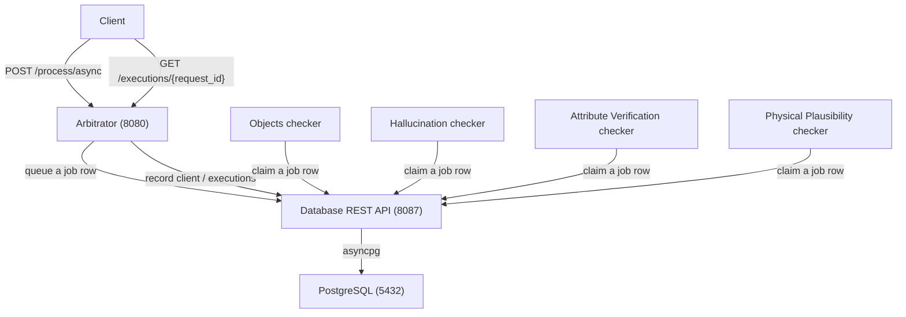

# Orchestration Layer

The individual checkers (Objects, Hallucination, Attribute Verification, Physical Plausibility) can each run standalone as REST
microservices. The **orchestration layer** ties them together so a single request can fan out to multiple checkers,
run them in dependency order, and have every result recorded durably. It has three components:

| Component | Role | Local port | Image (via `image_load`) |
|-----------|------|:----------:|--------------------------|
| **Arbitrator** (`services/arbitrator/`) | Coordinator. Accepts an evaluation request, discovers healthy checkers, builds a dependency-ordered work queue, publishes each job for the checker fleet to claim, aggregates results, and records everything via the Database REST API. | 8080 | `arbitrator:1.1.0` |
| **Database REST API** (`services/database/`) | Persistence gateway. The only component that talks to PostgreSQL. Exposes a small HTTP API for recording clients, executions, and per-checker executions, protected by API-key RBAC. | 8087 | `database:1.1.0` |
| **PostgreSQL container** (`database/`) | Storage. A generic, environment-driven Postgres image that applies the bundled `orchestration.sql` schema on every boot, so an existing data directory keeps up with it. See its dedicated [README](../../database/README.md). | 5432 | `database-postgres:1.2.0` |

The Database REST API (`//services/database:image_load`) and the PostgreSQL container (`//database:image_load`) are
distinct images loaded under distinct tags (`database:1.1.0` and `database-postgres:1.2.0` respectively).

## Architecture



The Arbitrator never touches PostgreSQL directly; all persistence goes through the Database REST API. Clients never
touch the checkers directly when using the orchestration layer; they talk only to the Arbitrator.

Checkers are never called at all: their jobs are written to `checker_executions` rows, and checker replicas claim
whatever is waiting for them whenever they have room. Nothing is held open for the duration of a job, so neither a
gateway recycling a connection nor a pod dying loses the work.

## Running the Local Stack

The whole stack is self-contained. From the repo root, after `source tools/env_setup.sh`:

```bash
dazel run //services:rest_apis
```

This launches the Arbitrator (8080), each checker service, and the Database REST API (8087) wired together. The
Arbitrator's local run target pre-populates `COSMOS_EVALUATOR_CHECKER_ENDPOINTS` (pointing at the local checker ports)
and `COSMOS_EVALUATOR_DATABASE_API_URL` (pointing at the local Database REST API) for you, so no manual configuration
is required for local development.

To run services individually:

```bash
dazel run //services/arbitrator:rest_api
dazel run //services/database:rest_api
```

## Arbitrator

### Endpoints

| Method | Path | Description |
|--------|------|-------------|
| `POST` | `/process/async` | Submit an evaluation request. Returns `202 Accepted` with `{ "request_id": <int> }` immediately; the work runs in the background. |
| `GET` | `/executions/{request_id}` | Poll the parent execution plus per-checker rows for a submitted request. Poll until `data.execution.is_terminal` is `true` (terminal statuses are `success` and `fail`). |
| `GET` | `/checkers` | Probe every configured checker's `/health` in parallel and return the healthy ones. |
| `GET` | `/dependency-graph` | Return the parsed dependency graph as `{ checker: { deps, priority } }` (priority is topological depth; `0` = no dependencies). |
| `GET` | `/config` | Fan out to every checker's `/config` and return the aggregated defaults. |
| `GET` | `/health` | Service status: `{ service, status, version, git_sha, environment }`. |
| `GET` | `/metrics` | Prometheus metrics (`arbitrator_requests_in_progress`, `arbitrator_requests_queued`, `arbitrator_checker_jobs{checker,state}`). |

The Arbitrator uses a **submit-and-poll** model rather than a blocking call: `POST /process/async` returns a
`request_id`, and the client polls `GET /executions/{request_id}` until the run is terminal. The final aggregated
results appear on the snapshot once the run completes.

### Request body

`POST /process/async` accepts:

| Field | Required | Description |
|-------|----------|-------------|
| `inputs.augmented_video_urls` | Yes | Object mapping camera stream id (e.g. `camera_front_wide_120fov`) to that camera's augmented video URL. At least one entry is required; this drives per-camera fan-out. |
| `inputs.rds_hq_url` | Conditional | URL to the RDS-HQ dataset archive. Required only when a checker that opens the dataset is in the resolved queue — `av.objects_single_view` in the base app; subclasses widen the set via `_rds_hq_required_by`. |
| `inputs.world_model_video_urls` | No | Per-camera world-model video URLs for two-stream Objects static (CWIP) checking. Optional: a camera without an entry runs the static check camera-only (no shared fallback). |
| `inputs.original_video_urls` | No | Per-camera reference video URLs for the Hallucination check. Cameras without an entry are skipped (no shared fallback). |
| `inputs.config` | No | Free-form configuration dictionary forwarded to the checkers. |
| `checks` | No | List of checker names to run. If empty, all healthy configured checkers are considered. |
| `output_storage_prefix` | No | Storage prefix forwarded to each checker; per-checker and per-camera suffixing is applied downstream. |

Example:

```bash
curl -X POST http://localhost:8080/process/async \
  -H "Content-Type: application/json" \
  -d '{
    "inputs": {
      "augmented_video_urls": {
        "camera_front_wide_120fov": "s3://<bucket>/path/to/augmented.mp4"
      },
      "rds_hq_url": "s3://<bucket>/path/to/rds_hq.zip"
    },
    "checks": ["av.objects_single_view"]
  }'
# -> { "success": true, "data": { "request_id": 42 }, "timestamp": "..." }

curl http://localhost:8080/executions/42
```

### Checker discovery — `COSMOS_EVALUATOR_CHECKER_ENDPOINTS`

The Arbitrator learns which checkers exist from the **required** `COSMOS_EVALUATOR_CHECKER_ENDPOINTS` environment
variable. It is a JSON object mapping each checker's base name to its base URL:

```json
{
  "av.objects_single_view": "http://localhost:8082",
  "metropolis.hallucination": "http://localhost:8085",
  "metropolis.attribute_verification": "http://localhost:8086",
  "metropolis.physical_plausibility": "http://localhost:8088"
}
```

At startup the Arbitrator validates this variable (it must be a non-empty JSON object of string values) and probes
each endpoint's `/health`. The `dazel run` local targets populate it automatically; you only need to set it for
custom or production deployments.

### Dependency graph and fan-out

The Arbitrator loads a dependency graph from the `deps:` entries in
[`checks/cosmos_evaluator.yaml`](../../checks/cosmos_evaluator.yaml). For each request it:

1. Starts from the set of requested (or all healthy) checkers and transitively pulls in any dependencies.
2. Computes a topological order so dependencies run before dependents.
3. **Fans out per-camera checkers** — `av.objects_single_view`, `metropolis.hallucination`,
   `metropolis.attribute_verification`, and `metropolis.physical_plausibility` become one job per entry in
   `augmented_video_urls`, named `<base>[<camera>]`.
4. Marks jobs whose required per-camera input is missing (world-model video for single-view static, original video for
   hallucination) as `SKIPPED` with a reason — the rest of the request still runs.

Jobs move through `PENDING → READY → QUEUED → IN_PROGRESS → COMPLETED`. `QUEUED` means the job's payload is on its row
waiting for a pod, and `IN_PROGRESS` means a poll has seen a pod holding it — the same two names `checker_executions.status`
uses, so a job's state reads the same whether you look at the metric or the row. A failure cascades `SKIPPED` to its
transitive dependents.

### Database recording

The Arbitrator records everything through the Database REST API (never directly to PostgreSQL):

- **Client** — an atomic UPSERT keyed off request headers (`X-Forwarded-For` / `X-Client-Name` / `X-Client-Description`).
- **Parent execution** (`arbitrator_executions`) — created as `queued`, advanced to `in_progress` on first checker
  acceptance, and finalized as `success` or `fail` with a `duration_ms`.
- **Checker executions** (`checker_executions`) — one row per non-skipped job, tracking
  `queued → in_progress → success/fail/timeout/skipped`. The row is also the job itself: it carries the payload, the
  claim, the lease and the result.

If `COSMOS_EVALUATOR_DATABASE_API_URL` is empty, recording is disabled and `POST /process/async` fails fast with
`503` (it cannot mint a `request_id`).

### Settings

| Environment variable | Default | Description |
|----------------------|---------|-------------|
| `COSMOS_EVALUATOR_CHECKER_ENDPOINTS` | — (required) | JSON object mapping checker base name to base URL. |
| `COSMOS_EVALUATOR_DATABASE_API_URL` | `""` | Base URL of the Database REST API. Empty disables recording. |
| `ARBITRATOR_DATABASE_API_KEY` | `""` | API key sent to the Database REST API (must match its `DATABASE_ADMIN_KEY`). |
| `ARBITRATOR_QUEUE_CAPACITY` | unbounded | Max combined queued + in-flight requests per replica. |
| `COSMOS_EVALUATOR_ENV` | `local` | `local` / `dev` / `staging` / `production`. Non-local envs enforce inbound `X-API-Key` auth. |
| `COSMOS_EVALUATOR_LOG_LEVEL` | `INFO` | Logging level. |
| `UVICORN_PORT` | `8080` (local) / `8000` (container) | Port the service listens on. |

## Database REST API

The Database REST API is the only component that connects to PostgreSQL. It exposes a small set of routes over the
`clients`, `arbitrator_executions`, and `checker_executions` tables.

### Endpoints

| Method | Path | Auth | Description |
|--------|------|------|-------------|
| `GET` | `/health` | read | Service health. |
| `GET` | `/arbitrator-executions/{request_id}` | read | Fetch a parent execution row. |
| `GET` | `/arbitrator-executions/{request_id}/checker-executions` | read | Fetch all checker-execution rows for a request. |
| `POST` | `/clients` | admin | Upsert a client record. |
| `POST` | `/arbitrator-executions` | admin | Create a parent execution row. |
| `PUT` | `/arbitrator-executions/{request_id}` | admin | Update a parent execution row (status, response, duration). |
| `POST` | `/checker-executions` | admin | Create a checker-execution row. |
| `PUT` | `/checker-executions/{execution_id}` | admin | Update a checker-execution row. |

### Authentication and RBAC

Authentication is a two-key model over the `X-API-Key` header:

| Key | Environment variable | Grants |
|-----|----------------------|--------|
| Read key | `DATABASE_READ_KEY` | Read endpoints and `/health`. |
| Admin key | `DATABASE_ADMIN_KEY` | All write endpoints (and, being a superset, reads). |

Both keys are **mandatory in staging and production** (validated at startup). In `local` mode, if no keys are
configured the endpoints are open for convenience. The Arbitrator authenticates with the admin key via its
`ARBITRATOR_DATABASE_API_KEY` setting.

### Settings

| Environment variable | Description |
|----------------------|-------------|
| `DATABASE_DB_CONFIG` | JSON connection blob: `{ "host", "port", "database", "user", "password", "connect_timeout"?, "echo"? }`. |
| `DATABASE_READ_KEY` | API key granting read access. |
| `DATABASE_ADMIN_KEY` | API key granting write access. |
| `COSMOS_EVALUATOR_ENV` | `local` / `dev` / `staging` / `production`. In `local`, connection settings are also read from [`database/config.yaml`](../../database/config.yaml) using `COSMOS_EVALUATOR_LOCAL_DB_USER` / `COSMOS_EVALUATOR_LOCAL_DB_PASSWORD`. |

The backend is PostgreSQL over `asyncpg`; there is no SQLite path in this tree.

## PostgreSQL Container

The storage layer is a generic, environment-driven PostgreSQL image. It is configured entirely through standard
`POSTGRES_USER` / `POSTGRES_PASSWORD` / `POSTGRES_DB` variables (plus optional `BACKUP_FILE`, `RESTORE_SCHEMA_ONLY`,
`FORCE_REINIT`, and `SCHEMA_DIR`), and applies the bundled `schemas/orchestration.sql` schema on every boot, so an
existing data directory keeps up with it. Only the optional `BACKUP_FILE` restore is confined to first initialization.

Build and run it with:

```bash
dazel run //database:image_load

docker run -d --name postgres \
  -p 5432:5432 \
  -e POSTGRES_USER=appuser \
  -e POSTGRES_PASSWORD=changeme \
  -e POSTGRES_DB=appdb \
  -v postgres-data:/var/lib/postgresql/data \
  database-postgres:1.2.0
```

For the full environment-variable contract, schema initialization, dump restore, and testing details, see the
[PostgreSQL container README](../../database/README.md).

## Testing

```bash
dazel test //services/arbitrator/tests:all
dazel test //services/database/tests:all
dazel test //database/tests:all
```
