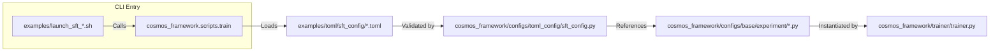
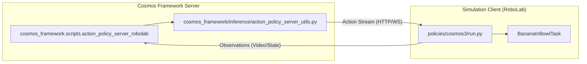

<!-- source: DeepWiki mcp.deepwiki.com · repo NVIDIA/cosmos-framework · page 1.1 Repository Layout and Code Structure · fetched 2026-10-26 -->

# Repository Layout and Code Structure

Relevant source files

The following files were used as context for generating this wiki page:

- [README.md](README.md)
- [docs/action_policy_droid_server.md](docs/action_policy_droid_server.md)
- [sitecustomize.py](sitecustomize.py)

This page provides a detailed walkthrough of the **Cosmos-Framework** repository. The project is designed around a single core Python package, `cosmos_framework`, which handles the end-to-end lifecycle of **Cosmos3** omnimodal world models—from data ingestion and distributed training to high-performance inference and serving [README.md:14-23]().

## Top-Level Directory Tree

The repository follows a modular structure where the core logic is isolated from examples, documentation, and ecosystem-specific shims.

| Directory | Purpose |
| :--- | :--- |
| `cosmos_framework/` | The primary Python package containing all core logic for training and inference [README.md:16-19](). |
| `packages/` | Standalone shim libraries that adapt Cosmos3 checkpoints for external ecosystems (Diffusers, Transformers, vLLM) [README.md:19-19](). |
| `examples/` | Reference SFT (Supervised Fine-Tuning) recipes and shell scripts for launching distributed jobs [README.md:62-68](). |
| `docs/` | Technical documentation covering setup, training, and inference [README.md:25-36](). |
| `docker/` | Dockerfiles and entrypoint scripts for containerized development and CI. |
| `tests/` | Unit and integration tests for verifying framework components. |
| `tools/` | Utility scripts for repository maintenance and development. |
| `inputs/` | Sample JSON/JSONL files used for testing inference modalities and prompt upsampling [README.md:78-84](). |

**Sources:** [README.md:14-84]()

---

## Core Package: `cosmos_framework/`

The `cosmos_framework/` directory is the heart of the repository. It is organized by functional concern, separating the model definitions from the training loops and the inference engine.

### Code Entity Mapping: Core Logic
The following diagram maps high-level framework responsibilities to specific code entities within the `cosmos_framework/` package.

**Diagram: System Responsibility to Code Entity Mapping**

```mermaid
graph TD
    subgraph "Training Infrastructure"
        TR["cosmos_framework.scripts.train"] --> T["cosmos_framework/trainer/"]
        T --> CB["cosmos_framework/callbacks/"]
        T --> CK["cosmos_framework/checkpoint/"]
    end

    subgraph "Model & Architecture"
        MOT["cosmos_framework/model/unified_mot.py"] --> ATTN["cosmos_framework/model/attention/"]
        MOT --> TOK["cosmos_framework/model/tokenizer/"]
    end

    subgraph "Data & Configuration"
        DS["cosmos_framework/data/"] --> CFG["cosmos_framework/configs/"]
        CFG --> SFT_PY["cosmos_framework/configs/toml_config/sft_config.py"]
    end

    subgraph "Inference Engine"
        INF["cosmos_framework.scripts.inference"] --> IE["cosmos_framework/inference/"]
        IE --> ARGS["cosmos_framework/inference/args.py"]
        IE --> RAY["cosmos_framework/inference/ray/"]
    end
```

**Sources:** [README.md:14-19](), [README.md:78-84]()

### Subpackage Walkthrough

*   **`configs/`**: Contains the two-layer configuration system. 
    *   `toml_config/sft_config.py`: Pydantic schemas for validating the high-level TOML recipes.
    *   `base/experiment/`: Low-level Hydra/LazyConfig SKUs for VFM (Video Functional Models) and VLM (Vision Language Models).
*   **`model/`**: Implementation of the Mixture-of-Transformers (MoT) architecture.
    *   `attention/`: Unified attention frontend supporting multiple backends (Flash2, Flash3, cuDNN) and Context Parallelism (CP).
    *   `tokenizer/`: Video and audio tokenizers (VAE/DC-AE) for compressing modalities into latent space.
*   **`data/`**: Dataset adapters for JSONL, WebDataset, and LeRobot formats, including sequence packing logic and action-specific datasets for robotics.
*   **`trainer/`**: The distributed training loop supporting FSDP, TP, and CP.
*   **`inference/`**: The inference engine, including modality-specific defaults in `defaults/` and Ray Serve integration in `ray/`.
*   **`scripts/`**: Command-line entry points. These are invoked via `python -m cosmos_framework.scripts.<name>`. Notable scripts include `train`, `inference`, and robotics-specific servers like `action_policy_server_robolab` [docs/action_policy_droid_server.md:66-67]().

---

## Ecosystem Packages (`packages/`)

To support the broader ML ecosystem without bloating the core framework, standalone "shim" libraries are provided. These allow Cosmos3 models to be used within popular third-party libraries.

| Package | Target Ecosystem | Description |
| :--- | :--- | :--- |
| `diffusers-cosmos3` | HuggingFace Diffusers | Wraps Cosmos3 generators for standard diffusion pipelines [README.md:19-19](). |
| `transformers-cosmos3` | HuggingFace Transformers | Adapts Cosmos3 Reasoner (VLM) models for the Transformers library [README.md:19-19](). |
| `vllm-cosmos3` | vLLM | Backend shim for high-throughput serving of the Reasoner model [README.md:19-19](). |

**Sources:** [README.md:14-19]()

---

## Configuration and Recipe Flow

The repository uses a "Recipe" pattern for training. A user selects a TOML file from `examples/toml/sft_config/` and launches it using a corresponding shell script [README.md:62-68]().

### Code Entity Mapping: Configuration Flow
This diagram illustrates how a user-facing recipe TOML is transformed into an active training state.

**Diagram: Configuration Resolution Flow**

**Sources:** [README.md:62-68]()

---

## Robotics and Action Policy Structure

The framework includes specialized components for robotics, specifically the Cosmos3-Nano-Policy-DROID model. This involves a server-client architecture where the server streams actions to robotic environments [docs/action_policy_droid_server.md:1-3]().

### Action Server Architecture
The action policy system is split between the framework (server) and external simulation environments (client).

**Diagram: Action Policy Data Flow**

**Sources:** [docs/action_policy_droid_server.md:1-105]()

---

## Runtime Customization (`sitecustomize.py`)

The repository includes a `sitecustomize.py` file which is automatically imported by every Python process started with `PYTHONPATH=.` [sitecustomize.py:6-6](). It provides two key infrastructure features:

1.  **Shared Memory Management**: If `COSMOS_DL_FILE_SYSTEM_SHARING=1` is set, it switches the PyTorch `DataLoader` IPC strategy to `file_system` to prevent `/dev/shm` overflows during large video batch training [sitecustomize.py:24-28]().
2.  **Load Tracing**: If `LOAD_TRACE_DIR` is set, it inventories all files touched during a process execution to help identify dead code [sitecustomize.py:32-59]().

**Sources:** [sitecustomize.py:1-60]()

---

