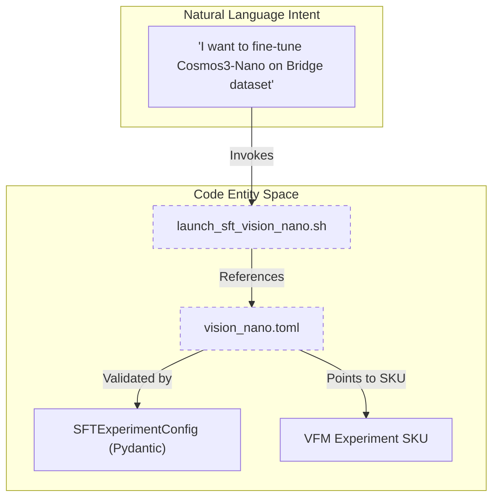
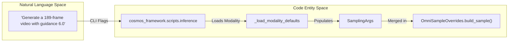

<!-- source: DeepWiki mcp.deepwiki.com · repo NVIDIA/cosmos-framework · page 10 Glossary · fetched 2026-10-26 -->

# Glossary

Relevant source files

The following files were used as context for generating this wiki page:

- [README.md](README.md)
- [cosmos_framework/data/vfm/action/datasets/droid_lerobot_dataset.py](cosmos_framework/data/vfm/action/datasets/droid_lerobot_dataset.py)
- [cosmos_framework/data/vfm/action/domain_utils.py](cosmos_framework/data/vfm/action/domain_utils.py)
- [cosmos_framework/inference/args.py](cosmos_framework/inference/args.py)
- [cosmos_framework/inference/inference.py](cosmos_framework/inference/inference.py)
- [cosmos_framework/inference/transfer.py](cosmos_framework/inference/transfer.py)
- [cosmos_framework/model/vfm/mot/unified_mot.py](cosmos_framework/model/vfm/mot/unified_mot.py)
- [cosmos_framework/model/vfm/omni_mot_model.py](cosmos_framework/model/vfm/omni_mot_model.py)
- [cosmos_framework/model/vfm/vlm/qwen3_vl/qwen3_vl.py](cosmos_framework/model/vfm/vlm/qwen3_vl/qwen3_vl.py)
- [docs/action_policy_droid_server.md](docs/action_policy_droid_server.md)

This glossary defines technical terms, abbreviations, and domain-specific concepts used throughout the Cosmos-Framework codebase. It serves as a reference for engineers to understand the mapping between high-level machine learning concepts and their specific implementations in the repository.

## Core Concepts & Terms

### Mixture-of-Transformers (MoT)
The unified architecture used by Cosmos3 models, which integrates components for both Video Foundation Models (VFM) and Video Language Models (VLM). It supports multiple backbones including Qwen3-VL Dense, Qwen3-VL MoE, and Nemotron 3 Dense VL.
*   **Implementation**: Defined in `OmniMoTModel` which manages the structural composition of the transformer blocks and orchestrates text, vision, and action tokenizers.
*   **Code Pointer**: [cosmos_framework/model/vfm/omni_mot_model.py:64-92](), [cosmos_framework/model/vfm/mot/unified_mot.py:85-137]()

### Distributed Checkpoint (DCP)
The primary storage format for model weights during training. Unlike monolithic safetensors, DCP shards the model state across multiple files to allow for efficient distributed loading and saving across different GPU topologies.
*   **Implementation**: Handled by the `checkpoint` subpackage using PyTorch Distributed Checkpoint APIs.
*   **Code Pointer**: [cosmos_framework/checkpoint/dcp.py:1-100]()

### Rectified Flow
The generative framework used for Cosmos3 video and image generation. It learns a straight-line trajectory (flow) between noise and data, often resulting in faster and more stable sampling compared to standard diffusion.
*   **Implementation**: `RectifiedFlow` class handles the calculation of flow matching loss during training.
*   **Code Pointer**: [cosmos_framework/model/vfm/algorithm/loss/flow_matching.py:26-30](), [cosmos_framework/model/vfm/omni_mot_model.py:38-38]()

### Sequence Packing
A technique to improve training efficiency by concatenating multiple variable-length sequences (text, video latents, actions) into a single fixed-length buffer, minimizing padding.
*   **Implementation**: Managed by `pack_input_sequence` and `SequencePlan`.
*   **Code Pointer**: [cosmos_framework/data/vfm/sequence_packing.py:30-36](), [cosmos_framework/model/vfm/omni_mot_model.py:30-36]()

### Modality Modes
Pre-defined configurations for different inference tasks (e.g., `text2video`, `image2video`, `policy`). Each mode has a corresponding JSON file defining default sampling parameters.
*   **Data Flow**: `cosmos_framework/inference/defaults/<mode>/sample_args.json` -> `_load_modality_defaults()` -> `SamplingArgs`.
*   **Code Pointer**: [cosmos_framework/inference/args.py:66-77](), [cosmos_framework/inference/args.py:157-184]()

---

## Technical Mapping Diagrams

### From Concept to Configuration
The following diagram illustrates how natural language training requirements are translated into specific code entities and configuration files.

**Config Resolution Logic**

**Sources**: [README.md:61-70](), [cosmos_framework/model/vfm/omni_mot_model.py:20-21]()

### Inference Data Flow
This diagram bridges the user's generation request to the internal argument resolution classes.

**Inference Argument Dispatch**

**Sources**: [cosmos_framework/inference/args.py:66-110](), [cosmos_framework/inference/inference.py:22-36]()

---

## Alphabetical Glossary

| Term | Definition | Code Pointer |
| :--- | :--- | :--- |
| **A2V** | Audio-to-Video: Specifically the `AUDIO_IMAGE2VIDEO` modality which conditions video generation on an input audio clip. | [cosmos_framework/inference/args.py:163-163]() |
| **ActionSpec** | Defines the layout of robotic actions (e.g., positions, rotations, gripper state). | [cosmos_framework/data/vfm/action/action_spec.py:20-20]() |
| **backward_framewise** | A pose convention used in robotic datasets where delta poses are calculated relative to the previous frame. | [cosmos_framework/data/vfm/action/datasets/droid_lerobot.py:27-27]() |
| **CFGP** | Classifier-Free Guidance Parallelism: A technique to parallelize the conditional and unconditional passes of CFG. | [cosmos_framework/inference/inference.py:158-164]() |
| **CP** | Context Parallelism: Shards the temporal dimension of video sequences across GPUs. | [cosmos_framework/model/vfm/omni_mot_model.py:42-42]() |
| **DCP** | Distributed Checkpoint: Sharded checkpoint format for distributed training. | [cosmos_framework/checkpoint/dcp.py:1-100]() |
| **DomainID** | A unique integer identifier for different robot embodiments (e.g., DROID=8, AgiBot=15). | [cosmos_framework/data/vfm/action/domain_utils.py:6-24]() |
| **DROID** | A large-scale robotic manipulation dataset used for policy training. | [cosmos_framework/data/vfm/action/datasets/droid_lerobot.py:58-67]() |
| **ee_pose** | End-Effector Pose: A 10D action space representation `[pos(3), rot6d(6), gripper(1)]`. | [cosmos_framework/data/vfm/action/datasets/droid_lerobot.py:62-63]() |
| **EMA** | Exponential Moving Average: Used to maintain a smoothed version of model weights for better inference stability. | [cosmos_framework/model/vfm/omni_mot_model.py:59-59]() |
| **FSDP** | Fully Sharded Data Parallel: Shards model parameters, gradients, and optimizer states across GPUs. | [cosmos_framework/model/vfm/omni_mot_model.py:84-85]() |
| **joint_pos** | Joint Position: An 8D action space representation `[7 arm joints, 1 gripper]`. | [cosmos_framework/data/vfm/action/datasets/droid_lerobot.py:64-67]() |
| **LeRobot** | A framework and dataset format for deep learning in robotics, used for Cosmos action datasets. | [cosmos_framework/data/vfm/action/datasets/droid_lerobot.py:58-60]() |
| **MRoPE** | Multimodal Rotary Positional Embedding: A RoPE variant that handles 3D (temporal + spatial) positions for video. | [cosmos_framework/model/vfm/vlm/qwen3_vl/qwen3_vl.py:98-116]() |
| **SFT** | Supervised Fine-Tuning: The training process used to adapt base models to specific tasks or datasets. | [README.md:29-30]() |
| **TP** | Tensor Parallelism: Shards individual weight tensors across multiple GPUs. | [cosmos_framework/model/vfm/omni_mot_model.py:84-85]() |
| **VFM** | Video Foundation Model: The generative component of the Cosmos3 family. | [README.md:18-19]() |
| **VLM** | Video Language Model: The reasoning/understanding component (e.g., Qwen3-VL). | [cosmos_framework/model/vfm/omni_mot_model.py:117-142]() |

**Sources**: [cosmos_framework/inference/args.py](), [cosmos_framework/model/vfm/omni_mot_model.py](), [cosmos_framework/data/vfm/action/domain_utils.py](), [cosmos_framework/data/vfm/action/datasets/droid_lerobot.py](), [README.md]()