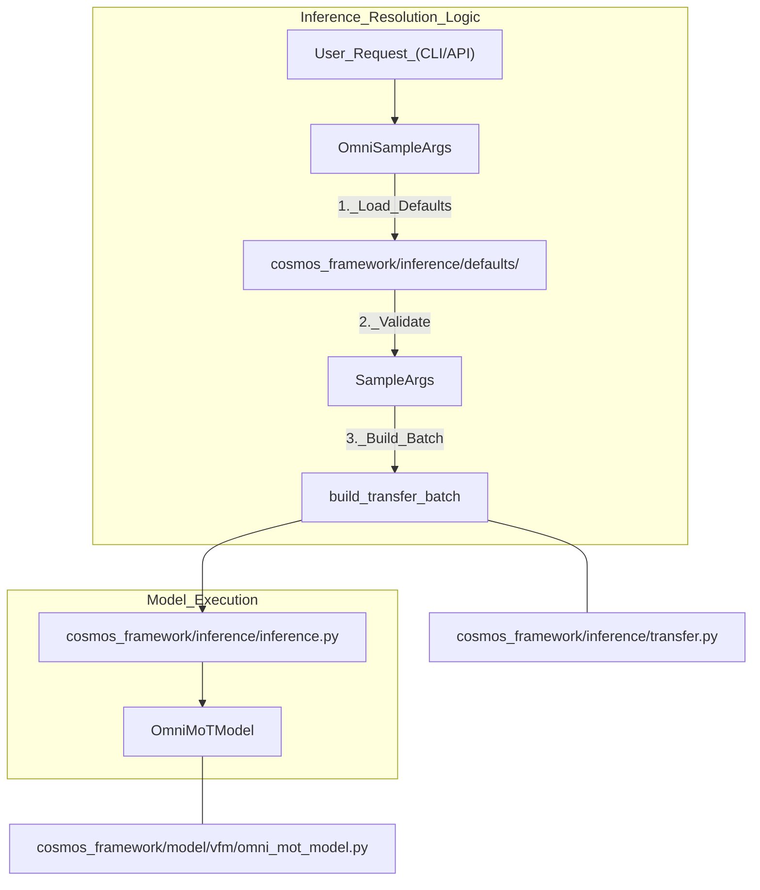

<!-- source: DeepWiki mcp.deepwiki.com · repo NVIDIA/cosmos-framework · page 2 Core Architecture · fetched 2026-10-26 -->

# Core Architecture

<details>
<summary>Relevant source files</summary>

The following files were used as context for generating this wiki page:

- [cosmos_framework/inference/inference.py](cosmos_framework/inference/inference.py)
- [cosmos_framework/inference/transfer.py](cosmos_framework/inference/transfer.py)
- [cosmos_framework/model/vfm/mot/unified_mot.py](cosmos_framework/model/vfm/mot/unified_mot.py)
- [cosmos_framework/model/vfm/omni_mot_model.py](cosmos_framework/model/vfm/omni_mot_model.py)
- [cosmos_framework/model/vfm/vlm/qwen3_vl/qwen3_vl.py](cosmos_framework/model/vfm/vlm/qwen3_vl/qwen3_vl.py)

</details>


The `cosmos_framework` is a unified Python package designed to support the training and inference of the Cosmos3 model family. It integrates Mixture-of-Transformers (MoT) architectures, a multi-modal data pipeline, and a scalable training infrastructure supporting FSDP, Tensor Parallelism, and Context Parallelism.

### Package Structure Overview

The codebase is organized into functional subpackages that separate configuration, model logic, data handling, and execution orchestration.

| Subpackage | Responsibility |
| :--- | :--- |
| `cosmos_framework/configs/` | Two-layer config system: Pydantic TOML validation and LazyConfig SKUs. |
| `cosmos_framework/model/` | Unified MoT architecture, VLM backbones, and VAE tokenizers. |
| `cosmos_framework/data/` | Multi-modal datasets, sequence packing, and data augmentors. |
| `cosmos_framework/trainer/` | Training loop orchestration and distributed strategy management. |
| `cosmos_framework/inference/` | Inference engine, sampling logic, and Ray/Gradio serving. |
| `cosmos_framework/scripts/` | Entry-point scripts for training, inference, and model conversion. |

**Sources:**
- [cosmos_framework/model/vfm/omni_mot_model.py:64-91]()
- [cosmos_framework/inference/inference.py:22-48]()

### System Data Flow: Configuration to Execution

The framework follows a structured flow where high-level user requirements (TOML) are validated and merged with low-level model SKUs (LazyConfig) before being instantiated by the trainer or inference engine.

#### Configuration and Initialization Flow
The following diagram illustrates how the `cosmos_framework.scripts.train` entry point processes configurations to initialize the system.

```mermaid
graph TD
    subgraph "Configuration_Space"
        A["examples/toml/sft_config/*.toml"] -- "Validated_by" --> B["SFTExperimentConfig"]
        B -- "References_SKU" --> C["cosmos_framework/configs/base/experiment/"]
        C -- "LazyConfig" --> D["instantiate()"]
    end

    subgraph "Execution_Space"
        D --> E["cosmos_framework/trainer/trainer.py"]
        E --> F["OmniMoTModel"]
        E --> G["JointDataLoader"]
    end

    [cosmos_framework/scripts/train.py] --> A
    F["OmniMoTModel"] --- F1["cosmos_framework/model/vfm/omni_mot_model.py"]
```

**Sources:**
- [cosmos_framework/model/vfm/omni_mot_model.py:20-21]()
- [cosmos_framework/model/vfm/omni_mot_model.py:64-70]()

---

### Major Subsystems

#### 1. Configuration System
The framework utilizes a dual-layer configuration approach. The top layer uses Pydantic-validated TOML files for user-facing experiment settings (e.g., learning rates, batch sizes). The bottom layer uses a `LazyConfig` system to define complex model architectures and experiment SKUs.
*   For details, see [Configuration System](#2.1).

#### 2. Model Architecture
At the core of Cosmos3 is the Mixture-of-Transformers (MoT) architecture. This subpackage manages the unified network definitions for both Video Foundation Models (VFM) and Vision-Language Models (VLM/Reasoner), including specialized backbones like `Qwen3VL` and `Nemotron3DenseVL`. It uses `OmniMoTModel` as the primary entry point for flow-matching objectives.
*   For details, see [Model Architecture](#2.2).

#### 3. Data Pipeline
The data pipeline handles diverse modalities including text, images, and video. It supports advanced features like `SequencePacking` to maximize GPU utilization and interfaces with multiple storage formats (JSONL, WebDataset, LeRobot).
*   For details, see [Data Pipeline](#2.3).

#### 4. Training Infrastructure
The training subsystem orchestrates distributed execution across large clusters. It includes the `Trainer` class, a robust `Callback` system for telemetry (WandB, MFU monitoring), and a checkpointing module that supports Distributed Checkpoint (DCP).
*   For details, see [Training Infrastructure](#2.4).

#### 5. Inference and Serving
The inference subsystem provides a high-performance sampling engine. It includes a resolution-aware parameter resolution chain and supports online serving via Ray Serve and Gradio. It uses `OmniSampleArgs` to define sampling behavior and `OmniMoTModel` for generation.
*   For details, see [Inference](#4).

---

### Code Entity Mapping: Inference Resolution

This diagram bridges the natural language "Inference Request" to the specific code entities in `cosmos_framework/inference/` that resolve parameters and execute the model.



**Sources:**
- [cosmos_framework/inference/inference.py:22-39]()
- [cosmos_framework/inference/transfer.py:142-156]()
- [cosmos_framework/model/vfm/omni_mot_model.py:64-68]()

### Shared Infrastructure
The `cosmos_framework/utils/` directory contains essential primitives used across all subsystems:
*   **Feature Flags**: Managed in `flags.py` to toggle experimental features like `TRAINING` or `DEVICE` settings.
*   **Distributed Helpers**: Utilities for managing process groups, `ParallelDims`, and collective operations.
*   **Easy IO**: Unified file backend for local and cloud storage.
*   **Lazy Config**: Registry and instantiation logic for `LazyDict`.
*   For details, see [Utilities and Shared Infrastructure](#2.5).

**Sources:**
- [cosmos_framework/utils/flags.py:19]()
- [cosmos_framework/utils/lazy_config.py:20-21]()
- [cosmos_framework/model/vfm/omni_mot_model.py:59-61]()

---

