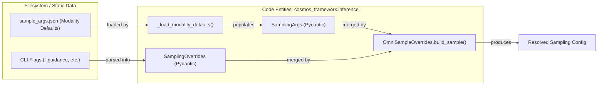

<!-- source: DeepWiki mcp.deepwiki.com · repo NVIDIA/cosmos-framework · page 2.1 Configuration System · fetched 2026-10-26 -->

# Configuration System

<details>
<summary>Relevant source files</summary>

The following files were used as context for generating this wiki page:

- [.github/workflows/pre-commit.yml](.github/workflows/pre-commit.yml)
- [cosmos_framework/configs/base/config.py](cosmos_framework/configs/base/config.py)
- [cosmos_framework/configs/base/experiment/sft/vision_sft_nano.py](cosmos_framework/configs/base/experiment/sft/vision_sft_nano.py)
- [cosmos_framework/configs/toml_config/sft_config.py](cosmos_framework/configs/toml_config/sft_config.py)
- [cosmos_framework/configs/toml_config/toml_config_helper.py](cosmos_framework/configs/toml_config/toml_config_helper.py)
- [cosmos_framework/utils/config.py](cosmos_framework/utils/config.py)
- [tests/launch_regression_test.py](tests/launch_regression_test.py)

</details>


Cosmos-Framework utilizes a two-layer configuration architecture designed to balance strict type safety with the flexibility required for complex deep learning experiments. The system separates the high-level experiment definition (TOML-based) from the low-level model and training primitives (LazyConfig-based).

## Two-Layer Architecture Overview

The configuration system is split into two distinct layers that interact during the initialization of a training or inference job:

1.  **The SFT Recipe Layer (Pydantic/TOML):** This layer is user-facing. It uses TOML files to define experiment metadata, dataset paths, optimizer hyper-parameters, and parallelism strategies. These are validated against Pydantic schemas defined in `cosmos_framework/configs/toml_config/sft_config.py` [cosmos_framework/configs/toml_config/sft_config.py:4-17]().
2.  **The Experiment SKU Layer (LazyConfig):** This layer defines the structural "blueprint" of the model and training loop. It uses a "LazyConfig" approach where Python objects are represented as `LazyDict` or `LazyCall` objects that can be instantiated into real objects. These SKUs are located in `cosmos_framework/configs/base/experiment/` [cosmos_framework/configs/base/experiment/sft/vision_sft_nano.py:56-61]().

### Configuration Data Flow

The following diagram illustrates how a user-provided TOML recipe is transformed into a running experiment by bridging the Natural Language/File space to the Code Entity space.

**Configuration Resolution Flow**
```mermaid
graph TD
    subgraph "Natural Language / File Space"
        TOML["SFT Recipe (.toml)"]
        LaunchScript["launch_sft_*.sh"]
    end

    subgraph "Code Entity Space: Validation & Translation"
        SFTExp["SFTExperimentConfig (Pydantic)"]
        JobCfg["JobConfig (Pydantic)"]
        BHO["build_hydra_overrides()"]
        PR["PATH_REMAPS"]
    end

    subgraph "Code Entity Space: Instantiation"
        LazyDict["LazyDict (Experiment SKU)"]
        MakeCfg["make_config()"]
        Instantiate["instantiate()"]
    end

    TOML --> SFTExp
    LaunchScript -- "CLI Overrides" --> BHO
    SFTExp --> JobCfg
    JobCfg -- "experiment name" --> LazyDict
    BHO -- "Uses" --> PR
    PR -- "Generates Dotted Keys" --> LazyDict
    LazyDict -- "Registered in" --> MakeCfg
    MakeCfg -- "Hydra Compose" --> Instantiate
    Instantiate --> "Trainer / Model / Dataloader"
```
**Sources:** [cosmos_framework/configs/toml_config/sft_config.py:19-22](), [cosmos_framework/configs/toml_config/toml_config_helper.py:115-123](), [cosmos_framework/configs/base/config.py:48-55]().

---

## 1. Pydantic-Validated TOML Schema

The Supervised Fine-Tuning (SFT) recipes are the primary entry point for users. These recipes are validated using Pydantic to ensure that all required parameters are present and of the correct type before GPU resources are allocated.

### Key Classes in `sft_config.py`

*   **`SFTExperimentConfig`**: The root configuration object that encapsulates `JobConfig`, `TrainPolicyConfig`, `ModelConfig`, and other sub-sections [cosmos_framework/configs/toml_config/sft_config.py:28-30]().
*   **`JobConfig`**: Handles experiment metadata such as `project`, `group`, and `name`. It also includes the `task` field which selects the base configuration tree (`vfm` vs `vlm`) [cosmos_framework/configs/toml_config/sft_config.py:32-45]().
*   **`ParallelismConfig`**: Configures FSDP, context-parallel (CP), and classifier-free-guidance (CFG) degrees [cosmos_framework/configs/toml_config/sft_config.py:125-130]().
*   **`EMAConfig`**: Configures the Exponential Moving Average tracking for generation-pathway weights [cosmos_framework/configs/toml_config/sft_config.py:89-98]().

### Mapping Tasks to SKUs
The system uses `TASK_TO_BASE_CONFIG` in `toml_config_helper.py` to map the `job.task` field to the appropriate base Hydra configuration file [cosmos_framework/configs/toml_config/toml_config_helper.py:23-26]().

**Sources:** [cosmos_framework/configs/toml_config/sft_config.py:32-130](), [cosmos_framework/configs/toml_config/toml_config_helper.py:23-26]().

---

## 2. LazyConfig Experiment SKUs

While TOML handles "values," the LazyConfig system handles "structure." These Python files define how components like the optimizer, scheduler, and model architecture are wired together using `LazyDict` and `LazyCall` (aliased as `L`).

### VFM vs. VLM Trees
The framework maintains two distinct configuration trees based on the model modality:
*   **VFM (Video Foundation Model):** Uses `cosmos_framework/configs/base/config.py` as the entry point. Experiments like `vision_sft_nano` are registered here [cosmos_framework/configs/base/config.py:24-45]().
*   **VLM (Vision-Language Model):** Uses `cosmos_framework/configs/base/vlm/config.py` as the entry point. This tree is tailored for autoregressive models like Qwen3-VL.

### PATH_REMAPS
Because the TOML schema is flat and user-friendly, but the underlying `LazyDict` structure is deeply nested, the system uses `PATH_REMAPS` to route TOML keys to their correct destination in the Hydra tree [cosmos_framework/configs/toml_config/toml_config_helper.py:45-90]().

| TOML Path | Task | Hydra Destination Path |
| :--- | :--- | :--- |
| `model.parallelism` | vfm | `model.config.parallelism` |
| `dataloader_train.max_caption_tokens` | vfm | `dataloader_train.dataloader.datasets.video.dataset.max_caption_tokens` |
| `model.backbone` | vlm | `model.config.policy.backbone` |

**Sources:** [cosmos_framework/configs/toml_config/toml_config_helper.py:45-90](), [cosmos_framework/configs/base/config.py:95-100]().

---

## 3. Inference Configuration & Resolution

Inference utilizes a specialized resolution chain to handle the variety of modalities (e.g., `text2video`, `image2video`) and sampling parameters.

### The Resolution Chain
When a user runs `cosmos_framework.scripts.inference`, the configuration is resolved through a series of defaults and overrides.

**Inference Config Entity Map**

**Sources:** [cosmos_framework/utils/config.py:109-132](), [tests/launch_regression_test.py:43-44]().

---

## 4. Hydra Override Syntax

The framework supports Hydra-style override syntax, allowing users to modify nested configuration keys without editing the physical files. The function `build_hydra_overrides` transforms the validated TOML dictionary into a list of CLI-compatible strings [cosmos_framework/configs/toml_config/toml_config_helper.py:115-123]().

### Example Transformation
A TOML entry like:
```toml
[model.parallelism]
data_parallel_shard_degree = 8
```
Is transformed into the Hydra override:
`model.config.parallelism.data_parallel_shard_degree=8`

This allows the `cosmos_framework.scripts.train` script to compose the final configuration using `Hydra` while maintaining the simplicity of TOML for the end-user [tests/launch_regression_test.py:9-11]().

**Sources:** [cosmos_framework/configs/toml_config/toml_config_helper.py:115-144](), [tests/launch_regression_test.py:9-11]().

---

