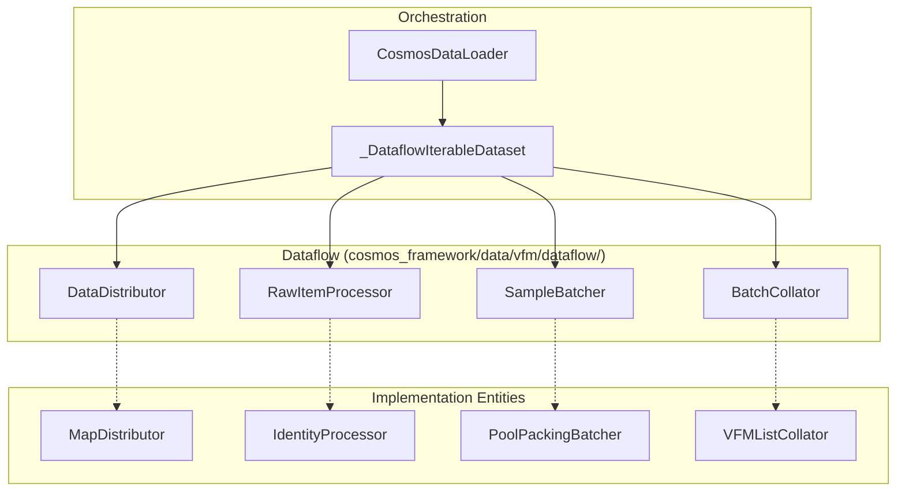
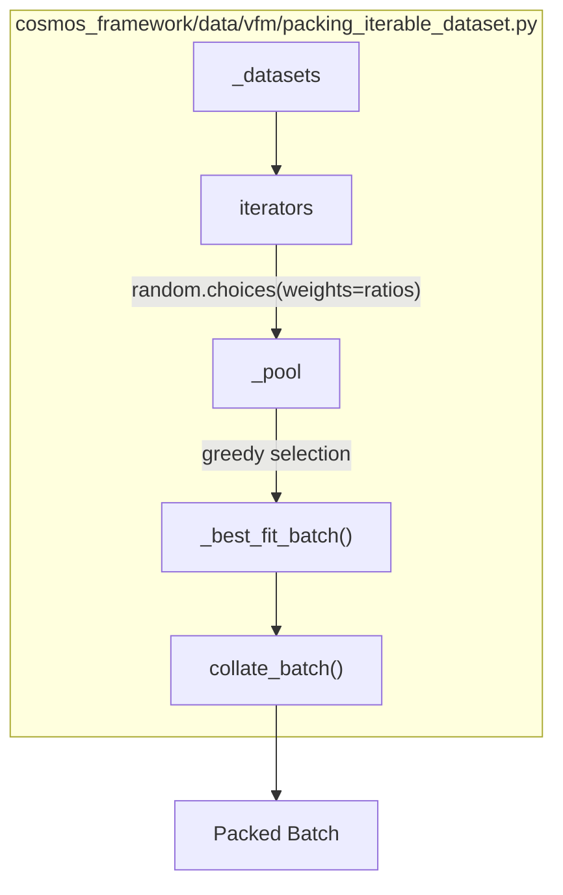

<!-- source: DeepWiki mcp.deepwiki.com · repo NVIDIA/cosmos-framework · page 2.3 Data Pipeline · fetched 2026-10-26 -->

# Data Pipeline

Relevant source files

The following files were used as context for generating this wiki page:

- [cosmos_framework/data/vfm/action/datasets/base_dataset.py](cosmos_framework/data/vfm/action/datasets/base_dataset.py)
- [cosmos_framework/data/vfm/dataflow/loader.py](cosmos_framework/data/vfm/dataflow/loader.py)
- [cosmos_framework/data/vfm/dataflow/processors.py](cosmos_framework/data/vfm/dataflow/processors.py)
- [cosmos_framework/data/vfm/packing_iterable_dataset.py](cosmos_framework/data/vfm/packing_iterable_dataset.py)
- [docs/custom_dataset.md](docs/custom_dataset.md)
- [docs/dataset_jsonl.md](docs/dataset_jsonl.md)

The Cosmos-Framework data pipeline is a modular system designed for high-throughput ingestion and processing for Video Foundation Models (VFM) and Video-Language Models (VLM). It leverages a flexible role-based architecture to handle diverse data formats including JSONL, WebDataset, and LeRobot adapters, while providing advanced features like sequence packing and multi-embodiment action normalization.

## CosmosDataLoader Architecture

The `CosmosDataLoader` is the primary orchestrator for training data. It is a `torch.utils.data.DataLoader` subclass that decomposes the data pipeline into four distinct, swappable roles [docs/custom_dataset.md:3-9](), [cosmos_framework/data/vfm/dataflow/loader.py:98-107]().

### The Four Roles
1.  **`DataDistributor`**: Owns the dataset and yields disjoint slices of raw items per Distributed Data Parallel (DDP) rank and worker [docs/custom_dataset.md:19-20]().
2.  **`RawItemProcessor`**: Transforms one raw item (e.g., a file path or dict) into a training-ready sample (e.g., decoding and tokenizing) [docs/custom_dataset.md:21-22]().
3.  **`SampleBatcher`**: Pulls from the sample stream and groups them into batches based on size or token-budget constraints [docs/custom_dataset.md:23-24]().
4.  **`BatchCollator`**: Aggregates a group of samples into a single batch dictionary for the model's `forward()` pass [docs/custom_dataset.md:25]().

**Dataflow Entity Relationship**

**Sources:** [docs/custom_dataset.md:7-25](), [cosmos_framework/data/vfm/dataflow/loader.py:26-97](), [cosmos_framework/data/vfm/dataflow/loader.py:108-154]()

---

## JSONL Dataset Format

The primary format for training manifests is JSONL (JSON Lines). Each line represents a training sample, keeping post-training examples aligned with inference prompt formats [docs/dataset_jsonl.md:56-69]().

### Schema Specification
A standard VFM entry contains:
*   **`vision_path`**: Path to the video file [docs/dataset_jsonl.md:79]().
*   **`t2w_windows`**: A list of temporal windows containing:
    *   `caption_json`: Canonical structured-JSON caption object [docs/dataset_jsonl.md:60-64]().
    *   `caption`: Dense narrative string used as a backup [docs/dataset_jsonl.md:65-66]().
    *   `start_frame`/`end_frame`: Temporal bounds for the clip [docs/dataset_jsonl.md:82-83]().

**Sources:** [docs/dataset_jsonl.md:1-102]()

---

## Sequence Packing and Joint Dataloading

To maximize GPU utilization, Cosmos-Framework implements token-budget bin-packing. This bundles multiple samples into a single sequence, minimizing padding overhead [cosmos_framework/data/vfm/packing_iterable_dataset.py:4-9]().

### Packing Strategies
*   **`PoolPackingBatcher`**: Maintains a pool of samples and greedily selects candidates that fit within a `max_tokens` budget [cosmos_framework/data/vfm/packing_iterable_dataset.py:41-45]().
*   **`SequentialPackingBatcher`**: An order-preserving batcher that packs samples until the budget is reached without reordering [docs/custom_dataset.md:112]().

### Joint Dataloading
The `PackingIterableDataset` supports mixing multiple datasets via `datasets_cfg`, which maps dataset names to their respective configurations and sampling ratios [cosmos_framework/data/vfm/packing_iterable_dataset.py:71-79]().

**Packing Logic Flow**

**Sources:** [cosmos_framework/data/vfm/packing_iterable_dataset.py:41-132](), [cosmos_framework/data/vfm/packing_iterable_dataset.py:156-180]()

---

## Action Dataset Subsystem

The action dataset subsystem is built on the LeRobot framework and handles multi-embodiment robotic data [cosmos_framework/data/vfm/action/datasets/base_dataset.py:4]().

### Action Normalization
Robotic actions (e.g., end-effector poses or joint positions) are normalized using dataset-specific statistics [cosmos_framework/data/vfm/action/datasets/base_dataset.py:189]().
*   **Methods**: Supports `quantile`, `meanstd`, and `minmax` normalization [cosmos_framework/data/vfm/action/datasets/base_dataset.py:43]().
*   **Stats**: Statistics are loaded from JSON files defined in each dataset class via `_stats_path()` [cosmos_framework/data/vfm/action/datasets/base_dataset.py:120-131]().

### Dataset Adapters
*   **`DROIDLeRobotDataset`**: Adapter for the DROID dataset.
*   **`AgiBotWorldBetaLeRobotDataset`**: Adapter for AgiBot data.
*   **`BridgeOrigLeRobotDataset`**: Adapter for the Bridge dataset.

These datasets implement the `ActionBaseDataset` abstract class, which enforces a `backward_framewise` pose convention for deltas [cosmos_framework/data/vfm/action/datasets/base_dataset.py:27-48]().

**Sources:** [cosmos_framework/data/vfm/action/datasets/base_dataset.py:1-205](), [cosmos_framework/data/vfm/action/action_normalization.py:1-50]()

---

## VLM Data Infrastructure

The VLM pipeline supports models like Qwen3-VL and Nemotron3DenseVL, providing specialized processors for each.

### Model-Specific Processors
*   **`Qwen3VLProcessor`**: Manages vision-language alignment and tokenization for the Qwen3-VL family.
*   **`Nemotron3DenseVLProcessor`**: Handles processing for dense-backbone models.

### Dataset Sources
*   **Local SFT Dataset**: Consumes the JSONL format for supervised fine-tuning.
*   **Videophy2**: Provides data sources for physical reasoning tasks.

**Sources:** [cosmos_framework/data/vfm/dataflow/processors.py:1-18](), [docs/dataset_jsonl.md:107-110]()

---

