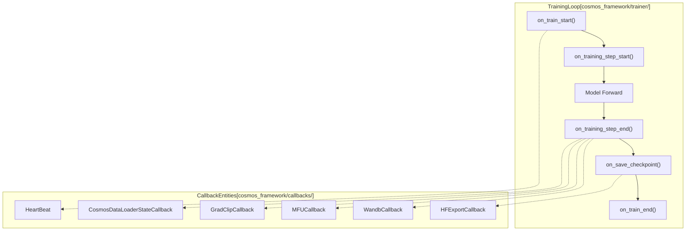
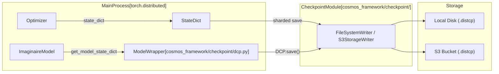

<!-- source: DeepWiki mcp.deepwiki.com · repo NVIDIA/cosmos-framework · page 2.4 Training Infrastructure · fetched 2026-10-26 -->

# Training Infrastructure

Relevant source files

The following files were used as context for generating this wiki page:

- [.github/workflows/pre-commit.yml](.github/workflows/pre-commit.yml)
- [cosmos_framework/callbacks/cosmos_dataloader_state.py](cosmos_framework/callbacks/cosmos_dataloader_state.py)
- [cosmos_framework/callbacks/dataloader_state.py](cosmos_framework/callbacks/dataloader_state.py)
- [cosmos_framework/checkpoint/dcp.py](cosmos_framework/checkpoint/dcp.py)
- [cosmos_framework/configs/base/vlm/experiment/dataflow_roles.py](cosmos_framework/configs/base/vlm/experiment/dataflow_roles.py)
- [cosmos_framework/configs/base/vlm/experiment/llava_ov_vlm.py](cosmos_framework/configs/base/vlm/experiment/llava_ov_vlm.py)
- [cosmos_framework/configs/base/vlm/experiment/videophy2_dataflow_roles.py](cosmos_framework/configs/base/vlm/experiment/videophy2_dataflow_roles.py)
- [cosmos_framework/configs/base/vlm/experiment/videophy2_sft_nano.py](cosmos_framework/configs/base/vlm/experiment/videophy2_sft_nano.py)
- [cosmos_framework/utils/config.py](cosmos_framework/utils/config.py)
- [tests/launch_regression_test.py](tests/launch_regression_test.py)

The training infrastructure in Cosmos-Framework is a modular system designed for large-scale distributed training of Video Foundation Models (VFM) and Video-Language Models (VLM). It is centered around a centralized `ImaginaireTrainer`, a flexible callback system for telemetry and stability, and a robust Distributed Checkpoint (DCP) implementation that supports local, SFT, and S3 storage.

## Trainer Core

The `ImaginaireTrainer` (found in `cosmos_framework/trainer/`) serves as the orchestrator for the training loop. It manages the lifecycle of the model, optimizer, scheduler, and data loaders. The trainer is designed to be modality-agnostic, handling the complexities of distributed data parallel (FSDP), model parallelism, and sequence packing.

### Key Responsibilities
- **Execution Loop**: Manages the forward pass, loss computation, backward pass, and optimizer steps.
- **Distributed Coordination**: Interfaces with `torch.distributed` to ensure all ranks are synchronized during critical phases like checkpointing and validation.
- **State Management**: Tracks the current iteration, epoch, and global training state.

Sources: [cosmos_framework/utils/config.py:186-210](), [cosmos_framework/checkpoint/dcp.py:70-71]()

## Callbacks System

The callback system allows for decoupled logic to be injected into the training loop at specific hooks (e.g., `on_train_start`, `on_training_step_end`, `on_save_checkpoint`). These are managed by a `CallBackGroup` defined in `cosmos_framework/utils/callback.py`.

### Logging and Monitoring
- **WandbCallback**: Handles logging of losses (global and per-dataset), learning rates, and stability metrics to Weights & Biases. It includes logic to handle `NaN` or `Inf` losses by reducing valid masks across ranks to avoid crashing the training run.
- **HeartBeat**: Logs a periodic message (and optionally an S3 YAML file) to indicate the process is alive, which is critical for long-running jobs on unreliable clusters.
- **MFUCallback**: Computes **Model FLOPs Utilization (MFU)** and **Object FLOPs Utilization (OFU)**. It uses an `OmniMoTModelDescriptor` to calculate theoretical peak TFLOPS for hardware like H100 or GB200 and compares it against measured wall-clock time.

### Stability and Optimization
- **GradClipCallback**: Implements gradient norm clipping. Because standard `clip_grad_norm_` only handles DP/FSDP/TP, this callback manually reduces gradient norms across Pipeline Parallel (PP) stages using `DTensor` reduction.
- **Fused NaN-to-Num**: Uses `@torch.compile` to fuse `nan_to_num` operations across all parameter gradients into a single CUDA kernel, preventing training crashes from transient instabilities.

### Training Lifecycle to Code Entity Mapping
The following diagram maps high-level training events to the specific callback entities and methods that handle them.

**Training Event Flow**

Sources: [cosmos_framework/callbacks/cosmos_dataloader_state.py:51-69](), [cosmos_framework/callbacks/dataloader_state.py:23-35](), [cosmos_framework/checkpoint/dcp.py:128-151]()

## Checkpointing System

Cosmos-Framework uses a multi-layered checkpointing architecture defined in `cosmos_framework/checkpoint/`. It defaults to **Distributed Checkpoint (DCP)** for efficiency in multi-GPU environments.

### AbstractCheckpointer
The base class `AbstractCheckpointer` [cosmos_framework/checkpoint/base.py:17-106]() provides a unified interface for saving and loading. It handles path resolution between local storage (`config_job.path_local`) and object stores like S3 (`config_job.path`).

### Distributed Checkpointer (DCP)
The `DistributedCheckpointer` implements sharded I/O. Instead of gathering the full model to Rank 0, each rank saves its own shard (`.distcp` files), significantly reducing memory pressure and I/O bottlenecks.

**DCP Directory Structure**
| Component | Path | Description |
| :--- | :--- | :--- |
| **Model** | `iter_N/model/` | Sharded model weights (`__0_0.distcp`, etc) |
| **Optimizer** | `iter_N/optim/` | Sharded optimizer states |
| **Dataloader** | `iter_N/dataloader/` | Per-rank pickled state for resumable data loading |
| **Metadata** | `latest_checkpoint.txt` | Text file pointing to the most recent iteration folder |

Sources: [cosmos_framework/checkpoint/dcp.py:9-40](), [cosmos_framework/checkpoint/base.py:38-40]()

### Checkpoint Data Flow
This diagram illustrates the flow of data from the live model into the sharded storage backend via the `ModelWrapper` adapter.

**Checkpoint Persistence Flow**

Sources: [cosmos_framework/checkpoint/dcp.py:77-95](), [cosmos_framework/checkpoint/dcp.py:172-185](), [cosmos_framework/checkpoint/s3_filesystem.py:1-20]()

## Dataloader State and Resume

A critical component of the infrastructure is ensuring bit-identical resumes, especially for complex streaming datasets or sequence packing.

### CosmosDataLoaderStateCallback
This callback [cosmos_framework/callbacks/cosmos_dataloader_state.py:51-69]() tracks the highest-seen `(epoch, index)` per worker from batch metadata. 
- **Persistence**: On `state_dict()`, it serializes per-worker positions into the DCP checkpoint under the `dataloader/` component [cosmos_framework/callbacks/cosmos_dataloader_state.py:127-132]().
- **Restoration**: On `load_state_dict()`, it writes these positions to environment variables like `COSMOS_DL_STATE_WORKER_{id}_EPOCH` [cosmos_framework/callbacks/cosmos_dataloader_state.py:144-147](). The `MapDistributor` in the data pipeline reads these variables to fast-forward the stream upon restart.

### Joint Loader Support
For experiments using `JointCosmosDataLoader`, the `JointCosmosDataLoaderStateCallback` [cosmos_framework/callbacks/cosmos_dataloader_state.py:150-168]() manages:
1. **Outer State**: The `global_id` cursor for the dataset-selection sequence.
2. **Inner State**: A collection of `CosmosDataLoaderStateCallback` instances, one for each sub-dataset [cosmos_framework/callbacks/cosmos_dataloader_state.py:173-176]().

### Async Checkpointing
The system supports an `AsyncMode.ASYNC_WITH_PINNED_MEM` [cosmos_framework/checkpoint/dcp.py:153-155]() which allows the trainer to continue the next iteration while a background process, spawned via `multiprocessing`, handles the heavy I/O of writing shards to the filesystem or S3 [cosmos_framework/checkpoint/dcp.py:172-185]().

Sources: [cosmos_framework/callbacks/cosmos_dataloader_state.py:5-30](), [cosmos_framework/callbacks/dataloader_state.py:24-34](), [cosmos_framework/checkpoint/dcp.py:153-185]()

---

