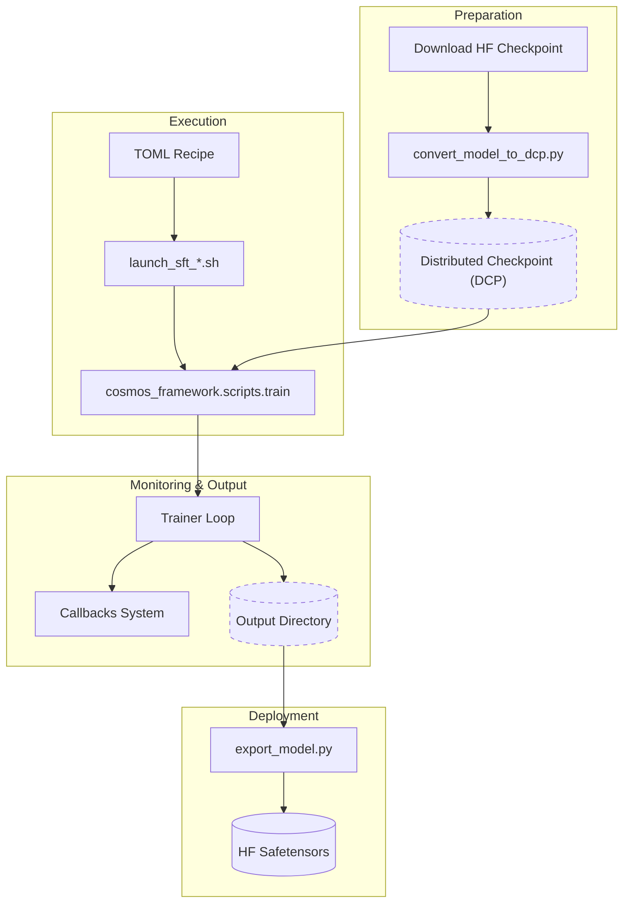

<!-- source: DeepWiki mcp.deepwiki.com · repo NVIDIA/cosmos-framework · page 3 Training (Supervised Fine-Tuning) · fetched 2026-10-26 -->

# Training (Supervised Fine-Tuning)

<details>
<summary>Relevant source files</summary>

The following files were used as context for generating this wiki page:

- [.github/workflows/pre-commit.yml](.github/workflows/pre-commit.yml)
- [cosmos_framework/utils/config.py](cosmos_framework/utils/config.py)
- [docs/training.md](docs/training.md)
- [tests/launch_regression_test.py](tests/launch_regression_test.py)

</details>


The Cosmos-Framework provides a robust Supervised Fine-Tuning (SFT) workflow designed for high-performance training of Video Foundation Models (VFM) and Vision-Language Models (VLM). The system uses a recipe-driven approach where training configurations are defined in TOML files and executed via specialized launch scripts that manage environment setup and distributed orchestration.

### SFT Workflow Overview

The fine-tuning process follows a structured lifecycle from environment preparation to final model export. The framework emphasizes a "checkpoint-centric" design where the `config.yaml` saved alongside model weights serves as the single source of truth for downstream inference.

#### Workflow Diagram: NL Space to Code Space
The following diagram maps the logical steps of the SFT process to the specific scripts and entities in the codebase.


**Sources:** [docs/training.md:113-128](), [tests/launch_regression_test.py:6-11]()

---

### SFT Recipes and Launch Scripts
Training is initiated using "recipes"—standardized TOML configurations located in `examples/toml/sft_config/`. These are paired with shell scripts (e.g., `launch_sft_vision_nano.sh`, `launch_sft_llava_ov.sh`) that handle `PYTHONPATH` setup, `MASTER_PORT` assignment, and the `TAIL_OVERRIDES` mechanism for dynamic parameter injection.

The framework supports two primary execution paths:
- **Option A (Recommended):** Using the provided launch shells which auto-resolve paths for datasets and VAEs.
- **Option B (Raw torchrun):** Direct invocation of `cosmos_framework.scripts.train` using `--sft-toml` for advanced users requiring manual control over environment variables.

For details, see [SFT Recipes and Launch Scripts](#3.1).

**Sources:** [docs/training.md:42-111](), [tests/launch_regression_test.py:95-100]()

---

### Distributed Parallelism
Cosmos-Framework utilizes a multi-dimensional parallelism strategy to handle large-scale video models and long sequences. This is configured via the `[model.parallelism]` block in the SFT TOML configuration.

Key primitives include:
- **Data Parallel Shard (FSDP):** Sharding model states across GPUs (controlled by `data_parallel_shard_degree`).
- **Context Parallel (CP):** Sharding the temporal/sequence dimension for long-form video training (controlled by `context_parallel_shard_degree`).
- **Data Parallel Replicate:** Standard DDP-style replication (controlled by `data_parallel_replicate_degree`).

The framework enforces that the product of these degrees must equal the total `WORLD_SIZE`.

For details, see [Distributed Parallelism for Training](#3.2).

**Sources:** [cosmos_framework/utils/config.py:28-28](), [tests/launch_regression_test.py:39-44]()

---

### Checkpoint Lifecycle
The framework uses PyTorch Distributed Checkpoint (DCP) as its native format for training to enable efficient sharded I/O and seamless resumption on different GPU topologies.

#### Checkpoint Data Flow
This diagram illustrates the transformation of model weights through the SFT lifecycle, involving specific scripts and configuration classes.

```mermaid
graph LR
    subgraph "Input"
        HF_IN["HF Safetensors"] -- "convert_model_to_dcp.py" --> DCP_BASE["Base DCP Shards"]
    end

    subgraph "Training"
        DCP_BASE -- "Load" --> TRAINER["cosmos_framework.scripts.train"]
        TRAINER -- "Save" --> ITER_N["iter_N/"]
        ITER_N -- "Update" --> LATEST["latest_checkpoint.txt"]
    end

    subgraph "Output"
        ITER_N -- "export_model.py" --> HF_OUT["Trained HF Safetensors"]
    end

    [cosmos_framework/utils/config.py] -. "HFExportConfig" .-> HF_OUT
    [cosmos_framework/utils/config.py] -. "JobConfig.path_local" .-> ITER_N
```

Training artifacts are organized under `$IMAGINAIRE_OUTPUT_ROOT/<project>/<group>/<name>/`. Each checkpoint directory includes the sharded weights and a `config.yaml` that captures the exact state of the model and training hyperparameters. The `HFExportConfig` class allows for automated conversion to HuggingFace format after DCP checkpoints are saved.

For details, see [Checkpoint Lifecycle: DCP and HuggingFace Export](#3.3).

**Sources:** [cosmos_framework/utils/config.py:171-182](), [cosmos_framework/utils/config.py:199-205](), [docs/training.md:143-155]()

---

