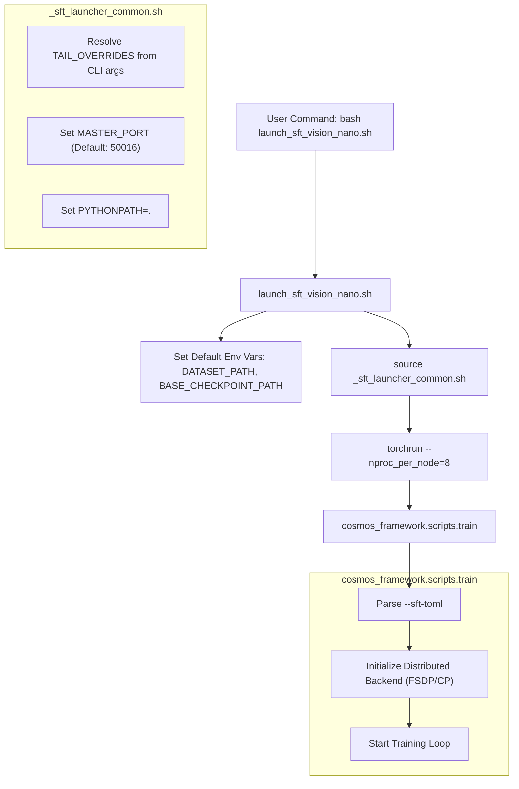
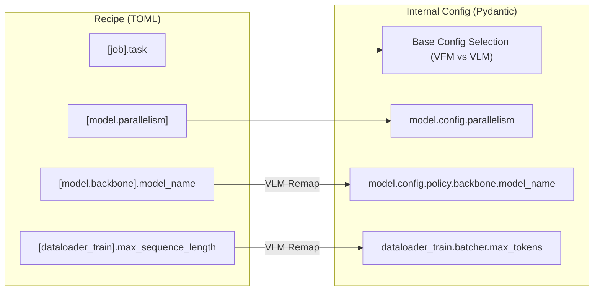

<!-- source: DeepWiki mcp.deepwiki.com · repo NVIDIA/cosmos-framework · page 3.1 SFT Recipes and Launch Scripts · fetched 2026-10-26 -->

# SFT Recipes and Launch Scripts

<details>
<summary>Relevant source files</summary>

The following files were used as context for generating this wiki page:

- [examples/launch_sft_llava_ov.sh](examples/launch_sft_llava_ov.sh)
- [examples/launch_sft_llava_ov_mapstyle_dataloader.sh](examples/launch_sft_llava_ov_mapstyle_dataloader.sh)
- [examples/launch_sft_videophy2_nano.sh](examples/launch_sft_videophy2_nano.sh)
- [examples/launch_sft_vision_nano.sh](examples/launch_sft_vision_nano.sh)
- [examples/launch_sft_vision_nano_cosmosdataloader.sh](examples/launch_sft_vision_nano_cosmosdataloader.sh)
- [examples/launch_sft_vision_super.sh](examples/launch_sft_vision_super.sh)
- [examples/toml/sft_config/llava_ov.toml](examples/toml/sft_config/llava_ov.toml)
- [examples/toml/sft_config/videophy2_sft_nano.toml](examples/toml/sft_config/videophy2_sft_nano.toml)
- [examples/toml/sft_config/vision_sft_nano.toml](examples/toml/sft_config/vision_sft_nano.toml)
- [examples/toml/sft_config/vision_sft_super.toml](examples/toml/sft_config/vision_sft_super.toml)

</details>


Supervised Fine-Tuning (SFT) in the Cosmos-Framework is driven by a recipe-based system. This system combines TOML configuration files, which define the model hyperparameters and data sources, with shell-based launch scripts that manage environment setup and distributed execution via `torchrun`.

## Overview of SFT Infrastructure

The framework provides two primary paths for executing SFT:
1.  **Option A (Launch Scripts):** Recommended for most users. Uses specialized `.sh` scripts that automatically resolve paths for datasets, checkpoints, and VAE weights while providing a mechanism for command-line overrides.
2.  **Option B (Raw torchrun):** Used for advanced integration or debugging. Requires manual export of environment variables and direct invocation of the `cosmos_framework.scripts.train` module.

### Core Components

| Component | Location | Purpose |
| :--- | :--- | :--- |
| **TOML Recipes** | `examples/toml/sft_config/` | Defines experiment SKUs, model architecture tweaks, and optimizer settings. |
| **Launch Shells** | `examples/launch_sft_*.sh` | Entry points for specific model variants (Nano, Super, VLM). |
| **Common Logic** | `examples/_sft_launcher_common.sh` | Shared shell logic for path resolution and `torchrun` orchestration. |
| **Training Script** | `cosmos_framework.scripts.train` | The main Python entry point that parses TOML and initializes the trainer. |

**Sources:**
- [examples/launch_sft_vision_nano.sh:7-19]()
- [examples/launch_sft_llava_ov.sh:5-8]()

---

## TOML Recipes and Configuration

Recipes are located in `examples/toml/sft_config/`. These files define the training state and are mapped to internal configuration classes via a path-remapping mechanism.

### Key Configuration Blocks
- **`[job]`**: Defines the task type (`vfm` or `vlm`), project name, and experiment group [examples/toml/sft_config/llava_ov.toml:31-37]().
- **`[model]`**: Specifies architecture parameters like `precision` and `joint_attn_implementation` [examples/toml/sft_config/vision_sft_nano.toml:16-19](). For VLMs, it includes the `[model.backbone]` block [examples/toml/sft_config/llava_ov.toml:44-45]().
- **`[model.parallelism]`**: Configures distributed strategies like `data_parallel_shard_degree` and `context_parallel_shard_degree` [examples/toml/sft_config/vision_sft_super.toml:30-34]().
- **`[dataloader_train]`**: Defines batch sizes and sequence lengths. For VLMs, these are routed to the `CosmosDataLoader`'s `PoolPackingBatcher` [examples/toml/sft_config/llava_ov.toml:103-109]().
- **`[optimizer]`**: Sets learning rates, weight decay, and `keys_to_select` for partial fine-tuning (e.g., training only LoRA or specific MoE components) [examples/toml/sft_config/vision_sft_nano.toml:43-54]().

### Available Recipes
- **`vision_sft_nano.toml`**: Full fine-tuning for Cosmos3-Nano (Qwen3-VL-8B) vision-only tasks [examples/toml/sft_config/vision_sft_nano.toml:4-14]().
- **`vision_sft_super.toml`**: LoRA-based fine-tuning for Cosmos3-Super (Qwen3-VL-32B) with CP=2 [examples/toml/sft_config/vision_sft_super.toml:4-22]().
- **`llava_ov.toml`**: VLM training on LLaVA-OneVision data using `CosmosDataLoader` [examples/toml/sft_config/llava_ov.toml:4-6]().
- **`videophy2_sft_nano.toml`**: VLM dialog SFT on VideoPhy-2 data [examples/toml/sft_config/videophy2_sft_nano.toml:4-5]().

**Sources:**
- [examples/toml/sft_config/vision_sft_nano.toml:1-92]()
- [examples/toml/sft_config/vision_sft_super.toml:1-93]()
- [examples/toml/sft_config/llava_ov.toml:1-109]()
- [examples/toml/sft_config/videophy2_sft_nano.toml:1-92]()

---

## Launch Scripts and Orchestration

The launch scripts automate the transition from "Natural Language" requirements to "Code Entity" execution.

### The Launcher Data Flow

The following diagram illustrates how a launch script (e.g., `launch_sft_vision_nano.sh`) interacts with the common launcher and the Python training script.

**SFT Launch Sequence**


### TAIL_OVERRIDES Mechanism
The launch scripts use a "tail override" pattern. Any arguments passed to the `.sh` script are appended to the `torchrun` call. This allows overriding TOML values from the CLI using Hydra-style syntax.

Example for resuming a run with overrides:
```bash
RESUME_FROM_CKPT=<path> RUN_NAME=<name> bash examples/launch_sft_llava_ov_mapstyle_dataloader.sh
```
In this case, `TAIL_OVERRIDES` includes `checkpoint.load_path` and `checkpoint.load_training_state=true` [examples/launch_sft_llava_ov_mapstyle_dataloader.sh:36-42]().

### Key Environment Variables
- **`MASTER_PORT`**: Used by `torchrun` for process synchronization. Defaults to `50016` in some VLM scripts [examples/launch_sft_llava_ov_mapstyle_dataloader.sh:26]().
- **`VIDEOPHYSICS_ROOT`**: Required for VideoPhy2 SFT [examples/launch_sft_videophy2_nano.sh:11-14]().
- **`VLM_SAFETENSORS_PATH`**: If set, overrides the backbone path to a local snapshot [examples/launch_sft_videophy2_nano.sh:38-40]().
- **`PYTORCH_ALLOC_CONF`**: Set to `expandable_segments:True` for the Super variant to prevent OOM [examples/launch_sft_vision_super.sh:31]().

**Sources:**
- [examples/launch_sft_vision_nano.sh:21-27]()
- [examples/launch_sft_vision_super.sh:30-33]()
- [examples/launch_sft_llava_ov_mapstyle_dataloader.sh:25-44]()

---

## Execution Paths: Option A vs. Option B

The framework supports two ways to start the `train.py` script.

### Option A: Paired Launch Shell (Recommended)
This method leverages the logic in `_sft_launcher_common.sh`. It automatically populates default paths for the Wan2.2 VAE and base checkpoints if they exist in the `examples/` directory [examples/launch_sft_vision_nano.sh:22-25]().

```bash
# Example invocation for Vision Nano
bash examples/launch_sft_vision_nano.sh
```

### Option B: Raw torchrun
For users who prefer manual control, `torchrun` can be invoked directly. This requires passing the TOML file and any necessary overrides manually.

```bash
# Example invocation for LLaVA-OV
torchrun --nproc_per_node=4 -m cosmos_framework.scripts.train \
    --sft-toml examples/toml/sft_config/llava_ov.toml -- \
    data_setting.max_tokens=16000
```

### Comparison of Execution Paths

| Feature | Option A (Shell) | Option B (Raw) |
| :--- | :--- | :--- |
| **Path Resolution** | Automatic (e.g., `WAN_VAE_PATH`) | Manual (via CLI or TOML) |
| **Env Setup** | Handled by `_sft_launcher_common.sh` | Manual |
| **VLM Handling** | Plumbs `VLM_SAFETENSORS_PATH` | Requires manual `model.config...` override |
| **Checkpoint Resume** | Env var `RESUME_FROM_CKPT` | Manual `checkpoint.load_path` |

**Sources:**
- [examples/toml/sft_config/llava_ov.toml:15-18]()
- [examples/launch_sft_videophy2_nano.sh:38-40]()
- [examples/launch_sft_llava_ov_mapstyle_dataloader.sh:19-22]()

---

## Training Artifacts and Configuration Mapping

The trainer produces a standardized output structure. The TOML keys are remapped to the internal Pydantic configuration schema during loading.

### Code Entity Mapping
The following diagram illustrates how TOML sections map to internal `cosmos_framework` configuration entities.

**Configuration Remapping Logic**


### VLM-Specific Remapping
For VLM tasks, the framework applies specific `_PATH_REMAPS` to bridge the simplified TOML structure to the complex `PolicyConfig` nested schema:
- `model.backbone.*` maps to `model.config.policy.backbone.*` [examples/toml/sft_config/llava_ov.toml:26]()
- `model.attn_implementation` maps to `model.config.policy.attn_implementation` [examples/toml/sft_config/llava_ov.toml:25]()
- `dataloader_train.max_sequence_length` maps to `dataloader_train.batcher.max_tokens` [examples/toml/sft_config/llava_ov.toml:106]()

**Sources:**
- [examples/toml/sft_config/llava_ov.toml:20-29]()
- [examples/toml/sft_config/videophy2_sft_nano.toml:87-91]()

---

