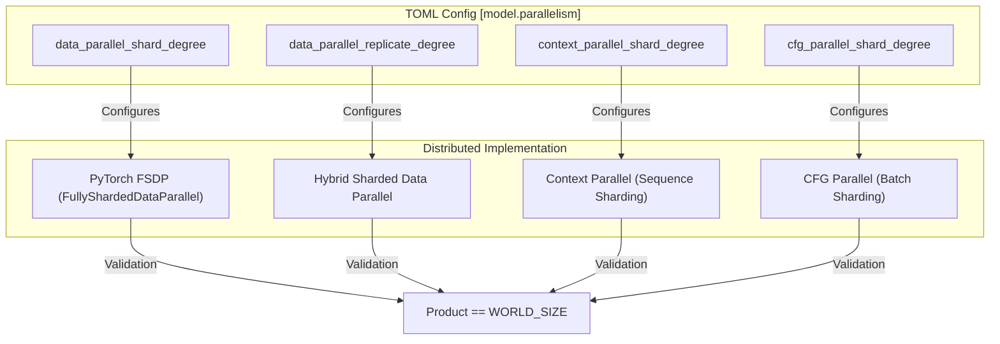
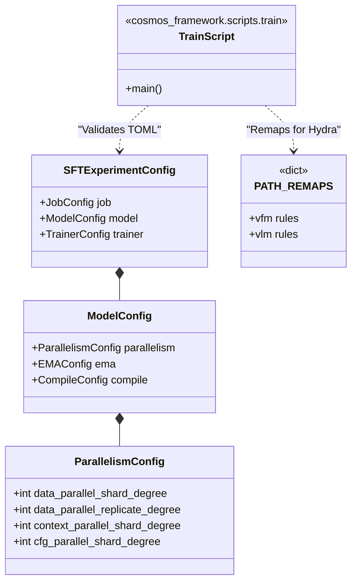

<!-- source: DeepWiki mcp.deepwiki.com · repo NVIDIA/cosmos-framework · page 3.2 Distributed Parallelism for Training · fetched 2026-10-26 -->

# Distributed Parallelism for Training

Relevant source files

The following files were used as context for generating this wiki page:

- [.github/workflows/pre-commit.yml](.github/workflows/pre-commit.yml)
- [cosmos_framework/configs/base/experiment/sft/vision_sft_nano.py](cosmos_framework/configs/base/experiment/sft/vision_sft_nano.py)
- [cosmos_framework/configs/toml_config/sft_config.py](cosmos_framework/configs/toml_config/sft_config.py)
- [cosmos_framework/configs/toml_config/toml_config_helper.py](cosmos_framework/configs/toml_config/toml_config_helper.py)
- [cosmos_framework/utils/config.py](cosmos_framework/utils/config.py)
- [tests/launch_regression_test.py](tests/launch_regression_test.py)

This page details the distributed parallelism architecture of the Cosmos-Framework, focusing on the `[model.parallelism]` configuration block and its implementation via PyTorch primitives. The framework supports a hybrid parallelism strategy combining Fully Sharded Data Parallel (FSDP), Data Parallel Replication (HSDP), Context Parallelism (CP), and Classifier-Free Guidance (CFG) Parallelism to scale training across large GPU clusters.

## Parallelism Configuration

The parallelism strategy is defined within the TOML configuration file under the `[model.parallelism]` section. This block is validated by the `ParallelismConfig` Pydantic model [cosmos_framework/configs/toml_config/sft_config.py:125-166]().

### Configuration Parameters

| Parameter | Type | Description |
| :--- | :--- | :--- |
| `data_parallel_shard_degree` | `int` | FSDP shard degree. Maps to the number of ranks over which model states are sharded. Default is `-1` (auto-fit) [cosmos_framework/configs/toml_config/sft_config.py:133-140](). |
| `data_parallel_replicate_degree` | `int` | FSDP replicate degree (HSDP). Adds an outer replicate loop; usually for very large clusters [cosmos_framework/configs/toml_config/sft_config.py:141-148](). |
| `context_parallel_shard_degree` | `int` | Context-parallel shard degree. Splits the sequence dimension across ranks to fit long-context models in memory [cosmos_framework/configs/toml_config/sft_config.py:149-156](). |
| `cfg_parallel_shard_degree` | `int` | Classifier-free-guidance parallel shard degree. Splits conditional/unconditional forwards across ranks. Usually 1 for SFT [cosmos_framework/configs/toml_config/sft_config.py:157-164](). |

### World Size Constraint
The product of all specified degrees must equal the total number of available GPUs (`WORLD_SIZE`) provided by the `torchrun` environment:
`data_parallel_shard_degree * data_parallel_replicate_degree * context_parallel_shard_degree * cfg_parallel_shard_degree == WORLD_SIZE`

### Auto-Calculation with `-1`
The framework supports automatic calculation of the FSDP sharding dimension. If `data_parallel_shard_degree` is set to `-1`, the system calculates its value based on the remaining parameters and the total `WORLD_SIZE` [cosmos_framework/configs/toml_config/sft_config.py:133-137]().

**Sources:**
- [cosmos_framework/configs/toml_config/sft_config.py:125-166]()
- [cosmos_framework/configs/base/experiment/sft/vision_sft_nano.py:119-120]()

---

## Distributed Primitives and Implementation

The Cosmos-Framework maps these configuration values to specific PyTorch distributed primitives during model initialization and trainer setup.

### Data Flow and Parallelism Mapping

The following diagram illustrates how the `ParallelismConfig` values translate into the distributed runtime environment.

**Parallelism Mapping Logic**

**Sources:**
- [cosmos_framework/configs/toml_config/sft_config.py:125-166]()
- [cosmos_framework/configs/base/experiment/sft/vision_sft_nano.py:119-120]()

### Context Parallelism (CP) for Long Videos
Context Parallelism is critical for high-resolution or long-duration video training. It shards the temporal/spatial sequence dimension across multiple GPUs. This allows the framework to handle sequences that exceed the memory capacity of a single GPU by distributing the activation load [cosmos_framework/configs/toml_config/sft_config.py:149-156]().

### FSDP and HSDP
The framework defaults to FSDP for memory efficiency. By setting `data_parallel_replicate_degree > 1`, the framework enables Hybrid Sharded Data Parallel (HSDP), which is effective for multi-node scaling where sharding is performed within a node and replication is performed across nodes [cosmos_framework/configs/toml_config/sft_config.py:141-148]().

---

## Code Entity Relationship

The configuration is processed through a multi-layer system: TOML schema validation, Hydra override generation, and final instantiation into the model's internal configuration.

**Distributed Infrastructure Entities**

**Sources:**
- [cosmos_framework/configs/toml_config/sft_config.py:284-323]() (SFTExperimentConfig definition)
- [cosmos_framework/configs/toml_config/sft_config.py:125-166]() (ParallelismConfig definition)
- [cosmos_framework/configs/toml_config/toml_config_helper.py:45-90]() (PATH_REMAPS routing)
- [tests/launch_regression_test.py:9-11]() (Train script entry point description)

---

## Execution and Launcher Integration

Parallelism settings are typically defined in TOML recipes (e.g., in `examples/toml/sft_config/`) and executed via `torchrun`.

### Configuration Routing
The `PATH_REMAPS` utility ensures that TOML-defined parallelism settings land in the correct location within the Hydra configuration tree. For both VFM and VLM tasks, `model.parallelism` is remapped to `model.config.parallelism` [cosmos_framework/configs/toml_config/toml_config_helper.py:57-88]().

### Regression and Verification
The framework includes regression tests that verify distributed training launches. These tests use `torchrun` and validate that rank-0 losses and gradient norms are reproducible across different GPU architectures like H100 and GB200 [tests/launch_regression_test.py:4-21]().

**Sources:**
- [cosmos_framework/configs/toml_config/toml_config_helper.py:45-90]()
- [tests/launch_regression_test.py:4-21]()
- [cosmos_framework/configs/base/experiment/sft/vision_sft_nano.py:118-120]()

---

