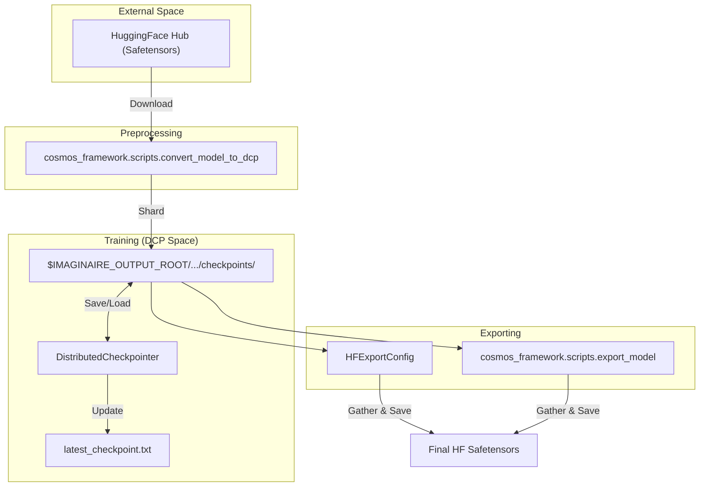
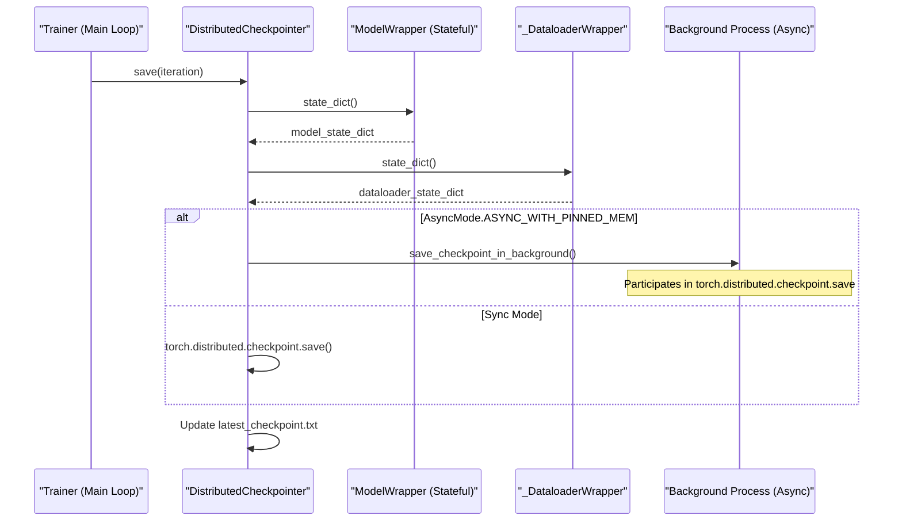

<!-- source: DeepWiki mcp.deepwiki.com · repo NVIDIA/cosmos-framework · page 3.3 Checkpoint Lifecycle: DCP and HuggingFace Export · fetched 2026-10-26 -->

# Checkpoint Lifecycle: DCP and HuggingFace Export

<details>
<summary>Relevant source files</summary>

The following files were used as context for generating this wiki page:

- [.github/workflows/pre-commit.yml](.github/workflows/pre-commit.yml)
- [cosmos_framework/checkpoint/dcp.py](cosmos_framework/checkpoint/dcp.py)
- [cosmos_framework/utils/config.py](cosmos_framework/utils/config.py)
- [tests/launch_regression_test.py](tests/launch_regression_test.py)

</details>


This page details the end-to-end lifecycle of model weights within the Cosmos-Framework, from initial conversion of HuggingFace (HF) weights to Distributed Checkpoint (DCP) format, the structured storage during training, and the final export back to portable safetensors.

## Overview of Checkpoint Formats

The framework utilizes two primary formats for model weights:
1.  **HuggingFace (HF) Safetensors**: The standard portable format used for distribution and sharing.
2.  **Distributed Checkpoint (DCP)**: A sharded format optimized for high-performance distributed training and multi-node I/O.

### DCP Directory Structure
During training, checkpoints are saved to `$IMAGINAIRE_OUTPUT_ROOT/<project>/<group>/<name>/checkpoints/iter_<N>/` [cosmos_framework/checkpoint/dcp.py:9-26]().

```text
checkpoints/
├── iter_000000005/
│   ├── model/                  # Model state shards (__0_0.distcp, etc.)
│   ├── optim/                  # Optimizer state shards
│   ├── scheduler/              # Learning rate scheduler state
│   ├── trainer/                # Additional training state (e.g., iteration count)
│   └── dataloader/             # Per-rank dataloader state (rank_0.pkl, etc.)
├── latest_checkpoint.txt       # Contains the string "iter_000000005"
└── config.yaml                 # The source of truth for model architecture
```
Sources: [cosmos_framework/checkpoint/dcp.py:9-26](), [cosmos_framework/utils/config.py:198-206]()

---

## 1. Checkpoint Conversion (HF → DCP)

Before fine-tuning a base model (e.g., Cosmos3-Nano), the HF safetensors must be converted into DCP shards to support distributed initialization across FSDP or Tensor Parallel groups.

### `convert_model_to_dcp`
The script `cosmos_framework.scripts.convert_model_to_dcp` performs this conversion [tests/launch_regression_test.py:132-133](). It instantiates the model based on the framework's internal configuration and maps the incoming HF keys to the internal state dict.

**Data Flow: Conversion**
1.  **Load HF Weights**: Downloads or reads local safetensors.
2.  **Initialize Model**: Uses the project's model definitions.
3.  **Sharding**: Distributes the weights across the expected parallelism degrees (FSDP/TP) and writes `.distcp` files using `torch.distributed.checkpoint` [cosmos_framework/checkpoint/dcp.py:36-40]().

Sources: [cosmos_framework/checkpoint/dcp.py:36-40](), [tests/launch_regression_test.py:126-140]()

---

## 2. Training Lifecycle and `DistributedCheckpointer`

The `DistributedCheckpointer` (DCP) class manages the persistence of state during training. It supports local filesystem and S3 backends [cosmos_framework/checkpoint/dcp.py:28-34]().

### Implementation Classes
- **`ModelWrapper`**: A `Stateful` object that handles model state dicts and strips `_orig_mod.` prefixes (often introduced by `torch.compile`) during saving and loading [cosmos_framework/checkpoint/dcp.py:77-95]().
- **`_DataloaderWrapper`**: An adapter that walks registered callbacks to find the first one tagged with `checkpoint_component == "dataloader"` to capture and restore the exact position in the dataset [cosmos_framework/checkpoint/dcp.py:108-151]().

### Async Checkpointing
To minimize training downtime, the framework supports an asynchronous mode (`ASYNC_WITH_PINNED_MEM`). This offloads the heavy I/O of writing shards to a separate background process using a `multiprocessing.Process` [cosmos_framework/checkpoint/dcp.py:153-156](), [cosmos_framework/checkpoint/dcp.py:172-180]().

**Checkpoint Save Process**
1.  **State Capture**: Callbacks are triggered to populate the state dict from `ModelWrapper`, `Optimizer`, etc.
2.  **Collective I/O**: All ranks participate in `dcp.save_state_dict()` to write their respective shards [cosmos_framework/checkpoint/dcp.py:179-180]().
3.  **`latest_checkpoint.txt`**: Updated only after a successful write to ensure the training resume logic is robust [cosmos_framework/checkpoint/dcp.py:26]().

Sources: [cosmos_framework/checkpoint/dcp.py:77-151](), [cosmos_framework/checkpoint/dcp.py:172-180]()

---

## 3. HuggingFace Export (DCP → HF)

After training, the sharded DCP checkpoints must be unified into a single set of safetensors for deployment or sharing.

### `HFExportCallback`
This callback automates the export during training based on the `HFExportConfig` [cosmos_framework/utils/config.py:171-182]().

**Mechanism:**
1.  **Weight Gathering**: All ranks participate in gathering sharded weights into a unified format.
2.  **Rank 0 Accumulation**: Typically, Rank 0 handles the final serialization to avoid OOM on worker nodes.
3.  **Background Writing**: The system can push exported weights to the HuggingFace Hub if `hf_repo_id` is provided [cosmos_framework/utils/config.py:176]().

### `export_model` Script
For manual conversion after a training run has finished, `cosmos_framework.scripts.export_model` is used to convert DCP shards back to HuggingFace-compatible safetensors.

Sources: [cosmos_framework/utils/config.py:171-182](), [cosmos_framework/checkpoint/dcp.py:4-40]()

---

## System Diagrams

### Checkpoint Data Flow
This diagram illustrates the transition of weights between different formats and storage locations during the lifecycle.


Sources: [cosmos_framework/checkpoint/dcp.py:4-40](), [tests/launch_regression_test.py:126-140](), [cosmos_framework/utils/config.py:171-182]()

### Code Entity Interaction: Checkpoint Saving
This diagram maps the save process to the specific code entities in `dcp.py`.


Sources: [cosmos_framework/checkpoint/dcp.py:77-106](), [cosmos_framework/checkpoint/dcp.py:153-180]()

---

## Configuration Reference

Checkpoint behavior is governed by the `CheckpointConfig` and `HFExportConfig` classes.

| Component | Config Key | Purpose |
| :--- | :--- | :--- |
| **DCP Save** | `checkpoint.save_iter` | Frequency of iteration-based saves [cosmos_framework/utils/config.py:223](). |
| **S3 Storage** | `checkpoint.save_to_object_store` | Configuration for S3 bucket and credentials [cosmos_framework/utils/config.py:230](). |
| **HF Export** | `checkpoint.hf_export.enabled` | Enables the automated export callback [cosmos_framework/utils/config.py:173](). |
| **Export Freq** | `checkpoint.hf_export.export_every_n` | Export every N DCP checkpoints [cosmos_framework/utils/config.py:181](). |
| **Output Path** | `job.path_local` | Base local directory for all outputs including checkpoints [cosmos_framework/utils/config.py:203-205](). |

Sources: [cosmos_framework/utils/config.py:171-235](), [cosmos_framework/checkpoint/dcp.py:28-40]()

---

