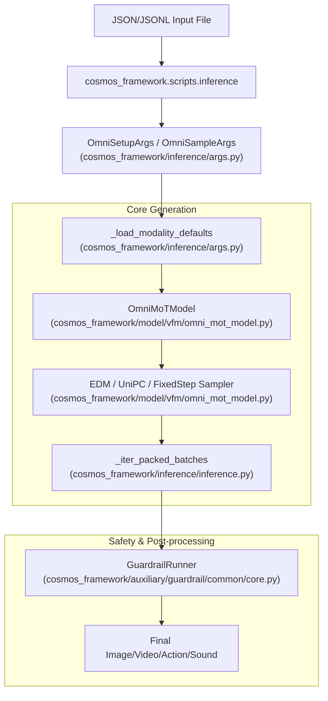
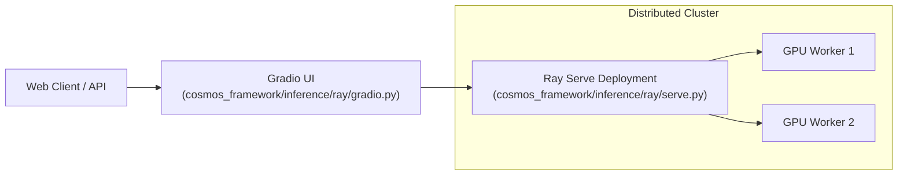

<!-- source: DeepWiki mcp.deepwiki.com · repo NVIDIA/cosmos-framework · page 4 Inference · fetched 2026-10-26 -->

# Inference

Relevant source files

The following files were used as context for generating this wiki page:

- [cosmos_framework/inference/args.py](cosmos_framework/inference/args.py)
- [cosmos_framework/inference/inference.py](cosmos_framework/inference/inference.py)
- [cosmos_framework/inference/transfer.py](cosmos_framework/inference/transfer.py)
- [cosmos_framework/model/vfm/omni_mot_model.py](cosmos_framework/model/vfm/omni_mot_model.py)

The Cosmos-Framework inference system is designed for high-performance generation across multiple modalities, supporting both large-scale offline batch processing and low-latency online serving. It leverages a unified Mixture-of-Transformers (MoT) architecture ([cosmos_framework/model/vfm/omni_mot_model.py:64-68]()) to handle tasks ranging from text-to-video (T2V) to robotic action policy generation.

The system is centered around the `cosmos_framework.scripts.inference` entry point, which provides a standardized interface for various model variants (Nano, Super) and modalities.

### Inference System Architecture

The following diagram illustrates the flow from input specification to generated output, highlighting the primary code entities involved in the process.

**Inference Request Flow**

**Sources:** [cosmos_framework/inference/args.py:65-77](), [cosmos_framework/inference/inference.py:66-72](), [cosmos_framework/model/vfm/omni_mot_model.py:38-41]().

---

### Modalities and Model Variants

Cosmos supports a wide array of generation tasks, categorized into `ModelMode` [cosmos_framework/inference/args.py:157-171](). Each modality has specific default parameters stored in `sample_args.json` files [cosmos_framework/inference/args.py:67-70]().

| Category | Modalities |
| :--- | :--- |
| **Vision Generation** | `text2image`, `text2video`, `image2video`, `image2image`, `video2video` |
| **Audio-Visual** | `audio_image2video` |
| **Robotics & Dynamics** | `forward_dynamics`, `inverse_dynamics`, `policy` |
| **Reasoning** | `reasoner` |

The framework typically offers model scales defined by `ModelSize` (e.g., `0.6B`, `2B`, `8B`, `32B`) [cosmos_framework/inference/args.py:154]().

For details on modality-specific configurations, see [Inference Configuration and Modality Defaults](#4.2).

**Sources:** [cosmos_framework/inference/args.py:154-198]().

---

### Offline Batch Inference

Offline inference is the primary method for generating large datasets or running experiments. It uses the `cosmos_framework.scripts.inference` CLI to process JSON or JSONL manifests.

Key features include:
*   **Automatic Resume**: The system identifies completed samples to avoid redundant computation.
*   **Path Resolution**: Relative paths for vision inputs (like `vision_path`) in JSON files are resolved relative to the directory containing the JSON file.
*   **Parallelism Presets**: Users can configure `ParallelismArgs` [cosmos_framework/inference/inference.py:31]() to optimize for `latency` (single request speed) or `throughput` (total samples per second).
*   **Deterministic Seeding**: Uses `_fallback_seed` derived from sample name and output directory to ensure CP/CFG-parallel ranks agree on initial noise [cosmos_framework/inference/inference.py:157-173]().

For CLI usage and input formats, see [Offline Batch Inference](#4.1).

**Sources:** [cosmos_framework/inference/inference.py:31-36](), [cosmos_framework/inference/inference.py:157-173]().

---

### Online Serving

For real-time applications, Cosmos-Framework integrates with **Ray Serve** and **Gradio**. This setup allows the models to be deployed as scalable web services capable of handling concurrent requests across multiple GPUs or nodes.

**Serving Infrastructure**

For deployment instructions and scaling configurations, see [Online Serving: Ray and Gradio](#4.3).

**Sources:** [cosmos_framework/inference/ray/serve.py](), [cosmos_framework/inference/ray/gradio.py]().

---

### Guardrails and Content Safety

To ensure safe generation, the inference pipeline includes a multi-stage guardrail system defined in `cosmos_framework/auxiliary/guardrail/`.

*   **Text Guardrails**: Uses models like `LlamaGuard3` and `Qwen3Guard` to detect harmful instructions.
*   **Vision Guardrails**: Filters generated video content and can apply post-processing like `face_blur_filter.py`.
*   **Infrastructure**: The `GuardrailRunner` [cosmos_framework/auxiliary/guardrail/common/core.py]() orchestrates these checks during the inference lifecycle.

For details on the guardrail architecture, see [Guardrails and Content Safety](#4.4).

**Sources:** [cosmos_framework/auxiliary/guardrail/common/core.py]().

---

### Low-Level APIs

While the CLI is recommended for most users, the framework provides low-level APIs for custom integrations:
*   `examples/inference.py`: Direct model interaction API.
*   `examples/inference_pipeline.py`: Higher-level pipeline API that handles the end-to-end generation flow.
*   `cosmos_framework/inference/transfer.py`: Specialized logic for video transfer tasks (edge/blur conditioning) [cosmos_framework/inference/transfer.py:4-5]().

**Sources:** [cosmos_framework/inference/transfer.py:4-21]().

---

