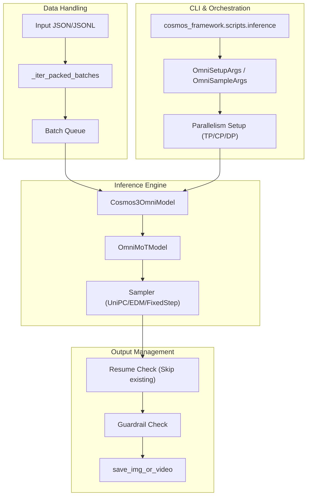

<!-- source: DeepWiki mcp.deepwiki.com · repo NVIDIA/cosmos-framework · page 4.1 Offline Batch Inference · fetched 2026-10-26 -->

# Offline Batch Inference

<details>
<summary>Relevant source files</summary>

The following files were used as context for generating this wiki page:

- [cosmos_framework/inference/args.py](cosmos_framework/inference/args.py)
- [cosmos_framework/inference/inference.py](cosmos_framework/inference/inference.py)
- [cosmos_framework/inference/model.py](cosmos_framework/inference/model.py)
- [cosmos_framework/inference/transfer.py](cosmos_framework/inference/transfer.py)
- [cosmos_framework/model/vfm/omni_mot_model.py](cosmos_framework/model/vfm/omni_mot_model.py)
- [docs/faq.md](docs/faq.md)

</details>


Offline batch inference in the Cosmos-Framework is designed for large-scale generation tasks, allowing users to process multiple prompts or media inputs asynchronously. The system is built around the `cosmos_framework.scripts.inference` entry point, which handles model loading, distributed orchestration, and output management.

## CLI Entry Point and Execution

The primary interface for batch processing is the `cosmos_framework.scripts.inference` module. It supports both single-GPU and multi-GPU execution via `torchrun`.

### Core CLI Flags
- `--input_json`: Path to a JSON or JSONL file containing the generation requests.
- `--output_dir`: Directory where generated assets (images/videos) will be stored.
- `--seed`: Sets a fixed seed for determinism. If `sample_args.seed` is `None`, a stable per-sample fallback seed is derived from the sample's `name` and `output_dir` using SHA-256 to ensure all ranks in a CP/CFG-parallel replica agree on the initial noise [cosmos_framework/inference/inference.py:157-173]().
- `--keep-going`: If a specific sample fails (e.g., due to a guardrail violation or malformed input), the script continues to the next sample instead of exiting.
- `--checkpoint_dir`: Path to the model weights (HuggingFace or DCP format).

### Automatic Resume and Skipping
The inference script implements an automatic resume mechanism. Before processing a batch, the system can be configured to skip existing outputs. In the `Inference` base class, the `run` method handles the iteration over samples, while specific implementations in `cosmos_framework/inference/inference.py` manage the skipping logic by checking if the target output file already exists in the `output_dir`.

## Input Data Format

The framework expects input in JSON or JSONL format. Each entry in the input file represents a single generation task, validated by the `OmniSampleArgs` Pydantic model [cosmos_framework/inference/args.py:25-27]().

### Mandatory 'name' Field
Every sample must contain a unique `name` field. This field serves two purposes:
1. **Output Filenaming**: The generated file is saved using this name (e.g., `<name>.mp4`).
2. **State Tracking**: Used by the resume logic to determine if a sample has already been completed.

### Relative Path Resolution
A critical convention in the Cosmos-Framework is how paths are resolved within input files. Any relative path provided in the JSON (e.g., for `vision_path` or `video_path`) is resolved relative to the directory containing the JSON file, not the current working directory of the shell. This is managed by the `ResolvedFilePath` and `ResolvedFilePathOrUrl` types [cosmos_framework/inference/common/args.py:23-24]().

### Example JSONL Input
```json
{"name": "sample_001", "prompt": "A cinematic shot of a robot in a forest", "num_frames": 81}
{"name": "sample_002", "prompt": "A sunset over the ocean", "vision_path": "images/reference.jpg"}
```

Sources: [cosmos_framework/inference/args.py:25-173](), [cosmos_framework/inference/inference.py:157-173]()

## Parallelism and Performance Presets

The framework supports different parallelism strategies for inference, configured via `ParallelismArgs` [cosmos_framework/inference/common/args.py:31]().

| Preset | Focus | Mechanism |
| :--- | :--- | :--- |
| **Latency** | Single-request speed | Uses Model Parallelism (Tensor Parallelism/Context Parallelism) to split a single sample across multiple GPUs. |
| **Throughput** | Total volume speed | Uses Data Parallelism to process different samples on different GPUs simultaneously. |

The `_iter_packed_batches` function is used to greedily pack items into batches based on either a token budget (`max_model_len`) or a sequence count budget (`max_num_seqs`) [cosmos_framework/inference/inference.py:66-124]().

## System Data Flow

The following diagram illustrates the data flow from the CLI invocation through the batching logic to the final output.

### Inference Execution Flow

Sources: [cosmos_framework/inference/inference.py:66-154](), [cosmos_framework/inference/args.py:86-110](), [cosmos_framework/model/vfm/omni_mot_model.py:38-41]()

## Low-Level APIs

For developers who need finer control than the CLI provides, the framework exposes low-level APIs.

### Inference Model API (`examples/inference.py`)
This script demonstrates how to interact directly with the `Cosmos3OmniModel` and `OmniMoTModel` classes. It covers:
- Model instantiation via `OmniMoTModel(config)` [cosmos_framework/model/vfm/omni_mot_model.py:70]().
- Setting up tokenizers, parallelism, and denoiser networks [cosmos_framework/model/vfm/omni_mot_model.py:82-91]().

### Inference Pipeline API (`examples/inference_pipeline.py`)
The `Inference` base class and its implementations in `cosmos_framework/inference/inference.py` provide the pipeline logic, including:
- **Conditioning**: Functions like `build_conditioned_video_batch` and `build_image_edit_batch` [cosmos_framework/inference/inference.py:40-42]().
- **Batching**: The `_iter_packed_batches` utility for efficient GPU utilization [cosmos_framework/inference/inference.py:66]().

### Code Entity Mapping
The following diagram maps high-level inference concepts to their respective code entities.

```mermaid
graph LR
    subgraph "Natural Language Space"
        "Batch CLI"
        "Sampling Config"
        "Model Architecture"
        "Transfer Logic"
    end

    subgraph "Code Entity Space"
        "Batch CLI" --- M1["cosmos_framework.scripts.inference"]
        "Sampling Config" --- M2["cosmos_framework.inference.args.OmniSampleArgs"]
        "Model Architecture" --- M3["cosmos_framework.model.vfm.omni_mot_model.OmniMoTModel"]
        "Transfer Logic" --- M4["cosmos_framework.inference.transfer.build_transfer_batch"]
    end
```
Sources: [cosmos_framework/inference/inference.py:1-154](), [cosmos_framework/model/vfm/omni_mot_model.py:64-91](), [cosmos_framework/inference/transfer.py:142-156]()

## Determinism and Reproducibility

To ensure bit-accurate reproducibility, the framework implements `_fallback_seed` [cosmos_framework/inference/inference.py:157](). This ensures that even when a user does not provide a seed, all distributed ranks generate identical noise by hashing the sample's identity (`name` and `output_dir`). This derived seed is a 31-bit integer safe for `int32` APIs [cosmos_framework/inference/inference.py:172-173]().

Sources:
- [cosmos_framework/inference/inference.py:66-173]()
- [cosmos_framework/inference/args.py:86-130]()
- [cosmos_framework/model/vfm/omni_mot_model.py:64-110]()
- [cosmos_framework/inference/transfer.py:142-190]()

---

