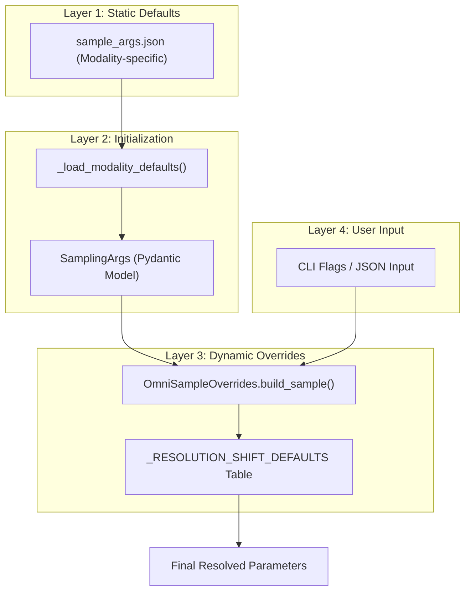
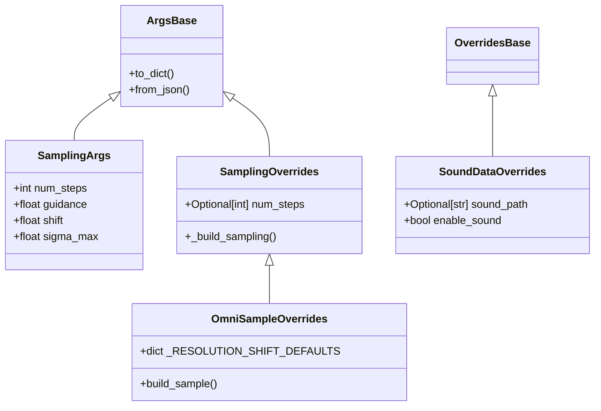
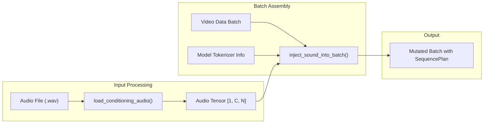

<!-- source: DeepWiki mcp.deepwiki.com · repo NVIDIA/cosmos-framework · page 4.2 Inference Configuration and Modality Defaults · fetched 2026-10-26 -->

# Inference Configuration and Modality Defaults

Relevant source files

The following files were used as context for generating this wiki page:

- [cosmos_framework/inference/args.py](cosmos_framework/inference/args.py)
- [cosmos_framework/inference/args_test.py](cosmos_framework/inference/args_test.py)
- [cosmos_framework/inference/defaults/audio_image2video/sample_args.json](cosmos_framework/inference/defaults/audio_image2video/sample_args.json)
- [cosmos_framework/inference/sound.py](cosmos_framework/inference/sound.py)
- [cosmos_framework/inference/sound_test.py](cosmos_framework/inference/sound_test.py)

This page details the configuration architecture for Cosmos3 inference. The system employs a multi-layered resolution strategy to manage sampling parameters (like guidance scale and noise schedule shifts) across diverse modalities including text-to-video, image-to-video, and the newly integrated audio-conditioned generation.

## Parameter Resolution Chain

The Cosmos-Framework uses a 6-step precedence logic to determine the final value of any sampling parameter. This ensures that while sensible defaults exist for every modality, users can override them at multiple levels of granularity.

### The 6-Step Resolution Logic

1.  **Static JSON Defaults**: The system first looks at modality-specific JSON files located in `cosmos_framework/inference/defaults/<mode>/sample_args.json` [cosmos_framework/inference/args.py:67-70]().
2.  **Cached Modality Defaults**: These JSON files are loaded via `_load_modality_defaults()` and cached using `functools.cache` to minimize I/O during batch processing [cosmos_framework/inference/args.py:65-66]().
3.  **Pydantic Validation**: Parameters are instantiated into `SamplingArgs` and `SamplingOverrides` classes, which perform type checking and field-level validation [cosmos_framework/inference/args.py:86-110]().
4.  **Override Merging**: `OmniSampleOverrides.build_sample()` merges user-provided overrides and modality defaults into the final resolved argument set [cosmos_framework/inference/args.py:153-171]().
5.  **Resolution-Based Shift Adjustment**: If the user has not explicitly set a `shift` value, the `_RESOLUTION_SHIFT_DEFAULTS` table (found in `OmniSampleOverrides`) provides values based on the model size and output resolution [cosmos_framework/inference/args.py:153-171]().
6.  **CLI Flag Precedence**: Explicit command-line arguments (e.g., `--guidance`, `--shift`) parsed into `OmniSampleOverrides` take ultimate precedence over all previous steps.

### Resolution Data Flow

Title: "Inference Parameter Resolution Flow"

Sources: [cosmos_framework/inference/args.py:65-110](), [cosmos_framework/inference/args.py:153-171]()

## Modality Defaults

The framework supports multiple modality modes, each with its own optimized sampling configuration. These are stored in `cosmos_framework/inference/defaults/`.

### Supported Modalities
| Mode | Directory Path | Primary Use Case |
| :--- | :--- | :--- |
| `text2image` | `.../defaults/text2image/` | Static image generation from text. |
| `text2video` | `.../defaults/text2video/` | Video generation from text prompts. |
| `image2video` | `.../defaults/image2video/` | Video generation using an image as the first frame. |
| `image2image` | `.../defaults/image2image/` | Image-to-image translation. |
| `video2video` | `.../defaults/video2video/` | Video-to-video translation/editing. |
| `audio_image2video`| `.../defaults/audio_image2video/`| Audio-conditioned video generation (TS2V). |
| `forward_dynamics` | `.../defaults/forward_dynamics/` | Predicting next state in robotics. |
| `inverse_dynamics` | `.../defaults/inverse_dynamics/` | Predicting actions between states. |
| `policy` | `.../defaults/policy/` | Direct action policy generation. |
| `reasoner` | `.../defaults/reasoner/` | Textual reasoning and logic generation. |

### Default Parameter Comparison (Example: Audio-Conditioned)
The `audio_image2video` modality introduces `enable_sound` and specific sampling steps:
| Parameter | text2video | audio_image2video |
| :--- | :--- | :--- |
| `num_steps` | 35 | 35 |
| `guidance` | 6.0 | 6.0 |
| `shift` | 10.0 | 10.0 |
| `enable_sound` | `false` | `true` |

Sources: [cosmos_framework/inference/args.py:157-171](), [cosmos_framework/inference/defaults/audio_image2video/sample_args.json:1-22]()

## Implementation Details

### Sound Inference Helpers
In `cosmos_framework/inference/sound.py`, the framework provides utilities to handle audio conditioning:
*   **`AudioTokenizerInfo`**: A dataclass that probes the model for its sound tokenizer, sample rate, and latent FPS [cosmos_framework/inference/sound.py:17-28]().
*   **`load_conditioning_audio`**: Decodes audio files, resamples them (typically to 48kHz), and pads/trims them to align with the video duration [cosmos_framework/inference/sound.py:62-83]().
*   **`inject_sound_into_batch`**: The core wiring function that takes a standard video batch and adds sound tensors and a modified `SequencePlan` (e.g., `ts2v` for audio-conditioned or `t2vs` for joint generation) [cosmos_framework/inference/sound.py:118-140]().

### Pydantic Validation Classes
The inference system relies on the following core classes for argument handling:

*   **`SamplingArgs`**: Defines the full schema for sampling, including `num_steps`, `guidance`, and noise schedule parameters [cosmos_framework/inference/args.py:86-93]().
*   **`SamplingOverrides`**: A subset of `SamplingArgs` used to capture only the fields a user intends to change. It includes a `_build_sampling` method to handle sentinel values for non-diffusion models like the `reasoner` [cosmos_framework/inference/args.py:95-125]().
*   **`OmniSampleOverrides`**: Extends the base overrides with vision-specific logic, such as prompt upsampling probabilities and negative prompt management [cosmos_framework/inference/args.py:153-171]().
*   **`ArgsBase` / `OverridesBase`**: Abstract base classes in `cosmos_framework/inference/common/args.py` providing common serialization and validation logic.

### Code Entity Association

Title: "Inference Configuration Class Relationships"

Sources: [cosmos_framework/inference/args.py:86-110](), [cosmos_framework/inference/args.py:153-171](), [cosmos_framework/inference/sound.py:17-28]()

## Audio Data Flow

Title: "Audio Conditioning Injection"

Sources: [cosmos_framework/inference/sound.py:62-116](), [cosmos_framework/inference/sound.py:118-178]()

Users can bypass standard defaults by providing a `negative_prompt_file` or specific templates in the modality JSON, which are resolved relative to the package directory during the `_load_modality_defaults` call [cosmos_framework/inference/args.py:66-77]().

---

