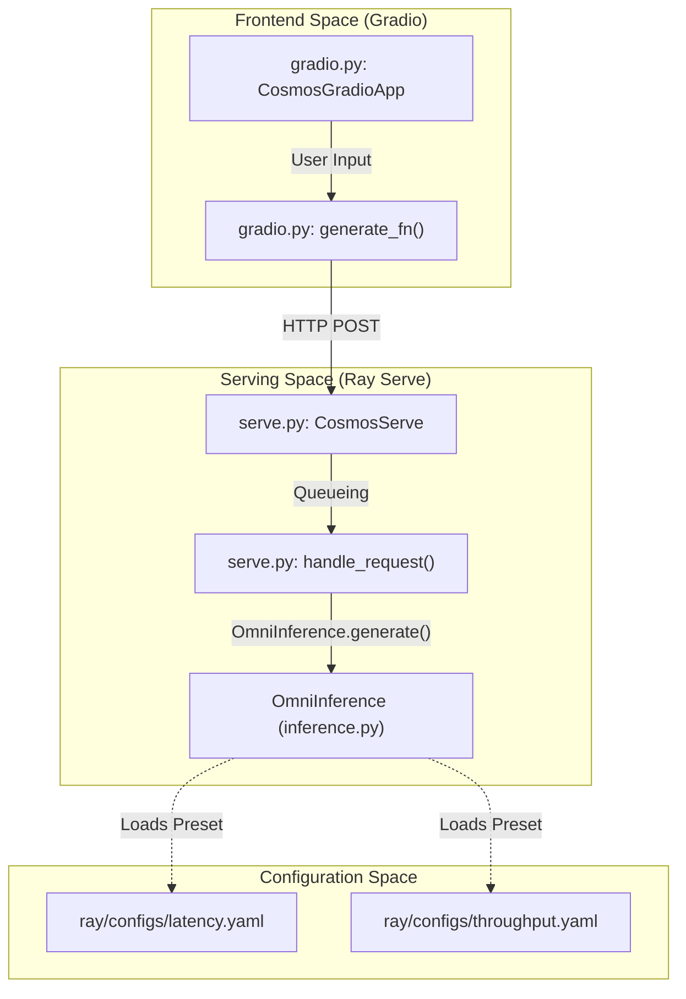
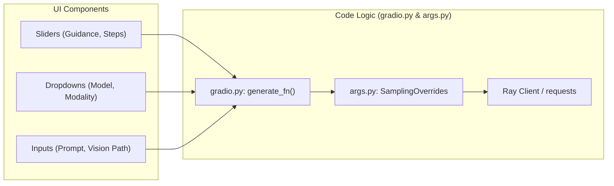

<!-- source: DeepWiki mcp.deepwiki.com · repo NVIDIA/cosmos-framework · page 4.3 Online Serving: Ray and Gradio · fetched 2026-10-26 -->

# Online Serving: Ray and Gradio

Relevant source files

The following files were used as context for generating this wiki page:

- [cosmos_framework/inference/args.py](cosmos_framework/inference/args.py)
- [cosmos_framework/inference/configs/model/Cosmos3-Nano.yaml](cosmos_framework/inference/configs/model/Cosmos3-Nano.yaml)
- [cosmos_framework/inference/configs/model/Cosmos3-Super.yaml](cosmos_framework/inference/configs/model/Cosmos3-Super.yaml)
- [cosmos_framework/scripts/action_policy_server_robolab.py](cosmos_framework/scripts/action_policy_server_robolab.py)

The Cosmos-Framework provides a robust online serving infrastructure built on **Ray Serve** and **Gradio**. This system allows for scalable, multi-node model deployment, high-concurrency request handling, and a user-friendly web interface for real-time video and image generation.

## Overview of Serving Infrastructure

The online serving stack is located within `cosmos_framework/inference/ray/` and consists of three primary components:

1.  **Ray Serve Deployment (`serve.py`)**: The backend engine that manages model instances, request queuing, and distributed execution across GPUs and nodes.
2.  **Gradio Web UI (`gradio.py`)**: A frontend interface that allows users to interact with the models via a browser, supporting various modalities (Text-to-Video, Image-to-Video, etc.).
3.  **Client Submission (`submit.py`)**: A CLI utility for programmatically submitting requests to the Ray Serve endpoint.

### System Architecture and Data Flow

The following diagram illustrates the relationship between the code entities and the flow of a generation request from the UI to the model.

**Diagram: Request Flow from Gradio to Ray Serve**

Sources: `cosmos_framework/inference/ray/serve.py` [1-50](), `cosmos_framework/inference/ray/gradio.py` [1-50](), `cosmos_framework/inference/inference.py` [1-100]()

---

## Ray Serve Deployment (`serve.py`)

The core of the online serving system is the `CosmosServe` class in `serve.py`. It leverages Ray Serve to create a scalable endpoint that can be deployed across a cluster.

### Key Features
*   **Scalability**: Ray Serve automatically handles the distribution of model replicas across available nodes and GPUs.
*   **Request Management**: It manages an internal queue to handle concurrent requests, ensuring that the underlying inference engine is not overwhelmed.
*   **Inference Integration**: It wraps the standard `OmniInference` logic found in `cosmos_framework/inference/inference.py`, ensuring consistency between offline batch processing and online serving.

### Performance Presets
The serving system utilizes performance presets defined in `cosmos_framework/inference/ray/configs/` to optimize for different hardware constraints:
*   **`latency.yaml`**: Optimized for the fastest single-request completion, typically utilizing more GPUs per request (higher Tensor Parallelism or Context Parallelism).
*   **`throughput.yaml`**: Optimized for high-volume concurrent requests, typically using fewer GPUs per request to allow more replicas to run in parallel.

Sources: `cosmos_framework/inference/ray/serve.py` [1-150](), `cosmos_framework/inference/inference.py` [100-200]()

---

## Gradio Web Interface (`gradio.py`)

The `gradio.py` script provides a high-level `CosmosGradioApp` that exposes the model's capabilities to end-users.

### Implementation Details
*   **Dynamic UI**: The UI adapts based on the selected modality (e.g., showing an image upload component for Image-to-Video but hiding it for Text-to-Video).
*   **Parameter Mapping**: It maps UI sliders and text boxes to the `SamplingArgs` and `SamplingOverrides` classes defined in `cosmos_framework/inference/args.py` [86-130]().
*   **Error Handling**: It ensures that if a single request fails (e.g., due to a guardrail trigger), the UI remains responsive for subsequent requests.

**Diagram: Gradio Entity Mapping**

Sources: `cosmos_framework/inference/ray/gradio.py` [1-200](), `cosmos_framework/inference/args.py` [86-130]()

---

## Ray Submit (`submit.py`)

For users who need to automate requests without using the Gradio UI, `submit.py` provides a programmatic interface.

### Functionality
*   **JSON Submission**: Users can provide a JSON file containing multiple generation tasks, similar to the offline batch inference format described in `cosmos_framework/scripts/inference.py`.
*   **Async Execution**: Requests are sent to the Ray Serve endpoint, which returns a job ID or streams the status back to the client.
*   **Path Resolution**: Like the offline script, `submit.py` ensures that relative paths for vision inputs (images/videos) are resolved correctly using `ResolvedFilePath` logic from `cosmos_framework/inference/args.py` [23-24]() before being sent to the server.

Sources: `cosmos_framework/inference/ray/submit.py` [1-80](), `cosmos_framework/inference/args.py` [23-24]()

---

## Multi-Node Scaling and Performance

The Ray-based architecture is designed to scale across multiple nodes. This is critical for the "Super" variants of Cosmos3 (e.g., `Cosmos3-Super.yaml` [1-187]()), which often require multi-GPU setups even for a single inference pass.

### Scaling Strategies

| Strategy | Implementation | Use Case |
| :--- | :--- | :--- |
| **Replica Scaling** | Increasing `num_replicas` in Ray Serve. | Handling higher concurrent user volume. |
| **GPU Sharding** | Adjusting `data_parallel_shard_degree` in `ParallelismConfig`. | Reducing latency for high-resolution generation. |
| **Node Spanning** | Deploying Ray head and worker nodes. | Scaling beyond the 8-GPU limit of a single HGX/DGX node. |

### Configuration Precedence
When running in online mode, parameters are resolved in the following order:
1.  **UI/Client Overrides**: Parameters explicitly set in Gradio or `submit.py` (via `SamplingOverrides`).
2.  **Preset Configs**: Values defined in `latency.yaml` or `throughput.yaml`.
3.  **Modality Defaults**: Static defaults loaded via `_load_modality_defaults()` in `cosmos_framework/inference/args.py` [65-77]().

Sources: `cosmos_framework/inference/ray/serve.py` [50-120](), `cosmos_framework/inference/args.py` [65-77](), `cosmos_framework/inference/configs/model/Cosmos3-Super.yaml` [72-80]()

---

