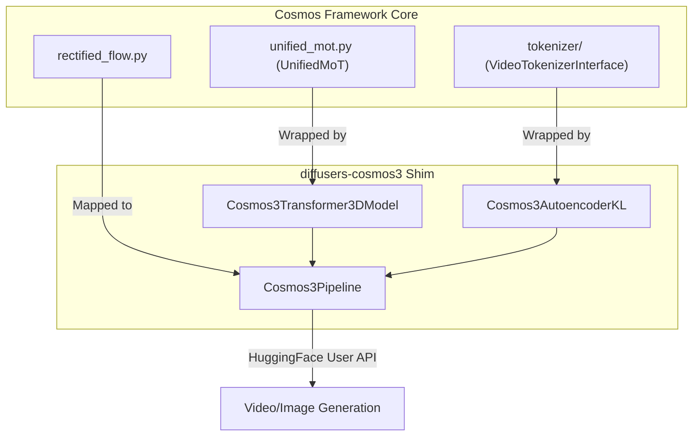
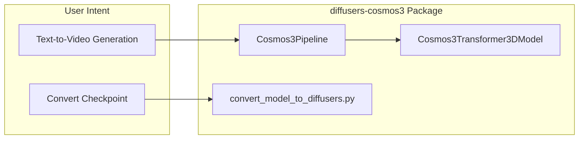

<!-- source: DeepWiki mcp.deepwiki.com · repo NVIDIA/cosmos-framework · page 5.1 diffusers-cosmos3 · fetched 2026-10-26 -->

# diffusers-cosmos3

<details>
<summary>Relevant source files</summary>

The following files were used as context for generating this wiki page:

- [README.md](README.md)
- [docs/action_policy_droid_server.md](docs/action_policy_droid_server.md)

</details>


The `diffusers-cosmos3` package is a standalone plugin located in `packages/diffusers-cosmos3/` that adapts **Cosmos3** model checkpoints for use within the HuggingFace `diffusers` ecosystem. It provides the necessary shims to wrap the native Cosmos3 architecture—specifically the Mixture-of-Transformers (MoT) and VAE components—into standard Diffusers classes, enabling users to leverage existing Diffusers pipelines, schedulers, and community tools.

## Package Structure and Integration

The package is designed as a lightweight wrapper around the core `cosmos_framework` logic, allowing it to be installed independently or as part of the full framework. It serves as one of the three standalone shim libraries under `packages/` that adapt Cosmos3 checkpoints to upstream ML ecosystems [README.md:19-20]().

### Project Configuration
The `pyproject.toml` defines the package identity and its dependencies. It ensures that `diffusers-cosmos3` can resolve the necessary `cosmos_framework` components while maintaining compatibility with specific versions of `diffusers` and `accelerate`.

### Internal Organization
The package follows a standard Python structure:
*   **`diffusers_cosmos3/`**: The main source directory containing the adapter logic.
*   **`diffusers_cosmos3/models/`**: Contains the Diffusers-compatible model definitions that wrap the native `cosmos_framework` models.
*   **`diffusers_cosmos3/pipelines/`**: Implements custom pipelines (e.g., for video generation or image-to-video) that orchestrate the Cosmos3 denoising process.

Sources: [README.md:16-20](), [README.md:92-95]()

## Implementation Details

The core of `diffusers-cosmos3` involves mapping the unified Mixture-of-Transformers (MoT) architecture of Cosmos3 into the `ModelMixin` and `ConfigMixin` structures expected by HuggingFace.

### Data Flow: Cosmos3 to Diffusers
The following diagram illustrates how the native framework components are exposed through the `diffusers-cosmos3` shim.

**Diagram: Cosmos3 Backend Integration Flow**

Sources: [README.md:16-23]()

### Key Classes and Functions

| Entity | Role | Source Reference |
| :--- | :--- | :--- |
| `Cosmos3Transformer3DModel` | Wraps the `UnifiedMoT` network for denoising tasks. | `packages/diffusers-cosmos3/` |
| `Cosmos3AutoencoderKL` | Adapts the Cosmos3 VAE (Wan2.2 or DC-AE) to the Diffusers VAE interface. | `packages/diffusers-cosmos3/` |
| `Cosmos3Pipeline` | The primary entry point for text-to-video and image-to-video inference using Diffusers. | `packages/diffusers-cosmos3/` |

## Mapping Natural Language Space to Code Entities

The following table and diagram bridge high-level user requirements to the specific code entities within the `diffusers-cosmos3` package.

**Table: Feature Mapping**
| User Concept | Code Entity / Path |
| :--- | :--- |
| **Model Checkpoint** | `Cosmos3-Nano`, `Cosmos3-Super` |
| **Diffusion Backend** | `diffusers_cosmos3.models.transformer_3d` |
| **Video Encoding** | `diffusers_cosmos3.models.autoencoder_kl` |
| **Inference Script** | `cosmos_framework.scripts.convert_model_to_diffusers` |

**Diagram: Entity Association**

Sources: [README.md:16-23](), [README.md:78-84]()

## Conversion and Usage

To use a Cosmos3 model with this package, the native Distributed Checkpoint (DCP) or HuggingFace `safetensors` format must be converted into the specific structure expected by the Diffusers plugin.

### Conversion Script
The framework provides a utility script, `cosmos_framework.scripts.convert_model_to_diffusers`, which performs the following:
1.  Loads the native `UnifiedMoT` weights.
2.  Remaps the keys to match the `diffusers-cosmos3` naming convention.
3.  Saves the resulting model in a format compatible with `from_pretrained()`.

### Inference Example
Once converted, the model can be loaded using standard Diffusers syntax. Note that the framework also provides a native inference script `cosmos_framework.scripts.inference` which supports various parallelism presets [README.md:78-84]().

```python
from diffusers_cosmos3 import Cosmos3Pipeline
import torch

# Load the converted model
pipe = Cosmos3Pipeline.from_pretrained("nvidia/Cosmos3-Nano-Diffusers", torch_dtype=torch.bfloat16)
pipe.to("cuda")

# Run inference
prompt = "A cinematic shot of a robotic arm assembling a circuit board."
video = pipe(prompt).frames[0]
```

Sources: [README.md:16-20](), [README.md:78-84]()

---

