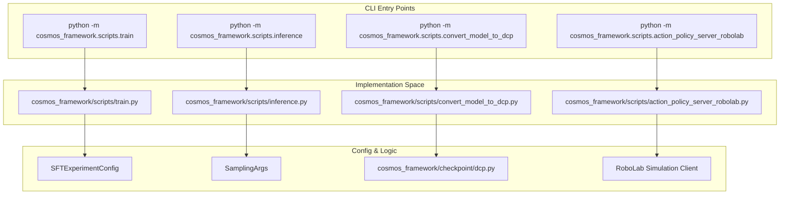
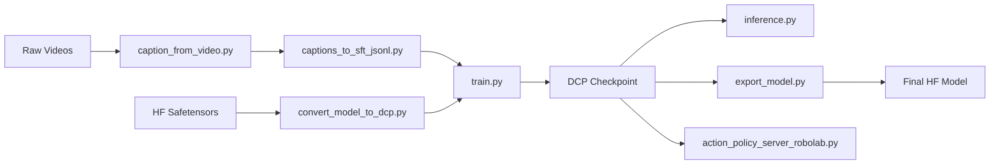

<!-- source: DeepWiki mcp.deepwiki.com · repo NVIDIA/cosmos-framework · page 6 CLI Scripts Reference · fetched 2026-10-26 -->

# CLI Scripts Reference

Relevant source files

The following files were used as context for generating this wiki page:

- [README.md](README.md)
- [cosmos_framework/inference/common/checkpoints.py](cosmos_framework/inference/common/checkpoints.py)
- [docs/action_policy_droid_server.md](docs/action_policy_droid_server.md)

This page provides a high-level reference for the command-line interface (CLI) entry points provided by the `cosmos_framework.scripts` package. These scripts serve as the primary interface for training, inference, checkpoint management, and data preparation within the Cosmos-Framework ecosystem.

Most scripts are intended to be invoked as Python modules: `python -m cosmos_framework.scripts.<script_name>`.

### Core Pipeline Scripts

The following scripts form the backbone of the model lifecycle, from initial checkpoint conversion to fine-tuning and final export.

| Script | Purpose | Key References |
| :--- | :--- | :--- |
| `train` | Primary entry point for Supervised Fine-Tuning (SFT). Processes TOML recipes to launch distributed training. | [README.md:18-18]() |
| `inference` | Offline batch generation for various modalities (T2V, I2V, etc.) using JSON/JSONL inputs. | [README.md:78-84](), [cosmos_framework/scripts/inference.py:1-1]() |
| `convert_model_to_dcp` | Converts Hugging Face `safetensors` checkpoints into Distributed Checkpoint (DCP) format for training. | [README.md:18-18](), [cosmos_framework/scripts/convert_model_to_dcp.py:1-1]() |
| `export_model` | Exports a trained DCP checkpoint back to a portable Hugging Face `safetensors` format. | [cosmos_framework/scripts/export_model.py:1-1]() |
| `eval` | Runs evaluation suites against trained models. | [cosmos_framework/scripts/eval.py:1-1]() |
| `prefetch_hf_checkpoints` | Utility to pre-download required weights from Hugging Face Hub. | [cosmos_framework/inference/common/checkpoints.py:123-151]() |

**Sources:**
- [README.md:18-84]()
- [cosmos_framework/scripts/inference.py:1-1]()
- [cosmos_framework/scripts/convert_model_to_dcp.py:1-1]()
- [cosmos_framework/scripts/export_model.py:1-1]()
- [cosmos_framework/scripts/eval.py:1-1]()

### Data Preparation and Processing

These scripts handle the transformation of raw video and text data into the structured formats required for training and inference.

*   **`caption_from_video`**: Utilizes a VLM to generate descriptive captions for raw video files using a specialized system prompt.
*   **`upsample_prompts`**: Enhances short user prompts into detailed descriptions suitable for high-quality generation.
*   **`captions_to_sft_jsonl`**: Aggregates processed videos and captions into the final JSONL manifest used by the training dataloaders.
*   **`dataset_utils`**: Provides shared utilities for manipulating dataset manifests and verifying file integrity.

For details on the data preparation workflow and input directory structures, see **[Data Preparation Scripts](#6.1)**.

**Sources:**
- [README.md:18-18]()
- [README.md:30-30]()

### Specialized and Robotic Serving

The framework includes specialized scripts for hosting models as interactive services, particularly for robotic action policies.

*   **`action_policy_server_libero`**: A specialized server for the LIBERO robotics benchmark.
*   **`action_policy_server_robolab`**: A general-purpose server for robotic labs supporting forward/inverse dynamics and policy modalities. It is typically run on port 8000 to interface with simulation clients like RoboLab.
*   **`convert_model_to_diffusers`**: Converts Cosmos3 weights into a format compatible with the Hugging Face Diffusers library, including specific remapping for audio tokenizers (AVAE).

For details on hosting robotic policies and HTTP/WebSocket communication, see **[Action Policy Servers](#6.2)**.

**Sources:**
- [docs/action_policy_droid_server.md:66-68]()
- [cosmos_framework/inference/common/checkpoints.py:32-41]()
- [README.md:86-88]()

### System Mapping: CLI to Implementation

The following diagram maps the high-level CLI commands to their respective implementation files and the core configuration entities they interact with.

**CLI to Code Entity Mapping**

**Sources:**
- [README.md:18-19]()
- [README.md:78-84]()
- [docs/action_policy_droid_server.md:66-68]()

### Workflow Integration

The scripts are designed to work in a sequence. The following diagram illustrates the standard "Post-Training" flow using these CLI tools.

**Standard Post-Training Workflow**

**Sources:**
- [README.md:18-19]()
- [README.md:61-69]()
- [docs/action_policy_droid_server.md:1-3]()

---

