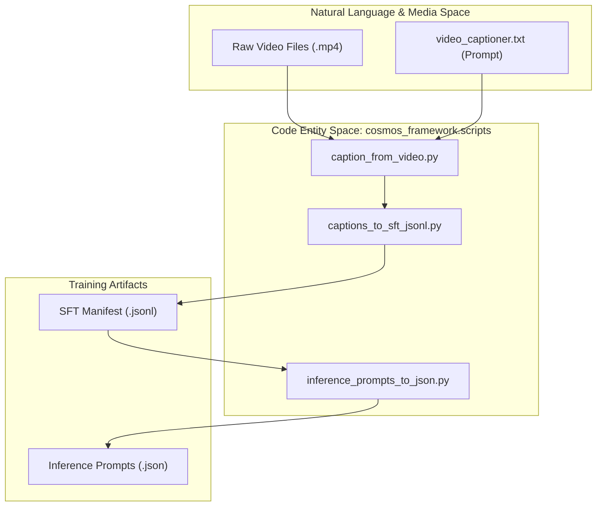
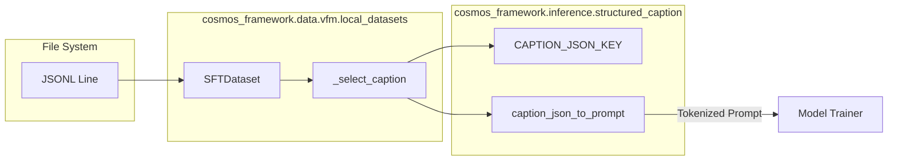

<!-- source: DeepWiki mcp.deepwiki.com · repo NVIDIA/cosmos-framework · page 6.1 Data Preparation Scripts · fetched 2026-10-26 -->

# Data Preparation Scripts

Relevant source files

The following files were used as context for generating this wiki page:

- [cosmos_framework/configs/base/defaults/open_source_dataloader.py](cosmos_framework/configs/base/defaults/open_source_dataloader.py)
- [cosmos_framework/configs/base/experiment/sft/vision_sft_super.py](cosmos_framework/configs/base/experiment/sft/vision_sft_super.py)
- [cosmos_framework/data/vfm/local_datasets/sft_dataset.py](cosmos_framework/data/vfm/local_datasets/sft_dataset.py)
- [cosmos_framework/data/vfm/local_datasets/sft_dataset_caption_test.py](cosmos_framework/data/vfm/local_datasets/sft_dataset_caption_test.py)
- [cosmos_framework/inference/defaults/video_captioner.txt](cosmos_framework/inference/defaults/video_captioner.txt)
- [cosmos_framework/inference/structured_caption.py](cosmos_framework/inference/structured_caption.py)
- [cosmos_framework/scripts/caption_from_video.py](cosmos_framework/scripts/caption_from_video.py)
- [cosmos_framework/scripts/captions_to_sft_jsonl.py](cosmos_framework/scripts/captions_to_sft_jsonl.py)
- [cosmos_framework/scripts/inference_prompts_to_json.py](cosmos_framework/scripts/inference_prompts_to_json.py)

This section details the suite of scripts and utilities provided in the `cosmos_framework` for preparing datasets for Supervised Fine-Tuning (SFT). The pipeline covers raw video captioning, prompt enhancement, and the assembly of training manifests in JSONL format.

## Overview of Data Flow

The data preparation pipeline transforms raw video assets and short text descriptions into high-quality, structured training data. The Cosmos3 model family primarily consumes a **Structured JSON** prompt format, which includes scene analysis (subjects, lighting, cinematography) and a dense narrative.

1.  **Video Captioning**: `caption_from_video.py` generates detailed descriptions for raw video files using a two-phase process (Structured JSON + Dense Narrative) [cosmos_framework/scripts/caption_from_video.py:4-12]().
2.  **Prompt Upsampling**: `upsample_prompts.py` expands short user prompts into rich, descriptive text using the `prompt_upsampler.txt` system prompt.
3.  **JSONL Assembly**: `captions_to_sft_jsonl.py` aggregates these outputs into a single training manifest compatible with the `SFTDataset` [cosmos_framework/scripts/captions_to_sft_jsonl.py:3-14]().

### Inputs and Templates
*   **System Prompts**: 
    *   `cosmos_framework/inference/defaults/video_captioner.txt`: Guides the VLM through Phase 1 (Scene Analysis) and Phase 2 (Dense Narrative Rewrite) [cosmos_framework/inference/defaults/video_captioner.txt:1-97]().
    *   `cosmos_framework/inference/defaults/prompt_upsampler.txt`: Used for prompt enhancement.
*   **Schema Definition**: `cosmos_framework/inference/structured_caption.py` defines the `StructuredCaption` Pydantic model, which mirrors the training target [cosmos_framework/inference/structured_caption.py:113-133]().

---

## Video Captioning (`caption_from_video.py`)

The `caption_from_video.py` script utilizes an OpenAI-compatible VLM server (e.g., vLLM serving Qwen3-VL) to generate captions. It supports processing individual videos, directories, or manifest files [cosmos_framework/scripts/caption_from_video.py:19-35]().

### Implementation and Data Handling
*   **Two-Phase Output**: The script produces `caption.json` (canonical structured JSON) and `caption.txt` (dense narrative) [cosmos_framework/scripts/caption_from_video.py:9-12]().
*   **Media Probing**: It uses `probe_video_metadata` to extract resolution, FPS, and duration, which are then injected into the final structured caption via `assemble_caption_json` [cosmos_framework/scripts/caption_from_video.py:182-192]().
*   **Remote vs. Local**: Local paths are converted to `file://` URLs for the VLM server, while remote URIs are passed through [cosmos_framework/scripts/caption_from_video.py:100-111]().

**Sources:** [cosmos_framework/scripts/caption_from_video.py:4-192](), [cosmos_framework/inference/defaults/video_captioner.txt:1-97]()

---

## Training Manifest Assembly (`captions_to_sft_jsonl.py`)

The `captions_to_sft_jsonl.py` script converts the per-video output directories from the captioner into a unified training manifest.

### SFT JSONL Structure
The script ensures each entry contains the necessary fields for the `SFTDataset` loader [cosmos_framework/scripts/captions_to_sft_jsonl.py:5-6]():
*   `uuid`: Unique identifier (derived from video name).
*   `vision_path`: Path to video, relativized to the JSONL location [cosmos_framework/scripts/captions_to_sft_jsonl.py:76-85]().
*   `caption_json`: The structured JSON object (Highest priority during training) [cosmos_framework/scripts/captions_to_sft_jsonl.py:11-12]().
*   `caption`: The dense narrative backup [cosmos_framework/scripts/captions_to_sft_jsonl.py:13-14]().

### Filtering Logic
The script applies hard-coded filters to match the `SFTDataset` requirements:
*   **Duration**: Maximum 61 seconds [cosmos_framework/scripts/captions_to_sft_jsonl.py:63-63]().
*   **Frames**: Minimum 61 frames [cosmos_framework/scripts/captions_to_sft_jsonl.py:64-64]().
*   **Resolution**: Optional `min_short_edge` filtering [cosmos_framework/scripts/captions_to_sft_jsonl.py:166-169]().

**Sources:** [cosmos_framework/scripts/captions_to_sft_jsonl.py:1-170](), [cosmos_framework/data/vfm/local_datasets/sft_dataset.py:65-94]()

---

## Structured Caption Logic (`structured_caption.py`)

This module acts as the single source of truth for the Cosmos3 prompt format.

| Component | Role |
| :--- | :--- |
| `CAPTION_JSON_KEY` | The string `"caption_json"`, used as the primary key in training manifests [cosmos_framework/inference/structured_caption.py:34-34](). |
| `StructuredCaption` | Pydantic class defining fields like `subjects`, `lighting`, `cinematography`, and `temporal_caption` [cosmos_framework/inference/structured_caption.py:113-133](). |
| `parse_structured_caption` | Robustly extracts JSON from VLM responses by looking for `<scene_draft>` tags or balanced braces [cosmos_framework/inference/structured_caption.py:184-214](). |
| `caption_json_to_prompt` | Serializes a JSON object into a string for the model's text encoder [cosmos_framework/inference/structured_caption.py:220-221](). |

---

## Data Preparation Diagrams

### Workflow: Natural Language to Code Entities
This diagram illustrates the transition from raw media to the structured objects consumed by the training scripts.

**Data Preparation Workflow**

**Sources:** [cosmos_framework/scripts/caption_from_video.py:4-15](), [cosmos_framework/scripts/captions_to_sft_jsonl.py:3-14](), [cosmos_framework/scripts/inference_prompts_to_json.py:3-12]()

### Mapping: Manifest to Dataloader
The following diagram bridges the gap between the file-system organization and the internal Python classes that consume this data during SFT.

**Manifest to Dataloader Mapping**

**Sources:** [cosmos_framework/data/vfm/local_datasets/sft_dataset.py:65-94](), [cosmos_framework/inference/structured_caption.py:34-34](), [cosmos_framework/data/vfm/local_datasets/sft_dataset_caption_test.py:11-35]()

---

## Dataset Utilities and Testing

### `sft_dataset_caption_test.py`
This test suite validates the priority logic in `_select_caption`. It ensures:
*   `caption_json` is preferred over dense `caption` [cosmos_framework/data/vfm/local_datasets/sft_dataset_caption_test.py:20-24]().
*   Dense captions receive a terminal period if missing [cosmos_framework/data/vfm/local_datasets/sft_dataset_caption_test.py:32-35]().
*   Structured JSON is serialized verbatim without trailing periods to avoid corrupting the JSON structure [cosmos_framework/data/vfm/local_datasets/sft_dataset_caption_test.py:11-18]().

### `inference_prompts_to_json.py`
This utility script updates existing inference JSON files to use the new structured format, ensuring parity between training and evaluation prompts [cosmos_framework/scripts/inference_prompts_to_json.py:3-12]().

**Sources:** [cosmos_framework/data/vfm/local_datasets/sft_dataset_caption_test.py:1-56](), [cosmos_framework/scripts/inference_prompts_to_json.py:34-87]()

---

