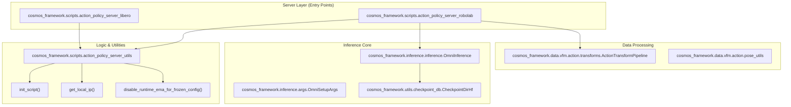
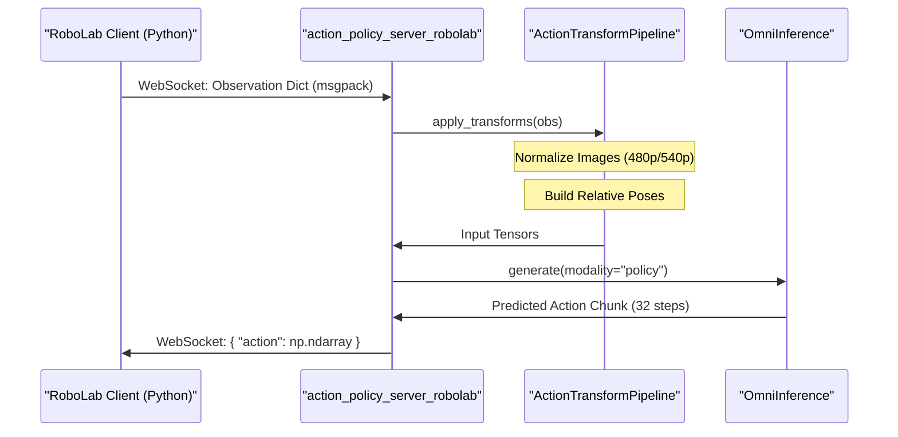

<!-- source: DeepWiki mcp.deepwiki.com · repo NVIDIA/cosmos-framework · page 6.2 Action Policy Servers · fetched 2026-10-26 -->

# Action Policy Servers

<details>
<summary>Relevant source files</summary>

The following files were used as context for generating this wiki page:

- [README.md](README.md)
- [cosmos_framework/inference/configs/model/Cosmos3-Nano.yaml](cosmos_framework/inference/configs/model/Cosmos3-Nano.yaml)
- [cosmos_framework/inference/configs/model/Cosmos3-Super.yaml](cosmos_framework/inference/configs/model/Cosmos3-Super.yaml)
- [cosmos_framework/scripts/action_policy_server_robolab.py](cosmos_framework/scripts/action_policy_server_robolab.py)
- [docs/action_policy_droid_server.md](docs/action_policy_droid_server.md)

</details>


Action Policy Servers provide a standardized interface for hosting robotic action policies and world models. These servers facilitate real-time interaction between robotic environments (like LIBERO or RoboLab) and Cosmos-Framework models, supporting modalities such as forward dynamics, inverse dynamics, and direct policy execution.

### Overview and Modalities

The servers are designed to handle three primary action-related modalities defined in the inference system:
*   **Forward Dynamics**: Predicts the next state (video frames) given current state and actions.
*   **Inverse Dynamics**: Predicts the actions required to transition between two states.
*   **Policy**: Directly predicts actions based on current observations and goals.

The implementation is split between environment-specific server scripts and a shared utility library. For the DROID policy specifically, the server is designed to stream actions to a client driving a simulated or real robot, such as the `RoboLab` simulation benchmark [docs/action_policy_droid_server.md:1-3]().

Sources: [docs/action_policy_droid_server.md:1-3](), [cosmos_framework/scripts/action_policy_server_robolab.py:4-17]()

---

### System Architecture

The Action Policy Servers bridge the gap between high-level robotic task specifications and the underlying Cosmos-Framework inference engine. They utilize a request-response pattern over HTTP or WebSockets to serve model predictions to client environments.

#### Code Entity Mapping

The following diagram illustrates the relationship between the server scripts, the shared utility library, and the core inference engine.

**Action Policy Server Component Map**

Sources: [cosmos_framework/scripts/action_policy_server_robolab.py:19-62](), [cosmos_framework/scripts/action_policy_server_utils.py:1-60]()

---

### Server Implementation Details

#### 1. RoboLab Server (`action_policy_server_robolab.py`)
The RoboLab server uses a WebSocket-based protocol (msgpack + NumPy) to serve policies like `Cosmos3-Nano-Policy-DROID` [cosmos_framework/scripts/action_policy_server_robolab.py:4-10]().
*   **Metadata**: On connection, it sends an empty metadata dictionary [cosmos_framework/scripts/action_policy_server_robolab.py:8-8]().
*   **Observations**: Each client message is an observation dict containing environment state [cosmos_framework/scripts/action_policy_server_robolab.py:9-9]().
*   **Responses**: The server responds with a dict containing the predicted `action` and optionally `video` [cosmos_framework/scripts/action_policy_server_robolab.py:10-10]().
*   **Checkpoint Resolution**: It automatically downloads consolidated checkpoints from Hugging Face (e.g., `nvidia/Cosmos3-Nano-Policy-DROID`) using `CheckpointDirHf` [cosmos_framework/scripts/action_policy_server_robolab.py:133-145]().

#### 2. Shared Utilities (`action_policy_server_utils.py`)
This module contains boilerplate logic shared between LIBERO and RoboLab servers:
*   **Distributed Initialization**: `maybe_init_distributed()` handles single-rank or multi-GPU setups for inference [cosmos_framework/scripts/action_policy_server_utils.py:58-58]().
*   **EMA Handling**: `disable_runtime_ema_for_frozen_config()` ensures that when loading a frozen config (like those exported for serving), runtime EMA weights are correctly handled [cosmos_framework/scripts/action_policy_server_utils.py:56-56]().
*   **Networking**: `get_local_ip()` assists in service discovery for the WebSocket listeners [cosmos_framework/scripts/action_policy_server_utils.py:57-57]().

#### 3. Configuration and Model Metadata
The servers attempt to load training configurations directly from checkpoint metadata to ensure the `ActionTransformPipeline` matches the parameters used during training [cosmos_framework/scripts/action_policy_server_robolab.py:85-110](). This includes:
*   `max_action_dim`: (e.g., 64 in Cosmos3-Nano) [cosmos_framework/inference/configs/model/Cosmos3-Nano.yaml:67-67]().
*   `num_embodiment_domains`: (e.g., 32) [cosmos_framework/inference/configs/model/Cosmos3-Nano.yaml:71-71]().

Sources: [cosmos_framework/scripts/action_policy_server_robolab.py:4-145](), [cosmos_framework/scripts/action_policy_server_utils.py:1-60](), [cosmos_framework/inference/configs/model/Cosmos3-Nano.yaml:67-71]()

---

### Data Flow

The data flow follows a sequence from environment observation to model inference and back to robotic control.

**Action Inference Data Flow (RoboLab)**

Sources: [cosmos_framework/scripts/action_policy_server_robolab.py:4-17](), [docs/action_policy_droid_server.md:91-96]()

---

### Deployment and Usage

#### Docker-Based Deployment
The recommended way to deploy the policy server is via Docker to ensure all CUDA and robotic dependencies are met [docs/action_policy_droid_server.md:27-33]().

1.  **Build**: `docker build -t cosmos-framework:latest .` [docs/action_policy_droid_server.md:30-32]()
2.  **Launch**: Run the container with the `policy-server` dependency group [docs/action_policy_droid_server.md:53-56]().
    ```bash
    uv sync --all-extras --group=cu130-train --group=policy-server
    ```
3.  **Start Server**: 
    ```bash
    python -m cosmos_framework.scripts.action_policy_server_robolab --port 8000
    ```

#### Simulation Client (RoboLab)
Once the server is running, a client (like RoboLab) connects to stream observations and receive actions [docs/action_policy_droid_server.md:70-77]().
*   **Task Execution**: `python policies/cosmos3/run.py --task BananaInBowlTask` [docs/action_policy_droid_server.md:94-95]().
*   **Parallel Evaluation**: Supports `--num-envs` for concurrent simulation instances [docs/action_policy_droid_server.md:101-104]().

| Component | Port / Interface | Primary Model |
| :--- | :--- | :--- |
| **RoboLab Server** | Port 8000 (WebSocket) | `Cosmos3-Nano-Policy-DROID` |
| **Inference Engine** | Native Python / Torch | `OmniMoTModel` |
| **Action Space** | `joint_pos` (8D) or `ee_pose` | Cosmos3-Nano |

Sources: [docs/action_policy_droid_server.md:1-105](), [cosmos_framework/scripts/action_policy_server_robolab.py:64-82](), [README.md:52-57]()

---

