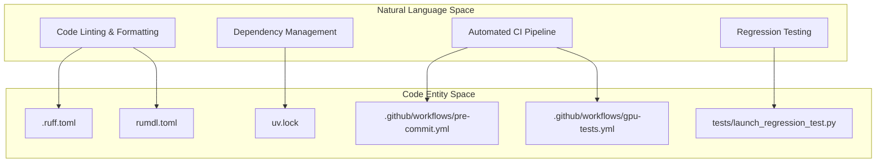
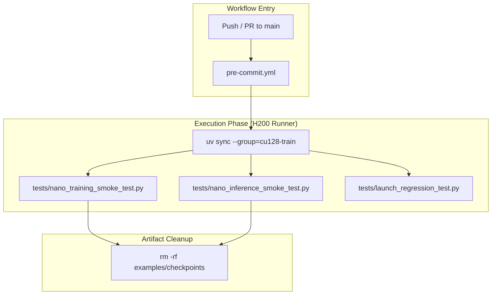

<!-- source: DeepWiki mcp.deepwiki.com · repo NVIDIA/cosmos-framework · page 7 Infrastructure and Developer Tooling · fetched 2026-10-26 -->

# Infrastructure and Developer Tooling

Relevant source files

The following files were used as context for generating this wiki page:

- [.github/workflows/gpu-tests.yml](.github/workflows/gpu-tests.yml)
- [.github/workflows/pre-commit.yml](.github/workflows/pre-commit.yml)
- [cosmos_framework/inference/common/args.py](cosmos_framework/inference/common/args.py)
- [cosmos_framework/inference/common/args_test.py](cosmos_framework/inference/common/args_test.py)
- [cosmos_framework/utils/config.py](cosmos_framework/utils/config.py)
- [tests/launch_regression_test.py](tests/launch_regression_test.py)

The **Cosmos-Framework** infrastructure is designed to support high-performance model training and inference while maintaining code quality through rigorous linting, containerization, and automated testing. This section provides an overview of the tools and processes used to develop, build, and validate the framework.

## CI/CD and Code Quality

The repository utilizes GitHub Actions and `pre-commit` hooks to enforce coding standards and prevent regressions.

*   **Linting and Formatting**: The framework uses `ruff` for fast Python linting and formatting, configured via `.ruff.toml`.
*   **Pre-commit Hooks**: Automated checks run on every pull request and push to the `main` branch. These include standard linting and base configuration checks [ .github/workflows/pre-commit.yml:4-23 ]().
*   **Documentation Linting**: Markdown files are validated using `rumdl` (configured via `rumdl.toml`) to ensure consistency across the project's extensive documentation.
*   **Automated GPU Testing**: A specialized GPU test suite runs on self-hosted H200 runners, covering training smoke tests, generator regressions, and multi-modality inference [ .github/workflows/gpu-tests.yml:4-13 ]().

For detailed information on configuring and running these tools, see **[CI, Linting, and Testing](#7.2)**.

**Sources:** [ .github/workflows/pre-commit.yml:1-23 ](), [ .github/workflows/gpu-tests.yml:1-13 ]()

---

## Containerization and Docker

To ensure environment parity across development, CI, and production deployments, Cosmos-Framework provides a comprehensive Docker infrastructure.

*   **Base Images**: The framework recommends the NVIDIA NGC PyTorch container (`nvcr.io/nvidia/pytorch:25.09-py3`) as the standard base to ensure CUDA and NCCL compatibility.
*   **Specialized Dockerfiles**: The repository includes `ci.Dockerfile` for automated testing and `nightly.Dockerfile` for development builds [ docker/README.md ]().
*   **Runtime Environment**: The `docker/entrypoint.sh` script handles environment initialization, including critical `LD_LIBRARY_PATH` overrides required for certain NGC container variants to prevent library conflicts (e.g., the `_functionalization` ImportError).

For details on building and running containers, see **[Docker and Containerization](#7.1)**.

**Sources:** [ docker/README.md ](), [ .github/workflows/gpu-tests.yml:61-63 ]()

---

## Testing Framework

The testing suite is built on `pytest` and is designed to handle complex multi-GPU scenarios and numerical regressions.

*   **Regression Testing**: The framework includes `tests/launch_regression_test.py`, which asserts that rank-0 `loss` and `clip_grad_norm` match "goldens" captured on specific architectures like H100/H200 [ tests/launch_regression_test.py:4-13 ]().
*   **GPU Management**: CI workflows use `uv sync` with specific groups like `cu128-train` to manage dependencies for different CUDA variants [ .github/workflows/gpu-tests.yml:53-54 ]().
*   **Smoke Tests**: Automated pipelines validate the full SFT lifecycle (convert -> train -> export -> generate) and multi-modality inference (t2vs, policy, forward dynamics) [ .github/workflows/gpu-tests.yml:59-63 ](), [ .github/workflows/gpu-tests.yml:125-130 ]().

For instructions on running the test suite and adding new tests, see **[CI, Linting, and Testing](#7.2)**.

**Sources:** [ tests/launch_regression_test.py:1-72 ](), [ .github/workflows/gpu-tests.yml:41-182 ]()

---

## Infrastructure Architecture

The following diagrams illustrate how the infrastructure components interact with the codebase and the developer workflow.

### Developer Tooling and Code Entities
This diagram maps the tooling configuration files to their respective roles in the development lifecycle.

**Sources:** [ .github/workflows/pre-commit.yml:21-22 ](), [ .github/workflows/gpu-tests.yml:10-13 ](), [ tests/launch_regression_test.py:4-11 ]()

### CI Workflow and Environment Sync
This diagram shows the relationship between the GitHub Action workflows, the `uv` package manager, and the test execution.

**Sources:** [ .github/workflows/gpu-tests.yml:38-43 ](), [ .github/workflows/gpu-tests.yml:54-63 ](), [ .github/workflows/gpu-tests.yml:69-73 ]()

---

## Troubleshooting and Support

Environment issues are a common hurdle in distributed training. The framework includes a structured remediation ladder for diagnosing common failures:

1.  **Library Conflicts**: Addressing `ImportError` for `_functionalization` by clearing `LD_LIBRARY_PATH` before execution [ .github/workflows/gpu-tests.yml:61 ]().
2.  **Installation Integrity**: Using `uv sync --reinstall` to repair corrupted virtual environments.
3.  **CUDA Mismatches**: Verifying alignment between `nvidia-smi` and `torch.version.cuda`.
4.  **Download Management**: Using `COSMOS_DOWNLOAD_CACHE_DIR` to avoid redundant downloads across test runs [ .github/workflows/gpu-tests.yml:128 ](), [ cosmos_framework/inference/common/args.py:137-145 ]().

For a complete guide to resolving these issues, see **[Environment Troubleshooting](#7.3)**.

**Sources:** [ .github/workflows/gpu-tests.yml:61 ](), [ cosmos_framework/inference/common/args.py:137-155 ]()

---

