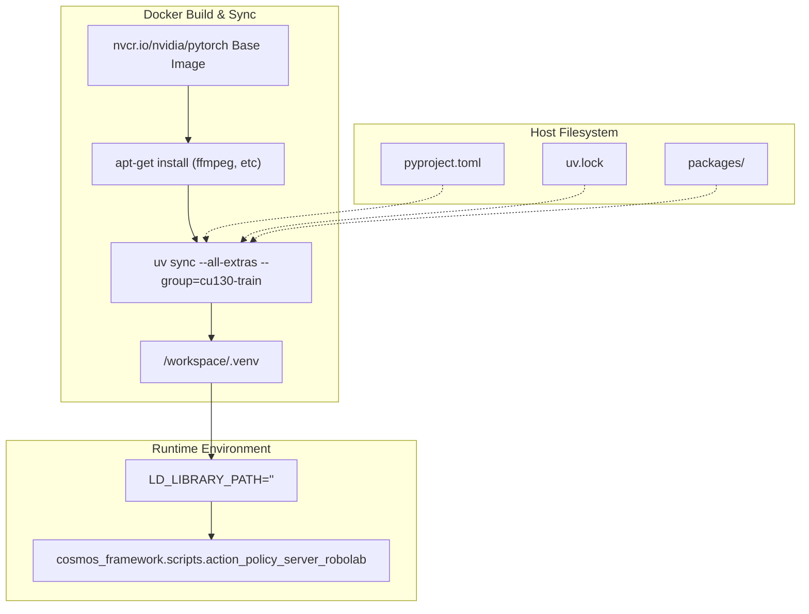
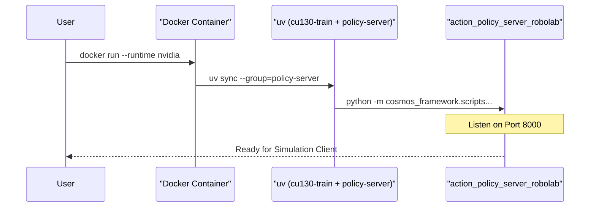

<!-- source: DeepWiki mcp.deepwiki.com · repo NVIDIA/cosmos-framework · page 7.1 Docker and Containerization · fetched 2026-10-26 -->

# Docker and Containerization

<details>
<summary>Relevant source files</summary>

The following files were used as context for generating this wiki page:

- [README.md](README.md)
- [SECURITY.md](SECURITY.md)
- [docs/action_policy_droid_server.md](docs/action_policy_droid_server.md)

</details>


This page details the containerization strategy for the Cosmos-Framework. The repository provides multiple Docker configurations tailored for development, continuous integration, and high-performance inference/training using NVIDIA's optimized base images.

## Container Architecture and Base Images

The framework is designed to run within high-performance containers that provide the necessary CUDA toolkits and system dependencies (e.g., `ffmpeg`, `libx11-dev`).

### Recommended NGC Base Image
For the most stable and optimized experience, NVIDIA recommends using the **NGC PyTorch** container. Specifically, the framework is validated against:
*   **Image:** `nvcr.io/nvidia/pytorch:25.09-py3`
*   **Purpose:** Provides optimized versions of PyTorch, CUDA, and cuDNN that are tuned for NVIDIA Hopper and Blackwell architectures.

### Implementation Details
The repository contains several Dockerfile variants located in the root and `docker/` directories. While the specific contents of `ci.Dockerfile` and `nightly.Dockerfile` are not provided in the source snippets, they are referenced as part of the infrastructure.

| File | Purpose | Key Characteristics |
| :--- | :--- | :--- |
| `Dockerfile` | Standard development image | Uses `uv` for dependency management. |
| `docker/ci.Dockerfile` | CI/CD validation | Minimal image optimized for running the test suite and linting. |
| `docker/nightly.Dockerfile` | Bleeding edge testing | Used for testing against nightly builds of dependencies. |

### System Dependency Installation
The framework requires specific system packages for video processing and framework operation:
*   `ffmpeg`: For video encoding/decoding.
*   `git-lfs`: For managing large model weights.
*   `libx11-dev`: Required for certain visualization utilities.

Sources: `README.md:41-47`(), `README.md:59-59`()

---

## Environment Management with `uv`

The framework utilizes `uv` within its Docker containers to manage virtual environments and ensure reproducible builds. This is particularly important for managing complex dependency groups like `cu130-train` (for CUDA 13.0) and `policy-server` (for robotics deployments).

### Build-time Dependency Resolution
The deployment flow typically involves:
1.  **Dependency Group Selection**: Users select the group matching their hardware, such as `--group=cu130-train` or `--group=cu128-train` [docs/action_policy_droid_server.md:53-61]().
2.  **Robotics Support**: For action policy serving, the `--group=policy-server` is included [docs/action_policy_droid_server.md:56-56]().
3.  **Path Configuration**: The virtual environment created by `uv` is activated to ensure `python` and `torchrun` calls use the containerized environment [README.md:56-56]().

### Docker Build and Run Flow
The following diagram illustrates how the framework is assembled and executed within a container:

**Container Construction and Runtime Data Flow**

Sources: `docs/action_policy_droid_server.md:29-59`(), `README.md:49-57`()

---

## The `LD_LIBRARY_PATH` Requirement

A critical requirement when running Cosmos-Framework inside NGC containers (like `nvcr.io/nvidia/pytorch`) is the management of the `LD_LIBRARY_PATH` environment variable.

### The Conflict
NGC containers often include pre-configured library paths that may conflict with the specific versions of PyTorch or functionalization libraries installed via `uv` or `pip`. This typically manifests as an `ImportError` related to `_functionalization`.

### The Resolution
Users must override or clear the `LD_LIBRARY_PATH` before importing the framework or activating the environment.
*   **Manual fix:** `export LD_LIBRARY_PATH=''` [README.md:56-56]()
*   **Automation:** This is recommended as a standard step after environment activation in the setup and README documentation.

Sources: `README.md:56-56`()

---

## Runtime Entrypoint and Configuration

For complex deployments, such as the DROID Policy Server, the container is launched with specific volume mounts and environment variables to ensure persistence and hardware access.

### Execution Sequence
When serving a model like `Cosmos3-Nano-Policy-DROID`, the container acts as a bridge between the model weights and the network.

**Policy Server Runtime Sequence**

Sources: `docs/action_policy_droid_server.md:41-68`()

---

## Docker Quickstart (NGC)

For users who do not wish to build custom images, the framework supports a "one-shot" deployment using the official NGC PyTorch image combined with `uv` for on-the-fly environment setup.

### Recommended Command for Policy Serving
```bash
docker run \
  -it \
  -e HF_HOME=/workspace/.cache/huggingface \
  -e HF_TOKEN=$HF_TOKEN \
  --net host \
  --rm \
  --runtime nvidia \
  -v .:/workspace \
  -v /workspace/.venv \
  -v $HOME/.cache/huggingface:/root/.cache/huggingface \
  nvcr.io/nvidia/pytorch:25.09-py3 \
  bash -c 'uv sync --all-extras --group=cu130-train --group=policy-server && exec bash'
```

### Post-Launch Setup
Once inside the NGC container, the following steps are required to initialize the framework:
1.  **Clear Library Path**: `export LD_LIBRARY_PATH=''` [README.md:56-56]()
2.  **Install Dependencies**: `uv sync --all-extras --group=cu130-train` [README.md:53-53]()
3.  **Activate Environment**: `source .venv/bin/activate` [README.md:56-56]()

Sources: `docs/action_policy_droid_server.md:41-59`(), `README.md:51-59`()

---

