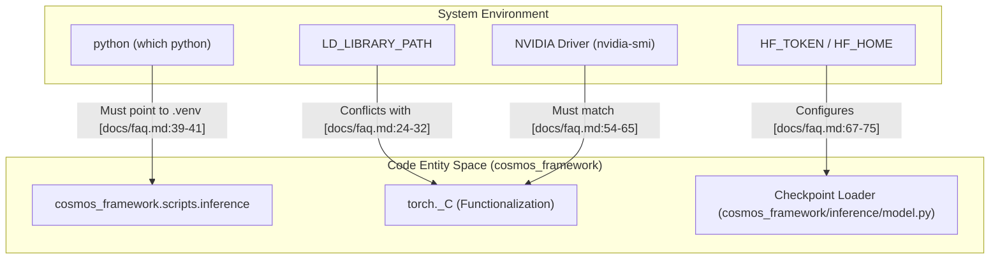

<!-- source: DeepWiki mcp.deepwiki.com · repo NVIDIA/cosmos-framework · page 7.3 Environment Troubleshooting · fetched 2026-10-26 -->

# Environment Troubleshooting

<details>
<summary>Relevant source files</summary>

The following files were used as context for generating this wiki page:

- [README.md](README.md)
- [cosmos_framework/inference/model.py](cosmos_framework/inference/model.py)
- [docs/action_policy_droid_server.md](docs/action_policy_droid_server.md)
- [docs/faq.md](docs/faq.md)

</details>


This page provides a structured guide for diagnosing and resolving common environment, installation, and runtime failures encountered when working with the `cosmos_framework`. Environment stability is critical for high-performance training and inference, particularly when navigating the complexities of CUDA versioning and containerized library paths.

## Common Error Signatures

Most environment failures in Cosmos-Framework fall into specific categories related to library pathing, dependency resolution, or hardware/driver mismatches.

| Error Signature | Primary Cause | Immediate Fix |
| :--- | :--- | :--- |
| `ImportError: cannot import name '_functionalization' from 'torch._C'` | NGC container library conflict | `export LD_LIBRARY_PATH=''` |
| `ModuleNotFoundError: No module named 'cosmos_framework'` | Package not installed in current venv | `uv sync --all-extras --group=cu130-train` |
| `fatal error: Python.h: No such file or directory` | Broken Python headers or `uv` install | Reinstall `uv` and the virtual environment |
| `CUDA error: no kernel image is available...` | CUDA version mismatch | `uv sync` with matching `--group` |
| `docker: Error response from daemon: ... nvidia` | NVIDIA runtime not configured | `sudo nvidia-ctk runtime configure --runtime=docker` |
| HuggingFace 401 / download failures | Missing `HF_TOKEN` or license acceptance | Run `uvx hf auth login` and check model terms |

### The NGC Library Path Conflict
A frequent issue when running within NVIDIA NGC containers (e.g., `nvcr.io/nvidia/pytorch:25.09-py3`) is a conflict between the container's pre-installed libraries and the local environment. Specifically, `torch._C` may fail to find `_functionalization` if `LD_LIBRARY_PATH` is pointing to incompatible system-level libraries instead of the local environment's Python libraries [docs/faq.md:24-32]().

### Module Resolution
The `cosmos_framework` package is designed to be installed as an editable or standard package. If `ModuleNotFoundError` occurs, verify that the `uv sync` command was executed successfully and that the virtual environment is active [docs/faq.md:34-43]().

**Sources:**
- [README.md:51-57]()
- [docs/faq.md:24-43]()
- [docs/faq.md:54-65]()

---

## Diagnostic Workflow

Before attempting destructive remediation (like deleting the virtual environment), execute the following diagnostic commands to establish the state of the "Natural Language Space" (user environment) vs. the "Code Entity Space" (installed packages).

### Diagnostic Commands
```shell
# System OS check
uname -a

# Python location and version
which python
python --version

# CUDA Alignment (System vs Torch)
nvidia-smi                                            # [docs/faq.md:59]()
python -c "import torch; print(torch.version.cuda)"   # [docs/faq.md:51]()

# Package Verification
uv pip list | grep cosmos
```

### Environment vs. Code Mapping
The following diagram illustrates how environment variables and system state map to the runtime behavior of the `cosmos_framework` package.

**Environment-to-Runtime Mapping**


**Sources:**
- [docs/faq.md:24-32]()
- [docs/faq.md:34-43]()
- [docs/faq.md:54-65]()
- [docs/faq.md:67-75]()
- [cosmos_framework/inference/model.py:58-63]()

---

## The Remediation Ladder

Follow these steps in order to resolve environment issues. Each step increases in intensity.

### 1. Sanitization
Clear the library path to ensure Python uses the libraries bundled with the `uv` environment. This is the primary fix for NGC container users [README.md:56-57]().
```shell
export LD_LIBRARY_PATH=''
```

### 2. Environment Synchronization
Force `uv` to re-evaluate the dependency tree and reinstall the `cosmos_framework` package. Use the group corresponding to your CUDA version [docs/faq.md:61]().
- **CUDA 13.0 (Recommended):** `cu130-train`
- **CUDA 12.8:** `cu128-train`

```shell
uv sync --all-extras --group=cu130-train --reinstall
```

### 3. Deep Reinstall
If the virtual environment is corrupted or `Python.h` is missing, purge the `uv` cache and the environment [docs/faq.md:77-87]().
```shell
# Reinstall the uv tool and python
curl -LsSf https://astral.sh/uv/install.sh | sh
uv python install --reinstall

# Purge and recreate the venv
rm -rf .venv
uv sync --all-extras --group=cu130-train --reinstall
source .venv/bin/activate && export LD_LIBRARY_PATH=
```

### 4. Docker Fallback
If the host OS is fundamentally incompatible (e.g., mismatched GLIBC versions), utilize the provided Docker configurations. The repository includes a `Dockerfile` for standardized deployment [docs/action_policy_droid_server.md:27-33]().

**Sources:**
- [README.md:51-57]()
- [docs/faq.md:61-63]()
- [docs/faq.md:77-87]()
- [docs/action_policy_droid_server.md:30-59]()

---

## Bug Report Template

If the remediation ladder fails, collect the following data for a GitHub issue. This bridges the gap between the local failure and the developer's ability to reproduce it.

### Data Flow for Bug Reporting
```mermaid
graph LR
    "System Diagnostics" --> "Environment Section"
    "Python Traceback" --> "Error Section"
    "Remediation Ladder Steps" --> "What Was Tried"
    "Bug Report Template" --> "GitHub Issue"

    subgraph "Report Components"
        A["uname -a"]
        B["nvidia-smi [docs/faq.md:59]"]
        C["torch.version.cuda [docs/faq.md:51]"]
    end
```

### Template
```markdown
## Environment
- **OS**: <output of uname -a>
- **Python**: <output of python --version>
- **CUDA (system)**: <output of nvidia-smi | grep "CUDA Version">
- **CUDA (torch)**: <python -c "import torch; print(torch.version.cuda)">
- **cosmos_framework installation**: <uv sync group used>
- **Disk Space**: <output of df -h for HF_HOME and UV_CACHE_DIR>

## Error
<Insert full traceback here>

## What was tried
1. Sanitized LD_LIBRARY_PATH [README.md:56]
2. Reinstalled venv via uv sync --reinstall [docs/faq.md:43]
3. Verified HF_TOKEN and license [docs/faq.md:67-75]
```

**Sources:**
- [README.md:56]()
- [docs/faq.md:43]()
- [docs/faq.md:51-59]()
- [docs/faq.md:67-75]()
- [docs/faq.md:89-97]()

---

