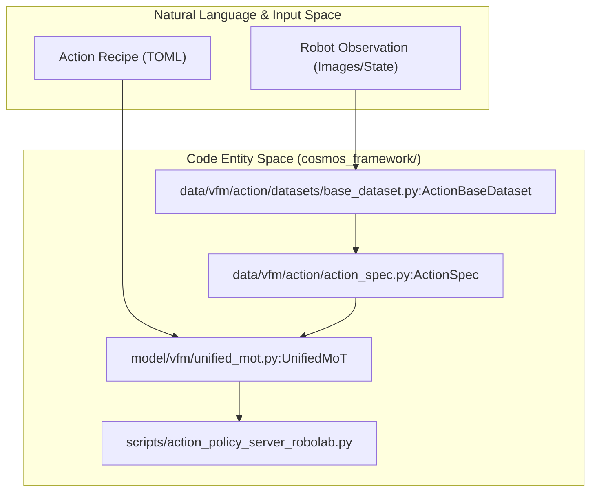
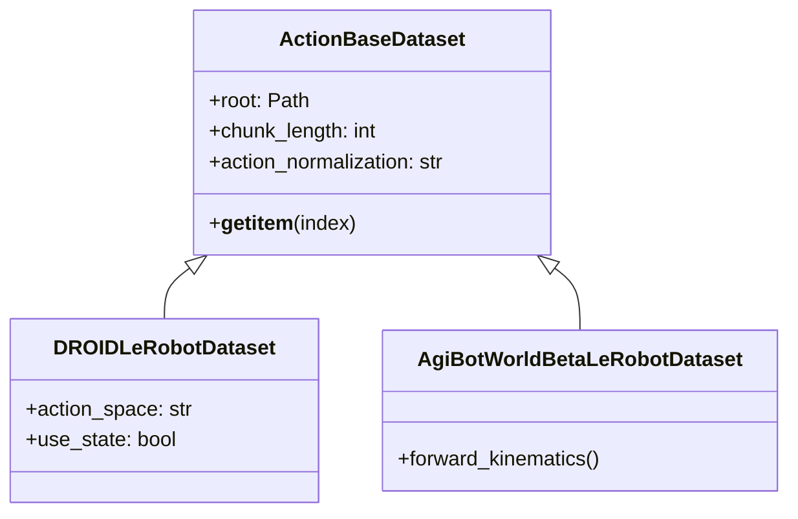

<!-- source: DeepWiki mcp.deepwiki.com · repo NVIDIA/cosmos-framework · page 9 Action Policy: Post-Training and Robotics · fetched 2026-10-26 -->

# Action Policy: Post-Training and Robotics

Relevant source files

The following files were used as context for generating this wiki page:

- [cosmos_framework/data/vfm/action/datasets/droid_lerobot_dataset.py](cosmos_framework/data/vfm/action/datasets/droid_lerobot_dataset.py)
- [cosmos_framework/data/vfm/action/domain_utils.py](cosmos_framework/data/vfm/action/domain_utils.py)
- [docs/action_policy_droid_posttrain.md](docs/action_policy_droid_posttrain.md)

The Action Policy subsystem in Cosmos-Framework enables the fine-tuning of Cosmos3-Nano foundation models into specialized robotic control policies. By leveraging a multi-embodiment dataset framework and a unified action specification, the framework supports training policies that map visual observations and proprioceptive state to precise robot actions (e.g., joint positions or end-effector poses).

This system bridges the gap between high-level video foundation models (VFMs) and real-time robotic execution, providing the tools for dataset ingestion, large-scale distributed post-training, and low-latency inference serving.

### System Architecture: From Video to Action

The following diagram illustrates how the codebase connects visual and state inputs to the action policy logic.

**Action Policy Data and Logic Flow**

**Sources:** [cosmos_framework/data/vfm/action/datasets/base_dataset.py:21-21](), [cosmos_framework/data/vfm/action/action_spec.py:20-20](), [cosmos_framework/model/vfm/unified_mot.py:1-50](), [cosmos_framework/scripts/action_policy_server_robolab.py:1-20]()

---

## 9.1 DROID Action Policy Post-Training
The DROID post-training workflow allows for the reproduction of `Cosmos3-Nano-Policy-DROID`. This process involves fine-tuning the 8B Mixture-of-Transformers (MoT) model on the DROID dataset using absolute joint-position actions.

*   **Experiment Configuration:** The `action_policy_droid_nano` config defines the core parameters, including a 32-frame chunk length and 480p resolution [docs/action_policy_droid_posttrain.md:22-23](), [docs/action_policy_droid_posttrain.md:40-50]().
*   **Action Space:** Utilizes `joint_pos` (8D: 7 arm joints + 1 gripper) and `use_state=True` to include proprioception [cosmos_framework/data/vfm/action/datasets/droid_lerobot_dataset.py:61-67]().
*   **Execution:** Training is launched via `examples/launch_sft_action_policy_droid.sh` and supports multi-node HSDP (Hybrid Sharded Data Parallelism) [docs/action_policy_droid_posttrain.md:70-77]().

For details, see [DROID Action Policy Post-Training](#9.1).

---

## 9.2 Action Datasets: Multi-Embodiment LeRobot Framework
The framework provides a robust data abstraction layer for robotic datasets, primarily based on the LeRobot format. It handles the complexities of different robot embodiments and action conventions.

*   **Dataset Implementations:** Includes concrete classes for `DROIDLeRobotDataset`, `AgiBotWorldBetaLeRobotDataset`, `BridgeOrigLeRobotDataset`, and `RoboMINDFrankaDataset` [cosmos_framework/data/vfm/action/datasets/droid_lerobot_dataset.py:58-58]().
*   **Normalization:** Utilities in `action_normalization.py` support quantile, mean/std, and min/max normalization methods to stabilize training across diverse scales [cosmos_framework/data/vfm/action/datasets/droid_lerobot_dataset.py:62-63]().
*   **Domain Mapping:** The `EMBODIMENT_TO_DOMAIN_ID` mapping ensures that the model can distinguish between different robot types (e.g., DROID is ID 8, AgiBot is ID 15) [cosmos_framework/data/vfm/action/domain_utils.py:6-24]().

**Action Dataset Hierarchy**

**Sources:** [cosmos_framework/data/vfm/action/datasets/base_dataset.py:21-21](), [cosmos_framework/data/vfm/action/datasets/droid_lerobot_dataset.py:58-58]()

For details, see [Action Datasets: Multi-Embodiment LeRobot Framework](#9.2).

---

## 9.3 DROID Policy Server Deployment
Once trained, action policies are deployed as real-time servers that interface with robotic controllers or simulators like RoboLab.

*   **Server Implementation:** The `action_policy_server_robolab.py` script hosts the model and provides an API for streaming actions [cosmos_framework/scripts/action_policy_server_robolab.py:1-10]().
*   **Deployment:** Policies are typically deployed via Docker containers using specific CUDA variants (e.g., `cu130-train`) and connected to clients using a dedicated action streaming protocol [docs/action_policy_droid_server.md:1-20]().
*   **Simulation:** The server supports connection to the RoboLab simulation environment for closed-loop evaluation in tasks like `BananaInBowlTask` [docs/action_policy_droid_server.md:15-25]().

For details, see [DROID Policy Server Deployment](#9.3).

---
**Sources:**
- [cosmos_framework/data/vfm/action/datasets/droid_lerobot_dataset.py:58-148]()
- [cosmos_framework/data/vfm/action/domain_utils.py:6-76]()
- [docs/action_policy_droid_posttrain.md:4-97]()

---

