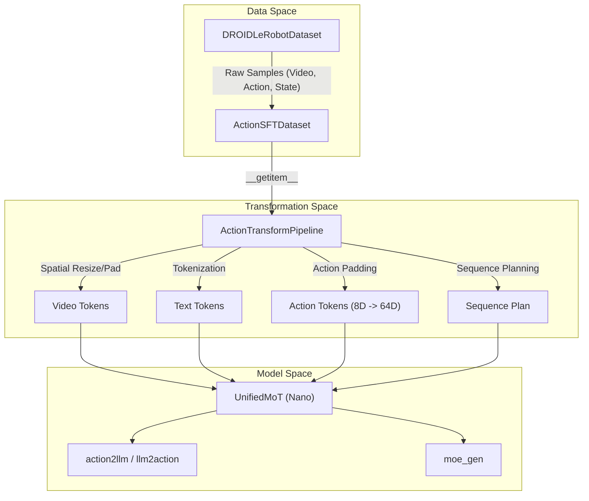
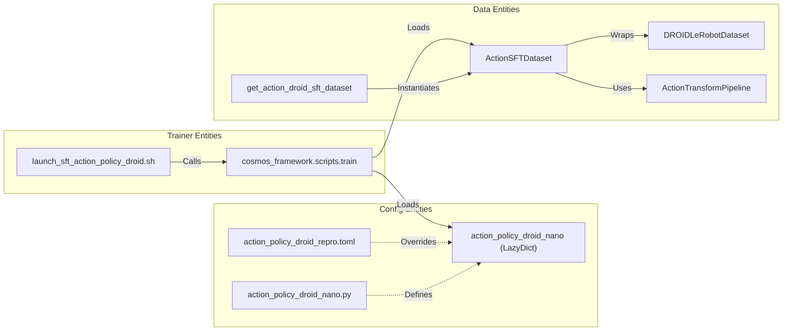

<!-- source: DeepWiki mcp.deepwiki.com · repo NVIDIA/cosmos-framework · page 9.1 DROID Action Policy Post-Training · fetched 2026-10-26 -->

# DROID Action Policy Post-Training

<details>
<summary>Relevant source files</summary>

The following files were used as context for generating this wiki page:

- [cosmos_framework/configs/base/experiment/action/posttrain_config/action_policy_droid_nano.py](cosmos_framework/configs/base/experiment/action/posttrain_config/action_policy_droid_nano.py)
- [cosmos_framework/data/vfm/action/datasets/action_sft_dataset.py](cosmos_framework/data/vfm/action/datasets/action_sft_dataset.py)
- [docs/action_policy_droid_posttrain.md](docs/action_policy_droid_posttrain.md)
- [examples/launch_sft_action_policy_droid.sh](examples/launch_sft_action_policy_droid.sh)
- [examples/toml/sft_config/action_policy_droid_repro.toml](examples/toml/sft_config/action_policy_droid_repro.toml)

</details>


This page details the end-to-end workflow for reproducing **Cosmos3-Nano-Policy-DROID**. This process fine-tunes the `Cosmos3-Nano` (8B MoT) base model into a robotic action policy using the DROID dataset. The recipe utilizes absolute joint-position actions (8D) combined with proprioceptive state at 480p resolution.

## Overview and Purpose

The DROID action policy post-training mirrors the standard vision SFT stack but introduces a specialized data pipeline for robotics. It leverages the `ActionTransformPipeline` to handle joint positions and robot states, training the generation and action heads of the Mixture-of-Transformers (MoT) architecture [cosmos_framework/configs/base/experiment/action/posttrain_config/action_policy_droid_nano.py:4-10]().

Key characteristics of this workflow include:
*   **Embodiment**: DROID (Franka Panda).
*   **Action Space**: `joint_pos` (8-D absolute joint positions including gripper) [docs/action_policy_droid_posttrain.md:43-43]().
*   **State**: Proprioception enabled via `use_state=True` [cosmos_framework/data/vfm/action/datasets/action_sft_dataset.py:62-64]().
*   **Resolution**: 480p with `concat_view` [docs/action_policy_droid_posttrain.md:45-46]().
*   **Optimization**: FusedAdam with specific learning rate multipliers for action-related modules [cosmos_framework/configs/base/experiment/action/posttrain_config/action_policy_droid_nano.py:89-94]().

## System Data Flow: From Dataset to Model

The data flow bridges raw robotic datasets in LeRobot format to the unified MoT model inputs.

### Data Flow Diagram
Title: DROID Action Policy Data Transformation

Sources: [cosmos_framework/data/vfm/action/datasets/action_sft_dataset.py:4-13](), [cosmos_framework/data/vfm/action/datasets/action_sft_dataset.py:25-39](), [cosmos_framework/configs/base/experiment/action/posttrain_config/action_policy_droid_nano.py:72-74]()

## Configuration and Recipe Knobs

The configuration is split between a registered experiment SKU and a TOML recipe. The experiment SKU defines the architecture and optimization logic, while the TOML handles environment-specific paths and scalar overrides.

### 1. Experiment Config: `action_policy_droid_nano`
Defined in `cosmos_framework/configs/base/experiment/action/posttrain_config/action_policy_droid_nano.py`, this configures the core training behavior:
*   **Optimizer**: Uses `FusedAdam` to ensure convergence of the small action heads [cosmos_framework/configs/base/experiment/action/posttrain_config/action_policy_droid_nano.py:44-49]().
*   **Learning Rate Multipliers**: Action heads (`action2llm`, `llm2action`, `action_modality_embed`) receive a **5.0x multiplier** relative to the base LR of 2e-4 [cosmos_framework/configs/base/experiment/action/posttrain_config/action_policy_droid_nano.py:89-94]().
*   **EMA Warm-start**: A critical fix in `checkpoint/dcp.py` ensures that when training starts, the model weights are copied to `net_ema` to avoid starting with uninitialized EMA weights [docs/action_policy_droid_posttrain.md:6-7]().

### 2. TOML Recipe: `action_policy_droid_repro.toml`
The TOML file (`examples/toml/sft_config/action_policy_droid_repro.toml`) provides the execution parameters:
*   **Parallelism**: Default `data_parallel_shard_degree = 8` for intra-node FSDP [examples/toml/sft_config/action_policy_droid_repro.toml:30-30]().
*   **Tokenization**: Points to the external `WAN_VAE_PATH` [examples/toml/sft_config/action_policy_droid_repro.toml:38-38]().
*   **Checkpointing**: Loads from `BASE_CHECKPOINT_PATH` and saves every 1000 iterations [examples/toml/sft_config/action_policy_droid_repro.toml:48-49]().

## Implementation Details

### Action Dataset Wrapper
The `ActionSFTDataset` class acts as a thin wrapper that composes a map-style dataset with the `ActionTransformPipeline`. This allows the robotics data to be compatible with standard training utilities like `RankPartitionedDataLoader` [cosmos_framework/data/vfm/action/datasets/action_sft_dataset.py:10-13]().

### Code Entity Association
Title: Action Policy Code Entity Mapping

Sources: [cosmos_framework/configs/base/experiment/action/posttrain_config/action_policy_droid_nano.py:38-38](), [cosmos_framework/data/vfm/action/datasets/action_sft_dataset.py:25-28](), [examples/launch_sft_action_policy_droid.sh:6-10]()

## Execution Workflow

### Required Inputs
Three external inputs must be provided via environment variables:
1.  **`DROID_ROOT`**: Path to the prepared DROID LeRobot v3.0 success split [docs/action_policy_droid_posttrain.md:27-29]().
2.  **`BASE_CHECKPOINT_PATH`**: The `Cosmos3-Nano` model converted to DCP format [docs/action_policy_droid_posttrain.md:30-32]().
3.  **`WAN_VAE_PATH`**: Path to the `Wan2.2_VAE.pth` weights [examples/launch_sft_action_policy_droid.sh:16-16]().

### Launching the Training
The provided launch script `examples/launch_sft_action_policy_droid.sh` automates the setup and execution:

```bash
export DATASET_PATH=/path/to/droid_lerobot/success
export BASE_CHECKPOINT_PATH=/path/to/base_checkpoint
export WAN_VAE_PATH=/path/to/Wan2.2_VAE.pth
export NPROC_PER_NODE=8
bash examples/launch_sft_action_policy_droid.sh
```
Sources: [docs/action_policy_droid_posttrain.md:66-71]()

### HSDP Multi-Node Setup
For multi-node training (Hybrid Sharded Data Parallel), the `data_parallel_replicate_degree` should be set to the number of nodes, while the `data_parallel_shard_degree` remains 8 (for intra-node sharding) [docs/action_policy_droid_posttrain.md:76-78]().

## Checkpoint Lifecycle

### Key Skipping and Initialization
When loading the base `Cosmos3-Nano` checkpoint, specific keys are skipped to ensure robotic-specific heads are initialized fresh:
*   `net_ema.` (Warm-started from `net` later)
*   `action2llm`, `llm2action`
*   `action_modality_embed`, `action_pos_embed`

This is controlled via `keys_to_skip_loading` in the experiment config [cosmos_framework/configs/base/experiment/action/posttrain_config/action_policy_droid_nano.py:147-153]().

### Export
Checkpoints are saved in DCP format. To use the model for inference or deployment in the DROID Policy Server, they must be exported to Hugging Face safetensors using `cosmos_framework.scripts.export_model` [docs/action_policy_droid_posttrain.md:91-91]().

Sources: [cosmos_framework/configs/base/experiment/action/posttrain_config/action_policy_droid_nano.py](), [cosmos_framework/data/vfm/action/datasets/action_sft_dataset.py](), [docs/action_policy_droid_posttrain.md](), [examples/launch_sft_action_policy_droid.sh](), [examples/toml/sft_config/action_policy_droid_repro.toml]()

---

