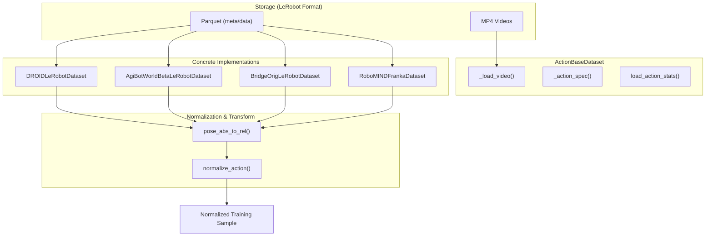
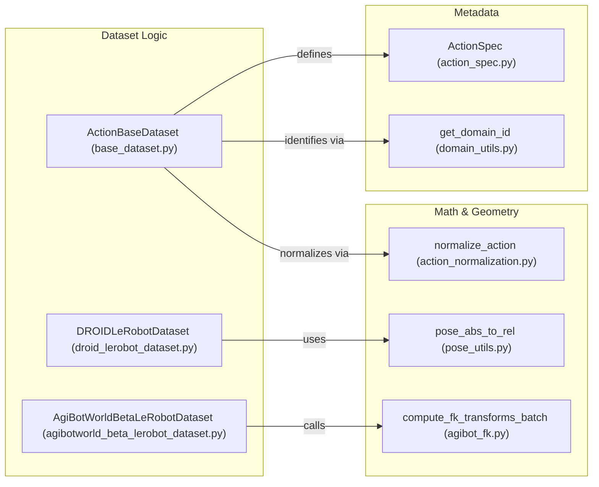

<!-- source: DeepWiki mcp.deepwiki.com · repo NVIDIA/cosmos-framework · page 9.2 Action Datasets: Multi-Embodiment LeRobot Framework · fetched 2026-10-26 -->

# Action Datasets: Multi-Embodiment LeRobot Framework

Relevant source files

The following files were used as context for generating this wiki page:

- [cosmos_framework/data/vfm/action/action_normalization.py](cosmos_framework/data/vfm/action/action_normalization.py)
- [cosmos_framework/data/vfm/action/action_normalization_test.py](cosmos_framework/data/vfm/action/action_normalization_test.py)
- [cosmos_framework/data/vfm/action/agibot_fk.py](cosmos_framework/data/vfm/action/agibot_fk.py)
- [cosmos_framework/data/vfm/action/agibot_spec.py](cosmos_framework/data/vfm/action/agibot_spec.py)
- [cosmos_framework/data/vfm/action/datasets/__init__.py](cosmos_framework/data/vfm/action/datasets/__init__.py)
- [cosmos_framework/data/vfm/action/datasets/agibotworld_beta_lerobot_dataset.py](cosmos_framework/data/vfm/action/datasets/agibotworld_beta_lerobot_dataset.py)
- [cosmos_framework/data/vfm/action/datasets/base_dataset.py](cosmos_framework/data/vfm/action/datasets/base_dataset.py)
- [cosmos_framework/data/vfm/action/datasets/bridge_orig_lerobot_dataset.py](cosmos_framework/data/vfm/action/datasets/bridge_orig_lerobot_dataset.py)
- [cosmos_framework/data/vfm/action/datasets/droid_lerobot_dataset.py](cosmos_framework/data/vfm/action/datasets/droid_lerobot_dataset.py)
- [cosmos_framework/data/vfm/action/datasets/robomind_franka_dataset.py](cosmos_framework/data/vfm/action/datasets/robomind_franka_dataset.py)
- [cosmos_framework/data/vfm/action/datasets/stats/agibotworld_beta_lerobot_stats.json](cosmos_framework/data/vfm/action/datasets/stats/agibotworld_beta_lerobot_stats.json)
- [cosmos_framework/data/vfm/action/datasets/stats/bridge_orig_lerobot_stats.json](cosmos_framework/data/vfm/action/datasets/stats/bridge_orig_lerobot_stats.json)
- [cosmos_framework/data/vfm/action/datasets/stats/droid_lerobot_stats.json](cosmos_framework/data/vfm/action/datasets/stats/droid_lerobot_stats.json)
- [cosmos_framework/data/vfm/action/datasets/stats/robomind_franka_stats.json](cosmos_framework/data/vfm/action/datasets/stats/robomind_franka_stats.json)
- [cosmos_framework/data/vfm/action/domain_utils.py](cosmos_framework/data/vfm/action/domain_utils.py)
- [cosmos_framework/data/vfm/action/urdf_visualizer/G1_omnipicker_calibrated.urdf](cosmos_framework/data/vfm/action/urdf_visualizer/G1_omnipicker_calibrated.urdf)

The Action Dataset subsystem provides a unified interface for loading, processing, and normalizing robotic datasets for fine-tuning Cosmos3 models into action policies. It leverages the [LeRobot](https://github.com/huggingface/lerobot) format for underlying data storage while providing specialized wrappers for multi-embodiment training.

## System Overview

The subsystem is organized around a base abstract class that handles common LeRobot data loading logic, specialized concrete implementations for different robot embodiments, and a robust action normalization pipeline.

### Core Data Flow

The following diagram illustrates the data flow from raw Parquet/Video files to a normalized training sample:

**Action Data Pipeline**

**Sources:** `cosmos_framework/data/vfm/action/datasets/base_dataset.py`, `cosmos_framework/data/vfm/action/action_normalization.py`

---

## Action Normalization and Specs

Action normalization is critical for multi-dataset training. The framework supports three methods: `quantile` (default for v1.2), `meanstd`, and `minmax` [cosmos_framework/data/vfm/action/action_normalization.py:27-43]().

### Action Normalization Utilities
The `normalize_action` function applies stats loaded from per-dataset JSON files located in `datasets/stats/`.
*   **Quantile Normalization:** Maps the 1st and 99th percentiles to `[-1, 1]` using `q01` and `q99` stats [cosmos_framework/data/vfm/action/action_normalization.py:33-36]().
*   **Mean/Std:** Standard Z-score normalization [cosmos_framework/data/vfm/action/action_normalization.py:37-38]().

### ActionSpec
The `ActionSpec` class defines the structure of the action vector, typically composed of `Pos` (3D position), `Rot` (6D rotation), and `Gripper` (1D) components [cosmos_framework/data/vfm/action/action_spec.py:20]().
*   **ee_pose (10D):** `[pos_delta(3), rot6d_delta(6), gripper(1)]`.
*   **joint_pos (8D):** `[joint(7), gripper(1)]` (Used primarily in DROID joint-space policies).

**Sources:** `cosmos_framework/data/vfm/action/action_normalization.py`, `cosmos_framework/data/vfm/action/action_spec.py`

---

## Concrete Dataset Implementations

All datasets inherit from `ActionBaseDataset` [cosmos_framework/data/vfm/action/datasets/base_dataset.py:27]().

| Dataset Class | Embodiment | Action Dim | Viewpoint | Key Features |
| :--- | :--- | :--- | :--- | :--- |
| `DROIDLeRobotDataset` | Franka Panda | 10D / 8D | `concat_view` | Supports `joint_pos` absolute commands [cosmos_framework/data/vfm/action/datasets/droid_lerobot_dataset.py:58-67](). |
| `AgiBotWorldBetaLeRobotDataset` | AgiBot G1 | 29D | `concat_view` | Full humanoid FK-pose actions including head, left, and right arms [cosmos_framework/data/vfm/action/datasets/agibotworld_beta_lerobot_dataset.py:98-109](). |
| `BridgeOrigLeRobotDataset` | WidowX | 10D | `ego_view` | Re-references EE link to flange in kinematics frame [cosmos_framework/data/vfm/action/datasets/bridge_orig_lerobot_dataset.py:57-64](). |
| `RoboMINDFrankaDataset` | Dual Franka | 20D | `concat_view` | Dual-arm Cartesian deltas with front/left/right camera concatenation [cosmos_framework/data/vfm/action/datasets/robomind_franka_dataset.py:56-64](). |

### Domain Identification
To allow the model to distinguish between embodiments, each dataset is assigned a unique `domain_id` via `EMBODIMENT_TO_DOMAIN_ID` mapping in `domain_utils.py` [cosmos_framework/data/vfm/action/domain_utils.py:21]().

**Sources:** `cosmos_framework/data/vfm/action/datasets/`, `cosmos_framework/data/vfm/action/domain_utils.py`

---

## Pose Utilities and Conventions

The framework uses a **backward_framewise** convention for relative poses.

### Relative Pose Calculation
The function `pose_abs_to_rel` computes the transformation from the current frame back to the previous frame [cosmos_framework/data/vfm/action/pose_utils.py:24]().
1.  **Rotation:** Converts absolute rotations to `rot6d` or `euler` format.
2.  **Delta:** Calculates `pose[t] - pose[t-1]`.

### Coordinate Transformations
Datasets often require mapping from robot-specific frames (e.g., Franka/WidowX) to the OpenCV coordinate system used by Cosmos.
*   **DROID:** Applies a 90-degree Z-axis rotation `_DROID_TO_OPENCV` [cosmos_framework/data/vfm/action/datasets/droid_lerobot_dataset.py:50-53]().
*   **Bridge:** Uses `_BRIDGE_TO_OPENCV` to align WidowX kinematics with the camera frame [cosmos_framework/data/vfm/action/datasets/bridge_orig_lerobot_dataset.py:38-41]().

**Sources:** `cosmos_framework/data/vfm/action/pose_utils.py`, `cosmos_framework/data/vfm/action/datasets/bridge_orig_lerobot_dataset.py`

---

## AgiBot Specifics: FK and URDF

The AgiBot implementation includes specialized Forward Kinematics (FK) logic to handle its complex humanoid structure.

### AgiBot Forward Kinematics (`agibot_fk.py`)
*   **FK Transforms:** `compute_fk_transforms_batch` calculates the link transforms from joint angles using the robot's URDF [cosmos_framework/data/vfm/action/agibot_fk.py:20]().
*   **Base Motion:** `apply_robot_base_motion_to_poses` accounts for the mobile base movement by normalizing poses to the first frame of the chunk [cosmos_framework/data/vfm/action/agibot_fk.py:139-152]().
*   **Gripper Normalization:** Converts raw actuator values into a `[0, 1]` open fraction [cosmos_framework/data/vfm/action/agibot_fk.py:21]().

### URDF Visualizer
The framework provides a URDF for the AgiBot G1 omnipicker located at `urdf_visualizer/G1_omnipicker_calibrated.urdf` [cosmos_framework/data/vfm/action/agibot_spec.py:15](), which is used by the FK solver to resolve link names like `head_camera_link` and `gripper_l_base_link` [cosmos_framework/data/vfm/action/agibot_spec.py:34-35]().

**Sources:** `cosmos_framework/data/vfm/action/agibot_fk.py`, `cosmos_framework/data/vfm/action/agibot_spec.py`

---

## Action System Entity Mapping

This diagram maps the high-level dataset concepts to the specific classes and functions in the codebase.

**Code Entity Mapping**

**Sources:** `cosmos_framework/data/vfm/action/` (package-wide)

---

