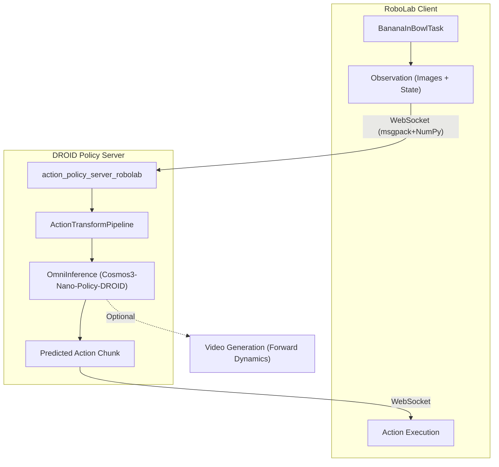
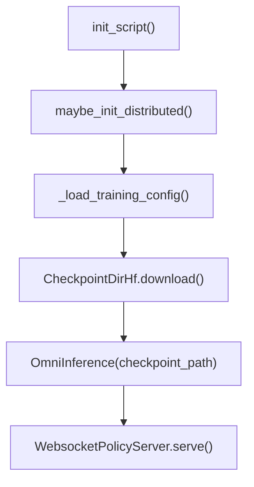

<!-- source: DeepWiki mcp.deepwiki.com · repo NVIDIA/cosmos-framework · page 9.3 DROID Policy Server Deployment · fetched 2026-10-26 -->

# DROID Policy Server Deployment

<details>
<summary>Relevant source files</summary>

The following files were used as context for generating this wiki page:

- [README.md](README.md)
- [cosmos_framework/inference/configs/model/Cosmos3-Nano.yaml](cosmos_framework/inference/configs/model/Cosmos3-Nano.yaml)
- [cosmos_framework/inference/configs/model/Cosmos3-Super.yaml](cosmos_framework/inference/configs/model/Cosmos3-Super.yaml)
- [cosmos_framework/scripts/action_policy_server_robolab.py](cosmos_framework/scripts/action_policy_server_robolab.py)
- [docs/action_policy_droid_server.md](docs/action_policy_droid_server.md)

</details>


This page covers the deployment of **Cosmos3-Nano-Policy-DROID** as a real-time action server. The server hosts the model and streams robotic actions to a client (such as the RoboLab simulation) using a WebSocket-based protocol.

## Overview

The DROID Policy Server is designed to bridge the gap between high-latency model inference and real-time robotic control. It utilizes the `cosmos_framework.scripts.action_policy_server_robolab` entry point to serve actions derived from visual observations. The server-client architecture allows the heavy compute (GPU-based inference) to be decoupled from the robot's control loop.

### Data Flow: Observation to Action

The following diagram illustrates the path from a camera observation in the RoboLab simulation to an executed action via the Cosmos3-Nano policy.

**Policy Server Data Flow**

Sources: [docs/action_policy_droid_server.md:1-12](), [cosmos_framework/scripts/action_policy_server_robolab.py:4-17]()

## Deployment Environment Setup

Deployment is standardized using Docker to ensure all CUDA and robotic dependencies are correctly configured.

### 1. Build the Docker Image
The framework provides a unified Dockerfile for both training and serving.
```bash
docker build -t cosmos-framework:latest .
```
Sources: [docs/action_policy_droid_server.md:27-33]()

### 2. Launch the Container
The container requires specific environment variables and volume mounts to access Hugging Face models and the local source code. Note the use of `uv sync` with specific groups:
*   `cu130-train`: Targets CUDA 13.x (use `cu128-train` for CUDA 12.x).
*   `policy-server`: Installs specialized dependencies for robotic serving.

```bash
export HF_TOKEN=<your_hf_token>

docker run -it \
  -e HF_HOME=/workspace/.cache/huggingface \
  -e HF_TOKEN=$HF_TOKEN \
  --net host --rm --runtime nvidia \
  -v .:/workspace \
  -v $HOME/.cache/huggingface:/root/.cache/huggingface \
  cosmos-framework:latest \
  bash -c 'uv sync --all-extras --group=cu130-train --group=policy-server && exec bash'
```
Sources: [docs/action_policy_droid_server.md:35-61]()

## Server Implementation

The server is implemented in `cosmos_framework.scripts.action_policy_server_robolab`. It uses `OmniInference` to load the model and `ActionTransformPipeline` to handle robotic state normalization.

### Key Components

| Component | Code Entity | Description |
| :--- | :--- | :--- |
| **Entry Point** | `action_policy_server_robolab.py` | Main script for the RoboLab/OpenPI-style WebSocket server. |
| **Inference Engine** | `OmniInference` | High-level API for running Cosmos3 model inference. |
| **Data Transform** | `ActionTransformPipeline` | Handles image resizing and robotic state normalization/denormalization. |
| **Checkpoint Loader** | `CheckpointDirHf` | Manages downloading and loading consolidated HF weights. |

### Server Configuration Defaults
The DROID policy operates with the following default spatial and temporal parameters:
*   **Target FPS**: 15.0 [cosmos_framework/scripts/action_policy_server_robolab.py:65]()
*   **Action Chunk Size**: 32 [cosmos_framework/scripts/action_policy_server_robolab.py:66]()
*   **Resolution**: 640x540 (concatenated views) [cosmos_framework/scripts/action_policy_server_robolab.py:67-68]()

**Server Initialization Logic**

Sources: [cosmos_framework/scripts/action_policy_server_robolab.py:24-145](), [cosmos_framework/scripts/action_policy_server_utils.py:54-59]()

## Connecting the Simulation Client

The server is tested against **RoboLab**, a simulation benchmark.

### Client Setup
1.  Clone the RoboLab repository.
2.  Build and launch the RoboLab Docker container.
3.  Run the task script pointing to the local server (defaulting to `localhost:8000`).

```bash
# In the RoboLab container
python policies/cosmos3/run.py --task BananaInBowlTask
```

### Parallel Evaluation
For benchmarking, the client supports headless execution across multiple environments:
```bash
python policies/cosmos3/run.py \
  --task BananaInBowlTask \
  --num-envs 10 \
  --headless
```
Sources: [docs/action_policy_droid_server.md:72-105]()

## Protocol and Streaming

The server speaks a `msgpack+NumPy` protocol compatible with OpenPI:
1.  **Handshake**: On connection, the server sends an empty metadata dictionary. [cosmos_framework/scripts/action_policy_server_robolab.py:8]()
2.  **Request**: The client sends an observation dictionary containing camera frames and robot state. [cosmos_framework/scripts/action_policy_server_robolab.py:9]()
3.  **Response**: The server responds with a dictionary containing the `action` (a chunk of future steps) and optionally a `video` (if forward dynamics are enabled). [cosmos_framework/scripts/action_policy_server_robolab.py:10]()

The `ActionTransformPipeline` ensures that the raw observations from the simulation are transformed into the format expected by the model (e.g., 8D joint positions or 10D EE poses) based on the training configuration. [cosmos_framework/scripts/action_policy_server_robolab.py:47](), [cosmos_framework/scripts/action_policy_server_robolab.py:112-130]()

Sources: [cosmos_framework/scripts/action_policy_server_robolab.py:4-17](), [docs/action_policy_droid_server.md:3-4]()

---

