# Page: Overview

# Overview

<details>
<summary>Relevant source files</summary>

The following files were used as context for generating this wiki page:

- [README.md](README.md)
- [cosmos_framework/inference/args.py](cosmos_framework/inference/args.py)
- [docs/action_policy_droid_server.md](docs/action_policy_droid_server.md)

</details>


**Cosmos-Framework** is an end-to-end platform for training and serving world models, specifically optimized for the **Cosmos3** model family [README.md:14-16](). It unifies vision-language models (VLM), video generators (VFM), world simulators, and world-action models into a single framework [README.md:21-23]().

The repository is structured around a single top-level Python package, `cosmos_framework`, which handles core logic for distributed training, multi-modal inference, and model serving [README.md:16-19]().

### The Cosmos3 Model Family
Cosmos3 is a suite of omnimodal world models built on a unified **Mixture-of-Transformers (MoT)** architecture [README.md:21-23](). It processes and generates language, images, video, audio, and action sequences. The framework supports several variants:
*   **Cosmos3-Nano**: Optimized for efficiency and robotics applications, including forward/inverse dynamics and policy modalities [cosmos_framework/inference/args.py:165-168]().
*   **Cosmos3-Vision**: Large-scale generative models for high-quality video and image synthesis.
*   **Cosmos3-Reasoner**: VLM-based models designed for complex reasoning tasks [cosmos_framework/inference/args.py:170-171]().

---

### Key Capabilities

#### 1. Distributed Training (SFT)
The framework provides a robust infrastructure for Supervised Fine-Tuning (SFT) using PyTorch distributed primitives [README.md:18-19]().
*   **Parallelism**: Supports Fully Sharded Data Parallel (FSDP), Tensor Parallel (TP), Context Parallel (CP), and Pipeline Parallel (PP) [README.md:18-19]().
*   **Checkpointing**: Uses native Distributed Checkpoint (DCP) format with utilities to import/export HuggingFace `safetensors` [README.md:18-19]().
*   **Data Handling**: Adapters for JSONL, WebDataset, and LeRobot formats [README.md:18-19]().

For details, see [Training (Supervised Fine-Tuning)](#3).

#### 2. Multi-Modal Inference
Inference is handled through a flexible CLI and API system that supports various modality modes such as `text2video`, `image2video`, and `forward_dynamics` [cosmos_framework/inference/args.py:157-171]().
*   **Offline Batching**: High-throughput generation from JSON/JSONL input manifests [README.md:77-83]().
*   **Backends**: Integration with native `cosmos_framework` engines as well as ecosystem shims for `diffusers`, `transformers`, and `vllm` [README.md:19-19]().

For details, see [Inference](#4).

#### 3. Online Serving and Action Policy
The framework includes a production-ready serving stack and specialized robotics support [README.md:19-19]().
*   **Ray Serve**: Scalable deployment for handling concurrent requests.
*   **Action Policy Servers**: Specialized servers (e.g., `action_policy_server_robolab`) for streaming actions to robotic clients [docs/action_policy_droid_server.md:66-68]().

---

### Repository Organization

The repository follows a single-package design where the core logic resides in `cosmos_framework/`, supplemented by standalone ecosystem packages [README.md:16-19]().

#### High-Level Structure
| Directory | Description |
| :--- | :--- |
| `cosmos_framework/` | Core package: data pipelines, model architectures, trainer, and inference logic. |
| `packages/` | Standalone shim libraries for `diffusers`, `transformers`, and `vllm` [README.md:19-19](). |
| `examples/` | SFT recipes (TOML) and shell scripts for launching training [README.md:63-66](). |
| `cosmos_framework/scripts/` | Entry points for training, inference, and model conversion [README.md:18-19](). |
| `inputs/` | Sample JSON manifests for testing various inference modalities [README.md:80-80](). |

For a detailed walkthrough, see [Repository Layout and Code Structure](#1.1).

#### System Mapping: Natural Language to Code Entities
The following diagram bridges high-level framework concepts to their specific implementation points in the codebase.

**Framework Entity Mapping**
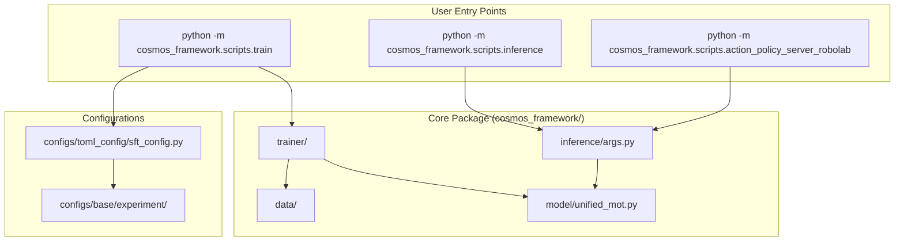
Sources: [README.md:16-19](), [cosmos_framework/inference/args.py:157-171](), [docs/action_policy_droid_server.md:66-68]()

---

### Getting Started

To begin using the framework, ensure your environment meets the system requirements (FFmpeg, CUDA 12.8+, etc.) and install using the `uv` package manager [README.md:40-56]().

```bash
# Example installation for CUDA 13.0
uv sync --all-extras --group=cu130-train
source .venv/bin/activate
```

For a step-by-step guide, see [Getting Started: Setup and Installation](#1.2).

#### Inference Configuration Flow
The framework uses a multi-layered resolution chain to determine parameters like guidance scale and frame count, managed primarily through `SamplingArgs` and `SamplingOverrides` [cosmos_framework/inference/args.py:86-110]().

**Inference Parameter Resolution**
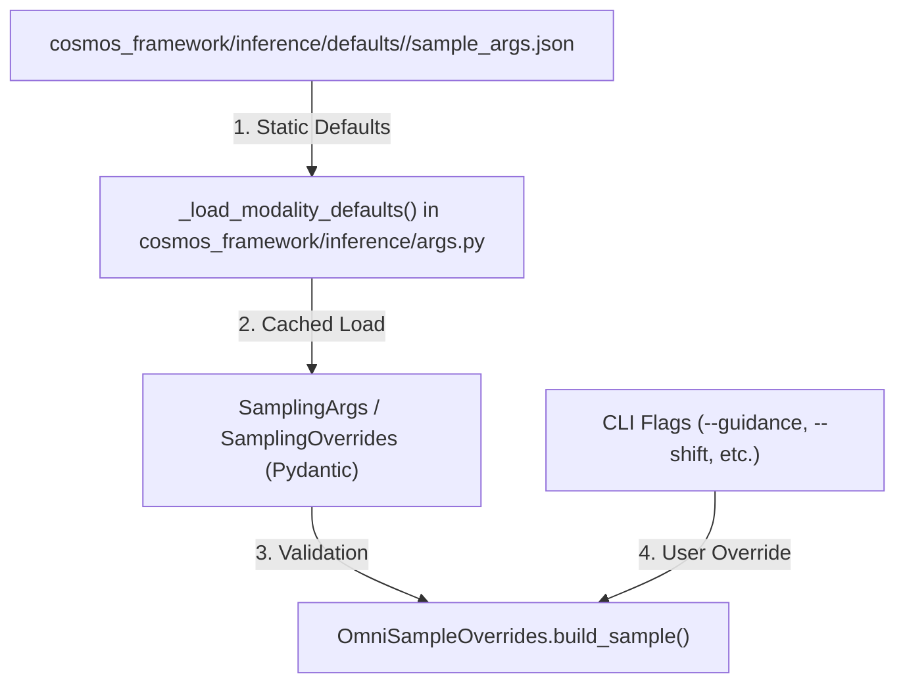
Sources: [cosmos_framework/inference/args.py:65-110]()

---

### Child Sections
*   [Repository Layout and Code Structure](#1.1): Detailed breakdown of the directory tree and internal package organization.
*   [Getting Started: Setup and Installation](#1.2): Environment prerequisites, installation commands, and verification steps.

---

# Page: Repository Layout and Code Structure

# Repository Layout and Code Structure

<details>
<summary>Relevant source files</summary>

The following files were used as context for generating this wiki page:

- [README.md](README.md)
- [docs/action_policy_droid_server.md](docs/action_policy_droid_server.md)
- [sitecustomize.py](sitecustomize.py)

</details>


This page provides a detailed walkthrough of the **Cosmos-Framework** repository. The project is designed around a single core Python package, `cosmos_framework`, which handles the end-to-end lifecycle of **Cosmos3** omnimodal world models—from data ingestion and distributed training to high-performance inference and serving [README.md:14-23]().

## Top-Level Directory Tree

The repository follows a modular structure where the core logic is isolated from examples, documentation, and ecosystem-specific shims.

| Directory | Purpose |
| :--- | :--- |
| `cosmos_framework/` | The primary Python package containing all core logic for training and inference [README.md:16-19](). |
| `packages/` | Standalone shim libraries that adapt Cosmos3 checkpoints for external ecosystems (Diffusers, Transformers, vLLM) [README.md:19-19](). |
| `examples/` | Reference SFT (Supervised Fine-Tuning) recipes and shell scripts for launching distributed jobs [README.md:62-68](). |
| `docs/` | Technical documentation covering setup, training, and inference [README.md:25-36](). |
| `docker/` | Dockerfiles and entrypoint scripts for containerized development and CI. |
| `tests/` | Unit and integration tests for verifying framework components. |
| `tools/` | Utility scripts for repository maintenance and development. |
| `inputs/` | Sample JSON/JSONL files used for testing inference modalities and prompt upsampling [README.md:78-84](). |

**Sources:** [README.md:14-84]()

---

## Core Package: `cosmos_framework/`

The `cosmos_framework/` directory is the heart of the repository. It is organized by functional concern, separating the model definitions from the training loops and the inference engine.

### Code Entity Mapping: Core Logic
The following diagram maps high-level framework responsibilities to specific code entities within the `cosmos_framework/` package.

**Diagram: System Responsibility to Code Entity Mapping**
```mermaid
graph TD
    subgraph "Training Infrastructure"
        TR["cosmos_framework.scripts.train"] --> T["cosmos_framework/trainer/"]
        T --> CB["cosmos_framework/callbacks/"]
        T --> CK["cosmos_framework/checkpoint/"]
    end

    subgraph "Model & Architecture"
        MOT["cosmos_framework/model/unified_mot.py"] --> ATTN["cosmos_framework/model/attention/"]
        MOT --> TOK["cosmos_framework/model/tokenizer/"]
    end

    subgraph "Data & Configuration"
        DS["cosmos_framework/data/"] --> CFG["cosmos_framework/configs/"]
        CFG --> SFT_PY["cosmos_framework/configs/toml_config/sft_config.py"]
    end

    subgraph "Inference Engine"
        INF["cosmos_framework.scripts.inference"] --> IE["cosmos_framework/inference/"]
        IE --> ARGS["cosmos_framework/inference/args.py"]
        IE --> RAY["cosmos_framework/inference/ray/"]
    end
```
**Sources:** [README.md:14-19](), [README.md:78-84]()

### Subpackage Walkthrough

*   **`configs/`**: Contains the two-layer configuration system. 
    *   `toml_config/sft_config.py`: Pydantic schemas for validating the high-level TOML recipes.
    *   `base/experiment/`: Low-level Hydra/LazyConfig SKUs for VFM (Video Functional Models) and VLM (Vision Language Models).
*   **`model/`**: Implementation of the Mixture-of-Transformers (MoT) architecture.
    *   `attention/`: Unified attention frontend supporting multiple backends (Flash2, Flash3, cuDNN) and Context Parallelism (CP).
    *   `tokenizer/`: Video and audio tokenizers (VAE/DC-AE) for compressing modalities into latent space.
*   **`data/`**: Dataset adapters for JSONL, WebDataset, and LeRobot formats, including sequence packing logic and action-specific datasets for robotics.
*   **`trainer/`**: The distributed training loop supporting FSDP, TP, and CP.
*   **`inference/`**: The inference engine, including modality-specific defaults in `defaults/` and Ray Serve integration in `ray/`.
*   **`scripts/`**: Command-line entry points. These are invoked via `python -m cosmos_framework.scripts.<name>`. Notable scripts include `train`, `inference`, and robotics-specific servers like `action_policy_server_robolab` [docs/action_policy_droid_server.md:66-67]().

---

## Ecosystem Packages (`packages/`)

To support the broader ML ecosystem without bloating the core framework, standalone "shim" libraries are provided. These allow Cosmos3 models to be used within popular third-party libraries.

| Package | Target Ecosystem | Description |
| :--- | :--- | :--- |
| `diffusers-cosmos3` | HuggingFace Diffusers | Wraps Cosmos3 generators for standard diffusion pipelines [README.md:19-19](). |
| `transformers-cosmos3` | HuggingFace Transformers | Adapts Cosmos3 Reasoner (VLM) models for the Transformers library [README.md:19-19](). |
| `vllm-cosmos3` | vLLM | Backend shim for high-throughput serving of the Reasoner model [README.md:19-19](). |

**Sources:** [README.md:14-19]()

---

## Configuration and Recipe Flow

The repository uses a "Recipe" pattern for training. A user selects a TOML file from `examples/toml/sft_config/` and launches it using a corresponding shell script [README.md:62-68]().

### Code Entity Mapping: Configuration Flow
This diagram illustrates how a user-facing recipe TOML is transformed into an active training state.

**Diagram: Configuration Resolution Flow**
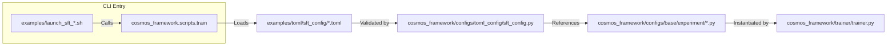
**Sources:** [README.md:62-68]()

---

## Robotics and Action Policy Structure

The framework includes specialized components for robotics, specifically the Cosmos3-Nano-Policy-DROID model. This involves a server-client architecture where the server streams actions to robotic environments [docs/action_policy_droid_server.md:1-3]().

### Action Server Architecture
The action policy system is split between the framework (server) and external simulation environments (client).

**Diagram: Action Policy Data Flow**
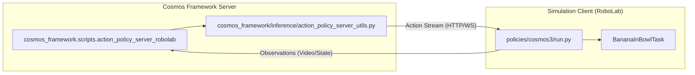
**Sources:** [docs/action_policy_droid_server.md:1-105]()

---

## Runtime Customization (`sitecustomize.py`)

The repository includes a `sitecustomize.py` file which is automatically imported by every Python process started with `PYTHONPATH=.` [sitecustomize.py:6-6](). It provides two key infrastructure features:

1.  **Shared Memory Management**: If `COSMOS_DL_FILE_SYSTEM_SHARING=1` is set, it switches the PyTorch `DataLoader` IPC strategy to `file_system` to prevent `/dev/shm` overflows during large video batch training [sitecustomize.py:24-28]().
2.  **Load Tracing**: If `LOAD_TRACE_DIR` is set, it inventories all files touched during a process execution to help identify dead code [sitecustomize.py:32-59]().

**Sources:** [sitecustomize.py:1-60]()

---

# Page: Getting Started: Setup and Installation

# Getting Started: Setup and Installation

<details>
<summary>Relevant source files</summary>

The following files were used as context for generating this wiki page:

- [README.md](README.md)
- [SECURITY.md](SECURITY.md)
- [docs/action_policy_droid_server.md](docs/action_policy_droid_server.md)

</details>


This page provides a comprehensive guide to setting up the environment for the Cosmos-Framework. It covers system prerequisites, dependency management using `uv`, CUDA variant selection, container-specific configurations, and model authentication.

## System Prerequisites

Before installing the Python package, the host system must have specific binary utilities and libraries installed to handle video processing, large file storage, and GUI-related dependencies for certain attention backends.

| Dependency | Purpose |
| :--- | :--- |
| `ffmpeg` | Required for video encoding/decoding within the data pipeline and inference scripts. |
| `git-lfs` | Necessary for downloading large model weights from HuggingFace. |
| `libx11-dev` | Required for specific X11-based dependencies in some environments. |
| `curl` / `wget` | Used for downloading installation scripts and assets. |

**Installation Command (Ubuntu/Debian):**
```bash
sudo apt-get update && sudo apt-get install -y --no-install-recommends \
    curl ffmpeg git-lfs libx11-dev tree wget
```
Sources: [README.md:43-47](), [docs/action_policy_droid_server.md:20-25]()

---

## Installation via `uv`

The Cosmos-Framework utilizes `uv` for high-performance Python package and environment management. This ensures reproducible builds and fast dependency resolution.

### 1. CUDA Variant Selection
The framework supports different CUDA versions via `uv` dependency groups. You must choose the group that matches your installed NVIDIA driver version.

*   **`cu130`**: For systems with CUDA 13.0 compatible drivers (Recommended).
*   **`cu128`**: For systems with CUDA 12.8 compatible drivers.
*   **`-train` suffix**: Append this to include training-specific dependencies (e.g., `cu130-train`).
*   **`policy-server`**: Required for running the action policy servers.

### 2. Environment Synchronization
Run the following command from the repository root to create a virtual environment and install all dependencies:
```bash
# Example for CUDA 13.0 with training support
uv sync --all-extras --group=cu130-train
source .venv/bin/activate
```
Sources: [README.md:49-57](), [docs/action_policy_droid_server.md:52-59]()

---

## Environment Data Flow and Entity Mapping

The following diagrams illustrate how the installation process maps system-level components to the internal `cosmos_framework` environment and scripts.

### Setup Process Mapping
```mermaid
graph TD
    subgraph "Natural Language Space"
        "System_Requirements"["System Requirements"]
        "Python_Environment"["Python Environment"]
        "CUDA_Version"["CUDA Version"]
        "Model_Weights"["Model Weights"]
    end

    subgraph "Code Entity Space"
        "apt_install"["apt-get install ffmpeg libx11-dev"]
        "uv_sync"["uv sync --group=cu130-train"]
        "venv_python"["source .venv/bin/activate"]
        "torch_cuda"["torch.version.cuda"]
        "hf_token"["export HF_TOKEN=..."]
        "prefetch_script"["cosmos_framework.scripts.prefetch_hf_checkpoints"]
    end

    "System_Requirements" --> "apt_install"
    "Python_Environment" --> "uv_sync"
    "uv_sync" --> "venv_python"
    "CUDA_Version" --> "torch_cuda"
    "Model_Weights" --> "hf_token"
    "hf_token" --> "prefetch_script"
```
Sources: [README.md:43-57](), [docs/action_policy_droid_server.md:38-44]()

### CLI Entrypoint Mapping
```mermaid
graph LR
    subgraph "User Tasks"
        "Train_Model"["Train Model"]
        "Run_Inference"["Run Inference"]
        "Serve_Policy"["Serve Policy"]
    end

    subgraph "Code Entry Points"
        "train_script"["cosmos_framework.scripts.train"]
        "inference_script"["cosmos_framework.scripts.inference"]
        "policy_script"["cosmos_framework.scripts.action_policy_server_robolab"]
    end

    "Train_Model" --> "train_script"
    "Run_Inference" --> "inference_script"
    "Serve_Policy" --> "policy_script"
```
Sources: [README.md:18-19](), [docs/action_policy_droid_server.md:66-68]()

---

## Containerized Installation

### Docker Deployment
The repository supports Docker-based deployment, which is the recommended method for the Policy Server.

**Building the Image:**
```bash
docker build -t cosmos-framework:latest .
```
Sources: [docs/action_policy_droid_server.md:27-33]()

**Running the Container:**
When launching the container, it is critical to mount the local directory and provide the `HF_TOKEN`.
```bash
docker run -it \
  -e HF_HOME=/workspace/.cache/huggingface \
  -e HF_TOKEN=$HF_TOKEN \
  --net host --runtime nvidia \
  -v .:/workspace \
  cosmos-framework:latest
```
Sources: [docs/action_policy_droid_server.md:41-59]()

### NGC Container Quirks
When running inside an NVIDIA GPU Cloud (NGC) PyTorch container (e.g., `nvcr.io/nvidia/pytorch:25.09-py3`), a known conflict exists between the container's pre-installed libraries and the framework's dependencies.

**Critical Fix:**
You must clear `LD_LIBRARY_PATH` after activating the environment to avoid the `ImportError: cannot import name '_functionalization' from 'torch._C'` error.
```bash
source .venv/bin/activate && export LD_LIBRARY_PATH=
```
Sources: [README.md:56-56]()

---

## HuggingFace Authentication and Verification

Cosmos3 model weights are hosted on HuggingFace. Accessing them requires authentication.

### Authentication
1.  Obtain a User Access Token from [HuggingFace Settings](https://huggingface.co/settings/tokens).
2.  Set the environment variable: `export HF_TOKEN=<your_hf_token>`.

### Cache Management
By default, models are stored in `~/.cache/huggingface`. You can override this by setting the `HF_HOME` environment variable. This is particularly important in Docker environments to ensure weights persist across container restarts.
Sources: [docs/action_policy_droid_server.md:38-51]()

### Verification
To verify the installation and GPU accessibility, you can run a quick single-GPU inference test:
```bash
python -m cosmos_framework.scripts.inference \
    --parallelism-preset=latency \
    -i "inputs/omni/t2v.json" \
    -o outputs/verification_test \
    --checkpoint-path Cosmos3-Nano \
    --seed=0
```
Sources: [README.md:77-84]()

---

## Troubleshooting the Environment

If installation or runtime fails, check the following common issues.

### Common Issues and Fixes
| Error | Remediation |
| :--- | :--- |
| `ImportError: cannot import name '_functionalization'` | Clear your library path: `export LD_LIBRARY_PATH=` |
| `ModuleNotFoundError: No module named 'cosmos_framework'` | Ensure you have run `uv sync` and activated the `.venv`. |
| CUDA Version Mismatch | Check `nvidia-smi` against your chosen `uv` group (`cu130` vs `cu128`). |
| Permission Denied (HF) | Ensure `HF_TOKEN` is exported and you have accepted the model license on HuggingFace. |

### Diagnostic Flow
```mermaid
flowchart TD
    "Start"["Installation Error"] --> "Q1"{"Is it a Torch error?"}
    "Q1" -- Yes --> "Fix1"["export LD_LIBRARY_PATH=''"]
    "Q1" -- No --> "Q2"{"Is it a missing module?"}
    "Q2" -- Yes --> "Fix2"["uv sync --all-extras --reinstall"]
    "Q2" -- No --> "Q3"{"Is it a CUDA error?"}
    "Q3" -- Yes --> "Fix3"["Switch between cu130 and cu128 groups"]
    "Q3" -- No --> "Fix4"["Check HF_TOKEN and HF_HOME"]
```
Sources: [README.md:49-57](), [docs/action_policy_droid_server.md:52-61]()

---

# Page: Core Architecture

# Core Architecture

<details>
<summary>Relevant source files</summary>

The following files were used as context for generating this wiki page:

- [cosmos_framework/inference/inference.py](cosmos_framework/inference/inference.py)
- [cosmos_framework/inference/transfer.py](cosmos_framework/inference/transfer.py)
- [cosmos_framework/model/vfm/mot/unified_mot.py](cosmos_framework/model/vfm/mot/unified_mot.py)
- [cosmos_framework/model/vfm/omni_mot_model.py](cosmos_framework/model/vfm/omni_mot_model.py)
- [cosmos_framework/model/vfm/vlm/qwen3_vl/qwen3_vl.py](cosmos_framework/model/vfm/vlm/qwen3_vl/qwen3_vl.py)

</details>


The `cosmos_framework` is a unified Python package designed to support the training and inference of the Cosmos3 model family. It integrates Mixture-of-Transformers (MoT) architectures, a multi-modal data pipeline, and a scalable training infrastructure supporting FSDP, Tensor Parallelism, and Context Parallelism.

### Package Structure Overview

The codebase is organized into functional subpackages that separate configuration, model logic, data handling, and execution orchestration.

| Subpackage | Responsibility |
| :--- | :--- |
| `cosmos_framework/configs/` | Two-layer config system: Pydantic TOML validation and LazyConfig SKUs. |
| `cosmos_framework/model/` | Unified MoT architecture, VLM backbones, and VAE tokenizers. |
| `cosmos_framework/data/` | Multi-modal datasets, sequence packing, and data augmentors. |
| `cosmos_framework/trainer/` | Training loop orchestration and distributed strategy management. |
| `cosmos_framework/inference/` | Inference engine, sampling logic, and Ray/Gradio serving. |
| `cosmos_framework/scripts/` | Entry-point scripts for training, inference, and model conversion. |

**Sources:**
- [cosmos_framework/model/vfm/omni_mot_model.py:64-91]()
- [cosmos_framework/inference/inference.py:22-48]()

### System Data Flow: Configuration to Execution

The framework follows a structured flow where high-level user requirements (TOML) are validated and merged with low-level model SKUs (LazyConfig) before being instantiated by the trainer or inference engine.

#### Configuration and Initialization Flow
The following diagram illustrates how the `cosmos_framework.scripts.train` entry point processes configurations to initialize the system.

```mermaid
graph TD
    subgraph "Configuration_Space"
        A["examples/toml/sft_config/*.toml"] -- "Validated_by" --> B["SFTExperimentConfig"]
        B -- "References_SKU" --> C["cosmos_framework/configs/base/experiment/"]
        C -- "LazyConfig" --> D["instantiate()"]
    end

    subgraph "Execution_Space"
        D --> E["cosmos_framework/trainer/trainer.py"]
        E --> F["OmniMoTModel"]
        E --> G["JointDataLoader"]
    end

    [cosmos_framework/scripts/train.py] --> A
    F["OmniMoTModel"] --- F1["cosmos_framework/model/vfm/omni_mot_model.py"]
```

**Sources:**
- [cosmos_framework/model/vfm/omni_mot_model.py:20-21]()
- [cosmos_framework/model/vfm/omni_mot_model.py:64-70]()

---

### Major Subsystems

#### 1. Configuration System
The framework utilizes a dual-layer configuration approach. The top layer uses Pydantic-validated TOML files for user-facing experiment settings (e.g., learning rates, batch sizes). The bottom layer uses a `LazyConfig` system to define complex model architectures and experiment SKUs.
*   For details, see [Configuration System](#2.1).

#### 2. Model Architecture
At the core of Cosmos3 is the Mixture-of-Transformers (MoT) architecture. This subpackage manages the unified network definitions for both Video Foundation Models (VFM) and Vision-Language Models (VLM/Reasoner), including specialized backbones like `Qwen3VL` and `Nemotron3DenseVL`. It uses `OmniMoTModel` as the primary entry point for flow-matching objectives.
*   For details, see [Model Architecture](#2.2).

#### 3. Data Pipeline
The data pipeline handles diverse modalities including text, images, and video. It supports advanced features like `SequencePacking` to maximize GPU utilization and interfaces with multiple storage formats (JSONL, WebDataset, LeRobot).
*   For details, see [Data Pipeline](#2.3).

#### 4. Training Infrastructure
The training subsystem orchestrates distributed execution across large clusters. It includes the `Trainer` class, a robust `Callback` system for telemetry (WandB, MFU monitoring), and a checkpointing module that supports Distributed Checkpoint (DCP).
*   For details, see [Training Infrastructure](#2.4).

#### 5. Inference and Serving
The inference subsystem provides a high-performance sampling engine. It includes a resolution-aware parameter resolution chain and supports online serving via Ray Serve and Gradio. It uses `OmniSampleArgs` to define sampling behavior and `OmniMoTModel` for generation.
*   For details, see [Inference](#4).

---

### Code Entity Mapping: Inference Resolution

This diagram bridges the natural language "Inference Request" to the specific code entities in `cosmos_framework/inference/` that resolve parameters and execute the model.

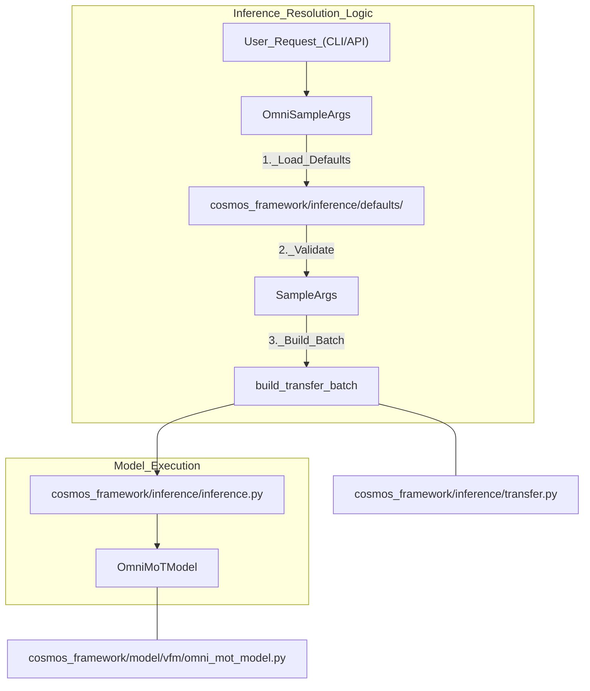

**Sources:**
- [cosmos_framework/inference/inference.py:22-39]()
- [cosmos_framework/inference/transfer.py:142-156]()
- [cosmos_framework/model/vfm/omni_mot_model.py:64-68]()

### Shared Infrastructure
The `cosmos_framework/utils/` directory contains essential primitives used across all subsystems:
*   **Feature Flags**: Managed in `flags.py` to toggle experimental features like `TRAINING` or `DEVICE` settings.
*   **Distributed Helpers**: Utilities for managing process groups, `ParallelDims`, and collective operations.
*   **Easy IO**: Unified file backend for local and cloud storage.
*   **Lazy Config**: Registry and instantiation logic for `LazyDict`.
*   For details, see [Utilities and Shared Infrastructure](#2.5).

**Sources:**
- [cosmos_framework/utils/flags.py:19]()
- [cosmos_framework/utils/lazy_config.py:20-21]()
- [cosmos_framework/model/vfm/omni_mot_model.py:59-61]()

---

# Page: Configuration System

# Configuration System

<details>
<summary>Relevant source files</summary>

The following files were used as context for generating this wiki page:

- [.github/workflows/pre-commit.yml](.github/workflows/pre-commit.yml)
- [cosmos_framework/configs/base/config.py](cosmos_framework/configs/base/config.py)
- [cosmos_framework/configs/base/experiment/sft/vision_sft_nano.py](cosmos_framework/configs/base/experiment/sft/vision_sft_nano.py)
- [cosmos_framework/configs/toml_config/sft_config.py](cosmos_framework/configs/toml_config/sft_config.py)
- [cosmos_framework/configs/toml_config/toml_config_helper.py](cosmos_framework/configs/toml_config/toml_config_helper.py)
- [cosmos_framework/utils/config.py](cosmos_framework/utils/config.py)
- [tests/launch_regression_test.py](tests/launch_regression_test.py)

</details>


Cosmos-Framework utilizes a two-layer configuration architecture designed to balance strict type safety with the flexibility required for complex deep learning experiments. The system separates the high-level experiment definition (TOML-based) from the low-level model and training primitives (LazyConfig-based).

## Two-Layer Architecture Overview

The configuration system is split into two distinct layers that interact during the initialization of a training or inference job:

1.  **The SFT Recipe Layer (Pydantic/TOML):** This layer is user-facing. It uses TOML files to define experiment metadata, dataset paths, optimizer hyper-parameters, and parallelism strategies. These are validated against Pydantic schemas defined in `cosmos_framework/configs/toml_config/sft_config.py` [cosmos_framework/configs/toml_config/sft_config.py:4-17]().
2.  **The Experiment SKU Layer (LazyConfig):** This layer defines the structural "blueprint" of the model and training loop. It uses a "LazyConfig" approach where Python objects are represented as `LazyDict` or `LazyCall` objects that can be instantiated into real objects. These SKUs are located in `cosmos_framework/configs/base/experiment/` [cosmos_framework/configs/base/experiment/sft/vision_sft_nano.py:56-61]().

### Configuration Data Flow

The following diagram illustrates how a user-provided TOML recipe is transformed into a running experiment by bridging the Natural Language/File space to the Code Entity space.

**Configuration Resolution Flow**
```mermaid
graph TD
    subgraph "Natural Language / File Space"
        TOML["SFT Recipe (.toml)"]
        LaunchScript["launch_sft_*.sh"]
    end

    subgraph "Code Entity Space: Validation & Translation"
        SFTExp["SFTExperimentConfig (Pydantic)"]
        JobCfg["JobConfig (Pydantic)"]
        BHO["build_hydra_overrides()"]
        PR["PATH_REMAPS"]
    end

    subgraph "Code Entity Space: Instantiation"
        LazyDict["LazyDict (Experiment SKU)"]
        MakeCfg["make_config()"]
        Instantiate["instantiate()"]
    end

    TOML --> SFTExp
    LaunchScript -- "CLI Overrides" --> BHO
    SFTExp --> JobCfg
    JobCfg -- "experiment name" --> LazyDict
    BHO -- "Uses" --> PR
    PR -- "Generates Dotted Keys" --> LazyDict
    LazyDict -- "Registered in" --> MakeCfg
    MakeCfg -- "Hydra Compose" --> Instantiate
    Instantiate --> "Trainer / Model / Dataloader"
```
**Sources:** [cosmos_framework/configs/toml_config/sft_config.py:19-22](), [cosmos_framework/configs/toml_config/toml_config_helper.py:115-123](), [cosmos_framework/configs/base/config.py:48-55]().

---

## 1. Pydantic-Validated TOML Schema

The Supervised Fine-Tuning (SFT) recipes are the primary entry point for users. These recipes are validated using Pydantic to ensure that all required parameters are present and of the correct type before GPU resources are allocated.

### Key Classes in `sft_config.py`

*   **`SFTExperimentConfig`**: The root configuration object that encapsulates `JobConfig`, `TrainPolicyConfig`, `ModelConfig`, and other sub-sections [cosmos_framework/configs/toml_config/sft_config.py:28-30]().
*   **`JobConfig`**: Handles experiment metadata such as `project`, `group`, and `name`. It also includes the `task` field which selects the base configuration tree (`vfm` vs `vlm`) [cosmos_framework/configs/toml_config/sft_config.py:32-45]().
*   **`ParallelismConfig`**: Configures FSDP, context-parallel (CP), and classifier-free-guidance (CFG) degrees [cosmos_framework/configs/toml_config/sft_config.py:125-130]().
*   **`EMAConfig`**: Configures the Exponential Moving Average tracking for generation-pathway weights [cosmos_framework/configs/toml_config/sft_config.py:89-98]().

### Mapping Tasks to SKUs
The system uses `TASK_TO_BASE_CONFIG` in `toml_config_helper.py` to map the `job.task` field to the appropriate base Hydra configuration file [cosmos_framework/configs/toml_config/toml_config_helper.py:23-26]().

**Sources:** [cosmos_framework/configs/toml_config/sft_config.py:32-130](), [cosmos_framework/configs/toml_config/toml_config_helper.py:23-26]().

---

## 2. LazyConfig Experiment SKUs

While TOML handles "values," the LazyConfig system handles "structure." These Python files define how components like the optimizer, scheduler, and model architecture are wired together using `LazyDict` and `LazyCall` (aliased as `L`).

### VFM vs. VLM Trees
The framework maintains two distinct configuration trees based on the model modality:
*   **VFM (Video Foundation Model):** Uses `cosmos_framework/configs/base/config.py` as the entry point. Experiments like `vision_sft_nano` are registered here [cosmos_framework/configs/base/config.py:24-45]().
*   **VLM (Vision-Language Model):** Uses `cosmos_framework/configs/base/vlm/config.py` as the entry point. This tree is tailored for autoregressive models like Qwen3-VL.

### PATH_REMAPS
Because the TOML schema is flat and user-friendly, but the underlying `LazyDict` structure is deeply nested, the system uses `PATH_REMAPS` to route TOML keys to their correct destination in the Hydra tree [cosmos_framework/configs/toml_config/toml_config_helper.py:45-90]().

| TOML Path | Task | Hydra Destination Path |
| :--- | :--- | :--- |
| `model.parallelism` | vfm | `model.config.parallelism` |
| `dataloader_train.max_caption_tokens` | vfm | `dataloader_train.dataloader.datasets.video.dataset.max_caption_tokens` |
| `model.backbone` | vlm | `model.config.policy.backbone` |

**Sources:** [cosmos_framework/configs/toml_config/toml_config_helper.py:45-90](), [cosmos_framework/configs/base/config.py:95-100]().

---

## 3. Inference Configuration & Resolution

Inference utilizes a specialized resolution chain to handle the variety of modalities (e.g., `text2video`, `image2video`) and sampling parameters.

### The Resolution Chain
When a user runs `cosmos_framework.scripts.inference`, the configuration is resolved through a series of defaults and overrides.

**Inference Config Entity Map**
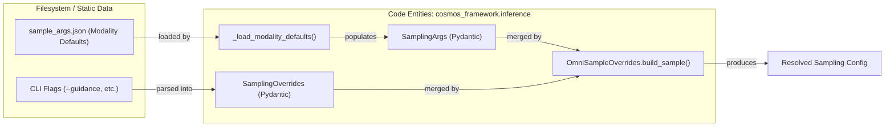
**Sources:** [cosmos_framework/utils/config.py:109-132](), [tests/launch_regression_test.py:43-44]().

---

## 4. Hydra Override Syntax

The framework supports Hydra-style override syntax, allowing users to modify nested configuration keys without editing the physical files. The function `build_hydra_overrides` transforms the validated TOML dictionary into a list of CLI-compatible strings [cosmos_framework/configs/toml_config/toml_config_helper.py:115-123]().

### Example Transformation
A TOML entry like:
```toml
[model.parallelism]
data_parallel_shard_degree = 8
```
Is transformed into the Hydra override:
`model.config.parallelism.data_parallel_shard_degree=8`

This allows the `cosmos_framework.scripts.train` script to compose the final configuration using `Hydra` while maintaining the simplicity of TOML for the end-user [tests/launch_regression_test.py:9-11]().

**Sources:** [cosmos_framework/configs/toml_config/toml_config_helper.py:115-144](), [tests/launch_regression_test.py:9-11]().

---

# Page: Model Architecture

# Model Architecture

<details>
<summary>Relevant source files</summary>

The following files were used as context for generating this wiki page:

- [cosmos_framework/inference/inference.py](cosmos_framework/inference/inference.py)
- [cosmos_framework/inference/transfer.py](cosmos_framework/inference/transfer.py)
- [cosmos_framework/model/vfm/mot/unified_mot.py](cosmos_framework/model/vfm/mot/unified_mot.py)
- [cosmos_framework/model/vfm/omni_mot_model.py](cosmos_framework/model/vfm/omni_mot_model.py)
- [cosmos_framework/model/vfm/vlm/qwen3_vl/qwen3_vl.py](cosmos_framework/model/vfm/vlm/qwen3_vl/qwen3_vl.py)
- [cosmos_framework/model/vfm/vlm/qwen3_vl_moe/moe.py](cosmos_framework/model/vfm/vlm/qwen3_vl_moe/moe.py)
- [cosmos_framework/model/vfm/vlm/qwen3_vl_moe/moe_test.py](cosmos_framework/model/vfm/vlm/qwen3_vl_moe/moe_test.py)

</details>


The Cosmos-Framework architecture is built around the **Mixture-of-Transformers (MoT)** design, a unified approach for both Video Foundation Models (VFM) and Vision-Language Models (VLM). This architecture integrates high-performance attention backends, diverse video tokenization schemes, and scalable parallelism strategies to support tasks ranging from text-to-video generation to robotic action policy reasoning.

### Unified Mixture-of-Transformers (MoT)

The core of the framework is the `OmniMoTModel` class, which serves as the top-level `ImaginaireModel` for training and inference [cosmos_framework/model/vfm/omni_mot_model.py:64-70](). It orchestrates the Mixture-of-Transformers (MoT) backbone, which is implemented in `unified_mot.py` to support multiple architecture families including **Qwen3-VL** (Dense and MoE) and **Nemotron 3 Dense VL** [cosmos_framework/model/vfm/mot/unified_mot.py:86-96]().

For generative tasks, the `Cosmos3VFMNetwork` handles the rectified-flow diffusion process [cosmos_framework/model/vfm/mot/cosmos3_vfm_network.py:43-43](), utilizing `RectifiedFlow` for training and various samplers (EDM, UniPC, FixedStep) for inference [cosmos_framework/model/vfm/omni_mot_model.py:38-41]().

#### Structural Overview
The diagram below illustrates the relationship between the unified network and its primary components.

**Cosmos3 Model Entity Map**
```mermaid
graph TD
    subgraph "Model Entry Points"
        [omni_mot_model.py] --> "OmniMoTModel"
        "OmniMoTModel" --> "Cosmos3VFMNetwork"
        "OmniMoTModel" --> "UnifiedMoT"
    end

    subgraph "VLM Backbones"
        "UnifiedMoT" --> [Qwen3VLPreTrainedModel]
        "UnifiedMoT" --> [Qwen3VLMoePreTrainedModel]
        "UnifiedMoT" --> [Nemotron3DenseVLPreTrainedModel]
    end

    subgraph "Generative Components"
        "Cosmos3VFMNetwork" --> "RectifiedFlow"
        "Cosmos3VFMNetwork" --> "Mixture-of-Transformers Blocks"
    end

    subgraph "Parallelism Wrappers"
        "OmniMoTModel" --> [FSDPModule]
        "OmniMoTModel" --> [ParallelDims]
    end
```
**Sources:** [cosmos_framework/model/vfm/omni_mot_model.py:64-91](), [cosmos_framework/model/vfm/mot/unified_mot.py:86-132](), [cosmos_framework/model/vfm/mot/cosmos3_vfm_network.py:43-43]()

---

### Video Tokenizers (VAE)

The framework utilizes a variety of Video Autoencoders (VAE) to compress high-dimensional video data into a latent space. The system is designed around the `VideoTokenizerInterface`, allowing for interchangeable use of different architectures like **Wan2.2 VAE**, **DC-AE**, and **UniAE** [cosmos_framework/model/vfm/omni_mot_model.py:56-56](). These tokenizers are instantiated during model setup and handle the spatial and temporal compression factors required for efficient processing [cosmos_framework/model/vfm/omni_mot_model.py:110-155]().

For details, see [Video Tokenizers (VAE)](#2.2.2).

---

### Attention and Parallelism

To handle long-context video sequences and large-scale model parameters, the architecture employs a unified attention frontend in `cosmos_framework/model/attention/` that dispatches to optimized backends [cosmos_framework/model/vfm/mot/unified_mot.py:13-13](). The `dispatch_attention` function manages different masking types and backend selection [cosmos_framework/model/vfm/mot/unified_mot.py:27-30]().

The framework integrates multiple parallelism dimensions:
*   **Fully Sharded Data Parallel (FSDP):** Shards model states using `FSDPModule` [cosmos_framework/model/vfm/omni_mot_model.py:16-16]().
*   **Tensor Parallel (TP):** Handled via `ParallelDims` and specialized network parallelization logic [cosmos_framework/model/vfm/omni_mot_model.py:45-61]().
*   **Context Parallel (CP):** Distributes long video sequences across devices using `context_parallel_broadcast_tensor_list` [cosmos_framework/model/vfm/mot/context_parallel_utils.py:42-42]().

For details, see [Attention Backends](#2.2.1).

---

### Component Integration

The following diagram bridges the high-level architecture concepts to the specific code entities responsible for their implementation.

**Code Entity Space Mapping**
```mermaid
graph LR
    subgraph "Natural Language Space"
        "Unified Architecture"
        "Parallelism"
        "Inference Logic"
        "MoE Routing"
    end

    subgraph "Code Entity Space"
        "Unified Architecture" --- [cosmos_framework/model/vfm/mot/unified_mot.py]
        "Parallelism" --- [cosmos_framework/model/vfm/mot/parallelize_vfm_network.py]
        "Inference Logic" --- [cosmos_framework/inference/inference.py]
        "MoE Routing" --- [cosmos_framework/model/vfm/vlm/qwen3_vl_moe/moe.py]
    end
```
**Sources:** [cosmos_framework/model/vfm/omni_mot_model.py:1-91](), [cosmos_framework/inference/inference.py:1-48](), [cosmos_framework/model/vfm/vlm/qwen3_vl_moe/moe.py:47-80]()

### Summary Table: Core Architecture Components

| Component | File Path | Primary Role |
| :--- | :--- | :--- |
| **Omni MoT Model** | `cosmos_framework/model/vfm/omni_mot_model.py` | Top-level model wrapper for VFM/VLM [cosmos_framework/model/vfm/omni_mot_model.py:64-70](). |
| **Unified MoT** | `cosmos_framework/model/vfm/mot/unified_mot.py` | Shared transformer backbone across model families [cosmos_framework/model/vfm/mot/unified_mot.py:86-96](). |
| **Qwen3-VL MoE** | `cosmos_framework/model/vfm/vlm/qwen3_vl_moe/moe.py` | Implementation of Mixture-of-Experts with Grouped GEMM [cosmos_framework/model/vfm/vlm/qwen3_vl_moe/moe.py:47-80](). |
| **Inference Pipeline** | `cosmos_framework/inference/inference.py` | Orchestrates batch packing and sampling [cosmos_framework/inference/inference.py:66-124](). |
| **Transfer Logic** | `cosmos_framework/inference/transfer.py` | Handles image/video transfer tasks (Edge, Blur) [cosmos_framework/inference/transfer.py:55-87](). |

**Sources:** [cosmos_framework/model/vfm/omni_mot_model.py:64-91](), [cosmos_framework/model/vfm/mot/unified_mot.py:86-132](), [cosmos_framework/inference/inference.py:66-124](), [cosmos_framework/inference/transfer.py:55-87]()

---

# Page: Attention Backends

# Attention Backends

<details>
<summary>Relevant source files</summary>

The following files were used as context for generating this wiki page:

- [cosmos_framework/inference/inference.py](cosmos_framework/inference/inference.py)
- [cosmos_framework/inference/transfer.py](cosmos_framework/inference/transfer.py)
- [cosmos_framework/model/vfm/mot/unified_mot.py](cosmos_framework/model/vfm/mot/unified_mot.py)
- [cosmos_framework/model/vfm/omni_mot_model.py](cosmos_framework/model/vfm/omni_mot_model.py)
- [cosmos_framework/model/vfm/vlm/qwen3_vl/qwen3_vl.py](cosmos_framework/model/vfm/vlm/qwen3_vl/qwen3_vl.py)

</details>


The Cosmos-Framework provides a unified attention frontend that abstracts various high-performance attention backends. This system automatically selects the most efficient kernel based on hardware capabilities, sequence properties (such as causal masking), and memory constraints. It supports advanced features including variable-length (varlen) sequences for efficient packing, context parallelism (CP), and specialized kernels like FlashAttention-3 and NATTEN.

## Unified Attention Frontend

The primary entry point for attention operations is the `Attention` class and its functional counterpart `attention`. These components handle the dispatch logic to specific backends while maintaining a consistent interface for the model layers. The `OmniMoTModel` and `Cosmos3VFMNetwork` rely on this unified interface to execute attention across different modalities [cosmos_framework/model/vfm/omni_mot_model.py:43-45]().

### Backend Selection Logic
The framework evaluates compatibility for multiple backends in a prioritized order. The selection is governed by the `is_backend_compatible` function, which checks hardware support (e.g., Hopper architecture for FlashAttention-3) and input requirements (e.g., causal vs. non-causal).

| Backend | Priority | Hardware/Requirement | File Reference |
| :--- | :--- | :--- | :--- |
| **Flash3** | High | NVIDIA Hopper (sm90a), Head Dim 64/128 | [cosmos_framework/model/attention/backend.py:101-118]() |
| **Flash2** | Medium | NVIDIA Ampere+ (sm80+), Head Dim <= 256 | [cosmos_framework/model/attention/backend.py:84-99]() |
| **NATTEN** | Specialized | Neighborhood Attention (Sliding Window) | [cosmos_framework/model/attention/backend.py:137-146]() |
| **cuDNN** | Fallback | General CUDA support | [cosmos_framework/model/attention/backend.py:120-135]() |
| **SDPA** | Baseline | PyTorch Native (Scaled Dot Product) | [cosmos_framework/model/attention/backend.py:148-154]() |

**Sources:**
- `cosmos_framework/model/attention/backend.py` [101-154]()
- `cosmos_framework/model/attention/attention.py` [220-256]()

---

## Implementation Architecture

The following diagram illustrates the flow from a high-level `Attention` module call down to the specific hardware kernels.

### Attention Dispatch Flow
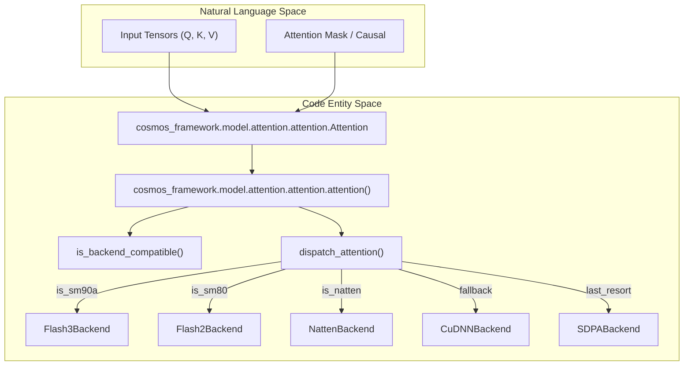
**Sources:**
- `cosmos_framework/model/attention/attention.py` [113-218]() (Attention class)
- `cosmos_framework/model/attention/attention.py` [220-305]() (attention function)
- `cosmos_framework/model/vfm/mot/attention.py` [27-30]() (dispatch_attention)
- `cosmos_framework/model/attention/backend.py` [33-68]() (Backend definitions)

---

## Key Components and Features

### Variable-Length (Varlen) Support
To handle packed sequences efficiently without wasting computation on padding tokens, the framework implements `varlen` attention. This is critical for the `OmniMoTModel` which uses `SequencePacking` to combine multiple videos or text samples into a single batch [cosmos_framework/model/vfm/omni_mot_model.py:30-36]().

- **Implementation:** The `Flash2Backend` and `Flash3Backend` accept cumulative sequence lengths (`cu_seqlens`) [cosmos_framework/model/attention/backend.py:236-258]().
- **Metadata Logic:** The `Attention` module detects varlen inputs by checking for `cu_seqlens` in the `AttentionMetadata` object [cosmos_framework/model/attention/attention.py:11-35]().

### Causal Masking Types
The framework supports different masking strategies, defined via the `CausalType` enum [cosmos_framework/model/attention/masks.py:14]():
1. **None**: Standard bidirectional attention.
2. **Causal**: Standard auto-regressive masking.
3. **Prefix**: Specialized masking for prefix-LM or encoder-decoder styles.

In `OmniMoTModel`, the `SequencePlan` determines the specific masking requirements, such as whether to share temporal positions or apply specific condition frame indexes [cosmos_framework/inference/transfer.py:179-186]().

### Context Parallel (CP) Dispatch
For long-sequence modeling, the framework supports Context Parallelism. The `attention` function integrates with the `ParallelContext` to determine if the sequence is split across multiple GPUs. If CP is active, the framework handles the necessary communication and local attention computation [cosmos_framework/model/attention/attention.py:270-285](). The `context_parallel_broadcast_tensor_list` utility is used to sync states across CP ranks [cosmos_framework/model/vfm/mot/context_parallel_utils.py:42]().

**Sources:**
- `cosmos_framework/model/attention/attention.py` [11-35]() (Metadata)
- `cosmos_framework/model/attention/backend.py` [210-265]() (Flash2 implementation)
- `cosmos_framework/model/vfm/omni_mot_model.py` [42-45]() (CP utilities)

---

## Backend Comparison and Data Flow

The backends are implemented as subclasses of `AttentionBackend`, providing a standard `forward` method.

| Feature | Flash2 | Flash3 | cuDNN | NATTEN |
| :--- | :--- | :--- | :--- | :--- |
| **Causal Support** | Yes | Yes | Yes | No |
| **Varlen Support** | Yes | Yes | Yes | No |
| **GQA/MQA** | Yes | Yes | Yes | No |
| **FP8 Support** | No | Yes | Yes | No |

### Unified MoT Layer Integration
The `MoTDecoderLayer` in `unified_mot.py` uses these backends to implement the core transformer logic across different model variants (Qwen3-VL, Nemotron-3) [cosmos_framework/model/vfm/mot/unified_mot.py:85-96]().

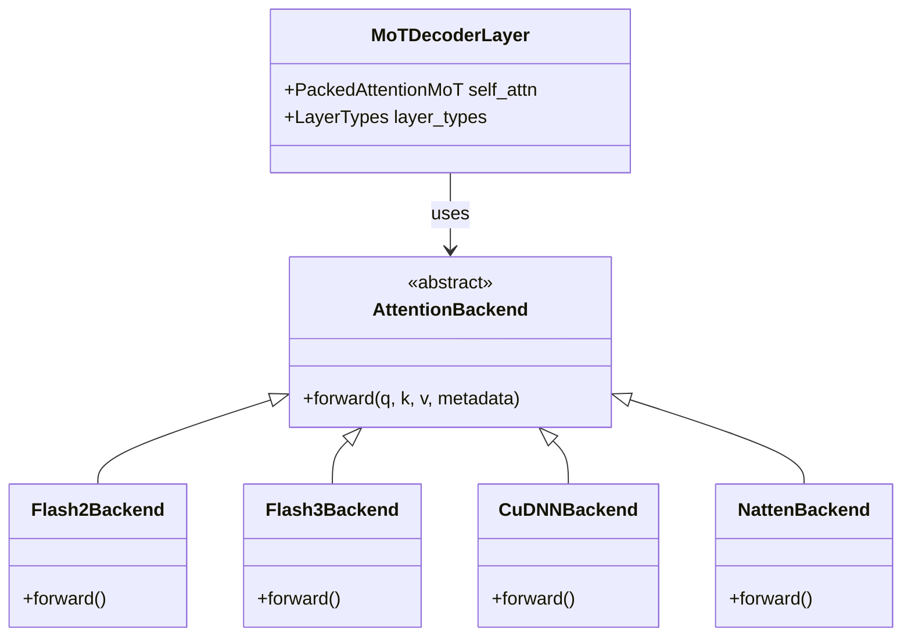

**Sources:**
- `cosmos_framework/model/attention/backend.py` [33-68]() (Base and concrete classes)
- `cosmos_framework/model/vfm/mot/unified_mot.py` [99-131]() (LayerTypes and MoT integration)
- `cosmos_framework/model/attention/backend.py` [267-313]() (Flash3 specific logic)

### Neighborhood Attention (NATTEN)
Specialized for spatial/temporal locality, the `NattenBackend` is triggered when the `is_natten` flag is set in the metadata. It uses sliding window kernels which are significantly more efficient for local attention patterns in video or image processing than global attention [cosmos_framework/model/attention/backend.py:378-410]().

**Sources:**
- `cosmos_framework/model/attention/backend.py` [137-146]() (NATTEN compatibility check)
- `cosmos_framework/model/attention/backend.py` [378-410]() (NATTEN forward pass)

---

# Page: Video Tokenizers (VAE)

# Video Tokenizers (VAE)

<details>
<summary>Relevant source files</summary>

The following files were used as context for generating this wiki page:

- [cosmos_framework/inference/inference.py](cosmos_framework/inference/inference.py)
- [cosmos_framework/inference/sound.py](cosmos_framework/inference/sound.py)
- [cosmos_framework/inference/transfer.py](cosmos_framework/inference/transfer.py)
- [cosmos_framework/model/vfm/omni_mot_model.py](cosmos_framework/model/vfm/omni_mot_model.py)

</details>


The Cosmos framework utilizes a variety of video and audio tokenizers to compress high-dimensional raw media into latent representations suitable for the Mixture-of-Transformers (MoT) architecture. This section covers the abstract interfaces, specific implementations for Wan2.2, DC-AE, and UniAE, and the spatial/temporal compression logic.

## Tokenizer Architecture Overview

All video tokenizers in the framework implement a consistent interface defined by the `VideoTokenizerInterface`. This ensures that the diffusion models can interact with different compression backends using a unified set of methods for encoding and decoding.

### VideoTokenizerInterface
The `VideoTokenizerInterface` defines the core contract for all vision-based tokenizers. It ensures that the `OmniMoTModel` can handle different compression backends (e.g., Wan2.2 vs. DC-AE) through a standard API.

*   `encode(input_data)`: Converts raw pixel data into latent space.
*   `decode(latent_data)`: Reconstructions raw pixels from latents.
*   `get_temporal_compression_factor()`: Returns the factor by which time is reduced.
*   `get_spatial_compression_factor()`: Returns the factor by which height/width are reduced.

### System Mapping: Interface to Implementation
The following diagram illustrates how the abstract interface is realized by specific tokenizer classes and how they are orchestrated within the `OmniMoTModel`.

**Tokenizer Class Hierarchy and Model Integration**
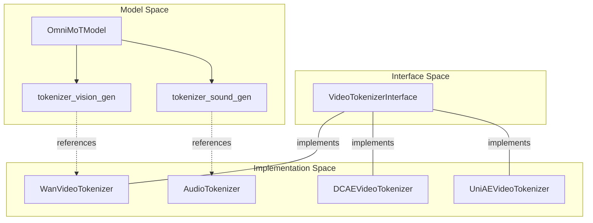
Sources: [cosmos_framework/model/vfm/omni_mot_model.py:56-56](), [cosmos_framework/model/vfm/omni_mot_model.py:110-155]()

## Wan2.2 VAE

The Wan2.2 VAE is the primary tokenizer used in the Cosmos-Framework. It is available in multiple configurations, typically defined by their compression factors (e.g., 4x8x8 or 4x16x16).

### Implementation Details
The Wan tokenizer is integrated into the model via `set_up_tokenizers` [cosmos_framework/model/vfm/omni_mot_model.py:110-155](). It handles the transition between torch tensors and the latent space, which is critical for the flow matching objective.

*   **Temporal Compression**: Typically fixed at 4x.
*   **Spatial Compression**: Typically 8x or 16x depending on the specific model SKU.
*   **Data Flow**: During inference, the `OmniMoTModel` uses these tokenizers to process video inputs for tasks like Video2Video or Image2Video, where the vision tokenizer is used to project conditioning frames into the latent space [cosmos_framework/inference/sound.py:160-161]().

**Wan Tokenizer Data Flow**
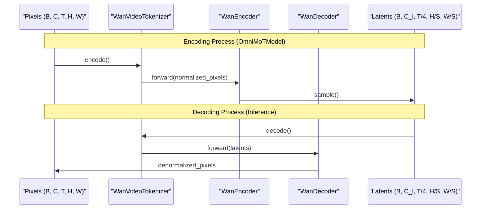
Sources: [cosmos_framework/model/vfm/omni_mot_model.py:155-170](), [cosmos_framework/inference/sound.py:160-164]()

## DC-AE and UniAE

Beyond Wan, the framework supports **DC-AE** (Decoupled Autoencoder) and **UniAE** (Unified Autoencoder). 

*   **DC-AE**: Focuses on decoupling spatial and temporal features during the compression process to maintain high fidelity in motion.
*   **UniAE**: Provides a unified latent space that can be shared across different media types, often using a 4x8x8 compression scheme.

## Audio Tokenizers

Cosmos-Framework includes support for audio tokenization to enable multi-modal video generation (video + synchronized audio).

### Audio Latent Space
Audio tokenizers are managed via the `AudioTokenizerInfo` dataclass [cosmos_framework/inference/sound.py:17-24](). This helper probes the model for its sound tokenizer (`tokenizer_sound_gen`) and consolidates metadata such as sample rate and latent FPS.

*   **Sample Rate**: Typically 48,000 Hz [cosmos_framework/inference/sound.py:34-37]().
*   **Latent FPS**: Defined by `sound_latent_fps` in the model configuration [cosmos_framework/inference/sound.py:39-39]().
*   **Compression**: The `get_latent_num_samples` method [cosmos_framework/inference/sound.py:163-163]() determines the sequence length of the audio latent stream.

### Multi-modal Synchronization
During joint generation (e.g., `t2vs` mode), the framework aligns video and audio latent lengths. The `inject_sound_into_batch` function [cosmos_framework/inference/sound.py:118-140]() updates the `SequencePlan` to include sound, ensuring the MoT architecture correctly interleaves video and audio tokens.

| Modality | Compression Factor | Latent Unit |
| :--- | :--- | :--- |
| Video | Temporal (4x), Spatial (8x/16x) | Vision Tokens |
| Audio | Sample Rate / Latent FPS | Sound Tokens |

Sources: [cosmos_framework/inference/sound.py:30-40](), [cosmos_framework/inference/sound.py:156-173]()

## Compression Factors and Sequence Planning

The relationship between input resolution and latent shape is governed by the `spatial_compression_factor` and `temporal_compression_factor`. These factors are used by the `SequencePlan` [cosmos_framework/inference/transfer.py:179-186]() to calculate token budgets and positional indices.

In transfer inference (e.g., edge or blur control), the `temporal_compression_factor` is used to determine which frame indexes serve as conditioning [cosmos_framework/inference/transfer.py:161-164]().

**Latent Shape Calculation**
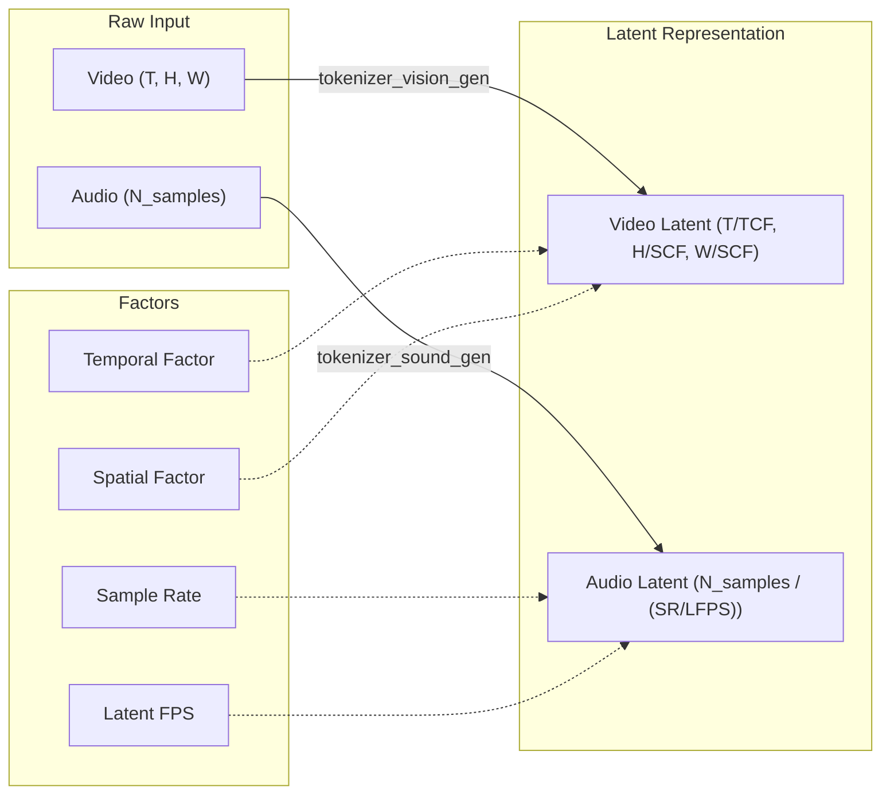
Sources: [cosmos_framework/inference/transfer.py:161-164](), [cosmos_framework/inference/sound.py:160-164]()

---

# Page: Data Pipeline

# Data Pipeline

<details>
<summary>Relevant source files</summary>

The following files were used as context for generating this wiki page:

- [cosmos_framework/data/vfm/action/datasets/base_dataset.py](cosmos_framework/data/vfm/action/datasets/base_dataset.py)
- [cosmos_framework/data/vfm/dataflow/loader.py](cosmos_framework/data/vfm/dataflow/loader.py)
- [cosmos_framework/data/vfm/dataflow/processors.py](cosmos_framework/data/vfm/dataflow/processors.py)
- [cosmos_framework/data/vfm/packing_iterable_dataset.py](cosmos_framework/data/vfm/packing_iterable_dataset.py)
- [docs/custom_dataset.md](docs/custom_dataset.md)
- [docs/dataset_jsonl.md](docs/dataset_jsonl.md)

</details>


The Cosmos-Framework data pipeline is a modular system designed for high-throughput ingestion and processing for Video Foundation Models (VFM) and Video-Language Models (VLM). It leverages a flexible role-based architecture to handle diverse data formats including JSONL, WebDataset, and LeRobot adapters, while providing advanced features like sequence packing and multi-embodiment action normalization.

## CosmosDataLoader Architecture

The `CosmosDataLoader` is the primary orchestrator for training data. It is a `torch.utils.data.DataLoader` subclass that decomposes the data pipeline into four distinct, swappable roles [docs/custom_dataset.md:3-9](), [cosmos_framework/data/vfm/dataflow/loader.py:98-107]().

### The Four Roles
1.  **`DataDistributor`**: Owns the dataset and yields disjoint slices of raw items per Distributed Data Parallel (DDP) rank and worker [docs/custom_dataset.md:19-20]().
2.  **`RawItemProcessor`**: Transforms one raw item (e.g., a file path or dict) into a training-ready sample (e.g., decoding and tokenizing) [docs/custom_dataset.md:21-22]().
3.  **`SampleBatcher`**: Pulls from the sample stream and groups them into batches based on size or token-budget constraints [docs/custom_dataset.md:23-24]().
4.  **`BatchCollator`**: Aggregates a group of samples into a single batch dictionary for the model's `forward()` pass [docs/custom_dataset.md:25]().

**Dataflow Entity Relationship**
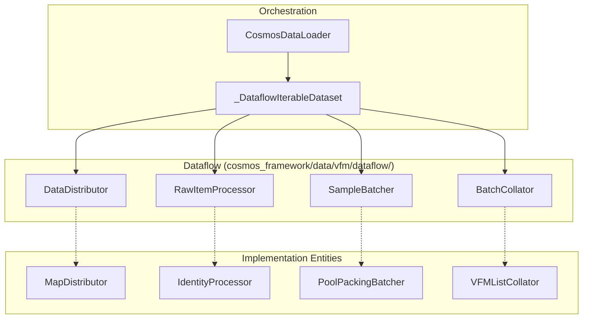
**Sources:** [docs/custom_dataset.md:7-25](), [cosmos_framework/data/vfm/dataflow/loader.py:26-97](), [cosmos_framework/data/vfm/dataflow/loader.py:108-154]()

---

## JSONL Dataset Format

The primary format for training manifests is JSONL (JSON Lines). Each line represents a training sample, keeping post-training examples aligned with inference prompt formats [docs/dataset_jsonl.md:56-69]().

### Schema Specification
A standard VFM entry contains:
*   **`vision_path`**: Path to the video file [docs/dataset_jsonl.md:79]().
*   **`t2w_windows`**: A list of temporal windows containing:
    *   `caption_json`: Canonical structured-JSON caption object [docs/dataset_jsonl.md:60-64]().
    *   `caption`: Dense narrative string used as a backup [docs/dataset_jsonl.md:65-66]().
    *   `start_frame`/`end_frame`: Temporal bounds for the clip [docs/dataset_jsonl.md:82-83]().

**Sources:** [docs/dataset_jsonl.md:1-102]()

---

## Sequence Packing and Joint Dataloading

To maximize GPU utilization, Cosmos-Framework implements token-budget bin-packing. This bundles multiple samples into a single sequence, minimizing padding overhead [cosmos_framework/data/vfm/packing_iterable_dataset.py:4-9]().

### Packing Strategies
*   **`PoolPackingBatcher`**: Maintains a pool of samples and greedily selects candidates that fit within a `max_tokens` budget [cosmos_framework/data/vfm/packing_iterable_dataset.py:41-45]().
*   **`SequentialPackingBatcher`**: An order-preserving batcher that packs samples until the budget is reached without reordering [docs/custom_dataset.md:112]().

### Joint Dataloading
The `PackingIterableDataset` supports mixing multiple datasets via `datasets_cfg`, which maps dataset names to their respective configurations and sampling ratios [cosmos_framework/data/vfm/packing_iterable_dataset.py:71-79]().

**Packing Logic Flow**
```mermaid
graph TD
    subgraph "cosmos_framework/data/vfm/packing_iterable_dataset.py"
        DS["_datasets"]
        IT["iterators"]
        POOL["_pool"]
        BFB["_best_fit_batch()"]
        CB["collate_batch()"]
    end

    DS --> IT
    IT -- "random.choices(weights=ratios)" --> POOL
    POOL -- "greedy selection" --> BFB
    BFB --> CB
    CB --> OUT["Packed Batch"]
```
**Sources:** [cosmos_framework/data/vfm/packing_iterable_dataset.py:41-132](), [cosmos_framework/data/vfm/packing_iterable_dataset.py:156-180]()

---

## Action Dataset Subsystem

The action dataset subsystem is built on the LeRobot framework and handles multi-embodiment robotic data [cosmos_framework/data/vfm/action/datasets/base_dataset.py:4]().

### Action Normalization
Robotic actions (e.g., end-effector poses or joint positions) are normalized using dataset-specific statistics [cosmos_framework/data/vfm/action/datasets/base_dataset.py:189]().
*   **Methods**: Supports `quantile`, `meanstd`, and `minmax` normalization [cosmos_framework/data/vfm/action/datasets/base_dataset.py:43]().
*   **Stats**: Statistics are loaded from JSON files defined in each dataset class via `_stats_path()` [cosmos_framework/data/vfm/action/datasets/base_dataset.py:120-131]().

### Dataset Adapters
*   **`DROIDLeRobotDataset`**: Adapter for the DROID dataset.
*   **`AgiBotWorldBetaLeRobotDataset`**: Adapter for AgiBot data.
*   **`BridgeOrigLeRobotDataset`**: Adapter for the Bridge dataset.

These datasets implement the `ActionBaseDataset` abstract class, which enforces a `backward_framewise` pose convention for deltas [cosmos_framework/data/vfm/action/datasets/base_dataset.py:27-48]().

**Sources:** [cosmos_framework/data/vfm/action/datasets/base_dataset.py:1-205](), [cosmos_framework/data/vfm/action/action_normalization.py:1-50]()

---

## VLM Data Infrastructure

The VLM pipeline supports models like Qwen3-VL and Nemotron3DenseVL, providing specialized processors for each.

### Model-Specific Processors
*   **`Qwen3VLProcessor`**: Manages vision-language alignment and tokenization for the Qwen3-VL family.
*   **`Nemotron3DenseVLProcessor`**: Handles processing for dense-backbone models.

### Dataset Sources
*   **Local SFT Dataset**: Consumes the JSONL format for supervised fine-tuning.
*   **Videophy2**: Provides data sources for physical reasoning tasks.

**Sources:** [cosmos_framework/data/vfm/dataflow/processors.py:1-18](), [docs/dataset_jsonl.md:107-110]()

---

# Page: Training Infrastructure

# Training Infrastructure

<details>
<summary>Relevant source files</summary>

The following files were used as context for generating this wiki page:

- [.github/workflows/pre-commit.yml](.github/workflows/pre-commit.yml)
- [cosmos_framework/callbacks/cosmos_dataloader_state.py](cosmos_framework/callbacks/cosmos_dataloader_state.py)
- [cosmos_framework/callbacks/dataloader_state.py](cosmos_framework/callbacks/dataloader_state.py)
- [cosmos_framework/checkpoint/dcp.py](cosmos_framework/checkpoint/dcp.py)
- [cosmos_framework/configs/base/vlm/experiment/dataflow_roles.py](cosmos_framework/configs/base/vlm/experiment/dataflow_roles.py)
- [cosmos_framework/configs/base/vlm/experiment/llava_ov_vlm.py](cosmos_framework/configs/base/vlm/experiment/llava_ov_vlm.py)
- [cosmos_framework/configs/base/vlm/experiment/videophy2_dataflow_roles.py](cosmos_framework/configs/base/vlm/experiment/videophy2_dataflow_roles.py)
- [cosmos_framework/configs/base/vlm/experiment/videophy2_sft_nano.py](cosmos_framework/configs/base/vlm/experiment/videophy2_sft_nano.py)
- [cosmos_framework/utils/config.py](cosmos_framework/utils/config.py)
- [tests/launch_regression_test.py](tests/launch_regression_test.py)

</details>


The training infrastructure in Cosmos-Framework is a modular system designed for large-scale distributed training of Video Foundation Models (VFM) and Video-Language Models (VLM). It is centered around a centralized `ImaginaireTrainer`, a flexible callback system for telemetry and stability, and a robust Distributed Checkpoint (DCP) implementation that supports local, SFT, and S3 storage.

## Trainer Core

The `ImaginaireTrainer` (found in `cosmos_framework/trainer/`) serves as the orchestrator for the training loop. It manages the lifecycle of the model, optimizer, scheduler, and data loaders. The trainer is designed to be modality-agnostic, handling the complexities of distributed data parallel (FSDP), model parallelism, and sequence packing.

### Key Responsibilities
- **Execution Loop**: Manages the forward pass, loss computation, backward pass, and optimizer steps.
- **Distributed Coordination**: Interfaces with `torch.distributed` to ensure all ranks are synchronized during critical phases like checkpointing and validation.
- **State Management**: Tracks the current iteration, epoch, and global training state.

Sources: [cosmos_framework/utils/config.py:186-210](), [cosmos_framework/checkpoint/dcp.py:70-71]()

## Callbacks System

The callback system allows for decoupled logic to be injected into the training loop at specific hooks (e.g., `on_train_start`, `on_training_step_end`, `on_save_checkpoint`). These are managed by a `CallBackGroup` defined in `cosmos_framework/utils/callback.py`.

### Logging and Monitoring
- **WandbCallback**: Handles logging of losses (global and per-dataset), learning rates, and stability metrics to Weights & Biases. It includes logic to handle `NaN` or `Inf` losses by reducing valid masks across ranks to avoid crashing the training run.
- **HeartBeat**: Logs a periodic message (and optionally an S3 YAML file) to indicate the process is alive, which is critical for long-running jobs on unreliable clusters.
- **MFUCallback**: Computes **Model FLOPs Utilization (MFU)** and **Object FLOPs Utilization (OFU)**. It uses an `OmniMoTModelDescriptor` to calculate theoretical peak TFLOPS for hardware like H100 or GB200 and compares it against measured wall-clock time.

### Stability and Optimization
- **GradClipCallback**: Implements gradient norm clipping. Because standard `clip_grad_norm_` only handles DP/FSDP/TP, this callback manually reduces gradient norms across Pipeline Parallel (PP) stages using `DTensor` reduction.
- **Fused NaN-to-Num**: Uses `@torch.compile` to fuse `nan_to_num` operations across all parameter gradients into a single CUDA kernel, preventing training crashes from transient instabilities.

### Training Lifecycle to Code Entity Mapping
The following diagram maps high-level training events to the specific callback entities and methods that handle them.

**Training Event Flow**
```mermaid
graph TD
    subgraph "TrainingLoop[cosmos_framework/trainer/]"
        START["on_train_start()"] --> STEP_START["on_training_step_start()"]
        STEP_START --> FORWARD["Model Forward"]
        FORWARD --> STEP_END["on_training_step_end()"]
        STEP_END --> SAVE_CHECK["on_save_checkpoint()"]
        SAVE_CHECK --> END["on_train_end()"]
    end

    subgraph "CallbackEntities[cosmos_framework/callbacks/]"
        H["HeartBeat"]
        W["WandbCallback"]
        M["MFUCallback"]
        G["GradClipCallback"]
        HF["HFExportCallback"]
        DL["CosmosDataLoaderStateCallback"]
    end

    START -.-> H
    STEP_END -.-> W
    STEP_END -.-> M
    STEP_END -.-> G
    STEP_END -.-> DL
    SAVE_CHECK -.-> HF
```
Sources: [cosmos_framework/callbacks/cosmos_dataloader_state.py:51-69](), [cosmos_framework/callbacks/dataloader_state.py:23-35](), [cosmos_framework/checkpoint/dcp.py:128-151]()

## Checkpointing System

Cosmos-Framework uses a multi-layered checkpointing architecture defined in `cosmos_framework/checkpoint/`. It defaults to **Distributed Checkpoint (DCP)** for efficiency in multi-GPU environments.

### AbstractCheckpointer
The base class `AbstractCheckpointer` [cosmos_framework/checkpoint/base.py:17-106]() provides a unified interface for saving and loading. It handles path resolution between local storage (`config_job.path_local`) and object stores like S3 (`config_job.path`).

### Distributed Checkpointer (DCP)
The `DistributedCheckpointer` implements sharded I/O. Instead of gathering the full model to Rank 0, each rank saves its own shard (`.distcp` files), significantly reducing memory pressure and I/O bottlenecks.

**DCP Directory Structure**
| Component | Path | Description |
| :--- | :--- | :--- |
| **Model** | `iter_N/model/` | Sharded model weights (`__0_0.distcp`, etc) |
| **Optimizer** | `iter_N/optim/` | Sharded optimizer states |
| **Dataloader** | `iter_N/dataloader/` | Per-rank pickled state for resumable data loading |
| **Metadata** | `latest_checkpoint.txt` | Text file pointing to the most recent iteration folder |

Sources: [cosmos_framework/checkpoint/dcp.py:9-40](), [cosmos_framework/checkpoint/base.py:38-40]()

### Checkpoint Data Flow
This diagram illustrates the flow of data from the live model into the sharded storage backend via the `ModelWrapper` adapter.

**Checkpoint Persistence Flow**
```mermaid
graph LR
    subgraph "MainProcess[torch.distributed]"
        M["ImaginaireModel"] -- "get_model_state_dict" --> SW["ModelWrapper[cosmos_framework/checkpoint/dcp.py]"]
        O["Optimizer"] -- "state_dict" --> SD["StateDict"]
    end

    subgraph "CheckpointModule[cosmos_framework/checkpoint/]"
        SD -- "sharded save" --> FS["FileSystemWriter / S3StorageWriter"]
        SW -- "DCP.save()" --> FS
    end

    subgraph "Storage"
        FS --> LOCAL["Local Disk (.distcp)"]
        FS --> S3["S3 Bucket (.distcp)"]
    end
```
Sources: [cosmos_framework/checkpoint/dcp.py:77-95](), [cosmos_framework/checkpoint/dcp.py:172-185](), [cosmos_framework/checkpoint/s3_filesystem.py:1-20]()

## Dataloader State and Resume

A critical component of the infrastructure is ensuring bit-identical resumes, especially for complex streaming datasets or sequence packing.

### CosmosDataLoaderStateCallback
This callback [cosmos_framework/callbacks/cosmos_dataloader_state.py:51-69]() tracks the highest-seen `(epoch, index)` per worker from batch metadata. 
- **Persistence**: On `state_dict()`, it serializes per-worker positions into the DCP checkpoint under the `dataloader/` component [cosmos_framework/callbacks/cosmos_dataloader_state.py:127-132]().
- **Restoration**: On `load_state_dict()`, it writes these positions to environment variables like `COSMOS_DL_STATE_WORKER_{id}_EPOCH` [cosmos_framework/callbacks/cosmos_dataloader_state.py:144-147](). The `MapDistributor` in the data pipeline reads these variables to fast-forward the stream upon restart.

### Joint Loader Support
For experiments using `JointCosmosDataLoader`, the `JointCosmosDataLoaderStateCallback` [cosmos_framework/callbacks/cosmos_dataloader_state.py:150-168]() manages:
1. **Outer State**: The `global_id` cursor for the dataset-selection sequence.
2. **Inner State**: A collection of `CosmosDataLoaderStateCallback` instances, one for each sub-dataset [cosmos_framework/callbacks/cosmos_dataloader_state.py:173-176]().

### Async Checkpointing
The system supports an `AsyncMode.ASYNC_WITH_PINNED_MEM` [cosmos_framework/checkpoint/dcp.py:153-155]() which allows the trainer to continue the next iteration while a background process, spawned via `multiprocessing`, handles the heavy I/O of writing shards to the filesystem or S3 [cosmos_framework/checkpoint/dcp.py:172-185]().

Sources: [cosmos_framework/callbacks/cosmos_dataloader_state.py:5-30](), [cosmos_framework/callbacks/dataloader_state.py:24-34](), [cosmos_framework/checkpoint/dcp.py:153-185]()

---

# Page: Utilities and Shared Infrastructure

# Utilities and Shared Infrastructure

<details>
<summary>Relevant source files</summary>

The following files were used as context for generating this wiki page:

- [cosmos_framework/utils/easy_io/backends/base_backend.py](cosmos_framework/utils/easy_io/backends/base_backend.py)
- [cosmos_framework/utils/easy_io/backends/boto3_backend.py](cosmos_framework/utils/easy_io/backends/boto3_backend.py)
- [cosmos_framework/utils/easy_io/backends/http_backend.py](cosmos_framework/utils/easy_io/backends/http_backend.py)
- [cosmos_framework/utils/easy_io/backends/local_backend.py](cosmos_framework/utils/easy_io/backends/local_backend.py)
- [cosmos_framework/utils/easy_io/backends/msc_backend.py](cosmos_framework/utils/easy_io/backends/msc_backend.py)
- [cosmos_framework/utils/easy_io/easy_io.py](cosmos_framework/utils/easy_io/easy_io.py)
- [cosmos_framework/utils/easy_io/file_client.py](cosmos_framework/utils/easy_io/file_client.py)
- [cosmos_framework/utils/easy_io/handlers/imageio_video_handler.py](cosmos_framework/utils/easy_io/handlers/imageio_video_handler.py)

</details>


The `cosmos_framework/utils/` directory serves as the foundational layer for the Cosmos-Framework, providing shared infrastructure that spans configuration management, distributed training helpers, I/O abstraction, and model-specific utilities for both Video Foundation Models (VFM) and Video Language Models (VLM).

## Feature Flags and Environment Control

The framework utilizes a centralized feature flag system to manage experimental features, hardware-specific optimizations, and debugging toggles.

*   **`flags.py`**: Contains global constants and environment variable checks that influence runtime behavior, such as enabling specific attention backends or toggling distributed communication optimizations [cosmos_framework/utils/flags.py:1-20](). It specifically exports a `TRAINING` flag used to conditionally import heavy dependencies like `MSCBackend` [cosmos_framework/utils/easy_io/file_client.py:9-9]().

**Sources:**
- [cosmos_framework/utils/flags.py:1-20]()
- [cosmos_framework/utils/easy_io/file_client.py:9-81]()

## Configuration System: LazyConfig and Registry

Cosmos-Framework employs a "LazyConfig" system to handle complex model architectures and experiment SKUs. This allows for deferred instantiation of objects, enabling the configuration to be manipulated as a dictionary before being realized into Python objects.

### LazyDict and Registry
The core of this system is the `LazyDict`, which stores class paths and arguments. The `Registry` acts as a mapping between string identifiers and actual class/function definitions.

*   **`LazyDict`**: A dictionary-like structure that stores metadata for object instantiation [cosmos_framework/utils/lazy_config.py:10-40]().
*   **`instantiate()`**: The primary entry point that recursively traverses a `LazyDict` and calls the referenced constructors with the provided arguments [cosmos_framework/utils/lazy_config.py:50-80]().

### Configuration Resolution Flow
The following diagram illustrates how a TOML recipe is transformed into a running model instance through the utility layer.

**Config to Instance Flow**
```mermaid
graph TD
    subgraph "ConfigurationSpace"
        ["TOML_Recipe"] --> ["SFTExperimentConfig_Pydantic"]
        ["SFTExperimentConfig_Pydantic"] --> ["LazyDict_experiment_SKU"]
    end

    subgraph "RegistrySpace"
        ["registry.py"] -- "maps" --> ["Model_Classes"]
        ["registry.py"] -- "maps" --> ["Dataset_Classes"]
    end

    subgraph "ExecutionSpace"
        ["instantiate_function"]
        ["LazyDict_experiment_SKU"] --> ["instantiate_function"]
        ["registry.py"] --> ["instantiate_function"]
        ["instantiate_function"] --> ["Model_Trainer_Instance"]
    end
```
**Sources:**
- [cosmos_framework/utils/lazy_config.py:10-80]()

## Easy_IO: Unified File Backends

The `easy_io` subpackage provides a polymorphic interface for file operations, abstracting local and remote storage. It is built around a `FileClient` and a set of `BaseStorageBackend` implementations.

### Storage Backends
All backends inherit from `BaseStorageBackend` [cosmos_framework/utils/easy_io/backends/base_backend.py:25-136](), which defines a standard interface for `get`, `put`, `exists`, and `size`.

| Backend | Protocol | Description |
| :--- | :--- | :--- |
| **`LocalBackend`** | `file://` | Standard filesystem access with symlink support [cosmos_framework/utils/easy_io/backends/local_backend.py:16-210](). |
| **`MSCBackend`** | `s3://`, `msc://` | Multi-Storage Client for high-performance S3 access, including telemetry via OpenTelemetry [cosmos_framework/utils/easy_io/backends/msc_backend.py:19-161](). |
| **`HTTPBackend`** | `http://`, `https://` | Read-only access to remote web resources using `urllib` [cosmos_framework/utils/easy_io/backends/http_backend.py:16-173](). |
| **`Boto3Backend`** | `s3://` | Legacy S3 backend (deprecated in favor of MSC) [cosmos_framework/utils/easy_io/backends/boto3_backend.py:19-170](). |

### File Handlers and Video I/O
The `easy_io` system uses specialized handlers to process specific file formats during I/O.
*   **`ImageioVideoHandler`**: Handles video loading and dumping using `imageio.v3`. It supports metadata extraction (FPS, duration) and H.264 encoding via `ffmpeg` with CRF (Constant Rate Factor) control [cosmos_framework/utils/easy_io/handlers/imageio_video_handler.py:15-172]().

### Data Flow in easy_io
The `FileClient` acts as a dispatcher, using URI prefixes to select the appropriate backend.

**Easy_IO Entity Mapping**
```mermaid
graph LR
    subgraph "InterfaceLayer"
        ["easy_io.py_get"]
        ["easy_io.py_put"]
    end

    subgraph "ClientLayer"
        ["FileClient"]
    end

    subgraph "BackendImplementations"
        ["FileClient"] --> ["LocalBackend"]
        ["FileClient"] --> ["MSCBackend"]
        ["FileClient"] --> ["HTTPBackend"]
    end

    subgraph "FormatHandlers"
        ["LocalBackend"] --> ["ImageioVideoHandler"]
        ["MSCBackend"] --> ["ImageioVideoHandler"]
    end
```

**Sources:**
- [cosmos_framework/utils/easy_io/easy_io.py:93-151]()
- [cosmos_framework/utils/easy_io/file_client.py:25-117]()
- [cosmos_framework/utils/easy_io/backends/base_backend.py:25-136]()
- [cosmos_framework/utils/easy_io/backends/local_backend.py:16-210]()
- [cosmos_framework/utils/easy_io/backends/msc_backend.py:19-161]()
- [cosmos_framework/utils/easy_io/handlers/imageio_video_handler.py:15-172]()

## Distributed Helpers and Parallelism

The framework provides abstractions over PyTorch distributed primitives to support various parallelism strategies (FSDP, TP, CP).

*   **`distributed.py`**: Contains helpers for initializing process groups, gathering tensors across ranks, and managing distributed barriers [cosmos_framework/utils/distributed.py:5-100]().
*   **`dtensor_helper.py`**: Provides utilities for working with `DTensor`, facilitating the transition between local and sharded tensor representations during training and inference [cosmos_framework/utils/dtensor_helper.py:1-50]().

**Sources:**
- [cosmos_framework/utils/distributed.py:5-100]()
- [cosmos_framework/utils/dtensor_helper.py:1-50]()

## Logging and Telemetry

### OneLogger
Cosmos-Framework uses a specialized logger to unify standard output, file logging, and experiment tracking.
*   **`one_logger.py`**: A singleton-style logger that handles rank-aware logging to prevent terminal flooding in distributed settings [cosmos_framework/utils/one_logger.py:10-60]().

### Training Telemetry
Captures metrics such as Model Flops Utilization (MFU) and Optimizer Flops Utilization (OFU) to monitor hardware efficiency [cosmos_framework/utils/telemetry.py:5-40]().

**Sources:**
- [cosmos_framework/utils/one_logger.py:10-60]()
- [cosmos_framework/utils/telemetry.py:5-40]()

## VFM and VLM Utility Submodules

Specific utilities are partitioned into `vfm/` and `vlm/` subdirectories to handle modality-specific logic.

### Shared Model Utilities
| Utility | Description | File Path |
| :--- | :--- | :--- |
| **LoRA** | Implementation of Low-Rank Adaptation for parameter-efficient fine-tuning. | `cosmos_framework/utils/vfm/lora.py` |
| **Model Loader** | Logic for mapping checkpoint keys and loading weights into unified architectures. | `cosmos_framework/utils/vfm/model_loader.py` |
| **EMA** | Exponential Moving Average of model weights for training stability. | `cosmos_framework/utils/vfm/ema.py` |
| **Profiling** | Integration with PyTorch Profiler and Nsight for performance bottleneck analysis. | `cosmos_framework/utils/vfm/profiler.py` |

**Sources:**
- [cosmos_framework/utils/vfm/lora.py:1-50]()
- [cosmos_framework/utils/vfm/model_loader.py:1-100]()
- [cosmos_framework/utils/vfm/ema.py:1-40]()
- [cosmos_framework/utils/vfm/profiler.py:1-30]()

---

# Page: Training (Supervised Fine-Tuning)

# Training (Supervised Fine-Tuning)

<details>
<summary>Relevant source files</summary>

The following files were used as context for generating this wiki page:

- [.github/workflows/pre-commit.yml](.github/workflows/pre-commit.yml)
- [cosmos_framework/utils/config.py](cosmos_framework/utils/config.py)
- [docs/training.md](docs/training.md)
- [tests/launch_regression_test.py](tests/launch_regression_test.py)

</details>


The Cosmos-Framework provides a robust Supervised Fine-Tuning (SFT) workflow designed for high-performance training of Video Foundation Models (VFM) and Vision-Language Models (VLM). The system uses a recipe-driven approach where training configurations are defined in TOML files and executed via specialized launch scripts that manage environment setup and distributed orchestration.

### SFT Workflow Overview

The fine-tuning process follows a structured lifecycle from environment preparation to final model export. The framework emphasizes a "checkpoint-centric" design where the `config.yaml` saved alongside model weights serves as the single source of truth for downstream inference.

#### Workflow Diagram: NL Space to Code Space
The following diagram maps the logical steps of the SFT process to the specific scripts and entities in the codebase.

```mermaid
graph TD
    subgraph "Preparation"
        A["Download HF Checkpoint"] --> B["convert_model_to_dcp.py"]
        B --> C[("Distributed Checkpoint (DCP)")]
    end

    subgraph "Execution"
        D["TOML Recipe"] --> E["launch_sft_*.sh"]
        E --> F["cosmos_framework.scripts.train"]
        C --> F
    end

    subgraph "Monitoring & Output"
        F --> G["Trainer Loop"]
        G --> H["Callbacks System"]
        G --> I[("Output Directory")]
    end

    subgraph "Deployment"
        I --> J["export_model.py"]
        J --> K[("HF Safetensors")]
    end

    style C stroke-dasharray: 5 5
    style I stroke-dasharray: 5 5
```
**Sources:** [docs/training.md:113-128](), [tests/launch_regression_test.py:6-11]()

---

### SFT Recipes and Launch Scripts
Training is initiated using "recipes"—standardized TOML configurations located in `examples/toml/sft_config/`. These are paired with shell scripts (e.g., `launch_sft_vision_nano.sh`, `launch_sft_llava_ov.sh`) that handle `PYTHONPATH` setup, `MASTER_PORT` assignment, and the `TAIL_OVERRIDES` mechanism for dynamic parameter injection.

The framework supports two primary execution paths:
- **Option A (Recommended):** Using the provided launch shells which auto-resolve paths for datasets and VAEs.
- **Option B (Raw torchrun):** Direct invocation of `cosmos_framework.scripts.train` using `--sft-toml` for advanced users requiring manual control over environment variables.

For details, see [SFT Recipes and Launch Scripts](#3.1).

**Sources:** [docs/training.md:42-111](), [tests/launch_regression_test.py:95-100]()

---

### Distributed Parallelism
Cosmos-Framework utilizes a multi-dimensional parallelism strategy to handle large-scale video models and long sequences. This is configured via the `[model.parallelism]` block in the SFT TOML configuration.

Key primitives include:
- **Data Parallel Shard (FSDP):** Sharding model states across GPUs (controlled by `data_parallel_shard_degree`).
- **Context Parallel (CP):** Sharding the temporal/sequence dimension for long-form video training (controlled by `context_parallel_shard_degree`).
- **Data Parallel Replicate:** Standard DDP-style replication (controlled by `data_parallel_replicate_degree`).

The framework enforces that the product of these degrees must equal the total `WORLD_SIZE`.

For details, see [Distributed Parallelism for Training](#3.2).

**Sources:** [cosmos_framework/utils/config.py:28-28](), [tests/launch_regression_test.py:39-44]()

---

### Checkpoint Lifecycle
The framework uses PyTorch Distributed Checkpoint (DCP) as its native format for training to enable efficient sharded I/O and seamless resumption on different GPU topologies.

#### Checkpoint Data Flow
This diagram illustrates the transformation of model weights through the SFT lifecycle, involving specific scripts and configuration classes.

```mermaid
graph LR
    subgraph "Input"
        HF_IN["HF Safetensors"] -- "convert_model_to_dcp.py" --> DCP_BASE["Base DCP Shards"]
    end

    subgraph "Training"
        DCP_BASE -- "Load" --> TRAINER["cosmos_framework.scripts.train"]
        TRAINER -- "Save" --> ITER_N["iter_N/"]
        ITER_N -- "Update" --> LATEST["latest_checkpoint.txt"]
    end

    subgraph "Output"
        ITER_N -- "export_model.py" --> HF_OUT["Trained HF Safetensors"]
    end

    [cosmos_framework/utils/config.py] -. "HFExportConfig" .-> HF_OUT
    [cosmos_framework/utils/config.py] -. "JobConfig.path_local" .-> ITER_N
```

Training artifacts are organized under `$IMAGINAIRE_OUTPUT_ROOT/<project>/<group>/<name>/`. Each checkpoint directory includes the sharded weights and a `config.yaml` that captures the exact state of the model and training hyperparameters. The `HFExportConfig` class allows for automated conversion to HuggingFace format after DCP checkpoints are saved.

For details, see [Checkpoint Lifecycle: DCP and HuggingFace Export](#3.3).

**Sources:** [cosmos_framework/utils/config.py:171-182](), [cosmos_framework/utils/config.py:199-205](), [docs/training.md:143-155]()

---

# Page: SFT Recipes and Launch Scripts

# SFT Recipes and Launch Scripts

<details>
<summary>Relevant source files</summary>

The following files were used as context for generating this wiki page:

- [examples/launch_sft_llava_ov.sh](examples/launch_sft_llava_ov.sh)
- [examples/launch_sft_llava_ov_mapstyle_dataloader.sh](examples/launch_sft_llava_ov_mapstyle_dataloader.sh)
- [examples/launch_sft_videophy2_nano.sh](examples/launch_sft_videophy2_nano.sh)
- [examples/launch_sft_vision_nano.sh](examples/launch_sft_vision_nano.sh)
- [examples/launch_sft_vision_nano_cosmosdataloader.sh](examples/launch_sft_vision_nano_cosmosdataloader.sh)
- [examples/launch_sft_vision_super.sh](examples/launch_sft_vision_super.sh)
- [examples/toml/sft_config/llava_ov.toml](examples/toml/sft_config/llava_ov.toml)
- [examples/toml/sft_config/videophy2_sft_nano.toml](examples/toml/sft_config/videophy2_sft_nano.toml)
- [examples/toml/sft_config/vision_sft_nano.toml](examples/toml/sft_config/vision_sft_nano.toml)
- [examples/toml/sft_config/vision_sft_super.toml](examples/toml/sft_config/vision_sft_super.toml)

</details>


Supervised Fine-Tuning (SFT) in the Cosmos-Framework is driven by a recipe-based system. This system combines TOML configuration files, which define the model hyperparameters and data sources, with shell-based launch scripts that manage environment setup and distributed execution via `torchrun`.

## Overview of SFT Infrastructure

The framework provides two primary paths for executing SFT:
1.  **Option A (Launch Scripts):** Recommended for most users. Uses specialized `.sh` scripts that automatically resolve paths for datasets, checkpoints, and VAE weights while providing a mechanism for command-line overrides.
2.  **Option B (Raw torchrun):** Used for advanced integration or debugging. Requires manual export of environment variables and direct invocation of the `cosmos_framework.scripts.train` module.

### Core Components

| Component | Location | Purpose |
| :--- | :--- | :--- |
| **TOML Recipes** | `examples/toml/sft_config/` | Defines experiment SKUs, model architecture tweaks, and optimizer settings. |
| **Launch Shells** | `examples/launch_sft_*.sh` | Entry points for specific model variants (Nano, Super, VLM). |
| **Common Logic** | `examples/_sft_launcher_common.sh` | Shared shell logic for path resolution and `torchrun` orchestration. |
| **Training Script** | `cosmos_framework.scripts.train` | The main Python entry point that parses TOML and initializes the trainer. |

**Sources:**
- [examples/launch_sft_vision_nano.sh:7-19]()
- [examples/launch_sft_llava_ov.sh:5-8]()

---

## TOML Recipes and Configuration

Recipes are located in `examples/toml/sft_config/`. These files define the training state and are mapped to internal configuration classes via a path-remapping mechanism.

### Key Configuration Blocks
- **`[job]`**: Defines the task type (`vfm` or `vlm`), project name, and experiment group [examples/toml/sft_config/llava_ov.toml:31-37]().
- **`[model]`**: Specifies architecture parameters like `precision` and `joint_attn_implementation` [examples/toml/sft_config/vision_sft_nano.toml:16-19](). For VLMs, it includes the `[model.backbone]` block [examples/toml/sft_config/llava_ov.toml:44-45]().
- **`[model.parallelism]`**: Configures distributed strategies like `data_parallel_shard_degree` and `context_parallel_shard_degree` [examples/toml/sft_config/vision_sft_super.toml:30-34]().
- **`[dataloader_train]`**: Defines batch sizes and sequence lengths. For VLMs, these are routed to the `CosmosDataLoader`'s `PoolPackingBatcher` [examples/toml/sft_config/llava_ov.toml:103-109]().
- **`[optimizer]`**: Sets learning rates, weight decay, and `keys_to_select` for partial fine-tuning (e.g., training only LoRA or specific MoE components) [examples/toml/sft_config/vision_sft_nano.toml:43-54]().

### Available Recipes
- **`vision_sft_nano.toml`**: Full fine-tuning for Cosmos3-Nano (Qwen3-VL-8B) vision-only tasks [examples/toml/sft_config/vision_sft_nano.toml:4-14]().
- **`vision_sft_super.toml`**: LoRA-based fine-tuning for Cosmos3-Super (Qwen3-VL-32B) with CP=2 [examples/toml/sft_config/vision_sft_super.toml:4-22]().
- **`llava_ov.toml`**: VLM training on LLaVA-OneVision data using `CosmosDataLoader` [examples/toml/sft_config/llava_ov.toml:4-6]().
- **`videophy2_sft_nano.toml`**: VLM dialog SFT on VideoPhy-2 data [examples/toml/sft_config/videophy2_sft_nano.toml:4-5]().

**Sources:**
- [examples/toml/sft_config/vision_sft_nano.toml:1-92]()
- [examples/toml/sft_config/vision_sft_super.toml:1-93]()
- [examples/toml/sft_config/llava_ov.toml:1-109]()
- [examples/toml/sft_config/videophy2_sft_nano.toml:1-92]()

---

## Launch Scripts and Orchestration

The launch scripts automate the transition from "Natural Language" requirements to "Code Entity" execution.

### The Launcher Data Flow

The following diagram illustrates how a launch script (e.g., `launch_sft_vision_nano.sh`) interacts with the common launcher and the Python training script.

**SFT Launch Sequence**
```mermaid
graph TD
    User["User Command: bash launch_sft_vision_nano.sh"] --> Script["launch_sft_vision_nano.sh"]
    Script --> EnvSet["Set Default Env Vars: DATASET_PATH, BASE_CHECKPOINT_PATH"]
    Script --> Common["source _sft_launcher_common.sh"]
    
    subgraph CommonLogic ["_sft_launcher_common.sh"]
        PathRes["Resolve TAIL_OVERRIDES from CLI args"]
        PortSet["Set MASTER_PORT (Default: 50016)"]
        PyPath["Set PYTHONPATH=."]
    end
    
    Common --> TorchRun["torchrun --nproc_per_node=8"]
    TorchRun --> TrainPy["cosmos_framework.scripts.train"]
    
    subgraph PythonExecution ["cosmos_framework.scripts.train"]
        Parse["Parse --sft-toml"]
        Init["Initialize Distributed Backend (FSDP/CP)"]
        Train["Start Training Loop"]
    end
    
    TrainPy --> Parse
    Parse --> Init
    Init --> Train
```

### TAIL_OVERRIDES Mechanism
The launch scripts use a "tail override" pattern. Any arguments passed to the `.sh` script are appended to the `torchrun` call. This allows overriding TOML values from the CLI using Hydra-style syntax.

Example for resuming a run with overrides:
```bash
RESUME_FROM_CKPT=<path> RUN_NAME=<name> bash examples/launch_sft_llava_ov_mapstyle_dataloader.sh
```
In this case, `TAIL_OVERRIDES` includes `checkpoint.load_path` and `checkpoint.load_training_state=true` [examples/launch_sft_llava_ov_mapstyle_dataloader.sh:36-42]().

### Key Environment Variables
- **`MASTER_PORT`**: Used by `torchrun` for process synchronization. Defaults to `50016` in some VLM scripts [examples/launch_sft_llava_ov_mapstyle_dataloader.sh:26]().
- **`VIDEOPHYSICS_ROOT`**: Required for VideoPhy2 SFT [examples/launch_sft_videophy2_nano.sh:11-14]().
- **`VLM_SAFETENSORS_PATH`**: If set, overrides the backbone path to a local snapshot [examples/launch_sft_videophy2_nano.sh:38-40]().
- **`PYTORCH_ALLOC_CONF`**: Set to `expandable_segments:True` for the Super variant to prevent OOM [examples/launch_sft_vision_super.sh:31]().

**Sources:**
- [examples/launch_sft_vision_nano.sh:21-27]()
- [examples/launch_sft_vision_super.sh:30-33]()
- [examples/launch_sft_llava_ov_mapstyle_dataloader.sh:25-44]()

---

## Execution Paths: Option A vs. Option B

The framework supports two ways to start the `train.py` script.

### Option A: Paired Launch Shell (Recommended)
This method leverages the logic in `_sft_launcher_common.sh`. It automatically populates default paths for the Wan2.2 VAE and base checkpoints if they exist in the `examples/` directory [examples/launch_sft_vision_nano.sh:22-25]().

```bash
# Example invocation for Vision Nano
bash examples/launch_sft_vision_nano.sh
```

### Option B: Raw torchrun
For users who prefer manual control, `torchrun` can be invoked directly. This requires passing the TOML file and any necessary overrides manually.

```bash
# Example invocation for LLaVA-OV
torchrun --nproc_per_node=4 -m cosmos_framework.scripts.train \
    --sft-toml examples/toml/sft_config/llava_ov.toml -- \
    data_setting.max_tokens=16000
```

### Comparison of Execution Paths

| Feature | Option A (Shell) | Option B (Raw) |
| :--- | :--- | :--- |
| **Path Resolution** | Automatic (e.g., `WAN_VAE_PATH`) | Manual (via CLI or TOML) |
| **Env Setup** | Handled by `_sft_launcher_common.sh` | Manual |
| **VLM Handling** | Plumbs `VLM_SAFETENSORS_PATH` | Requires manual `model.config...` override |
| **Checkpoint Resume** | Env var `RESUME_FROM_CKPT` | Manual `checkpoint.load_path` |

**Sources:**
- [examples/toml/sft_config/llava_ov.toml:15-18]()
- [examples/launch_sft_videophy2_nano.sh:38-40]()
- [examples/launch_sft_llava_ov_mapstyle_dataloader.sh:19-22]()

---

## Training Artifacts and Configuration Mapping

The trainer produces a standardized output structure. The TOML keys are remapped to the internal Pydantic configuration schema during loading.

### Code Entity Mapping
The following diagram illustrates how TOML sections map to internal `cosmos_framework` configuration entities.

**Configuration Remapping Logic**
```mermaid
graph LR
    subgraph TOML ["Recipe (TOML)"]
        T_Task["[job].task"]
        T_Parallel["[model.parallelism]"]
        T_Backbone["[model.backbone].model_name"]
        T_DL["[dataloader_train].max_sequence_length"]
    end

    subgraph Internal ["Internal Config (Pydantic)"]
        C_Base["Base Config Selection (VFM vs VLM)"]
        C_Parallel["model.config.parallelism"]
        C_Backbone["model.config.policy.backbone.model_name"]
        C_DL["dataloader_train.batcher.max_tokens"]
    end

    T_Task --> C_Base
    T_Parallel --> C_Parallel
    T_Backbone -- "VLM Remap" --> C_Backbone
    T_DL -- "VLM Remap" --> C_DL
```

### VLM-Specific Remapping
For VLM tasks, the framework applies specific `_PATH_REMAPS` to bridge the simplified TOML structure to the complex `PolicyConfig` nested schema:
- `model.backbone.*` maps to `model.config.policy.backbone.*` [examples/toml/sft_config/llava_ov.toml:26]()
- `model.attn_implementation` maps to `model.config.policy.attn_implementation` [examples/toml/sft_config/llava_ov.toml:25]()
- `dataloader_train.max_sequence_length` maps to `dataloader_train.batcher.max_tokens` [examples/toml/sft_config/llava_ov.toml:106]()

**Sources:**
- [examples/toml/sft_config/llava_ov.toml:20-29]()
- [examples/toml/sft_config/videophy2_sft_nano.toml:87-91]()

---

# Page: Distributed Parallelism for Training

# Distributed Parallelism for Training

<details>
<summary>Relevant source files</summary>

The following files were used as context for generating this wiki page:

- [.github/workflows/pre-commit.yml](.github/workflows/pre-commit.yml)
- [cosmos_framework/configs/base/experiment/sft/vision_sft_nano.py](cosmos_framework/configs/base/experiment/sft/vision_sft_nano.py)
- [cosmos_framework/configs/toml_config/sft_config.py](cosmos_framework/configs/toml_config/sft_config.py)
- [cosmos_framework/configs/toml_config/toml_config_helper.py](cosmos_framework/configs/toml_config/toml_config_helper.py)
- [cosmos_framework/utils/config.py](cosmos_framework/utils/config.py)
- [tests/launch_regression_test.py](tests/launch_regression_test.py)

</details>


This page details the distributed parallelism architecture of the Cosmos-Framework, focusing on the `[model.parallelism]` configuration block and its implementation via PyTorch primitives. The framework supports a hybrid parallelism strategy combining Fully Sharded Data Parallel (FSDP), Data Parallel Replication (HSDP), Context Parallelism (CP), and Classifier-Free Guidance (CFG) Parallelism to scale training across large GPU clusters.

## Parallelism Configuration

The parallelism strategy is defined within the TOML configuration file under the `[model.parallelism]` section. This block is validated by the `ParallelismConfig` Pydantic model [cosmos_framework/configs/toml_config/sft_config.py:125-166]().

### Configuration Parameters

| Parameter | Type | Description |
| :--- | :--- | :--- |
| `data_parallel_shard_degree` | `int` | FSDP shard degree. Maps to the number of ranks over which model states are sharded. Default is `-1` (auto-fit) [cosmos_framework/configs/toml_config/sft_config.py:133-140](). |
| `data_parallel_replicate_degree` | `int` | FSDP replicate degree (HSDP). Adds an outer replicate loop; usually for very large clusters [cosmos_framework/configs/toml_config/sft_config.py:141-148](). |
| `context_parallel_shard_degree` | `int` | Context-parallel shard degree. Splits the sequence dimension across ranks to fit long-context models in memory [cosmos_framework/configs/toml_config/sft_config.py:149-156](). |
| `cfg_parallel_shard_degree` | `int` | Classifier-free-guidance parallel shard degree. Splits conditional/unconditional forwards across ranks. Usually 1 for SFT [cosmos_framework/configs/toml_config/sft_config.py:157-164](). |

### World Size Constraint
The product of all specified degrees must equal the total number of available GPUs (`WORLD_SIZE`) provided by the `torchrun` environment:
`data_parallel_shard_degree * data_parallel_replicate_degree * context_parallel_shard_degree * cfg_parallel_shard_degree == WORLD_SIZE`

### Auto-Calculation with `-1`
The framework supports automatic calculation of the FSDP sharding dimension. If `data_parallel_shard_degree` is set to `-1`, the system calculates its value based on the remaining parameters and the total `WORLD_SIZE` [cosmos_framework/configs/toml_config/sft_config.py:133-137]().

**Sources:**
- [cosmos_framework/configs/toml_config/sft_config.py:125-166]()
- [cosmos_framework/configs/base/experiment/sft/vision_sft_nano.py:119-120]()

---

## Distributed Primitives and Implementation

The Cosmos-Framework maps these configuration values to specific PyTorch distributed primitives during model initialization and trainer setup.

### Data Flow and Parallelism Mapping

The following diagram illustrates how the `ParallelismConfig` values translate into the distributed runtime environment.

**Parallelism Mapping Logic**
```mermaid
graph TD
    subgraph "TOML Config [model.parallelism]"
        DP_SHARD["data_parallel_shard_degree"]
        DP_REPL["data_parallel_replicate_degree"]
        CP_DEG["context_parallel_shard_degree"]
        CFG_DEG["cfg_parallel_shard_degree"]
    end

    subgraph "Distributed Implementation"
        FSDP["PyTorch FSDP (FullyShardedDataParallel)"]
        HSDP["Hybrid Sharded Data Parallel"]
        CP_IMPL["Context Parallel (Sequence Sharding)"]
        CFG_IMPL["CFG Parallel (Batch Sharding)"]
    end

    DP_SHARD -->|"Configures"| FSDP
    DP_REPL -->|"Configures"| HSDP
    CP_DEG -->|"Configures"| CP_IMPL
    CFG_DEG -->|"Configures"| CFG_IMPL

    FSDP & HSDP & CP_IMPL & CFG_IMPL -->|"Validation"| WS_CHECK["Product == WORLD_SIZE"]
```
**Sources:**
- [cosmos_framework/configs/toml_config/sft_config.py:125-166]()
- [cosmos_framework/configs/base/experiment/sft/vision_sft_nano.py:119-120]()

### Context Parallelism (CP) for Long Videos
Context Parallelism is critical for high-resolution or long-duration video training. It shards the temporal/spatial sequence dimension across multiple GPUs. This allows the framework to handle sequences that exceed the memory capacity of a single GPU by distributing the activation load [cosmos_framework/configs/toml_config/sft_config.py:149-156]().

### FSDP and HSDP
The framework defaults to FSDP for memory efficiency. By setting `data_parallel_replicate_degree > 1`, the framework enables Hybrid Sharded Data Parallel (HSDP), which is effective for multi-node scaling where sharding is performed within a node and replication is performed across nodes [cosmos_framework/configs/toml_config/sft_config.py:141-148]().

---

## Code Entity Relationship

The configuration is processed through a multi-layer system: TOML schema validation, Hydra override generation, and final instantiation into the model's internal configuration.

**Distributed Infrastructure Entities**
```mermaid
classDiagram
    class SFTExperimentConfig {
        +JobConfig job
        +ModelConfig model
        +TrainerConfig trainer
    }
    class ModelConfig {
        +ParallelismConfig parallelism
        +EMAConfig ema
        +CompileConfig compile
    }
    class ParallelismConfig {
        +int data_parallel_shard_degree
        +int data_parallel_replicate_degree
        +int context_parallel_shard_degree
        +int cfg_parallel_shard_degree
    }
    class PATH_REMAPS {
        <<dict>>
        +vfm rules
        +vlm rules
    }
    class TrainScript {
        <<cosmos_framework.scripts.train>>
        +main()
    }

    SFTExperimentConfig *-- ModelConfig
    ModelConfig *-- ParallelismConfig
    TrainScript ..> SFTExperimentConfig : "Validates TOML"
    TrainScript ..> PATH_REMAPS : "Remaps for Hydra"
```
**Sources:**
- [cosmos_framework/configs/toml_config/sft_config.py:284-323]() (SFTExperimentConfig definition)
- [cosmos_framework/configs/toml_config/sft_config.py:125-166]() (ParallelismConfig definition)
- [cosmos_framework/configs/toml_config/toml_config_helper.py:45-90]() (PATH_REMAPS routing)
- [tests/launch_regression_test.py:9-11]() (Train script entry point description)

---

## Execution and Launcher Integration

Parallelism settings are typically defined in TOML recipes (e.g., in `examples/toml/sft_config/`) and executed via `torchrun`.

### Configuration Routing
The `PATH_REMAPS` utility ensures that TOML-defined parallelism settings land in the correct location within the Hydra configuration tree. For both VFM and VLM tasks, `model.parallelism` is remapped to `model.config.parallelism` [cosmos_framework/configs/toml_config/toml_config_helper.py:57-88]().

### Regression and Verification
The framework includes regression tests that verify distributed training launches. These tests use `torchrun` and validate that rank-0 losses and gradient norms are reproducible across different GPU architectures like H100 and GB200 [tests/launch_regression_test.py:4-21]().

**Sources:**
- [cosmos_framework/configs/toml_config/toml_config_helper.py:45-90]()
- [tests/launch_regression_test.py:4-21]()
- [cosmos_framework/configs/base/experiment/sft/vision_sft_nano.py:118-120]()

---

# Page: Checkpoint Lifecycle: DCP and HuggingFace Export

# Checkpoint Lifecycle: DCP and HuggingFace Export

<details>
<summary>Relevant source files</summary>

The following files were used as context for generating this wiki page:

- [.github/workflows/pre-commit.yml](.github/workflows/pre-commit.yml)
- [cosmos_framework/checkpoint/dcp.py](cosmos_framework/checkpoint/dcp.py)
- [cosmos_framework/utils/config.py](cosmos_framework/utils/config.py)
- [tests/launch_regression_test.py](tests/launch_regression_test.py)

</details>


This page details the end-to-end lifecycle of model weights within the Cosmos-Framework, from initial conversion of HuggingFace (HF) weights to Distributed Checkpoint (DCP) format, the structured storage during training, and the final export back to portable safetensors.

## Overview of Checkpoint Formats

The framework utilizes two primary formats for model weights:
1.  **HuggingFace (HF) Safetensors**: The standard portable format used for distribution and sharing.
2.  **Distributed Checkpoint (DCP)**: A sharded format optimized for high-performance distributed training and multi-node I/O.

### DCP Directory Structure
During training, checkpoints are saved to `$IMAGINAIRE_OUTPUT_ROOT/<project>/<group>/<name>/checkpoints/iter_<N>/` [cosmos_framework/checkpoint/dcp.py:9-26]().

```text
checkpoints/
├── iter_000000005/
│   ├── model/                  # Model state shards (__0_0.distcp, etc.)
│   ├── optim/                  # Optimizer state shards
│   ├── scheduler/              # Learning rate scheduler state
│   ├── trainer/                # Additional training state (e.g., iteration count)
│   └── dataloader/             # Per-rank dataloader state (rank_0.pkl, etc.)
├── latest_checkpoint.txt       # Contains the string "iter_000000005"
└── config.yaml                 # The source of truth for model architecture
```
Sources: [cosmos_framework/checkpoint/dcp.py:9-26](), [cosmos_framework/utils/config.py:198-206]()

---

## 1. Checkpoint Conversion (HF → DCP)

Before fine-tuning a base model (e.g., Cosmos3-Nano), the HF safetensors must be converted into DCP shards to support distributed initialization across FSDP or Tensor Parallel groups.

### `convert_model_to_dcp`
The script `cosmos_framework.scripts.convert_model_to_dcp` performs this conversion [tests/launch_regression_test.py:132-133](). It instantiates the model based on the framework's internal configuration and maps the incoming HF keys to the internal state dict.

**Data Flow: Conversion**
1.  **Load HF Weights**: Downloads or reads local safetensors.
2.  **Initialize Model**: Uses the project's model definitions.
3.  **Sharding**: Distributes the weights across the expected parallelism degrees (FSDP/TP) and writes `.distcp` files using `torch.distributed.checkpoint` [cosmos_framework/checkpoint/dcp.py:36-40]().

Sources: [cosmos_framework/checkpoint/dcp.py:36-40](), [tests/launch_regression_test.py:126-140]()

---

## 2. Training Lifecycle and `DistributedCheckpointer`

The `DistributedCheckpointer` (DCP) class manages the persistence of state during training. It supports local filesystem and S3 backends [cosmos_framework/checkpoint/dcp.py:28-34]().

### Implementation Classes
- **`ModelWrapper`**: A `Stateful` object that handles model state dicts and strips `_orig_mod.` prefixes (often introduced by `torch.compile`) during saving and loading [cosmos_framework/checkpoint/dcp.py:77-95]().
- **`_DataloaderWrapper`**: An adapter that walks registered callbacks to find the first one tagged with `checkpoint_component == "dataloader"` to capture and restore the exact position in the dataset [cosmos_framework/checkpoint/dcp.py:108-151]().

### Async Checkpointing
To minimize training downtime, the framework supports an asynchronous mode (`ASYNC_WITH_PINNED_MEM`). This offloads the heavy I/O of writing shards to a separate background process using a `multiprocessing.Process` [cosmos_framework/checkpoint/dcp.py:153-156](), [cosmos_framework/checkpoint/dcp.py:172-180]().

**Checkpoint Save Process**
1.  **State Capture**: Callbacks are triggered to populate the state dict from `ModelWrapper`, `Optimizer`, etc.
2.  **Collective I/O**: All ranks participate in `dcp.save_state_dict()` to write their respective shards [cosmos_framework/checkpoint/dcp.py:179-180]().
3.  **`latest_checkpoint.txt`**: Updated only after a successful write to ensure the training resume logic is robust [cosmos_framework/checkpoint/dcp.py:26]().

Sources: [cosmos_framework/checkpoint/dcp.py:77-151](), [cosmos_framework/checkpoint/dcp.py:172-180]()

---

## 3. HuggingFace Export (DCP → HF)

After training, the sharded DCP checkpoints must be unified into a single set of safetensors for deployment or sharing.

### `HFExportCallback`
This callback automates the export during training based on the `HFExportConfig` [cosmos_framework/utils/config.py:171-182]().

**Mechanism:**
1.  **Weight Gathering**: All ranks participate in gathering sharded weights into a unified format.
2.  **Rank 0 Accumulation**: Typically, Rank 0 handles the final serialization to avoid OOM on worker nodes.
3.  **Background Writing**: The system can push exported weights to the HuggingFace Hub if `hf_repo_id` is provided [cosmos_framework/utils/config.py:176]().

### `export_model` Script
For manual conversion after a training run has finished, `cosmos_framework.scripts.export_model` is used to convert DCP shards back to HuggingFace-compatible safetensors.

Sources: [cosmos_framework/utils/config.py:171-182](), [cosmos_framework/checkpoint/dcp.py:4-40]()

---

## System Diagrams

### Checkpoint Data Flow
This diagram illustrates the transition of weights between different formats and storage locations during the lifecycle.

```mermaid
graph TD
    subgraph "External Space"
        HF_HUB["HuggingFace Hub (Safetensors)"]
    end

    subgraph "Preprocessing"
        CONV["cosmos_framework.scripts.convert_model_to_dcp"]
    end

    subgraph "Training (DCP Space)"
        DCP_LOCAL["$IMAGINAIRE_OUTPUT_ROOT/.../checkpoints/"]
        LATEST["latest_checkpoint.txt"]
        TRAINER["DistributedCheckpointer"]
    end

    subgraph "Exporting"
        HF_EXPORT_CONFIG["HFExportConfig"]
        EXPORT_SCRIPT["cosmos_framework.scripts.export_model"]
    end

    HF_HUB -->|Download| CONV
    CONV -->|Shard| DCP_LOCAL
    DCP_LOCAL <-->|Save/Load| TRAINER
    TRAINER -->|Update| LATEST
    
    DCP_LOCAL --> HF_EXPORT_CONFIG
    DCP_LOCAL --> EXPORT_SCRIPT
    HF_EXPORT_CONFIG -->|Gather & Save| HF_HUB_OUT["Final HF Safetensors"]
    EXPORT_SCRIPT -->|Gather & Save| HF_HUB_OUT
```
Sources: [cosmos_framework/checkpoint/dcp.py:4-40](), [tests/launch_regression_test.py:126-140](), [cosmos_framework/utils/config.py:171-182]()

### Code Entity Interaction: Checkpoint Saving
This diagram maps the save process to the specific code entities in `dcp.py`.

```mermaid
sequenceDiagram
    participant T as "Trainer (Main Loop)"
    participant DCP as "DistributedCheckpointer"
    participant MW as "ModelWrapper (Stateful)"
    participant DW as "_DataloaderWrapper"
    participant BG as "Background Process (Async)"

    T->>DCP: save(iteration)
    DCP->>MW: state_dict()
    MW-->>DCP: model_state_dict
    DCP->>DW: state_dict()
    DW-->>DCP: dataloader_state_dict
    
    alt AsyncMode.ASYNC_WITH_PINNED_MEM
        DCP->>BG: save_checkpoint_in_background()
        Note over BG: Participates in torch.distributed.checkpoint.save
    else Sync Mode
        DCP->>DCP: torch.distributed.checkpoint.save()
    end
    
    DCP->>DCP: Update latest_checkpoint.txt
```
Sources: [cosmos_framework/checkpoint/dcp.py:77-106](), [cosmos_framework/checkpoint/dcp.py:153-180]()

---

## Configuration Reference

Checkpoint behavior is governed by the `CheckpointConfig` and `HFExportConfig` classes.

| Component | Config Key | Purpose |
| :--- | :--- | :--- |
| **DCP Save** | `checkpoint.save_iter` | Frequency of iteration-based saves [cosmos_framework/utils/config.py:223](). |
| **S3 Storage** | `checkpoint.save_to_object_store` | Configuration for S3 bucket and credentials [cosmos_framework/utils/config.py:230](). |
| **HF Export** | `checkpoint.hf_export.enabled` | Enables the automated export callback [cosmos_framework/utils/config.py:173](). |
| **Export Freq** | `checkpoint.hf_export.export_every_n` | Export every N DCP checkpoints [cosmos_framework/utils/config.py:181](). |
| **Output Path** | `job.path_local` | Base local directory for all outputs including checkpoints [cosmos_framework/utils/config.py:203-205](). |

Sources: [cosmos_framework/utils/config.py:171-235](), [cosmos_framework/checkpoint/dcp.py:28-40]()

---

# Page: Inference

# Inference

<details>
<summary>Relevant source files</summary>

The following files were used as context for generating this wiki page:

- [cosmos_framework/inference/args.py](cosmos_framework/inference/args.py)
- [cosmos_framework/inference/inference.py](cosmos_framework/inference/inference.py)
- [cosmos_framework/inference/transfer.py](cosmos_framework/inference/transfer.py)
- [cosmos_framework/model/vfm/omni_mot_model.py](cosmos_framework/model/vfm/omni_mot_model.py)

</details>


The Cosmos-Framework inference system is designed for high-performance generation across multiple modalities, supporting both large-scale offline batch processing and low-latency online serving. It leverages a unified Mixture-of-Transformers (MoT) architecture ([cosmos_framework/model/vfm/omni_mot_model.py:64-68]()) to handle tasks ranging from text-to-video (T2V) to robotic action policy generation.

The system is centered around the `cosmos_framework.scripts.inference` entry point, which provides a standardized interface for various model variants (Nano, Super) and modalities.

### Inference System Architecture

The following diagram illustrates the flow from input specification to generated output, highlighting the primary code entities involved in the process.

**Inference Request Flow**
```mermaid
graph TD
    Input["JSON/JSONL Input File"] --> CLI["cosmos_framework.scripts.inference"]
    CLI --> Args["OmniSetupArgs / OmniSampleArgs<br/>(cosmos_framework/inference/args.py)"]
    Args --> Loader["_load_modality_defaults<br/>(cosmos_framework/inference/args.py)"]
    
    subgraph "Core Generation"
        Loader --> Model["OmniMoTModel<br/>(cosmos_framework/model/vfm/omni_mot_model.py)"]
        Model --> Sampler["EDM / UniPC / FixedStep Sampler<br/>(cosmos_framework/model/vfm/omni_mot_model.py)"]
        Sampler --> Batcher["_iter_packed_batches<br/>(cosmos_framework/inference/inference.py)"]
    end
    
    subgraph "Safety & Post-processing"
        Batcher --> Guard["GuardrailRunner<br/>(cosmos_framework/auxiliary/guardrail/common/core.py)"]
        Guard --> Output["Final Image/Video/Action/Sound"]
    end
```
**Sources:** [cosmos_framework/inference/args.py:65-77](), [cosmos_framework/inference/inference.py:66-72](), [cosmos_framework/model/vfm/omni_mot_model.py:38-41]().

---

### Modalities and Model Variants

Cosmos supports a wide array of generation tasks, categorized into `ModelMode` [cosmos_framework/inference/args.py:157-171](). Each modality has specific default parameters stored in `sample_args.json` files [cosmos_framework/inference/args.py:67-70]().

| Category | Modalities |
| :--- | :--- |
| **Vision Generation** | `text2image`, `text2video`, `image2video`, `image2image`, `video2video` |
| **Audio-Visual** | `audio_image2video` |
| **Robotics & Dynamics** | `forward_dynamics`, `inverse_dynamics`, `policy` |
| **Reasoning** | `reasoner` |

The framework typically offers model scales defined by `ModelSize` (e.g., `0.6B`, `2B`, `8B`, `32B`) [cosmos_framework/inference/args.py:154]().

For details on modality-specific configurations, see [Inference Configuration and Modality Defaults](#4.2).

**Sources:** [cosmos_framework/inference/args.py:154-198]().

---

### Offline Batch Inference

Offline inference is the primary method for generating large datasets or running experiments. It uses the `cosmos_framework.scripts.inference` CLI to process JSON or JSONL manifests.

Key features include:
*   **Automatic Resume**: The system identifies completed samples to avoid redundant computation.
*   **Path Resolution**: Relative paths for vision inputs (like `vision_path`) in JSON files are resolved relative to the directory containing the JSON file.
*   **Parallelism Presets**: Users can configure `ParallelismArgs` [cosmos_framework/inference/inference.py:31]() to optimize for `latency` (single request speed) or `throughput` (total samples per second).
*   **Deterministic Seeding**: Uses `_fallback_seed` derived from sample name and output directory to ensure CP/CFG-parallel ranks agree on initial noise [cosmos_framework/inference/inference.py:157-173]().

For CLI usage and input formats, see [Offline Batch Inference](#4.1).

**Sources:** [cosmos_framework/inference/inference.py:31-36](), [cosmos_framework/inference/inference.py:157-173]().

---

### Online Serving

For real-time applications, Cosmos-Framework integrates with **Ray Serve** and **Gradio**. This setup allows the models to be deployed as scalable web services capable of handling concurrent requests across multiple GPUs or nodes.

**Serving Infrastructure**
```mermaid
graph LR
    User["Web Client / API"] --> Gradio["Gradio UI<br/>(cosmos_framework/inference/ray/gradio.py)"]
    Gradio --> RayServe["Ray Serve Deployment<br/>(cosmos_framework/inference/ray/serve.py)"]
    
    subgraph "Distributed Cluster"
        RayServe --> Worker1["GPU Worker 1"]
        RayServe --> Worker2["GPU Worker 2"]
    end
```

For deployment instructions and scaling configurations, see [Online Serving: Ray and Gradio](#4.3).

**Sources:** [cosmos_framework/inference/ray/serve.py](), [cosmos_framework/inference/ray/gradio.py]().

---

### Guardrails and Content Safety

To ensure safe generation, the inference pipeline includes a multi-stage guardrail system defined in `cosmos_framework/auxiliary/guardrail/`.

*   **Text Guardrails**: Uses models like `LlamaGuard3` and `Qwen3Guard` to detect harmful instructions.
*   **Vision Guardrails**: Filters generated video content and can apply post-processing like `face_blur_filter.py`.
*   **Infrastructure**: The `GuardrailRunner` [cosmos_framework/auxiliary/guardrail/common/core.py]() orchestrates these checks during the inference lifecycle.

For details on the guardrail architecture, see [Guardrails and Content Safety](#4.4).

**Sources:** [cosmos_framework/auxiliary/guardrail/common/core.py]().

---

### Low-Level APIs

While the CLI is recommended for most users, the framework provides low-level APIs for custom integrations:
*   `examples/inference.py`: Direct model interaction API.
*   `examples/inference_pipeline.py`: Higher-level pipeline API that handles the end-to-end generation flow.
*   `cosmos_framework/inference/transfer.py`: Specialized logic for video transfer tasks (edge/blur conditioning) [cosmos_framework/inference/transfer.py:4-5]().

**Sources:** [cosmos_framework/inference/transfer.py:4-21]().

---

# Page: Offline Batch Inference

# Offline Batch Inference

<details>
<summary>Relevant source files</summary>

The following files were used as context for generating this wiki page:

- [cosmos_framework/inference/args.py](cosmos_framework/inference/args.py)
- [cosmos_framework/inference/inference.py](cosmos_framework/inference/inference.py)
- [cosmos_framework/inference/model.py](cosmos_framework/inference/model.py)
- [cosmos_framework/inference/transfer.py](cosmos_framework/inference/transfer.py)
- [cosmos_framework/model/vfm/omni_mot_model.py](cosmos_framework/model/vfm/omni_mot_model.py)
- [docs/faq.md](docs/faq.md)

</details>


Offline batch inference in the Cosmos-Framework is designed for large-scale generation tasks, allowing users to process multiple prompts or media inputs asynchronously. The system is built around the `cosmos_framework.scripts.inference` entry point, which handles model loading, distributed orchestration, and output management.

## CLI Entry Point and Execution

The primary interface for batch processing is the `cosmos_framework.scripts.inference` module. It supports both single-GPU and multi-GPU execution via `torchrun`.

### Core CLI Flags
- `--input_json`: Path to a JSON or JSONL file containing the generation requests.
- `--output_dir`: Directory where generated assets (images/videos) will be stored.
- `--seed`: Sets a fixed seed for determinism. If `sample_args.seed` is `None`, a stable per-sample fallback seed is derived from the sample's `name` and `output_dir` using SHA-256 to ensure all ranks in a CP/CFG-parallel replica agree on the initial noise [cosmos_framework/inference/inference.py:157-173]().
- `--keep-going`: If a specific sample fails (e.g., due to a guardrail violation or malformed input), the script continues to the next sample instead of exiting.
- `--checkpoint_dir`: Path to the model weights (HuggingFace or DCP format).

### Automatic Resume and Skipping
The inference script implements an automatic resume mechanism. Before processing a batch, the system can be configured to skip existing outputs. In the `Inference` base class, the `run` method handles the iteration over samples, while specific implementations in `cosmos_framework/inference/inference.py` manage the skipping logic by checking if the target output file already exists in the `output_dir`.

## Input Data Format

The framework expects input in JSON or JSONL format. Each entry in the input file represents a single generation task, validated by the `OmniSampleArgs` Pydantic model [cosmos_framework/inference/args.py:25-27]().

### Mandatory 'name' Field
Every sample must contain a unique `name` field. This field serves two purposes:
1. **Output Filenaming**: The generated file is saved using this name (e.g., `<name>.mp4`).
2. **State Tracking**: Used by the resume logic to determine if a sample has already been completed.

### Relative Path Resolution
A critical convention in the Cosmos-Framework is how paths are resolved within input files. Any relative path provided in the JSON (e.g., for `vision_path` or `video_path`) is resolved relative to the directory containing the JSON file, not the current working directory of the shell. This is managed by the `ResolvedFilePath` and `ResolvedFilePathOrUrl` types [cosmos_framework/inference/common/args.py:23-24]().

### Example JSONL Input
```json
{"name": "sample_001", "prompt": "A cinematic shot of a robot in a forest", "num_frames": 81}
{"name": "sample_002", "prompt": "A sunset over the ocean", "vision_path": "images/reference.jpg"}
```

Sources: [cosmos_framework/inference/args.py:25-173](), [cosmos_framework/inference/inference.py:157-173]()

## Parallelism and Performance Presets

The framework supports different parallelism strategies for inference, configured via `ParallelismArgs` [cosmos_framework/inference/common/args.py:31]().

| Preset | Focus | Mechanism |
| :--- | :--- | :--- |
| **Latency** | Single-request speed | Uses Model Parallelism (Tensor Parallelism/Context Parallelism) to split a single sample across multiple GPUs. |
| **Throughput** | Total volume speed | Uses Data Parallelism to process different samples on different GPUs simultaneously. |

The `_iter_packed_batches` function is used to greedily pack items into batches based on either a token budget (`max_model_len`) or a sequence count budget (`max_num_seqs`) [cosmos_framework/inference/inference.py:66-124]().

## System Data Flow

The following diagram illustrates the data flow from the CLI invocation through the batching logic to the final output.

### Inference Execution Flow
```mermaid
graph TD
    subgraph CLI_Layer ["CLI & Orchestration"]
        A["cosmos_framework.scripts.inference"] --> B["OmniSetupArgs / OmniSampleArgs"]
        B --> C["Parallelism Setup (TP/CP/DP)"]
    end

    subgraph Data_Layer ["Data Handling"]
        D["Input JSON/JSONL"] --> E["_iter_packed_batches"]
        E --> F["Batch Queue"]
    end

    subgraph Core_Engine ["Inference Engine"]
        F --> G["Cosmos3OmniModel"]
        G --> H["OmniMoTModel"]
        H --> I["Sampler (UniPC/EDM/FixedStep)"]
    end

    subgraph Output_Layer ["Output Management"]
        I --> J["Resume Check (Skip existing)"]
        J --> K["Guardrail Check"]
        K --> L["save_img_or_video"]
    end

    C --> G
```
Sources: [cosmos_framework/inference/inference.py:66-154](), [cosmos_framework/inference/args.py:86-110](), [cosmos_framework/model/vfm/omni_mot_model.py:38-41]()

## Low-Level APIs

For developers who need finer control than the CLI provides, the framework exposes low-level APIs.

### Inference Model API (`examples/inference.py`)
This script demonstrates how to interact directly with the `Cosmos3OmniModel` and `OmniMoTModel` classes. It covers:
- Model instantiation via `OmniMoTModel(config)` [cosmos_framework/model/vfm/omni_mot_model.py:70]().
- Setting up tokenizers, parallelism, and denoiser networks [cosmos_framework/model/vfm/omni_mot_model.py:82-91]().

### Inference Pipeline API (`examples/inference_pipeline.py`)
The `Inference` base class and its implementations in `cosmos_framework/inference/inference.py` provide the pipeline logic, including:
- **Conditioning**: Functions like `build_conditioned_video_batch` and `build_image_edit_batch` [cosmos_framework/inference/inference.py:40-42]().
- **Batching**: The `_iter_packed_batches` utility for efficient GPU utilization [cosmos_framework/inference/inference.py:66]().

### Code Entity Mapping
The following diagram maps high-level inference concepts to their respective code entities.

```mermaid
graph LR
    subgraph "Natural Language Space"
        "Batch CLI"
        "Sampling Config"
        "Model Architecture"
        "Transfer Logic"
    end

    subgraph "Code Entity Space"
        "Batch CLI" --- M1["cosmos_framework.scripts.inference"]
        "Sampling Config" --- M2["cosmos_framework.inference.args.OmniSampleArgs"]
        "Model Architecture" --- M3["cosmos_framework.model.vfm.omni_mot_model.OmniMoTModel"]
        "Transfer Logic" --- M4["cosmos_framework.inference.transfer.build_transfer_batch"]
    end
```
Sources: [cosmos_framework/inference/inference.py:1-154](), [cosmos_framework/model/vfm/omni_mot_model.py:64-91](), [cosmos_framework/inference/transfer.py:142-156]()

## Determinism and Reproducibility

To ensure bit-accurate reproducibility, the framework implements `_fallback_seed` [cosmos_framework/inference/inference.py:157](). This ensures that even when a user does not provide a seed, all distributed ranks generate identical noise by hashing the sample's identity (`name` and `output_dir`). This derived seed is a 31-bit integer safe for `int32` APIs [cosmos_framework/inference/inference.py:172-173]().

Sources:
- [cosmos_framework/inference/inference.py:66-173]()
- [cosmos_framework/inference/args.py:86-130]()
- [cosmos_framework/model/vfm/omni_mot_model.py:64-110]()
- [cosmos_framework/inference/transfer.py:142-190]()

---

# Page: Inference Configuration and Modality Defaults

# Inference Configuration and Modality Defaults

<details>
<summary>Relevant source files</summary>

The following files were used as context for generating this wiki page:

- [cosmos_framework/inference/args.py](cosmos_framework/inference/args.py)
- [cosmos_framework/inference/args_test.py](cosmos_framework/inference/args_test.py)
- [cosmos_framework/inference/defaults/audio_image2video/sample_args.json](cosmos_framework/inference/defaults/audio_image2video/sample_args.json)
- [cosmos_framework/inference/sound.py](cosmos_framework/inference/sound.py)
- [cosmos_framework/inference/sound_test.py](cosmos_framework/inference/sound_test.py)

</details>


This page details the configuration architecture for Cosmos3 inference. The system employs a multi-layered resolution strategy to manage sampling parameters (like guidance scale and noise schedule shifts) across diverse modalities including text-to-video, image-to-video, and the newly integrated audio-conditioned generation.

## Parameter Resolution Chain

The Cosmos-Framework uses a 6-step precedence logic to determine the final value of any sampling parameter. This ensures that while sensible defaults exist for every modality, users can override them at multiple levels of granularity.

### The 6-Step Resolution Logic

1.  **Static JSON Defaults**: The system first looks at modality-specific JSON files located in `cosmos_framework/inference/defaults/<mode>/sample_args.json` [cosmos_framework/inference/args.py:67-70]().
2.  **Cached Modality Defaults**: These JSON files are loaded via `_load_modality_defaults()` and cached using `functools.cache` to minimize I/O during batch processing [cosmos_framework/inference/args.py:65-66]().
3.  **Pydantic Validation**: Parameters are instantiated into `SamplingArgs` and `SamplingOverrides` classes, which perform type checking and field-level validation [cosmos_framework/inference/args.py:86-110]().
4.  **Override Merging**: `OmniSampleOverrides.build_sample()` merges user-provided overrides and modality defaults into the final resolved argument set [cosmos_framework/inference/args.py:153-171]().
5.  **Resolution-Based Shift Adjustment**: If the user has not explicitly set a `shift` value, the `_RESOLUTION_SHIFT_DEFAULTS` table (found in `OmniSampleOverrides`) provides values based on the model size and output resolution [cosmos_framework/inference/args.py:153-171]().
6.  **CLI Flag Precedence**: Explicit command-line arguments (e.g., `--guidance`, `--shift`) parsed into `OmniSampleOverrides` take ultimate precedence over all previous steps.

### Resolution Data Flow

Title: "Inference Parameter Resolution Flow"
```mermaid
graph TD
    subgraph "Layer 1: Static Defaults"
        A["sample_args.json (Modality-specific)"]
    end

    subgraph "Layer 2: Initialization"
        B["_load_modality_defaults()"]
        C["SamplingArgs (Pydantic Model)"]
    end

    subgraph "Layer 3: Dynamic Overrides"
        D["OmniSampleOverrides.build_sample()"]
        E["_RESOLUTION_SHIFT_DEFAULTS Table"]
    end

    subgraph "Layer 4: User Input"
        F["CLI Flags / JSON Input"]
    end

    A --> B
    B --> C
    C --> D
    F --> D
    D --> E
    E --> G["Final Resolved Parameters"]
```
Sources: [cosmos_framework/inference/args.py:65-110](), [cosmos_framework/inference/args.py:153-171]()

## Modality Defaults

The framework supports multiple modality modes, each with its own optimized sampling configuration. These are stored in `cosmos_framework/inference/defaults/`.

### Supported Modalities
| Mode | Directory Path | Primary Use Case |
| :--- | :--- | :--- |
| `text2image` | `.../defaults/text2image/` | Static image generation from text. |
| `text2video` | `.../defaults/text2video/` | Video generation from text prompts. |
| `image2video` | `.../defaults/image2video/` | Video generation using an image as the first frame. |
| `image2image` | `.../defaults/image2image/` | Image-to-image translation. |
| `video2video` | `.../defaults/video2video/` | Video-to-video translation/editing. |
| `audio_image2video`| `.../defaults/audio_image2video/`| Audio-conditioned video generation (TS2V). |
| `forward_dynamics` | `.../defaults/forward_dynamics/` | Predicting next state in robotics. |
| `inverse_dynamics` | `.../defaults/inverse_dynamics/` | Predicting actions between states. |
| `policy` | `.../defaults/policy/` | Direct action policy generation. |
| `reasoner` | `.../defaults/reasoner/` | Textual reasoning and logic generation. |

### Default Parameter Comparison (Example: Audio-Conditioned)
The `audio_image2video` modality introduces `enable_sound` and specific sampling steps:
| Parameter | text2video | audio_image2video |
| :--- | :--- | :--- |
| `num_steps` | 35 | 35 |
| `guidance` | 6.0 | 6.0 |
| `shift` | 10.0 | 10.0 |
| `enable_sound` | `false` | `true` |

Sources: [cosmos_framework/inference/args.py:157-171](), [cosmos_framework/inference/defaults/audio_image2video/sample_args.json:1-22]()

## Implementation Details

### Sound Inference Helpers
In `cosmos_framework/inference/sound.py`, the framework provides utilities to handle audio conditioning:
*   **`AudioTokenizerInfo`**: A dataclass that probes the model for its sound tokenizer, sample rate, and latent FPS [cosmos_framework/inference/sound.py:17-28]().
*   **`load_conditioning_audio`**: Decodes audio files, resamples them (typically to 48kHz), and pads/trims them to align with the video duration [cosmos_framework/inference/sound.py:62-83]().
*   **`inject_sound_into_batch`**: The core wiring function that takes a standard video batch and adds sound tensors and a modified `SequencePlan` (e.g., `ts2v` for audio-conditioned or `t2vs` for joint generation) [cosmos_framework/inference/sound.py:118-140]().

### Pydantic Validation Classes
The inference system relies on the following core classes for argument handling:

*   **`SamplingArgs`**: Defines the full schema for sampling, including `num_steps`, `guidance`, and noise schedule parameters [cosmos_framework/inference/args.py:86-93]().
*   **`SamplingOverrides`**: A subset of `SamplingArgs` used to capture only the fields a user intends to change. It includes a `_build_sampling` method to handle sentinel values for non-diffusion models like the `reasoner` [cosmos_framework/inference/args.py:95-125]().
*   **`OmniSampleOverrides`**: Extends the base overrides with vision-specific logic, such as prompt upsampling probabilities and negative prompt management [cosmos_framework/inference/args.py:153-171]().
*   **`ArgsBase` / `OverridesBase`**: Abstract base classes in `cosmos_framework/inference/common/args.py` providing common serialization and validation logic.

### Code Entity Association

Title: "Inference Configuration Class Relationships"
```mermaid
classDiagram
    class ArgsBase {
        +to_dict()
        +from_json()
    }
    class SamplingArgs {
        +int num_steps
        +float guidance
        +float shift
        +float sigma_max
    }
    class SamplingOverrides {
        +Optional[int] num_steps
        +_build_sampling()
    }
    class OmniSampleOverrides {
        +build_sample()
        +dict _RESOLUTION_SHIFT_DEFAULTS
    }
    class SoundDataOverrides {
        +Optional[str] sound_path
        +bool enable_sound
    }

    ArgsBase <|-- SamplingArgs
    ArgsBase <|-- SamplingOverrides
    SamplingOverrides <|-- OmniSampleOverrides
    OverridesBase <|-- SoundDataOverrides
```
Sources: [cosmos_framework/inference/args.py:86-110](), [cosmos_framework/inference/args.py:153-171](), [cosmos_framework/inference/sound.py:17-28]()

## Audio Data Flow

Title: "Audio Conditioning Injection"
```mermaid
graph LR
    subgraph "Input Processing"
        A["Audio File (.wav)"] --> B["load_conditioning_audio()"]
        B --> C["Audio Tensor [1, C, N]"]
    end

    subgraph "Batch Assembly"
        D["Video Data Batch"] --> E["inject_sound_into_batch()"]
        C --> E
        F["Model Tokenizer Info"] --> E
    end

    subgraph "Output"
        E --> G["Mutated Batch with SequencePlan"]
    end
```
Sources: [cosmos_framework/inference/sound.py:62-116](), [cosmos_framework/inference/sound.py:118-178]()

Users can bypass standard defaults by providing a `negative_prompt_file` or specific templates in the modality JSON, which are resolved relative to the package directory during the `_load_modality_defaults` call [cosmos_framework/inference/args.py:66-77]().

---

# Page: Online Serving: Ray and Gradio

# Online Serving: Ray and Gradio

<details>
<summary>Relevant source files</summary>

The following files were used as context for generating this wiki page:

- [cosmos_framework/inference/args.py](cosmos_framework/inference/args.py)
- [cosmos_framework/inference/configs/model/Cosmos3-Nano.yaml](cosmos_framework/inference/configs/model/Cosmos3-Nano.yaml)
- [cosmos_framework/inference/configs/model/Cosmos3-Super.yaml](cosmos_framework/inference/configs/model/Cosmos3-Super.yaml)
- [cosmos_framework/scripts/action_policy_server_robolab.py](cosmos_framework/scripts/action_policy_server_robolab.py)

</details>


The Cosmos-Framework provides a robust online serving infrastructure built on **Ray Serve** and **Gradio**. This system allows for scalable, multi-node model deployment, high-concurrency request handling, and a user-friendly web interface for real-time video and image generation.

## Overview of Serving Infrastructure

The online serving stack is located within `cosmos_framework/inference/ray/` and consists of three primary components:

1.  **Ray Serve Deployment (`serve.py`)**: The backend engine that manages model instances, request queuing, and distributed execution across GPUs and nodes.
2.  **Gradio Web UI (`gradio.py`)**: A frontend interface that allows users to interact with the models via a browser, supporting various modalities (Text-to-Video, Image-to-Video, etc.).
3.  **Client Submission (`submit.py`)**: A CLI utility for programmatically submitting requests to the Ray Serve endpoint.

### System Architecture and Data Flow

The following diagram illustrates the relationship between the code entities and the flow of a generation request from the UI to the model.

**Diagram: Request Flow from Gradio to Ray Serve**
```mermaid
graph TD
    subgraph "Frontend Space (Gradio)"
        G_UI["gradio.py: CosmosGradioApp"]
        G_FN["gradio.py: generate_fn()"]
    end

    subgraph "Serving Space (Ray Serve)"
        R_DEP["serve.py: CosmosServe"]
        R_HND["serve.py: handle_request()"]
        R_INF["OmniInference (inference.py)"]
    end

    subgraph "Configuration Space"
        P_LAT["ray/configs/latency.yaml"]
        P_THR["ray/configs/throughput.yaml"]
    end

    G_UI -->|"User Input"| G_FN
    G_FN -->|"HTTP POST"| R_DEP
    R_DEP -->|"Queueing"| R_HND
    R_HND -->|"OmniInference.generate()"| R_INF
    R_INF -.->|"Loads Preset"| P_LAT
    R_INF -.->|"Loads Preset"| P_THR
```
Sources: `cosmos_framework/inference/ray/serve.py` [1-50](), `cosmos_framework/inference/ray/gradio.py` [1-50](), `cosmos_framework/inference/inference.py` [1-100]()

---

## Ray Serve Deployment (`serve.py`)

The core of the online serving system is the `CosmosServe` class in `serve.py`. It leverages Ray Serve to create a scalable endpoint that can be deployed across a cluster.

### Key Features
*   **Scalability**: Ray Serve automatically handles the distribution of model replicas across available nodes and GPUs.
*   **Request Management**: It manages an internal queue to handle concurrent requests, ensuring that the underlying inference engine is not overwhelmed.
*   **Inference Integration**: It wraps the standard `OmniInference` logic found in `cosmos_framework/inference/inference.py`, ensuring consistency between offline batch processing and online serving.

### Performance Presets
The serving system utilizes performance presets defined in `cosmos_framework/inference/ray/configs/` to optimize for different hardware constraints:
*   **`latency.yaml`**: Optimized for the fastest single-request completion, typically utilizing more GPUs per request (higher Tensor Parallelism or Context Parallelism).
*   **`throughput.yaml`**: Optimized for high-volume concurrent requests, typically using fewer GPUs per request to allow more replicas to run in parallel.

Sources: `cosmos_framework/inference/ray/serve.py` [1-150](), `cosmos_framework/inference/inference.py` [100-200]()

---

## Gradio Web Interface (`gradio.py`)

The `gradio.py` script provides a high-level `CosmosGradioApp` that exposes the model's capabilities to end-users.

### Implementation Details
*   **Dynamic UI**: The UI adapts based on the selected modality (e.g., showing an image upload component for Image-to-Video but hiding it for Text-to-Video).
*   **Parameter Mapping**: It maps UI sliders and text boxes to the `SamplingArgs` and `SamplingOverrides` classes defined in `cosmos_framework/inference/args.py` [86-130]().
*   **Error Handling**: It ensures that if a single request fails (e.g., due to a guardrail trigger), the UI remains responsive for subsequent requests.

**Diagram: Gradio Entity Mapping**
```mermaid
graph LR
    subgraph "UI Components"
        SLD["Sliders (Guidance, Steps)"]
        DRP["Dropdowns (Model, Modality)"]
        INP["Inputs (Prompt, Vision Path)"]
    end

    subgraph "Code Logic (gradio.py & args.py)"
        GFN["gradio.py: generate_fn()"]
        SOV["args.py: SamplingOverrides"]
        RCL["Ray Client / requests"]
    end

    SLD --> GFN
    DRP --> GFN
    INP --> GFN
    GFN --> SOV
    SOV --> RCL
```
Sources: `cosmos_framework/inference/ray/gradio.py` [1-200](), `cosmos_framework/inference/args.py` [86-130]()

---

## Ray Submit (`submit.py`)

For users who need to automate requests without using the Gradio UI, `submit.py` provides a programmatic interface.

### Functionality
*   **JSON Submission**: Users can provide a JSON file containing multiple generation tasks, similar to the offline batch inference format described in `cosmos_framework/scripts/inference.py`.
*   **Async Execution**: Requests are sent to the Ray Serve endpoint, which returns a job ID or streams the status back to the client.
*   **Path Resolution**: Like the offline script, `submit.py` ensures that relative paths for vision inputs (images/videos) are resolved correctly using `ResolvedFilePath` logic from `cosmos_framework/inference/args.py` [23-24]() before being sent to the server.

Sources: `cosmos_framework/inference/ray/submit.py` [1-80](), `cosmos_framework/inference/args.py` [23-24]()

---

## Multi-Node Scaling and Performance

The Ray-based architecture is designed to scale across multiple nodes. This is critical for the "Super" variants of Cosmos3 (e.g., `Cosmos3-Super.yaml` [1-187]()), which often require multi-GPU setups even for a single inference pass.

### Scaling Strategies

| Strategy | Implementation | Use Case |
| :--- | :--- | :--- |
| **Replica Scaling** | Increasing `num_replicas` in Ray Serve. | Handling higher concurrent user volume. |
| **GPU Sharding** | Adjusting `data_parallel_shard_degree` in `ParallelismConfig`. | Reducing latency for high-resolution generation. |
| **Node Spanning** | Deploying Ray head and worker nodes. | Scaling beyond the 8-GPU limit of a single HGX/DGX node. |

### Configuration Precedence
When running in online mode, parameters are resolved in the following order:
1.  **UI/Client Overrides**: Parameters explicitly set in Gradio or `submit.py` (via `SamplingOverrides`).
2.  **Preset Configs**: Values defined in `latency.yaml` or `throughput.yaml`.
3.  **Modality Defaults**: Static defaults loaded via `_load_modality_defaults()` in `cosmos_framework/inference/args.py` [65-77]().

Sources: `cosmos_framework/inference/ray/serve.py` [50-120](), `cosmos_framework/inference/args.py` [65-77](), `cosmos_framework/inference/configs/model/Cosmos3-Super.yaml` [72-80]()

---

# Page: Guardrails and Content Safety

# Guardrails and Content Safety

<details>
<summary>Relevant source files</summary>

The following files were used as context for generating this wiki page:

- [cosmos_framework/inference/args.py](cosmos_framework/inference/args.py)
- [cosmos_framework/inference/inference.py](cosmos_framework/inference/inference.py)
- [cosmos_framework/inference/transfer.py](cosmos_framework/inference/transfer.py)
- [cosmos_framework/model/vfm/omni_mot_model.py](cosmos_framework/model/vfm/omni_mot_model.py)

</details>


The Cosmos-Framework includes a comprehensive guardrail system designed to ensure content safety across both text prompts and generated video content. These guardrails are implemented as a modular suite of filters that can be executed before inference (input safety) and after generation (output safety and post-processing).

## Core Architecture

The guardrail system is built on a set of base classes that define the interface for safety checks and post-processing. The central orchestration is handled by the `GuardrailRunner`.

### Base Classes and Runner
- **`ContentSafetyGuardrail`**: A base class for models that determine if an input (text or video) is safe. Subclasses must implement `is_safe(**kwargs)` [cosmos_framework/auxiliary/guardrail/common/core.py:19-22]().
- **`PostprocessingGuardrail`**: A base class for filters that modify the generated output (e.g., blurring faces). Subclasses must implement `postprocess(frames)` [cosmos_framework/auxiliary/guardrail/common/core.py:24-27]().
- **`GuardrailRunner`**: The main entry point that iterates through a list of safety models and post-processors. It returns a boolean safety status and diagnostic messages [cosmos_framework/auxiliary/guardrail/common/core.py:29-67]().

### Data Flow and Entity Mapping
The following diagram illustrates how natural language safety concepts map to specific code entities within the `guardrail` subpackage.

**Guardrail Execution Flow**
```mermaid
graph TD
    subgraph "Input Space"
        Prompt["User Prompt (Text)"]
        GenFrames["Generated Video (Frames)"]
    end

    subgraph "Code Entity Space (cosmos_framework/auxiliary/guardrail/)"
        Runner["GuardrailRunner (common/core.py)"]
        
        subgraph "Safety Filters"
            BL["Blocklist (blocklist/blocklist.py)"]
            LG3["LlamaGuard3 (llamaGuard3/llamaGuard3.py)"]
            QG["Qwen3Guard (qwen3guard/qwen3guard.py)"]
            VCSF["VideoContentSafetyFilter (video_content_safety_filter/...)"]
        end
        
        subgraph "Post-Processors"
            FBF["RetinaFaceFilter (face_blur_filter/...)"]
        end
    end

    Prompt --> Runner
    Runner --> BL
    Runner --> LG3
    Runner --> QG
    GenFrames --> Runner
    Runner --> VCSF
    Runner --> FBF
    
    BL -- "is_safe()" --> Runner
    LG3 -- "is_safe()" --> Runner
    VCSF -- "is_safe()" --> Runner
    FBF -- "postprocess()" --> Runner
```
**Sources:** [cosmos_framework/auxiliary/guardrail/common/core.py:29-67](), [cosmos_framework/auxiliary/guardrail/blocklist/blocklist.py:24-29](), [cosmos_framework/auxiliary/guardrail/llamaGuard3/llamaGuard3.py:17-21](), [cosmos_framework/auxiliary/guardrail/video_content_safety_filter/video_content_safety_filter.py:35-39]()

## Text Safety Guardrails

Text-based guardrails evaluate user prompts before they reach the model backbone.

### 1. Blocklist Filter
The `Blocklist` class provides a keyword-based filtering mechanism using `better-profanity` and `nltk`.
- **Functionality**: It supports exact matches, fuzzy partial matches, and whitelisting [cosmos_framework/auxiliary/guardrail/blocklist/blocklist.py:45-52]().
- **Partial Matching**: Uses `difflib.SequenceMatcher` to detect variations of blocked words based on a `guardrail_partial_match_letter_count` threshold [cosmos_framework/auxiliary/guardrail/blocklist/blocklist.py:83-129]().
- **Data Source**: Keywords are loaded from the `Cosmos-Guardrail1` HuggingFace repository [cosmos_framework/auxiliary/guardrail/common/core.py:13-16]().

### 2. LlamaGuard3
The `LlamaGuard3` class wraps the `meta-llama/Llama-Guard-3-8B` model to perform LLM-based moderation.
- **Categories**: It checks against a predefined list of `UNSAFE_CATEGORIES` (e.g., Sourcing and Procurement, Criminal Activities) [cosmos_framework/auxiliary/guardrail/llamaGuard3/llamaGuard3.py:10]().
- **Implementation**: It applies a chat template to the prompt and parses the model output for the "unsafe" string and specific violation codes [cosmos_framework/auxiliary/guardrail/llamaGuard3/llamaGuard3.py:65-90]().

### 3. Qwen3Guard
Similar to LlamaGuard, `Qwen3Guard` utilizes the `Qwen/Qwen3Guard-Gen-0.6B` model.
- **Labeling**: It extracts safety labels (Safe, Unsafe, or Controversial) and specific categories using regex patterns [cosmos_framework/auxiliary/guardrail/qwen3guard/qwen3guard.py:45-62]().

**Sources:** [cosmos_framework/auxiliary/guardrail/blocklist/blocklist.py:1-150](), [cosmos_framework/auxiliary/guardrail/llamaGuard3/llamaGuard3.py:17-99](), [cosmos_framework/auxiliary/guardrail/qwen3guard/qwen3guard.py:18-71]()

## Video Safety and Post-processing

### Video Content Safety Filter (VCSF)
The `VideoContentSafetyFilter` performs frame-by-frame analysis of generated video to detect visual violations.
- **Architecture**: Uses a `SigLIPEncoder` for vision embedding and a `VideoSafetyModel` multi-class classifier [cosmos_framework/auxiliary/guardrail/video_content_safety_filter/video_content_safety_filter.py:51-58]().
- **Sampling Strategy**: Frames are sampled at 2 FPS for efficiency [cosmos_framework/auxiliary/guardrail/video_content_safety_filter/video_content_safety_filter.py:94-96]().
- **Rejection Logic**: A video is marked unsafe if more than 10% of sampled frames (defined by `CUTOFF_UNSAFE_FRAMES_PERCENT`) are classified into unsafe categories like "Sexual_Content", "Drugs", or "Child_Abuse" [cosmos_framework/auxiliary/guardrail/video_content_safety_filter/video_content_safety_filter.py:23-32](), [cosmos_framework/auxiliary/guardrail/video_content_safety_filter/video_content_safety_filter.py:127-131]().

### Face Blur Post-processor
The `RetinaFaceFilter` identifies human faces in generated frames and applies a pixelation effect.
- **Detection**: Employs the `RetinaFace` model with a ResNet50 backbone [cosmos_framework/auxiliary/guardrail/face_blur_filter/face_blur_filter.py:39-66]().
- **Processing**: Frames are converted to BGR, mean-subtracted, and passed through the detector. Detected bounding boxes are filtered by confidence (default 0.7) and NMS [cosmos_framework/auxiliary/guardrail/face_blur_filter/face_blur_filter.py:78-147]().
- **Pixelation**: Regions of interest (ROIs) corresponding to faces are pixelated using `pixelate_face` [cosmos_framework/auxiliary/guardrail/face_blur_filter/face_blur_filter.py:143-144]().

**Sources:** [cosmos_framework/auxiliary/guardrail/video_content_safety_filter/video_content_safety_filter.py:35-150](), [cosmos_framework/auxiliary/guardrail/face_blur_filter/face_blur_filter.py:39-160]()

## Implementation Details

### Checkpoint Management
Guardrail models (Blocklist, VCSF, and RetinaFace) utilize a unified checkpoint downloader pointing to `nvidia/Cosmos-Guardrail1` on HuggingFace [cosmos_framework/auxiliary/guardrail/common/core.py:13-16]().

### GPU Offloading
Most guardrail classes support an `offload_model_to_cpu` flag in their `__init__`. When enabled, the model is moved to GPU only during the active `is_safe` or `postprocess` call and returned to CPU memory immediately after to save VRAM for the primary inference tasks [cosmos_framework/auxiliary/guardrail/llamaGuard3/llamaGuard3.py:68-85](), [cosmos_framework/auxiliary/guardrail/video_content_safety_filter/video_content_safety_filter.py:77-87]().

### Integration with Inference
During inference, the `GuardrailRunner` is typically invoked at two stages:
1. **Pre-Inference**: `run_safety_check` is called with the text prompt. If it returns `False`, the generation is aborted.
2. **Post-Inference**: `postprocess` is called on the generated tensor, followed by a second `run_safety_check` on the resulting frames.

**Inference Integration Diagram**
```mermaid
sequenceDiagram
    participant CLI as Inference Script
    participant GR as GuardrailRunner
    participant SM as Safety Models (Text)
    participant Model as Cosmos3 Model
    participant PM as Post-processors (Face Blur)
    participant VM as Safety Models (Video)

    CLI->>GR: run_safety_check(prompt)
    GR->>SM: is_safe(prompt)
    SM-->>GR: safety_status
    GR-->>CLI: proceed/block

    CLI->>Model: generate_video()
    Model-->>CLI: raw_frames

    CLI->>GR: postprocess(raw_frames)
    GR->>PM: postprocess(frames)
    PM-->>GR: blurred_frames
    GR-->>CLI: processed_frames

    CLI->>GR: run_safety_check(processed_frames)
    GR->>VM: is_safe_frames(frames)
    VM-->>GR: safety_status
    GR-->>CLI: final_result
```
**Sources:** [cosmos_framework/auxiliary/guardrail/common/core.py:42-67](), [cosmos_framework/auxiliary/guardrail/video_content_safety_filter/video_content_safety_filter.py:100-149]()

---

# Page: Ecosystem Backend Packages

# Ecosystem Backend Packages

<details>
<summary>Relevant source files</summary>

The following files were used as context for generating this wiki page:

- [README.md](README.md)
- [docs/action_policy_droid_server.md](docs/action_policy_droid_server.md)

</details>


The **Cosmos-Framework** provides a set of standalone shim libraries located in the `packages/` directory. These packages are designed to adapt **Cosmos3** model checkpoints to the broader machine learning ecosystem, enabling seamless integration with industry-standard libraries such as HuggingFace `diffusers`, `transformers`, and the `vLLM` serving engine [README.md:18-20]().

While the core `cosmos_framework` package provides the primary training and inference implementations, these ecosystem backends serve as lightweight wrappers that allow developers to use Cosmos3 models within existing production pipelines and community tools.

### Backend Overview

The following table summarizes the available backend packages and their primary use cases:

| Package | Target Ecosystem | Primary Use Case |
| :--- | :--- | :--- |
| `diffusers-cosmos3` | HuggingFace Diffusers | Generative workflows (Text-to-Video, Image-to-Video) using the Diffusers API. |
| `transformers-cosmos3` | HuggingFace Transformers | Autoregressive reasoning and Vision-Language Model (VLM) tasks. |
| `vllm-cosmos3` | vLLM | High-throughput serving and deployment of Reasoner models. |

### Architecture and Code Mapping

The ecosystem backends bridge the gap between the internal Cosmos3 Mixture-of-Transformers (MoT) architecture and external API standards. The framework also provides specialized entry points for serving these models in robotics contexts, such as the `action_policy_server_robolab` [docs/action_policy_droid_server.md:66-68]().

**Ecosystem Integration Map**
```mermaid
graph TD
    subgraph "Natural Language Space"
        A["HuggingFace Diffusers"]
        B["HuggingFace Transformers"]
        C["vLLM Serving"]
        Z["RoboLab Simulation"]
    end

    subgraph "Code Entity Space (packages/)"
        D["packages/diffusers-cosmos3"]
        E["packages/transformers-cosmos3"]
        F["packages/vllm-cosmos3"]
    end

    subgraph "Core Framework Scripts"
        G["cosmos_framework.scripts.train"]
        H["cosmos_framework.scripts.inference"]
        I["cosmos_framework.scripts.action_policy_server_robolab"]
    end

    A --> D
    B --> E
    C --> F
    Z --> I
    H -- "Dispatches to" --> D
    H -- "Dispatches to" --> E
    H -- "Dispatches to" --> F
```
**Sources:** [README.md:18-20](), [docs/action_policy_droid_server.md:66-68]()

---

## 5.1 Diffusers Backend
The `packages/diffusers-cosmos3/` library is a dedicated plugin for the HuggingFace `diffusers` ecosystem. It wraps Cosmos3 Video Functional Models (VFM) to make them compatible with standard diffusion pipelines. This allows users to leverage existing `diffusers` features like schedulers and community-driven UI integrations while utilizing Cosmos3's state-of-the-art generation capabilities.

For detailed implementation details, including the package structure and `pyproject.toml` configuration, see **[diffusers-cosmos3](#5.1)**.

---

## 5.2 Transformers and vLLM Backends
These two packages focus on the **Cosmos3 Reasoner** (VLM) models, which are based on the Qwen3-VL architecture.

*   **transformers-cosmos3**: Located in `packages/transformers-cosmos3/`, this shim enables the Reasoner models to be loaded via the standard HuggingFace `AutoModelForCausalLM` and `AutoProcessor` interfaces. It is ideal for research, fine-tuning, and simple inference scripts.
*   **vllm-cosmos3**: Located in `packages/vllm-cosmos3/`, this backend provides the necessary kernels and logic to run Cosmos3 Reasoner models within the vLLM engine. This is the recommended path for high-performance production serving where request throughput and PagedAttention are critical.

For a comparison of when to use these backends versus the native `cosmos_framework` path, see **[transformers-cosmos3 and vllm-cosmos3](#5.2)**.

**Reasoner Backend Selection**
```mermaid
graph LR
    subgraph "Model Checkpoint"
        CKPT["Cosmos3 Reasoner (Qwen3-VL)"]
    end

    subgraph "Backend Packages"
        TR["packages/transformers-cosmos3"]
        VL["packages/vllm-cosmos3"]
    end

    subgraph "Use Case"
        UC1["Research & Scripting"]
        UC2["Production Serving"]
    end

    CKPT --> TR
    CKPT --> VL
    TR --> UC1
    VL --> UC2
```
**Sources:** [README.md:18-20](), [README.md:23-23]()

---

# Page: diffusers-cosmos3

# diffusers-cosmos3

<details>
<summary>Relevant source files</summary>

The following files were used as context for generating this wiki page:

- [README.md](README.md)
- [docs/action_policy_droid_server.md](docs/action_policy_droid_server.md)

</details>


The `diffusers-cosmos3` package is a standalone plugin located in `packages/diffusers-cosmos3/` that adapts **Cosmos3** model checkpoints for use within the HuggingFace `diffusers` ecosystem. It provides the necessary shims to wrap the native Cosmos3 architecture—specifically the Mixture-of-Transformers (MoT) and VAE components—into standard Diffusers classes, enabling users to leverage existing Diffusers pipelines, schedulers, and community tools.

## Package Structure and Integration

The package is designed as a lightweight wrapper around the core `cosmos_framework` logic, allowing it to be installed independently or as part of the full framework. It serves as one of the three standalone shim libraries under `packages/` that adapt Cosmos3 checkpoints to upstream ML ecosystems [README.md:19-20]().

### Project Configuration
The `pyproject.toml` defines the package identity and its dependencies. It ensures that `diffusers-cosmos3` can resolve the necessary `cosmos_framework` components while maintaining compatibility with specific versions of `diffusers` and `accelerate`.

### Internal Organization
The package follows a standard Python structure:
*   **`diffusers_cosmos3/`**: The main source directory containing the adapter logic.
*   **`diffusers_cosmos3/models/`**: Contains the Diffusers-compatible model definitions that wrap the native `cosmos_framework` models.
*   **`diffusers_cosmos3/pipelines/`**: Implements custom pipelines (e.g., for video generation or image-to-video) that orchestrate the Cosmos3 denoising process.

Sources: [README.md:16-20](), [README.md:92-95]()

## Implementation Details

The core of `diffusers-cosmos3` involves mapping the unified Mixture-of-Transformers (MoT) architecture of Cosmos3 into the `ModelMixin` and `ConfigMixin` structures expected by HuggingFace.

### Data Flow: Cosmos3 to Diffusers
The following diagram illustrates how the native framework components are exposed through the `diffusers-cosmos3` shim.

**Diagram: Cosmos3 Backend Integration Flow**
```mermaid
graph TD
    subgraph "Cosmos Framework Core"
        MOT["unified_mot.py (UnifiedMoT)"]
        VAE["tokenizer/ (VideoTokenizerInterface)"]
        RF["rectified_flow.py"]
    end

    subgraph "diffusers-cosmos3 Shim"
        D_MOT["Cosmos3Transformer3DModel"]
        D_VAE["Cosmos3AutoencoderKL"]
        D_PIPE["Cosmos3Pipeline"]
    end

    MOT -->|Wrapped by| D_MOT
    VAE -->|Wrapped by| D_VAE
    RF -->|Mapped to| D_PIPE
    
    D_MOT --> D_PIPE
    D_VAE --> D_PIPE
    
    D_PIPE -->|"HuggingFace User API"| Output["Video/Image Generation"]
```
Sources: [README.md:16-23]()

### Key Classes and Functions

| Entity | Role | Source Reference |
| :--- | :--- | :--- |
| `Cosmos3Transformer3DModel` | Wraps the `UnifiedMoT` network for denoising tasks. | `packages/diffusers-cosmos3/` |
| `Cosmos3AutoencoderKL` | Adapts the Cosmos3 VAE (Wan2.2 or DC-AE) to the Diffusers VAE interface. | `packages/diffusers-cosmos3/` |
| `Cosmos3Pipeline` | The primary entry point for text-to-video and image-to-video inference using Diffusers. | `packages/diffusers-cosmos3/` |

## Mapping Natural Language Space to Code Entities

The following table and diagram bridge high-level user requirements to the specific code entities within the `diffusers-cosmos3` package.

**Table: Feature Mapping**
| User Concept | Code Entity / Path |
| :--- | :--- |
| **Model Checkpoint** | `Cosmos3-Nano`, `Cosmos3-Super` |
| **Diffusion Backend** | `diffusers_cosmos3.models.transformer_3d` |
| **Video Encoding** | `diffusers_cosmos3.models.autoencoder_kl` |
| **Inference Script** | `cosmos_framework.scripts.convert_model_to_diffusers` |

**Diagram: Entity Association**
```mermaid
graph LR
    subgraph "User Intent"
        T2V["Text-to-Video Generation"]
        CVT["Convert Checkpoint"]
    end

    subgraph "diffusers-cosmos3 Package"
        direction TB
        PIPELINE["Cosmos3Pipeline"]
        CONVERTER["convert_model_to_diffusers.py"]
        WRAPPER["Cosmos3Transformer3DModel"]
    end

    T2V --> PIPELINE
    CVT --> CONVERTER
    PIPELINE --> WRAPPER
```
Sources: [README.md:16-23](), [README.md:78-84]()

## Conversion and Usage

To use a Cosmos3 model with this package, the native Distributed Checkpoint (DCP) or HuggingFace `safetensors` format must be converted into the specific structure expected by the Diffusers plugin.

### Conversion Script
The framework provides a utility script, `cosmos_framework.scripts.convert_model_to_diffusers`, which performs the following:
1.  Loads the native `UnifiedMoT` weights.
2.  Remaps the keys to match the `diffusers-cosmos3` naming convention.
3.  Saves the resulting model in a format compatible with `from_pretrained()`.

### Inference Example
Once converted, the model can be loaded using standard Diffusers syntax. Note that the framework also provides a native inference script `cosmos_framework.scripts.inference` which supports various parallelism presets [README.md:78-84]().

```python
from diffusers_cosmos3 import Cosmos3Pipeline
import torch

# Load the converted model
pipe = Cosmos3Pipeline.from_pretrained("nvidia/Cosmos3-Nano-Diffusers", torch_dtype=torch.bfloat16)
pipe.to("cuda")

# Run inference
prompt = "A cinematic shot of a robotic arm assembling a circuit board."
video = pipe(prompt).frames[0]
```

Sources: [README.md:16-20](), [README.md:78-84]()

---

# Page: transformers-cosmos3 and vllm-cosmos3

# transformers-cosmos3 and vllm-cosmos3

<details>
<summary>Relevant source files</summary>

The following files were used as context for generating this wiki page:

- [README.md](README.md)
- [cosmos_framework/model/vfm/mot/unified_mot.py](cosmos_framework/model/vfm/mot/unified_mot.py)
- [cosmos_framework/model/vfm/vlm/qwen3_vl/qwen3_vl.py](cosmos_framework/model/vfm/vlm/qwen3_vl/qwen3_vl.py)
- [docs/action_policy_droid_server.md](docs/action_policy_droid_server.md)

</details>


The **Cosmos3 Reasoner** (based on the Qwen3-VL architecture) can be executed through three primary paths: the native `cosmos_framework` inference pipeline, the HuggingFace Transformers integration via `transformers-cosmos3`, and the high-throughput serving backend via `vllm-cosmos3`. These ecosystem backend packages act as lightweight shims that adapt Cosmos3 checkpoints for use in standard industry toolchains.

### Backend Selection Guide

| Backend | Package Path | Use Case | Key Features |
| :--- | :--- | :--- | :--- |
| **Native** | `cosmos_framework/` | Research, Fine-tuning, and Omnimodal tasks. | Full access to MoT layers, custom guardrails, and joint modality processing. |
| **Transformers** | `packages/transformers-cosmos3/` | Prototyping and local experimentation. | Standard HF `AutoModel` compatibility, easy integration with existing HF scripts. |
| **vLLM** | `packages/vllm-cosmos3/` | Production serving and high-throughput inference. | PagedAttention, continuous batching, and optimized CUDA kernels for Reasoner models. |

Sources: [README.md:16-20](), [README.md:87-93]()

---

### transformers-cosmos3: HuggingFace Integration

The `transformers-cosmos3` package provides a compatibility layer for the Cosmos3 Reasoner, which utilizes the Qwen3-VL backbone. This allows users to load Reasoner checkpoints using standard HuggingFace Transformers classes. The core of this integration is the `Qwen3VL` implementation within the framework, which is adapted from the HuggingFace `modeling_qwen3_vl.py` [cosmos_framework/model/vfm/vlm/qwen3_vl/qwen3_vl.py:4-7]().

#### Implementation and Data Flow
The integration focuses on mapping the Cosmos3 unified architecture weights to the expected structure of a Qwen3-VL model. The model supports complex visual processing through `Qwen3VLVisionPatchEmbed` [cosmos_framework/model/vfm/vlm/qwen3_vl/qwen3_vl.py:74-83]() and `Qwen3VLVisionPatchMerger` [cosmos_framework/model/vfm/vlm/qwen3_vl/qwen3_vl.py:118-127]().

1.  **Checkpoint Loading**: The package expects a checkpoint in HuggingFace `safetensors` format.
2.  **Inference Example**: The `inference_example.py` script demonstrates the end-to-end flow:
    *   Initialize the processor (handling both image/video visual inputs and text).
    *   Load the model using `AutoModelForVision2Seq`.
    *   Process inputs into the required tensor format using utility functions like `prepare_multimodal_reasoner_inputs` [cosmos_framework/model/vfm/mot/unified_mot.py:61-63]().
    *   Generate text responses using the Reasoner's logic.

#### Key Components
*   **`Qwen3VLPreTrainedModel`**: The base class for the Reasoner within the framework [cosmos_framework/model/vfm/vlm/qwen3_vl/qwen3_vl.py:51-57]().
*   **`Qwen3VLVisionModel`**: Handles the visual tower processing, including 3D convolutions for temporal patching [cosmos_framework/model/vfm/vlm/qwen3_vl/qwen3_vl.py:82-83]().
*   **Rotary Embeddings**: Uses `Qwen3VLVisionRotaryEmbedding` for spatial-temporal positioning [cosmos_framework/model/vfm/vlm/qwen3_vl/qwen3_vl.py:98-105]().

**Reasoner Data Flow (Transformers Backend)**
```mermaid
graph TD
    subgraph "Natural Language Space"
        UserPrompt["User Prompt (Text/Video)"]
    end

    subgraph "Code Entity Space: packages/transformers-cosmos3/"
        InfEx["inference_example.py"]
        HFProc["AutoProcessor"]
        HFModel["AutoModelForVision2Seq"]
    end

    subgraph "Core Model Logic: cosmos_framework/model/vfm/vlm/qwen3_vl/"
        Q3VL["Qwen3VLPreTrainedModel"]
        Vision["Qwen3VLVisionModel"]
        Utils["prepare_multimodal_reasoner_inputs"]
    end

    UserPrompt --> InfEx
    InfEx --> HFProc
    HFProc --> Utils
    Utils --> Q3VL
    Q3VL --> Vision
    Q3VL -->|"Generated Response"| InfEx
```
Sources: [cosmos_framework/model/vfm/vlm/qwen3_vl/qwen3_vl.py:51-57](), [cosmos_framework/model/vfm/mot/unified_mot.py:61-63](), [README.md:19-20]()

---

### vllm-cosmos3: High-Throughput Serving

The `vllm-cosmos3` package is a specialized backend shim designed for high-performance serving of the Cosmos3 Reasoner. It leverages the **vLLM** engine to provide optimized inference capabilities.

#### Implementation Details
The shim integrates Cosmos3 with vLLM's internal model registry. It ensures that the specific architectural nuances of the Reasoner—such as its handling of long video sequences via the `UnifiedMoT` architecture [cosmos_framework/model/vfm/mot/unified_mot.py:86-96]()—are compatible with vLLM's optimized kernels.

*   **PagedAttention**: Efficiently manages KV cache for long reasoning chains.
*   **Continuous Batching**: Processes multiple requests simultaneously.
*   **Weight Mapping**: Dynamically maps Cosmos3 `safetensors` to vLLM's internal linear and attention layer implementations.

#### System Architecture
The following diagram illustrates how a request flows through the vLLM shim compared to the native framework.

**Inference Backend Comparison**
```mermaid
graph LR
    subgraph "Client Layer"
        Req["Inference Request"]
    end

    subgraph "vLLM Backend (packages/vllm-cosmos3/)"
        VLLMEngine["vLLM Engine"]
        PagedAttn["PagedAttention Kernel"]
        VLLMEngine --> PagedAttn
    end

    subgraph "Native Backend (cosmos_framework/)"
        NativeInf["cosmos_framework.scripts.inference"]
        Sampler["SamplingArgs"]
        NativeInf --> Sampler
    end

    subgraph "Shared Model Logic"
        MoT["UnifiedMoT (unified_mot.py)"]
    end

    Req --> VLLMEngine
    Req --> NativeInf
    VLLMEngine --> MoT
    NativeInf --> MoT
```
Sources: [cosmos_framework/model/vfm/mot/unified_mot.py:86-111](), [README.md:18-19](), [README.md:78-84]()

---

### When to use which Backend

The choice between these packages depends on the deployment target and the required features.

| Feature | `cosmos_framework` | `transformers-cosmos3` | `vllm-cosmos3` |
| :--- | :--- | :--- | :--- |
| **Model Support** | All Cosmos3 (VFM/VLM) | Reasoner only | Reasoner only |
| **Throughput** | Moderate (Batch) | Low (Sequential) | High (Concurrent) |
| **Ease of Use** | High (Internal CLI) | High (HF ecosystem) | Moderate (Requires vLLM setup) |
| **Customizability** | Maximum | Limited to HF API | Limited to vLLM Kernels |
| **Guardrails** | Full Support | Manual Integration | Manual Integration |

#### Integration with cosmos_framework
While these packages live in `packages/`, they are used in conjunction with the main framework's export tools. A model trained using `cosmos_framework.scripts.train` [README.md:18-18]() is exported into the `safetensors` format required by both the Transformers and vLLM shims. The Reasoner itself relies on the `LayerTypes` dispatch table to select between dense and MoE variants during initialization [cosmos_framework/model/vfm/mot/unified_mot.py:99-131]().

Sources: [README.md:16-20](), [cosmos_framework/model/vfm/mot/unified_mot.py:113-131]()

---

# Page: CLI Scripts Reference

# CLI Scripts Reference

<details>
<summary>Relevant source files</summary>

The following files were used as context for generating this wiki page:

- [README.md](README.md)
- [cosmos_framework/inference/common/checkpoints.py](cosmos_framework/inference/common/checkpoints.py)
- [docs/action_policy_droid_server.md](docs/action_policy_droid_server.md)

</details>


This page provides a high-level reference for the command-line interface (CLI) entry points provided by the `cosmos_framework.scripts` package. These scripts serve as the primary interface for training, inference, checkpoint management, and data preparation within the Cosmos-Framework ecosystem.

Most scripts are intended to be invoked as Python modules: `python -m cosmos_framework.scripts.<script_name>`.

### Core Pipeline Scripts

The following scripts form the backbone of the model lifecycle, from initial checkpoint conversion to fine-tuning and final export.

| Script | Purpose | Key References |
| :--- | :--- | :--- |
| `train` | Primary entry point for Supervised Fine-Tuning (SFT). Processes TOML recipes to launch distributed training. | [README.md:18-18]() |
| `inference` | Offline batch generation for various modalities (T2V, I2V, etc.) using JSON/JSONL inputs. | [README.md:78-84](), [cosmos_framework/scripts/inference.py:1-1]() |
| `convert_model_to_dcp` | Converts Hugging Face `safetensors` checkpoints into Distributed Checkpoint (DCP) format for training. | [README.md:18-18](), [cosmos_framework/scripts/convert_model_to_dcp.py:1-1]() |
| `export_model` | Exports a trained DCP checkpoint back to a portable Hugging Face `safetensors` format. | [cosmos_framework/scripts/export_model.py:1-1]() |
| `eval` | Runs evaluation suites against trained models. | [cosmos_framework/scripts/eval.py:1-1]() |
| `prefetch_hf_checkpoints` | Utility to pre-download required weights from Hugging Face Hub. | [cosmos_framework/inference/common/checkpoints.py:123-151]() |

**Sources:**
- [README.md:18-84]()
- [cosmos_framework/scripts/inference.py:1-1]()
- [cosmos_framework/scripts/convert_model_to_dcp.py:1-1]()
- [cosmos_framework/scripts/export_model.py:1-1]()
- [cosmos_framework/scripts/eval.py:1-1]()

### Data Preparation and Processing

These scripts handle the transformation of raw video and text data into the structured formats required for training and inference.

*   **`caption_from_video`**: Utilizes a VLM to generate descriptive captions for raw video files using a specialized system prompt.
*   **`upsample_prompts`**: Enhances short user prompts into detailed descriptions suitable for high-quality generation.
*   **`captions_to_sft_jsonl`**: Aggregates processed videos and captions into the final JSONL manifest used by the training dataloaders.
*   **`dataset_utils`**: Provides shared utilities for manipulating dataset manifests and verifying file integrity.

For details on the data preparation workflow and input directory structures, see **[Data Preparation Scripts](#6.1)**.

**Sources:**
- [README.md:18-18]()
- [README.md:30-30]()

### Specialized and Robotic Serving

The framework includes specialized scripts for hosting models as interactive services, particularly for robotic action policies.

*   **`action_policy_server_libero`**: A specialized server for the LIBERO robotics benchmark.
*   **`action_policy_server_robolab`**: A general-purpose server for robotic labs supporting forward/inverse dynamics and policy modalities. It is typically run on port 8000 to interface with simulation clients like RoboLab.
*   **`convert_model_to_diffusers`**: Converts Cosmos3 weights into a format compatible with the Hugging Face Diffusers library, including specific remapping for audio tokenizers (AVAE).

For details on hosting robotic policies and HTTP/WebSocket communication, see **[Action Policy Servers](#6.2)**.

**Sources:**
- [docs/action_policy_droid_server.md:66-68]()
- [cosmos_framework/inference/common/checkpoints.py:32-41]()
- [README.md:86-88]()

### System Mapping: CLI to Implementation

The following diagram maps the high-level CLI commands to their respective implementation files and the core configuration entities they interact with.

**CLI to Code Entity Mapping**
```mermaid
graph TD
    subgraph "CLI Entry Points"
        TRAIN["python -m cosmos_framework.scripts.train"]
        INF["python -m cosmos_framework.scripts.inference"]
        CONV["python -m cosmos_framework.scripts.convert_model_to_dcp"]
        SERV["python -m cosmos_framework.scripts.action_policy_server_robolab"]
    end

    subgraph "Implementation Space"
        TRAIN_PY["cosmos_framework/scripts/train.py"]
        INF_PY["cosmos_framework/scripts/inference.py"]
        DCP_PY["cosmos_framework/scripts/convert_model_to_dcp.py"]
        SERV_PY["cosmos_framework/scripts/action_policy_server_robolab.py"]
    end

    subgraph "Config & Logic"
        SFT_CFG["SFTExperimentConfig"]
        SAMPLING_ARGS["SamplingArgs"]
        DCP_UTILS["cosmos_framework/checkpoint/dcp.py"]
        ROBOLAB_SERV["RoboLab Simulation Client"]
    end

    TRAIN --> TRAIN_PY
    INF --> INF_PY
    CONV --> DCP_PY
    SERV --> SERV_PY

    TRAIN_PY --> SFT_CFG
    INF_PY --> SAMPLING_ARGS
    DCP_PY --> DCP_UTILS
    SERV_PY --> ROBOLAB_SERV
```

**Sources:**
- [README.md:18-19]()
- [README.md:78-84]()
- [docs/action_policy_droid_server.md:66-68]()

### Workflow Integration

The scripts are designed to work in a sequence. The following diagram illustrates the standard "Post-Training" flow using these CLI tools.

**Standard Post-Training Workflow**
```mermaid
flowchart LR
    RAW["Raw Videos"] --> CAP["caption_from_video.py"]
    CAP --> JSONL["captions_to_sft_jsonl.py"]
    
    HF["HF Safetensors"] --> DCP["convert_model_to_dcp.py"]
    
    JSONL --> TRAIN["train.py"]
    DCP --> TRAIN
    
    TRAIN --> CHECKPOINT["DCP Checkpoint"]
    CHECKPOINT --> INF["inference.py"]
    CHECKPOINT --> EXPORT["export_model.py"]
    CHECKPOINT --> POL_SERV["action_policy_server_robolab.py"]
    
    EXPORT --> FINAL["Final HF Model"]
```

**Sources:**
- [README.md:18-19]()
- [README.md:61-69]()
- [docs/action_policy_droid_server.md:1-3]()

---

# Page: Data Preparation Scripts

# Data Preparation Scripts

<details>
<summary>Relevant source files</summary>

The following files were used as context for generating this wiki page:

- [cosmos_framework/configs/base/defaults/open_source_dataloader.py](cosmos_framework/configs/base/defaults/open_source_dataloader.py)
- [cosmos_framework/configs/base/experiment/sft/vision_sft_super.py](cosmos_framework/configs/base/experiment/sft/vision_sft_super.py)
- [cosmos_framework/data/vfm/local_datasets/sft_dataset.py](cosmos_framework/data/vfm/local_datasets/sft_dataset.py)
- [cosmos_framework/data/vfm/local_datasets/sft_dataset_caption_test.py](cosmos_framework/data/vfm/local_datasets/sft_dataset_caption_test.py)
- [cosmos_framework/inference/defaults/video_captioner.txt](cosmos_framework/inference/defaults/video_captioner.txt)
- [cosmos_framework/inference/structured_caption.py](cosmos_framework/inference/structured_caption.py)
- [cosmos_framework/scripts/caption_from_video.py](cosmos_framework/scripts/caption_from_video.py)
- [cosmos_framework/scripts/captions_to_sft_jsonl.py](cosmos_framework/scripts/captions_to_sft_jsonl.py)
- [cosmos_framework/scripts/inference_prompts_to_json.py](cosmos_framework/scripts/inference_prompts_to_json.py)

</details>


This section details the suite of scripts and utilities provided in the `cosmos_framework` for preparing datasets for Supervised Fine-Tuning (SFT). The pipeline covers raw video captioning, prompt enhancement, and the assembly of training manifests in JSONL format.

## Overview of Data Flow

The data preparation pipeline transforms raw video assets and short text descriptions into high-quality, structured training data. The Cosmos3 model family primarily consumes a **Structured JSON** prompt format, which includes scene analysis (subjects, lighting, cinematography) and a dense narrative.

1.  **Video Captioning**: `caption_from_video.py` generates detailed descriptions for raw video files using a two-phase process (Structured JSON + Dense Narrative) [cosmos_framework/scripts/caption_from_video.py:4-12]().
2.  **Prompt Upsampling**: `upsample_prompts.py` expands short user prompts into rich, descriptive text using the `prompt_upsampler.txt` system prompt.
3.  **JSONL Assembly**: `captions_to_sft_jsonl.py` aggregates these outputs into a single training manifest compatible with the `SFTDataset` [cosmos_framework/scripts/captions_to_sft_jsonl.py:3-14]().

### Inputs and Templates
*   **System Prompts**: 
    *   `cosmos_framework/inference/defaults/video_captioner.txt`: Guides the VLM through Phase 1 (Scene Analysis) and Phase 2 (Dense Narrative Rewrite) [cosmos_framework/inference/defaults/video_captioner.txt:1-97]().
    *   `cosmos_framework/inference/defaults/prompt_upsampler.txt`: Used for prompt enhancement.
*   **Schema Definition**: `cosmos_framework/inference/structured_caption.py` defines the `StructuredCaption` Pydantic model, which mirrors the training target [cosmos_framework/inference/structured_caption.py:113-133]().

---

## Video Captioning (`caption_from_video.py`)

The `caption_from_video.py` script utilizes an OpenAI-compatible VLM server (e.g., vLLM serving Qwen3-VL) to generate captions. It supports processing individual videos, directories, or manifest files [cosmos_framework/scripts/caption_from_video.py:19-35]().

### Implementation and Data Handling
*   **Two-Phase Output**: The script produces `caption.json` (canonical structured JSON) and `caption.txt` (dense narrative) [cosmos_framework/scripts/caption_from_video.py:9-12]().
*   **Media Probing**: It uses `probe_video_metadata` to extract resolution, FPS, and duration, which are then injected into the final structured caption via `assemble_caption_json` [cosmos_framework/scripts/caption_from_video.py:182-192]().
*   **Remote vs. Local**: Local paths are converted to `file://` URLs for the VLM server, while remote URIs are passed through [cosmos_framework/scripts/caption_from_video.py:100-111]().

**Sources:** [cosmos_framework/scripts/caption_from_video.py:4-192](), [cosmos_framework/inference/defaults/video_captioner.txt:1-97]()

---

## Training Manifest Assembly (`captions_to_sft_jsonl.py`)

The `captions_to_sft_jsonl.py` script converts the per-video output directories from the captioner into a unified training manifest.

### SFT JSONL Structure
The script ensures each entry contains the necessary fields for the `SFTDataset` loader [cosmos_framework/scripts/captions_to_sft_jsonl.py:5-6]():
*   `uuid`: Unique identifier (derived from video name).
*   `vision_path`: Path to video, relativized to the JSONL location [cosmos_framework/scripts/captions_to_sft_jsonl.py:76-85]().
*   `caption_json`: The structured JSON object (Highest priority during training) [cosmos_framework/scripts/captions_to_sft_jsonl.py:11-12]().
*   `caption`: The dense narrative backup [cosmos_framework/scripts/captions_to_sft_jsonl.py:13-14]().

### Filtering Logic
The script applies hard-coded filters to match the `SFTDataset` requirements:
*   **Duration**: Maximum 61 seconds [cosmos_framework/scripts/captions_to_sft_jsonl.py:63-63]().
*   **Frames**: Minimum 61 frames [cosmos_framework/scripts/captions_to_sft_jsonl.py:64-64]().
*   **Resolution**: Optional `min_short_edge` filtering [cosmos_framework/scripts/captions_to_sft_jsonl.py:166-169]().

**Sources:** [cosmos_framework/scripts/captions_to_sft_jsonl.py:1-170](), [cosmos_framework/data/vfm/local_datasets/sft_dataset.py:65-94]()

---

## Structured Caption Logic (`structured_caption.py`)

This module acts as the single source of truth for the Cosmos3 prompt format.

| Component | Role |
| :--- | :--- |
| `CAPTION_JSON_KEY` | The string `"caption_json"`, used as the primary key in training manifests [cosmos_framework/inference/structured_caption.py:34-34](). |
| `StructuredCaption` | Pydantic class defining fields like `subjects`, `lighting`, `cinematography`, and `temporal_caption` [cosmos_framework/inference/structured_caption.py:113-133](). |
| `parse_structured_caption` | Robustly extracts JSON from VLM responses by looking for `<scene_draft>` tags or balanced braces [cosmos_framework/inference/structured_caption.py:184-214](). |
| `caption_json_to_prompt` | Serializes a JSON object into a string for the model's text encoder [cosmos_framework/inference/structured_caption.py:220-221](). |

---

## Data Preparation Diagrams

### Workflow: Natural Language to Code Entities
This diagram illustrates the transition from raw media to the structured objects consumed by the training scripts.

**Data Preparation Workflow**
```mermaid
graph TD
    subgraph "Natural Language & Media Space"
        A["Raw Video Files (.mp4)"]
        B["video_captioner.txt (Prompt)"]
    end

    subgraph "Code Entity Space: cosmos_framework.scripts"
        C["caption_from_video.py"]
        D["captions_to_sft_jsonl.py"]
        E["inference_prompts_to_json.py"]
    end

    subgraph "Training Artifacts"
        F["SFT Manifest (.jsonl)"]
        G["Inference Prompts (.json)"]
    end

    A --> C
    B --> C
    C --> D
    D --> F
    F --> E
    E --> G
```
**Sources:** [cosmos_framework/scripts/caption_from_video.py:4-15](), [cosmos_framework/scripts/captions_to_sft_jsonl.py:3-14](), [cosmos_framework/scripts/inference_prompts_to_json.py:3-12]()

### Mapping: Manifest to Dataloader
The following diagram bridges the gap between the file-system organization and the internal Python classes that consume this data during SFT.

**Manifest to Dataloader Mapping**
```mermaid
graph LR
    subgraph "File System"
        JSONL["JSONL Line"]
    end

    subgraph "cosmos_framework.data.vfm.local_datasets"
        SFTD["SFTDataset"]
        SEL["_select_caption"]
    end

    subgraph "cosmos_framework.inference.structured_caption"
        KEY["CAPTION_JSON_KEY"]
        PROC["caption_json_to_prompt"]
    end

    JSONL --> SFTD
    SFTD --> SEL
    SEL --> KEY
    SEL --> PROC
    PROC -->|"Tokenized Prompt"| Trainer["Model Trainer"]
```
**Sources:** [cosmos_framework/data/vfm/local_datasets/sft_dataset.py:65-94](), [cosmos_framework/inference/structured_caption.py:34-34](), [cosmos_framework/data/vfm/local_datasets/sft_dataset_caption_test.py:11-35]()

---

## Dataset Utilities and Testing

### `sft_dataset_caption_test.py`
This test suite validates the priority logic in `_select_caption`. It ensures:
*   `caption_json` is preferred over dense `caption` [cosmos_framework/data/vfm/local_datasets/sft_dataset_caption_test.py:20-24]().
*   Dense captions receive a terminal period if missing [cosmos_framework/data/vfm/local_datasets/sft_dataset_caption_test.py:32-35]().
*   Structured JSON is serialized verbatim without trailing periods to avoid corrupting the JSON structure [cosmos_framework/data/vfm/local_datasets/sft_dataset_caption_test.py:11-18]().

### `inference_prompts_to_json.py`
This utility script updates existing inference JSON files to use the new structured format, ensuring parity between training and evaluation prompts [cosmos_framework/scripts/inference_prompts_to_json.py:3-12]().

**Sources:** [cosmos_framework/data/vfm/local_datasets/sft_dataset_caption_test.py:1-56](), [cosmos_framework/scripts/inference_prompts_to_json.py:34-87]()

---

# Page: Action Policy Servers

# Action Policy Servers

<details>
<summary>Relevant source files</summary>

The following files were used as context for generating this wiki page:

- [README.md](README.md)
- [cosmos_framework/inference/configs/model/Cosmos3-Nano.yaml](cosmos_framework/inference/configs/model/Cosmos3-Nano.yaml)
- [cosmos_framework/inference/configs/model/Cosmos3-Super.yaml](cosmos_framework/inference/configs/model/Cosmos3-Super.yaml)
- [cosmos_framework/scripts/action_policy_server_robolab.py](cosmos_framework/scripts/action_policy_server_robolab.py)
- [docs/action_policy_droid_server.md](docs/action_policy_droid_server.md)

</details>


Action Policy Servers provide a standardized interface for hosting robotic action policies and world models. These servers facilitate real-time interaction between robotic environments (like LIBERO or RoboLab) and Cosmos-Framework models, supporting modalities such as forward dynamics, inverse dynamics, and direct policy execution.

### Overview and Modalities

The servers are designed to handle three primary action-related modalities defined in the inference system:
*   **Forward Dynamics**: Predicts the next state (video frames) given current state and actions.
*   **Inverse Dynamics**: Predicts the actions required to transition between two states.
*   **Policy**: Directly predicts actions based on current observations and goals.

The implementation is split between environment-specific server scripts and a shared utility library. For the DROID policy specifically, the server is designed to stream actions to a client driving a simulated or real robot, such as the `RoboLab` simulation benchmark [docs/action_policy_droid_server.md:1-3]().

Sources: [docs/action_policy_droid_server.md:1-3](), [cosmos_framework/scripts/action_policy_server_robolab.py:4-17]()

---

### System Architecture

The Action Policy Servers bridge the gap between high-level robotic task specifications and the underlying Cosmos-Framework inference engine. They utilize a request-response pattern over HTTP or WebSockets to serve model predictions to client environments.

#### Code Entity Mapping

The following diagram illustrates the relationship between the server scripts, the shared utility library, and the core inference engine.

**Action Policy Server Component Map**
```mermaid
graph TD
    subgraph "Server Layer (Entry Points)"
        LiberoServer["cosmos_framework.scripts.action_policy_server_libero"]
        RoboLabServer["cosmos_framework.scripts.action_policy_server_robolab"]
    end

    subgraph "Logic & Utilities"
        Utils["cosmos_framework.scripts.action_policy_server_utils"]
        init_script["init_script()"]
        get_local_ip["get_local_ip()"]
        disable_ema["disable_runtime_ema_for_frozen_config()"]
    end

    subgraph "Inference Core"
        OmniInference["cosmos_framework.inference.inference.OmniInference"]
        OmniSetupArgs["cosmos_framework.inference.args.OmniSetupArgs"]
        CheckpointDirHf["cosmos_framework.utils.checkpoint_db.CheckpointDirHf"]
    end

    subgraph "Data Processing"
        ActionTransform["cosmos_framework.data.vfm.action.transforms.ActionTransformPipeline"]
        PoseUtils["cosmos_framework.data.vfm.action.pose_utils"]
    end

    LiberoServer --> Utils
    RoboLabServer --> Utils
    RoboLabServer --> OmniInference
    RoboLabServer --> ActionTransform
    Utils --> init_script
    Utils --> get_local_ip
    Utils --> disable_ema
    OmniInference --> CheckpointDirHf
```
Sources: [cosmos_framework/scripts/action_policy_server_robolab.py:19-62](), [cosmos_framework/scripts/action_policy_server_utils.py:1-60]()

---

### Server Implementation Details

#### 1. RoboLab Server (`action_policy_server_robolab.py`)
The RoboLab server uses a WebSocket-based protocol (msgpack + NumPy) to serve policies like `Cosmos3-Nano-Policy-DROID` [cosmos_framework/scripts/action_policy_server_robolab.py:4-10]().
*   **Metadata**: On connection, it sends an empty metadata dictionary [cosmos_framework/scripts/action_policy_server_robolab.py:8-8]().
*   **Observations**: Each client message is an observation dict containing environment state [cosmos_framework/scripts/action_policy_server_robolab.py:9-9]().
*   **Responses**: The server responds with a dict containing the predicted `action` and optionally `video` [cosmos_framework/scripts/action_policy_server_robolab.py:10-10]().
*   **Checkpoint Resolution**: It automatically downloads consolidated checkpoints from Hugging Face (e.g., `nvidia/Cosmos3-Nano-Policy-DROID`) using `CheckpointDirHf` [cosmos_framework/scripts/action_policy_server_robolab.py:133-145]().

#### 2. Shared Utilities (`action_policy_server_utils.py`)
This module contains boilerplate logic shared between LIBERO and RoboLab servers:
*   **Distributed Initialization**: `maybe_init_distributed()` handles single-rank or multi-GPU setups for inference [cosmos_framework/scripts/action_policy_server_utils.py:58-58]().
*   **EMA Handling**: `disable_runtime_ema_for_frozen_config()` ensures that when loading a frozen config (like those exported for serving), runtime EMA weights are correctly handled [cosmos_framework/scripts/action_policy_server_utils.py:56-56]().
*   **Networking**: `get_local_ip()` assists in service discovery for the WebSocket listeners [cosmos_framework/scripts/action_policy_server_utils.py:57-57]().

#### 3. Configuration and Model Metadata
The servers attempt to load training configurations directly from checkpoint metadata to ensure the `ActionTransformPipeline` matches the parameters used during training [cosmos_framework/scripts/action_policy_server_robolab.py:85-110](). This includes:
*   `max_action_dim`: (e.g., 64 in Cosmos3-Nano) [cosmos_framework/inference/configs/model/Cosmos3-Nano.yaml:67-67]().
*   `num_embodiment_domains`: (e.g., 32) [cosmos_framework/inference/configs/model/Cosmos3-Nano.yaml:71-71]().

Sources: [cosmos_framework/scripts/action_policy_server_robolab.py:4-145](), [cosmos_framework/scripts/action_policy_server_utils.py:1-60](), [cosmos_framework/inference/configs/model/Cosmos3-Nano.yaml:67-71]()

---

### Data Flow

The data flow follows a sequence from environment observation to model inference and back to robotic control.

**Action Inference Data Flow (RoboLab)**
```mermaid
sequenceDiagram
    participant Env as "RoboLab Client (Python)"
    participant Srv as "action_policy_server_robolab"
    participant Trans as "ActionTransformPipeline"
    participant Inf as "OmniInference"

    Env->>Srv: WebSocket: Observation Dict (msgpack)
    Srv->>Trans: apply_transforms(obs)
    Note over Trans: Normalize Images (480p/540p)
    Note over Trans: Build Relative Poses
    Trans->>Srv: Input Tensors
    Srv->>Inf: generate(modality="policy")
    Inf->>Srv: Predicted Action Chunk (32 steps)
    Srv->>Env: WebSocket: { "action": np.ndarray }
```
Sources: [cosmos_framework/scripts/action_policy_server_robolab.py:4-17](), [docs/action_policy_droid_server.md:91-96]()

---

### Deployment and Usage

#### Docker-Based Deployment
The recommended way to deploy the policy server is via Docker to ensure all CUDA and robotic dependencies are met [docs/action_policy_droid_server.md:27-33]().

1.  **Build**: `docker build -t cosmos-framework:latest .` [docs/action_policy_droid_server.md:30-32]()
2.  **Launch**: Run the container with the `policy-server` dependency group [docs/action_policy_droid_server.md:53-56]().
    ```bash
    uv sync --all-extras --group=cu130-train --group=policy-server
    ```
3.  **Start Server**: 
    ```bash
    python -m cosmos_framework.scripts.action_policy_server_robolab --port 8000
    ```

#### Simulation Client (RoboLab)
Once the server is running, a client (like RoboLab) connects to stream observations and receive actions [docs/action_policy_droid_server.md:70-77]().
*   **Task Execution**: `python policies/cosmos3/run.py --task BananaInBowlTask` [docs/action_policy_droid_server.md:94-95]().
*   **Parallel Evaluation**: Supports `--num-envs` for concurrent simulation instances [docs/action_policy_droid_server.md:101-104]().

| Component | Port / Interface | Primary Model |
| :--- | :--- | :--- |
| **RoboLab Server** | Port 8000 (WebSocket) | `Cosmos3-Nano-Policy-DROID` |
| **Inference Engine** | Native Python / Torch | `OmniMoTModel` |
| **Action Space** | `joint_pos` (8D) or `ee_pose` | Cosmos3-Nano |

Sources: [docs/action_policy_droid_server.md:1-105](), [cosmos_framework/scripts/action_policy_server_robolab.py:64-82](), [README.md:52-57]()

---

# Page: Infrastructure and Developer Tooling

# Infrastructure and Developer Tooling

<details>
<summary>Relevant source files</summary>

The following files were used as context for generating this wiki page:

- [.github/workflows/gpu-tests.yml](.github/workflows/gpu-tests.yml)
- [.github/workflows/pre-commit.yml](.github/workflows/pre-commit.yml)
- [cosmos_framework/inference/common/args.py](cosmos_framework/inference/common/args.py)
- [cosmos_framework/inference/common/args_test.py](cosmos_framework/inference/common/args_test.py)
- [cosmos_framework/utils/config.py](cosmos_framework/utils/config.py)
- [tests/launch_regression_test.py](tests/launch_regression_test.py)

</details>


The **Cosmos-Framework** infrastructure is designed to support high-performance model training and inference while maintaining code quality through rigorous linting, containerization, and automated testing. This section provides an overview of the tools and processes used to develop, build, and validate the framework.

## CI/CD and Code Quality

The repository utilizes GitHub Actions and `pre-commit` hooks to enforce coding standards and prevent regressions.

*   **Linting and Formatting**: The framework uses `ruff` for fast Python linting and formatting, configured via `.ruff.toml`.
*   **Pre-commit Hooks**: Automated checks run on every pull request and push to the `main` branch. These include standard linting and base configuration checks [ .github/workflows/pre-commit.yml:4-23 ]().
*   **Documentation Linting**: Markdown files are validated using `rumdl` (configured via `rumdl.toml`) to ensure consistency across the project's extensive documentation.
*   **Automated GPU Testing**: A specialized GPU test suite runs on self-hosted H200 runners, covering training smoke tests, generator regressions, and multi-modality inference [ .github/workflows/gpu-tests.yml:4-13 ]().

For detailed information on configuring and running these tools, see **[CI, Linting, and Testing](#7.2)**.

**Sources:** [ .github/workflows/pre-commit.yml:1-23 ](), [ .github/workflows/gpu-tests.yml:1-13 ]()

---

## Containerization and Docker

To ensure environment parity across development, CI, and production deployments, Cosmos-Framework provides a comprehensive Docker infrastructure.

*   **Base Images**: The framework recommends the NVIDIA NGC PyTorch container (`nvcr.io/nvidia/pytorch:25.09-py3`) as the standard base to ensure CUDA and NCCL compatibility.
*   **Specialized Dockerfiles**: The repository includes `ci.Dockerfile` for automated testing and `nightly.Dockerfile` for development builds [ docker/README.md ]().
*   **Runtime Environment**: The `docker/entrypoint.sh` script handles environment initialization, including critical `LD_LIBRARY_PATH` overrides required for certain NGC container variants to prevent library conflicts (e.g., the `_functionalization` ImportError).

For details on building and running containers, see **[Docker and Containerization](#7.1)**.

**Sources:** [ docker/README.md ](), [ .github/workflows/gpu-tests.yml:61-63 ]()

---

## Testing Framework

The testing suite is built on `pytest` and is designed to handle complex multi-GPU scenarios and numerical regressions.

*   **Regression Testing**: The framework includes `tests/launch_regression_test.py`, which asserts that rank-0 `loss` and `clip_grad_norm` match "goldens" captured on specific architectures like H100/H200 [ tests/launch_regression_test.py:4-13 ]().
*   **GPU Management**: CI workflows use `uv sync` with specific groups like `cu128-train` to manage dependencies for different CUDA variants [ .github/workflows/gpu-tests.yml:53-54 ]().
*   **Smoke Tests**: Automated pipelines validate the full SFT lifecycle (convert -> train -> export -> generate) and multi-modality inference (t2vs, policy, forward dynamics) [ .github/workflows/gpu-tests.yml:59-63 ](), [ .github/workflows/gpu-tests.yml:125-130 ]().

For instructions on running the test suite and adding new tests, see **[CI, Linting, and Testing](#7.2)**.

**Sources:** [ tests/launch_regression_test.py:1-72 ](), [ .github/workflows/gpu-tests.yml:41-182 ]()

---

## Infrastructure Architecture

The following diagrams illustrate how the infrastructure components interact with the codebase and the developer workflow.

### Developer Tooling and Code Entities
This diagram maps the tooling configuration files to their respective roles in the development lifecycle.

```mermaid
graph TD
    subgraph "Natural Language Space"
        Linter["Code Linting & Formatting"]
        DepMan["Dependency Management"]
        CI_Pipeline["Automated CI Pipeline"]
        Regress["Regression Testing"]
    end

    subgraph "Code Entity Space"
        RuffConfig[".ruff.toml"]
        UVLock["uv.lock"]
        GPUTests[".github/workflows/gpu-tests.yml"]
        PreCommit[".github/workflows/pre-commit.yml"]
        LaunchReg["tests/launch_regression_test.py"]
        RumdlConfig["rumdl.toml"]
    end

    Linter --> RuffConfig
    Linter --> RumdlConfig
    CI_Pipeline --> PreCommit
    CI_Pipeline --> GPUTests
    DepMan --> UVLock
    Regress --> LaunchReg
```
**Sources:** [ .github/workflows/pre-commit.yml:21-22 ](), [ .github/workflows/gpu-tests.yml:10-13 ](), [ tests/launch_regression_test.py:4-11 ]()

### CI Workflow and Environment Sync
This diagram shows the relationship between the GitHub Action workflows, the `uv` package manager, and the test execution.

```mermaid
graph TD
    subgraph "Workflow Entry"
        Trigger["Push / PR to main"] --> PreCommit["pre-commit.yml"]
    end

    subgraph "Execution Phase (H200 Runner)"
        PreCommit --> SyncEnv["uv sync --group=cu128-train"]
        SyncEnv --> TrainSmoke["tests/nano_training_smoke_test.py"]
        SyncEnv --> InfSmoke["tests/nano_inference_smoke_test.py"]
        SyncEnv --> LossReg["tests/launch_regression_test.py"]
    end

    subgraph "Artifact Cleanup"
        TrainSmoke --> Cleanup["rm -rf examples/checkpoints"]
        InfSmoke --> Cleanup
    end
```
**Sources:** [ .github/workflows/gpu-tests.yml:38-43 ](), [ .github/workflows/gpu-tests.yml:54-63 ](), [ .github/workflows/gpu-tests.yml:69-73 ]()

---

## Troubleshooting and Support

Environment issues are a common hurdle in distributed training. The framework includes a structured remediation ladder for diagnosing common failures:

1.  **Library Conflicts**: Addressing `ImportError` for `_functionalization` by clearing `LD_LIBRARY_PATH` before execution [ .github/workflows/gpu-tests.yml:61 ]().
2.  **Installation Integrity**: Using `uv sync --reinstall` to repair corrupted virtual environments.
3.  **CUDA Mismatches**: Verifying alignment between `nvidia-smi` and `torch.version.cuda`.
4.  **Download Management**: Using `COSMOS_DOWNLOAD_CACHE_DIR` to avoid redundant downloads across test runs [ .github/workflows/gpu-tests.yml:128 ](), [ cosmos_framework/inference/common/args.py:137-145 ]().

For a complete guide to resolving these issues, see **[Environment Troubleshooting](#7.3)**.

**Sources:** [ .github/workflows/gpu-tests.yml:61 ](), [ cosmos_framework/inference/common/args.py:137-155 ]()

---

# Page: Docker and Containerization

# Docker and Containerization

<details>
<summary>Relevant source files</summary>

The following files were used as context for generating this wiki page:

- [README.md](README.md)
- [SECURITY.md](SECURITY.md)
- [docs/action_policy_droid_server.md](docs/action_policy_droid_server.md)

</details>


This page details the containerization strategy for the Cosmos-Framework. The repository provides multiple Docker configurations tailored for development, continuous integration, and high-performance inference/training using NVIDIA's optimized base images.

## Container Architecture and Base Images

The framework is designed to run within high-performance containers that provide the necessary CUDA toolkits and system dependencies (e.g., `ffmpeg`, `libx11-dev`).

### Recommended NGC Base Image
For the most stable and optimized experience, NVIDIA recommends using the **NGC PyTorch** container. Specifically, the framework is validated against:
*   **Image:** `nvcr.io/nvidia/pytorch:25.09-py3`
*   **Purpose:** Provides optimized versions of PyTorch, CUDA, and cuDNN that are tuned for NVIDIA Hopper and Blackwell architectures.

### Implementation Details
The repository contains several Dockerfile variants located in the root and `docker/` directories. While the specific contents of `ci.Dockerfile` and `nightly.Dockerfile` are not provided in the source snippets, they are referenced as part of the infrastructure.

| File | Purpose | Key Characteristics |
| :--- | :--- | :--- |
| `Dockerfile` | Standard development image | Uses `uv` for dependency management. |
| `docker/ci.Dockerfile` | CI/CD validation | Minimal image optimized for running the test suite and linting. |
| `docker/nightly.Dockerfile` | Bleeding edge testing | Used for testing against nightly builds of dependencies. |

### System Dependency Installation
The framework requires specific system packages for video processing and framework operation:
*   `ffmpeg`: For video encoding/decoding.
*   `git-lfs`: For managing large model weights.
*   `libx11-dev`: Required for certain visualization utilities.

Sources: `README.md:41-47`(), `README.md:59-59`()

---

## Environment Management with `uv`

The framework utilizes `uv` within its Docker containers to manage virtual environments and ensure reproducible builds. This is particularly important for managing complex dependency groups like `cu130-train` (for CUDA 13.0) and `policy-server` (for robotics deployments).

### Build-time Dependency Resolution
The deployment flow typically involves:
1.  **Dependency Group Selection**: Users select the group matching their hardware, such as `--group=cu130-train` or `--group=cu128-train` [docs/action_policy_droid_server.md:53-61]().
2.  **Robotics Support**: For action policy serving, the `--group=policy-server` is included [docs/action_policy_droid_server.md:56-56]().
3.  **Path Configuration**: The virtual environment created by `uv` is activated to ensure `python` and `torchrun` calls use the containerized environment [README.md:56-56]().

### Docker Build and Run Flow
The following diagram illustrates how the framework is assembled and executed within a container:

**Container Construction and Runtime Data Flow**
```mermaid
graph TD
    subgraph "Host Filesystem"
        PY["pyproject.toml"]
        LOCK["uv.lock"]
        PKGS["packages/"]
    end

    subgraph "Docker Build & Sync"
        BASE["nvcr.io/nvidia/pytorch Base Image"] --> DEPS["apt-get install (ffmpeg, etc)"]
        DEPS --> UV_SYNC["uv sync --all-extras --group=cu130-train"]
        PY -.-> UV_SYNC
        LOCK -.-> UV_SYNC
        PKGS -.-> UV_SYNC
        UV_SYNC --> VENV["/workspace/.venv"]
    end

    subgraph "Runtime Environment"
        VENV --> ENV_VARS["LD_LIBRARY_PATH=''"]
        ENV_VARS --> SCRIPT["cosmos_framework.scripts.action_policy_server_robolab"]
    end
```
Sources: `docs/action_policy_droid_server.md:29-59`(), `README.md:49-57`()

---

## The `LD_LIBRARY_PATH` Requirement

A critical requirement when running Cosmos-Framework inside NGC containers (like `nvcr.io/nvidia/pytorch`) is the management of the `LD_LIBRARY_PATH` environment variable.

### The Conflict
NGC containers often include pre-configured library paths that may conflict with the specific versions of PyTorch or functionalization libraries installed via `uv` or `pip`. This typically manifests as an `ImportError` related to `_functionalization`.

### The Resolution
Users must override or clear the `LD_LIBRARY_PATH` before importing the framework or activating the environment.
*   **Manual fix:** `export LD_LIBRARY_PATH=''` [README.md:56-56]()
*   **Automation:** This is recommended as a standard step after environment activation in the setup and README documentation.

Sources: `README.md:56-56`()

---

## Runtime Entrypoint and Configuration

For complex deployments, such as the DROID Policy Server, the container is launched with specific volume mounts and environment variables to ensure persistence and hardware access.

### Execution Sequence
When serving a model like `Cosmos3-Nano-Policy-DROID`, the container acts as a bridge between the model weights and the network.

**Policy Server Runtime Sequence**
```mermaid
sequenceDiagram
    participant User
    participant Docker as "Docker Container"
    participant UV as "uv (cu130-train + policy-server)"
    participant Srv as "action_policy_server_robolab"

    User->>Docker: docker run --runtime nvidia
    Docker->>UV: uv sync --group=policy-server
    UV->>Srv: python -m cosmos_framework.scripts...
    Note over Srv: Listen on Port 8000
    Srv-->>User: Ready for Simulation Client
```
Sources: `docs/action_policy_droid_server.md:41-68`()

---

## Docker Quickstart (NGC)

For users who do not wish to build custom images, the framework supports a "one-shot" deployment using the official NGC PyTorch image combined with `uv` for on-the-fly environment setup.

### Recommended Command for Policy Serving
```bash
docker run \
  -it \
  -e HF_HOME=/workspace/.cache/huggingface \
  -e HF_TOKEN=$HF_TOKEN \
  --net host \
  --rm \
  --runtime nvidia \
  -v .:/workspace \
  -v /workspace/.venv \
  -v $HOME/.cache/huggingface:/root/.cache/huggingface \
  nvcr.io/nvidia/pytorch:25.09-py3 \
  bash -c 'uv sync --all-extras --group=cu130-train --group=policy-server && exec bash'
```

### Post-Launch Setup
Once inside the NGC container, the following steps are required to initialize the framework:
1.  **Clear Library Path**: `export LD_LIBRARY_PATH=''` [README.md:56-56]()
2.  **Install Dependencies**: `uv sync --all-extras --group=cu130-train` [README.md:53-53]()
3.  **Activate Environment**: `source .venv/bin/activate` [README.md:56-56]()

Sources: `docs/action_policy_droid_server.md:41-59`(), `README.md:51-59`()

---

# Page: CI, Linting, and Testing

# CI, Linting, and Testing

<details>
<summary>Relevant source files</summary>

The following files were used as context for generating this wiki page:

- [.github/workflows/gpu-tests.yml](.github/workflows/gpu-tests.yml)
- [.github/workflows/pre-commit.yml](.github/workflows/pre-commit.yml)
- [conftest.py](conftest.py)
- [cosmos_framework/inference/common/args.py](cosmos_framework/inference/common/args.py)
- [cosmos_framework/inference/common/args_test.py](cosmos_framework/inference/common/args_test.py)
- [cosmos_framework/inference/common/config_test.py](cosmos_framework/inference/common/config_test.py)
- [cosmos_framework/inference/prompt_upsampling_test.py](cosmos_framework/inference/prompt_upsampling_test.py)
- [cosmos_framework/utils/config.py](cosmos_framework/utils/config.py)
- [tests/launch_regression_test.py](tests/launch_regression_test.py)
- [tests/launch_sft_vision_nano_5iter.sh](tests/launch_sft_vision_nano_5iter.sh)
- [tests/nano_inference_smoke_test.py](tests/nano_inference_smoke_test.py)
- [tests/nano_training_smoke_test.py](tests/nano_training_smoke_test.py)
- [tests/vision_sft_nano_5iter.toml](tests/vision_sft_nano_5iter.toml)

</details>


This page provides a detailed technical overview of the Continuous Integration (CI) pipelines, linting configurations, and testing infrastructure within the `cosmos-framework`. The repository employs a rigorous quality assurance suite leveraging `uv` for environment management, `pytest` for execution, and `ruff` for static analysis.

## CI and Automation Workflows

The primary entry point for automated validation is the GitHub Actions workflow suite, which separates lightweight linting from expensive GPU-based regression tests.

### Pre-commit Pipeline
The workflow defined in `.github/workflows/pre-commit.yml` utilizes `uvx` to execute `pre-commit` hooks in an isolated environment. It runs in two stages:
1.  **Base Configuration**: Executes hooks defined in `ci/.pre-commit-config-base.yaml` [.github/workflows/pre-commit.yml:21-21]().
2.  **Standard Hooks**: Executes the primary suite defined in `.pre-commit-config.yaml` [.github/workflows/pre-commit.yml:22-22]().

### GPU Test Suite
The `.github/workflows/gpu-tests.yml` workflow manages complex, multi-GPU validation on self-hosted H200 runners [.github/workflows/gpu-tests.yml:4-13](). It is gated by the pre-commit job to save resources [.github/workflows/gpu-tests.yml:38-42]().

Key GPU jobs include:
*   **`training-smoke`**: Validates the full SFT pipeline (Convert → Train → Export → Inference) using `tests/nano_training_smoke_test.py` [.github/workflows/gpu-tests.yml:56-63]().
*   **`generator-regression`**: Checks `vision_sft_nano` loss against "golden" values on 4 GPUs [.github/workflows/gpu-tests.yml:92-98]().
*   **`inference-smoke`**: Runs multi-modality inference (T2VS, Policy, Forward Dynamics) via `tests/nano_inference_smoke_test.py` [.github/workflows/gpu-tests.yml:122-130]().
*   **`reasoner-regression`**: Validates `llava_ov` loss against goldens [.github/workflows/gpu-tests.yml:156-162]().

**Data Flow: CI Validation**
```mermaid
graph TD
    "PR_Trigger"["Pull Request / Push"] --> "Pre_Commit_Gate"["pre-commit.yml (Linting)"]
    "Pre_Commit_Gate" -- "Success" --> "GPU_Tests"["gpu-tests.yml (Self-hosted H200)"]
    
    subgraph "GPU Pipeline"
        "GPU_Tests" --> "training_smoke"["training-smoke: Nano SFT Pipeline"]
        "GPU_Tests" --> "inference_smoke"["inference-smoke: Multi-modality check"]
        "GPU_Tests" --> "regressions"["Regression Tests: Loss vs Goldens"]
    end
    
    "training_smoke" --> "convert"["convert_model_to_dcp"]
    "convert" --> "train"["scripts.train (5 iters)"]
    "train" --> "export"["export_model"]
    "export" --> "inf_check"["scripts.inference"]
```
**Sources:** [.github/workflows/pre-commit.yml:1-23](), [.github/workflows/gpu-tests.yml:1-162]()

---

## Linting and Formatting

The framework uses `ruff` for Python linting and `rumdl` for Markdown formatting.

### Python Linting (`.ruff.toml`)
The configuration targets Python 3.10 and enforces a 120-character line length [.ruff.toml:4-5]().
*   **Selected Rules**: Includes Pycodestyle (`E`), Pyflakes (`F`), Isort (`I`), Relative Import prevention (`TID252`), and Debugger detection (`T10`) [.ruff.toml:8-14]().
*   **Ignored Rules**: Common overrides include `E402` (imports not at top), `F841` (unused variables), and `E501` (line length) [.ruff.toml:15-23]().

### Markdown and Documentation
*   **`rumdl`**: Enforces consistent Markdown formatting via the `rumdl-fmt` hook [.pre-commit-config.yaml:20-23]().
*   **Link Checker**: Validates internal and external links using `ci/.link-check.json` [.pre-commit-config.yaml:50-57]().

**Sources:** [.ruff.toml:1-25](), [.pre-commit-config.yaml:15-57]()

---

## Testing Infrastructure

The testing suite is built on `pytest` and handles multi-GPU environments via a custom `conftest.py`.

### Configuration (`.pytest.toml`)
The configuration restricts test discovery to files ending in `_test.py` [.pytest.toml:5-7](). It explicitly excludes several directories like `packages/` and `projects/` to focus on the core framework [.pytest.toml:8-13]().

### Test Levels and Markers
Tests are categorized by resource requirements using `pytest` markers [.pytest.toml:21-25]():
*   **Level 0**: Smoke tests. Requires $\ge 1$ GPU.
*   **Level 1**: Partial End-to-End (E2E) tests. Requires $\ge 8$ GPUs.
*   **Level 2**: Full E2E tests. Requires $\ge 8$ GPUs.
*   **`manual`**: Tests that only run when the `--manual` flag is provided [conftest.py:41-41]().

### Regression Testing and Goldens
The `tests/launch_regression_test.py` script validates that model training remains numerically stable.
*   **Goldens**: Hardcoded loss and gradient norm values keyed by architecture (e.g., `h100`, `gb200`) [tests/launch_regression_test.py:16-22]().
*   **Determinism**: Uses `PYTHONHASHSEED=42` and `--deterministic` flags where supported [tests/launch_regression_test.py:164-165]().
*   **Tolerance**: Employs tiered tolerance bands for `llava_ov` due to non-deterministic FMHA backward kernels on Hopper [tests/launch_regression_test.py:59-64]().

### Dynamic Resource Allocation (`conftest.py`)
The `conftest.py` file manages GPU visibility:
1.  **GPU Detection**: Uses `pynvml` to count hardware [conftest.py:27-37]().
2.  **Worker Partitioning**: When running with `pytest-xdist`, it calculates workers based on `--num-gpus` [conftest.py:52-62]().
3.  **Device Isolation**: During `pytest_runtest_setup`, it sets `CUDA_VISIBLE_DEVICES` to ensure a test only "sees" its allotted GPUs, unless it is a distributed `RANK` launch [conftest.py:186-199]().

**Entity Mapping: Test Execution Logic**
```mermaid
graph LR
    subgraph "CLI Entry"
        "pytest_call"["pytest tests/nano_inference_smoke_test.py --num-gpus=8 --levels=2"]
    end

    subgraph "conftest.py Logic"
        "pytest_call" --> "pytest_addoption"["pytest_addoption: Defines --num-gpus"]
        "pytest_addoption" --> "pytest_configure"["pytest_configure: Validates hardware"]
        "pytest_configure" --> "modify_items"["pytest_collection_modifyitems: Filters by level/gpu markers"]
        "modify_items" --> "setup"["pytest_runtest_setup: Pins CUDA_VISIBLE_DEVICES"]
    end

    subgraph "Hardware Interaction"
        "setup" --> "torch_threads"["torch.set_num_threads(1)"]
        "setup" --> "cuda_visibility"["os.environ[CUDA_VISIBLE_DEVICES]"]
    end
```
**Sources:** [conftest.py:27-200](), [tests/launch_regression_test.py:1-85](), [.pytest.toml:4-36]()

---

## Smoke Test Implementations

### Inference Smoke Test
`tests/nano_inference_smoke_test.py` validates multi-modality outputs:
*   **T2VS**: Decodes the muxed audio track to ensure it is non-silent and non-constant [.tests/nano_inference_smoke_test.py:116-130]().
*   **Forward Dynamics**: Asserts the resulting `.mp4` has decodable video frames [.tests/nano_inference_smoke_test.py:133-145]().
*   **Policy**: Validates that the `sample_outputs.json` contains a finite, non-empty `action` array [.tests/nano_inference_smoke_test.py:148-157]().

### Training Smoke Test
`tests/nano_training_smoke_test.py` uses a specialized TOML recipe `tests/vision_sft_nano_5iter.toml` which sets `max_iter=5` and `warm_up_steps=[1]` to force a visible loss trend in just 5 iterations [tests/vision_sft_nano_5iter.toml:69-75]().

**Sources:** [tests/nano_inference_smoke_test.py:4-157](), [tests/vision_sft_nano_5iter.toml:1-95]()

---

## Coverage and Reporting

The framework uses `coverage` via `.coveragerc`.
*   **Aggregation**: Data is stored in `outputs/coverage/` [.coveragerc:25-33]().
*   **Exclusions**: Ignores `if TYPE_CHECKING:`, `raise NotImplementedError`, and `*_test.py` files [.coveragerc:11-21]().
*   **Parallelism**: `parallel = True` is enabled to support `pytest-xdist` [.coveragerc:8-9]().

**Sources:** [.coveragerc:1-33]()

---

# Page: Environment Troubleshooting

# Environment Troubleshooting

<details>
<summary>Relevant source files</summary>

The following files were used as context for generating this wiki page:

- [README.md](README.md)
- [cosmos_framework/inference/model.py](cosmos_framework/inference/model.py)
- [docs/action_policy_droid_server.md](docs/action_policy_droid_server.md)
- [docs/faq.md](docs/faq.md)

</details>


This page provides a structured guide for diagnosing and resolving common environment, installation, and runtime failures encountered when working with the `cosmos_framework`. Environment stability is critical for high-performance training and inference, particularly when navigating the complexities of CUDA versioning and containerized library paths.

## Common Error Signatures

Most environment failures in Cosmos-Framework fall into specific categories related to library pathing, dependency resolution, or hardware/driver mismatches.

| Error Signature | Primary Cause | Immediate Fix |
| :--- | :--- | :--- |
| `ImportError: cannot import name '_functionalization' from 'torch._C'` | NGC container library conflict | `export LD_LIBRARY_PATH=''` |
| `ModuleNotFoundError: No module named 'cosmos_framework'` | Package not installed in current venv | `uv sync --all-extras --group=cu130-train` |
| `fatal error: Python.h: No such file or directory` | Broken Python headers or `uv` install | Reinstall `uv` and the virtual environment |
| `CUDA error: no kernel image is available...` | CUDA version mismatch | `uv sync` with matching `--group` |
| `docker: Error response from daemon: ... nvidia` | NVIDIA runtime not configured | `sudo nvidia-ctk runtime configure --runtime=docker` |
| HuggingFace 401 / download failures | Missing `HF_TOKEN` or license acceptance | Run `uvx hf auth login` and check model terms |

### The NGC Library Path Conflict
A frequent issue when running within NVIDIA NGC containers (e.g., `nvcr.io/nvidia/pytorch:25.09-py3`) is a conflict between the container's pre-installed libraries and the local environment. Specifically, `torch._C` may fail to find `_functionalization` if `LD_LIBRARY_PATH` is pointing to incompatible system-level libraries instead of the local environment's Python libraries [docs/faq.md:24-32]().

### Module Resolution
The `cosmos_framework` package is designed to be installed as an editable or standard package. If `ModuleNotFoundError` occurs, verify that the `uv sync` command was executed successfully and that the virtual environment is active [docs/faq.md:34-43]().

**Sources:**
- [README.md:51-57]()
- [docs/faq.md:24-43]()
- [docs/faq.md:54-65]()

---

## Diagnostic Workflow

Before attempting destructive remediation (like deleting the virtual environment), execute the following diagnostic commands to establish the state of the "Natural Language Space" (user environment) vs. the "Code Entity Space" (installed packages).

### Diagnostic Commands
```shell
# System OS check
uname -a

# Python location and version
which python
python --version

# CUDA Alignment (System vs Torch)
nvidia-smi                                            # [docs/faq.md:59]()
python -c "import torch; print(torch.version.cuda)"   # [docs/faq.md:51]()

# Package Verification
uv pip list | grep cosmos
```

### Environment vs. Code Mapping
The following diagram illustrates how environment variables and system state map to the runtime behavior of the `cosmos_framework` package.

**Environment-to-Runtime Mapping**
```mermaid
graph TD
    subgraph "System Environment"
        ENV_VAR["LD_LIBRARY_PATH"]
        DRIVER["NVIDIA Driver (nvidia-smi)"]
        PYTHON_BIN["python (which python)"]
        HF_ENV["HF_TOKEN / HF_HOME"]
    end

    subgraph "Code Entity Space (cosmos_framework)"
        CORE_PKG["cosmos_framework.scripts.inference"]
        TORCH_C["torch._C (Functionalization)"]
        CHECKPOINT["Checkpoint Loader (cosmos_framework/inference/model.py)"]
    end

    ENV_VAR -- "Conflicts with [docs/faq.md:24-32]" --> TORCH_C
    DRIVER -- "Must match [docs/faq.md:54-65]" --> TORCH_C
    PYTHON_BIN -- "Must point to .venv [docs/faq.md:39-41]" --> CORE_PKG
    HF_ENV -- "Configures [docs/faq.md:67-75]" --> CHECKPOINT
```

**Sources:**
- [docs/faq.md:24-32]()
- [docs/faq.md:34-43]()
- [docs/faq.md:54-65]()
- [docs/faq.md:67-75]()
- [cosmos_framework/inference/model.py:58-63]()

---

## The Remediation Ladder

Follow these steps in order to resolve environment issues. Each step increases in intensity.

### 1. Sanitization
Clear the library path to ensure Python uses the libraries bundled with the `uv` environment. This is the primary fix for NGC container users [README.md:56-57]().
```shell
export LD_LIBRARY_PATH=''
```

### 2. Environment Synchronization
Force `uv` to re-evaluate the dependency tree and reinstall the `cosmos_framework` package. Use the group corresponding to your CUDA version [docs/faq.md:61]().
- **CUDA 13.0 (Recommended):** `cu130-train`
- **CUDA 12.8:** `cu128-train`

```shell
uv sync --all-extras --group=cu130-train --reinstall
```

### 3. Deep Reinstall
If the virtual environment is corrupted or `Python.h` is missing, purge the `uv` cache and the environment [docs/faq.md:77-87]().
```shell
# Reinstall the uv tool and python
curl -LsSf https://astral.sh/uv/install.sh | sh
uv python install --reinstall

# Purge and recreate the venv
rm -rf .venv
uv sync --all-extras --group=cu130-train --reinstall
source .venv/bin/activate && export LD_LIBRARY_PATH=
```

### 4. Docker Fallback
If the host OS is fundamentally incompatible (e.g., mismatched GLIBC versions), utilize the provided Docker configurations. The repository includes a `Dockerfile` for standardized deployment [docs/action_policy_droid_server.md:27-33]().

**Sources:**
- [README.md:51-57]()
- [docs/faq.md:61-63]()
- [docs/faq.md:77-87]()
- [docs/action_policy_droid_server.md:30-59]()

---

## Bug Report Template

If the remediation ladder fails, collect the following data for a GitHub issue. This bridges the gap between the local failure and the developer's ability to reproduce it.

### Data Flow for Bug Reporting
```mermaid
graph LR
    "System Diagnostics" --> "Environment Section"
    "Python Traceback" --> "Error Section"
    "Remediation Ladder Steps" --> "What Was Tried"
    "Bug Report Template" --> "GitHub Issue"

    subgraph "Report Components"
        A["uname -a"]
        B["nvidia-smi [docs/faq.md:59]"]
        C["torch.version.cuda [docs/faq.md:51]"]
    end
```

### Template
```markdown
## Environment
- **OS**: <output of uname -a>
- **Python**: <output of python --version>
- **CUDA (system)**: <output of nvidia-smi | grep "CUDA Version">
- **CUDA (torch)**: <python -c "import torch; print(torch.version.cuda)">
- **cosmos_framework installation**: <uv sync group used>
- **Disk Space**: <output of df -h for HF_HOME and UV_CACHE_DIR>

## Error
<Insert full traceback here>

## What was tried
1. Sanitized LD_LIBRARY_PATH [README.md:56]
2. Reinstalled venv via uv sync --reinstall [docs/faq.md:43]
3. Verified HF_TOKEN and license [docs/faq.md:67-75]
```

**Sources:**
- [README.md:56]()
- [docs/faq.md:43]()
- [docs/faq.md:51-59]()
- [docs/faq.md:67-75]()
- [docs/faq.md:89-97]()

---

# Page: Action Policy: Post-Training and Robotics

# Action Policy: Post-Training and Robotics

<details>
<summary>Relevant source files</summary>

The following files were used as context for generating this wiki page:

- [cosmos_framework/data/vfm/action/datasets/droid_lerobot_dataset.py](cosmos_framework/data/vfm/action/datasets/droid_lerobot_dataset.py)
- [cosmos_framework/data/vfm/action/domain_utils.py](cosmos_framework/data/vfm/action/domain_utils.py)
- [docs/action_policy_droid_posttrain.md](docs/action_policy_droid_posttrain.md)

</details>


The Action Policy subsystem in Cosmos-Framework enables the fine-tuning of Cosmos3-Nano foundation models into specialized robotic control policies. By leveraging a multi-embodiment dataset framework and a unified action specification, the framework supports training policies that map visual observations and proprioceptive state to precise robot actions (e.g., joint positions or end-effector poses).

This system bridges the gap between high-level video foundation models (VFMs) and real-time robotic execution, providing the tools for dataset ingestion, large-scale distributed post-training, and low-latency inference serving.

### System Architecture: From Video to Action

The following diagram illustrates how the codebase connects visual and state inputs to the action policy logic.

**Action Policy Data and Logic Flow**
```mermaid
graph TD
    subgraph "Natural Language & Input Space"
        A["Robot Observation (Images/State)"]
        B["Action Recipe (TOML)"]
    end

    subgraph "Code Entity Space (cosmos_framework/)"
        C["ActionBaseDataset"]
        D["ActionSpec"]
        E["UnifiedMoT"]
        F["ActionPolicyServer"]
    end

    A --> C["data/vfm/action/datasets/base_dataset.py:ActionBaseDataset"]
    B --> E["model/vfm/unified_mot.py:UnifiedMoT"]
    C --> D["data/vfm/action/action_spec.py:ActionSpec"]
    D --> E
    E --> F["scripts/action_policy_server_robolab.py"]
```
**Sources:** [cosmos_framework/data/vfm/action/datasets/base_dataset.py:21-21](), [cosmos_framework/data/vfm/action/action_spec.py:20-20](), [cosmos_framework/model/vfm/unified_mot.py:1-50](), [cosmos_framework/scripts/action_policy_server_robolab.py:1-20]()

---

## 9.1 DROID Action Policy Post-Training
The DROID post-training workflow allows for the reproduction of `Cosmos3-Nano-Policy-DROID`. This process involves fine-tuning the 8B Mixture-of-Transformers (MoT) model on the DROID dataset using absolute joint-position actions.

*   **Experiment Configuration:** The `action_policy_droid_nano` config defines the core parameters, including a 32-frame chunk length and 480p resolution [docs/action_policy_droid_posttrain.md:22-23](), [docs/action_policy_droid_posttrain.md:40-50]().
*   **Action Space:** Utilizes `joint_pos` (8D: 7 arm joints + 1 gripper) and `use_state=True` to include proprioception [cosmos_framework/data/vfm/action/datasets/droid_lerobot_dataset.py:61-67]().
*   **Execution:** Training is launched via `examples/launch_sft_action_policy_droid.sh` and supports multi-node HSDP (Hybrid Sharded Data Parallelism) [docs/action_policy_droid_posttrain.md:70-77]().

For details, see [DROID Action Policy Post-Training](#9.1).

---

## 9.2 Action Datasets: Multi-Embodiment LeRobot Framework
The framework provides a robust data abstraction layer for robotic datasets, primarily based on the LeRobot format. It handles the complexities of different robot embodiments and action conventions.

*   **Dataset Implementations:** Includes concrete classes for `DROIDLeRobotDataset`, `AgiBotWorldBetaLeRobotDataset`, `BridgeOrigLeRobotDataset`, and `RoboMINDFrankaDataset` [cosmos_framework/data/vfm/action/datasets/droid_lerobot_dataset.py:58-58]().
*   **Normalization:** Utilities in `action_normalization.py` support quantile, mean/std, and min/max normalization methods to stabilize training across diverse scales [cosmos_framework/data/vfm/action/datasets/droid_lerobot_dataset.py:62-63]().
*   **Domain Mapping:** The `EMBODIMENT_TO_DOMAIN_ID` mapping ensures that the model can distinguish between different robot types (e.g., DROID is ID 8, AgiBot is ID 15) [cosmos_framework/data/vfm/action/domain_utils.py:6-24]().

**Action Dataset Hierarchy**
```mermaid
classDiagram
    class ActionBaseDataset {
        +root: Path
        +chunk_length: int
        +action_normalization: str
        +__getitem__(index)
    }
    class DROIDLeRobotDataset {
        +action_space: str
        +use_state: bool
    }
    class AgiBotWorldBetaLeRobotDataset {
        +forward_kinematics()
    }
    ActionBaseDataset <|-- DROIDLeRobotDataset
    ActionBaseDataset <|-- AgiBotWorldBetaLeRobotDataset
```
**Sources:** [cosmos_framework/data/vfm/action/datasets/base_dataset.py:21-21](), [cosmos_framework/data/vfm/action/datasets/droid_lerobot_dataset.py:58-58]()

For details, see [Action Datasets: Multi-Embodiment LeRobot Framework](#9.2).

---

## 9.3 DROID Policy Server Deployment
Once trained, action policies are deployed as real-time servers that interface with robotic controllers or simulators like RoboLab.

*   **Server Implementation:** The `action_policy_server_robolab.py` script hosts the model and provides an API for streaming actions [cosmos_framework/scripts/action_policy_server_robolab.py:1-10]().
*   **Deployment:** Policies are typically deployed via Docker containers using specific CUDA variants (e.g., `cu130-train`) and connected to clients using a dedicated action streaming protocol [docs/action_policy_droid_server.md:1-20]().
*   **Simulation:** The server supports connection to the RoboLab simulation environment for closed-loop evaluation in tasks like `BananaInBowlTask` [docs/action_policy_droid_server.md:15-25]().

For details, see [DROID Policy Server Deployment](#9.3).

---
**Sources:**
- [cosmos_framework/data/vfm/action/datasets/droid_lerobot_dataset.py:58-148]()
- [cosmos_framework/data/vfm/action/domain_utils.py:6-76]()
- [docs/action_policy_droid_posttrain.md:4-97]()

---

# Page: DROID Action Policy Post-Training

# DROID Action Policy Post-Training

<details>
<summary>Relevant source files</summary>

The following files were used as context for generating this wiki page:

- [cosmos_framework/configs/base/experiment/action/posttrain_config/action_policy_droid_nano.py](cosmos_framework/configs/base/experiment/action/posttrain_config/action_policy_droid_nano.py)
- [cosmos_framework/data/vfm/action/datasets/action_sft_dataset.py](cosmos_framework/data/vfm/action/datasets/action_sft_dataset.py)
- [docs/action_policy_droid_posttrain.md](docs/action_policy_droid_posttrain.md)
- [examples/launch_sft_action_policy_droid.sh](examples/launch_sft_action_policy_droid.sh)
- [examples/toml/sft_config/action_policy_droid_repro.toml](examples/toml/sft_config/action_policy_droid_repro.toml)

</details>


This page details the end-to-end workflow for reproducing **Cosmos3-Nano-Policy-DROID**. This process fine-tunes the `Cosmos3-Nano` (8B MoT) base model into a robotic action policy using the DROID dataset. The recipe utilizes absolute joint-position actions (8D) combined with proprioceptive state at 480p resolution.

## Overview and Purpose

The DROID action policy post-training mirrors the standard vision SFT stack but introduces a specialized data pipeline for robotics. It leverages the `ActionTransformPipeline` to handle joint positions and robot states, training the generation and action heads of the Mixture-of-Transformers (MoT) architecture [cosmos_framework/configs/base/experiment/action/posttrain_config/action_policy_droid_nano.py:4-10]().

Key characteristics of this workflow include:
*   **Embodiment**: DROID (Franka Panda).
*   **Action Space**: `joint_pos` (8-D absolute joint positions including gripper) [docs/action_policy_droid_posttrain.md:43-43]().
*   **State**: Proprioception enabled via `use_state=True` [cosmos_framework/data/vfm/action/datasets/action_sft_dataset.py:62-64]().
*   **Resolution**: 480p with `concat_view` [docs/action_policy_droid_posttrain.md:45-46]().
*   **Optimization**: FusedAdam with specific learning rate multipliers for action-related modules [cosmos_framework/configs/base/experiment/action/posttrain_config/action_policy_droid_nano.py:89-94]().

## System Data Flow: From Dataset to Model

The data flow bridges raw robotic datasets in LeRobot format to the unified MoT model inputs.

### Data Flow Diagram
Title: DROID Action Policy Data Transformation
```mermaid
graph TD
    subgraph "Data Space"
        A["DROIDLeRobotDataset"] -->|"Raw Samples (Video, Action, State)"| B["ActionSFTDataset"]
    end

    subgraph "Transformation Space"
        B -->|"__getitem__"| C["ActionTransformPipeline"]
        C -->|"Spatial Resize/Pad"| D["Video Tokens"]
        C -->|"Tokenization"| E["Text Tokens"]
        C -->|"Action Padding"| F["Action Tokens (8D -> 64D)"]
        C -->|"Sequence Planning"| G["Sequence Plan"]
    end

    subgraph "Model Space"
        D & E & F & G --> H["UnifiedMoT (Nano)"]
        H --> I["action2llm / llm2action"]
        H --> J["moe_gen"]
    end
```
Sources: [cosmos_framework/data/vfm/action/datasets/action_sft_dataset.py:4-13](), [cosmos_framework/data/vfm/action/datasets/action_sft_dataset.py:25-39](), [cosmos_framework/configs/base/experiment/action/posttrain_config/action_policy_droid_nano.py:72-74]()

## Configuration and Recipe Knobs

The configuration is split between a registered experiment SKU and a TOML recipe. The experiment SKU defines the architecture and optimization logic, while the TOML handles environment-specific paths and scalar overrides.

### 1. Experiment Config: `action_policy_droid_nano`
Defined in `cosmos_framework/configs/base/experiment/action/posttrain_config/action_policy_droid_nano.py`, this configures the core training behavior:
*   **Optimizer**: Uses `FusedAdam` to ensure convergence of the small action heads [cosmos_framework/configs/base/experiment/action/posttrain_config/action_policy_droid_nano.py:44-49]().
*   **Learning Rate Multipliers**: Action heads (`action2llm`, `llm2action`, `action_modality_embed`) receive a **5.0x multiplier** relative to the base LR of 2e-4 [cosmos_framework/configs/base/experiment/action/posttrain_config/action_policy_droid_nano.py:89-94]().
*   **EMA Warm-start**: A critical fix in `checkpoint/dcp.py` ensures that when training starts, the model weights are copied to `net_ema` to avoid starting with uninitialized EMA weights [docs/action_policy_droid_posttrain.md:6-7]().

### 2. TOML Recipe: `action_policy_droid_repro.toml`
The TOML file (`examples/toml/sft_config/action_policy_droid_repro.toml`) provides the execution parameters:
*   **Parallelism**: Default `data_parallel_shard_degree = 8` for intra-node FSDP [examples/toml/sft_config/action_policy_droid_repro.toml:30-30]().
*   **Tokenization**: Points to the external `WAN_VAE_PATH` [examples/toml/sft_config/action_policy_droid_repro.toml:38-38]().
*   **Checkpointing**: Loads from `BASE_CHECKPOINT_PATH` and saves every 1000 iterations [examples/toml/sft_config/action_policy_droid_repro.toml:48-49]().

## Implementation Details

### Action Dataset Wrapper
The `ActionSFTDataset` class acts as a thin wrapper that composes a map-style dataset with the `ActionTransformPipeline`. This allows the robotics data to be compatible with standard training utilities like `RankPartitionedDataLoader` [cosmos_framework/data/vfm/action/datasets/action_sft_dataset.py:10-13]().

### Code Entity Association
Title: Action Policy Code Entity Mapping
```mermaid
graph LR
    subgraph "Config Entities"
        C1["action_policy_droid_nano.py"] -.->|"Defines"| E1["action_policy_droid_nano (LazyDict)"]
        T1["action_policy_droid_repro.toml"] -.->|"Overrides"| E1
    end

    subgraph "Data Entities"
        D1["ActionSFTDataset"] -->|"Wraps"| D2["DROIDLeRobotDataset"]
        D1 -->|"Uses"| D3["ActionTransformPipeline"]
        F1["get_action_droid_sft_dataset"] -->|"Instantiates"| D1
    end

    subgraph "Trainer Entities"
        S1["launch_sft_action_policy_droid.sh"] -->|"Calls"| S2["cosmos_framework.scripts.train"]
        S2 -->|"Loads"| E1
        S2 -->|"Loads"| D1
    end
```
Sources: [cosmos_framework/configs/base/experiment/action/posttrain_config/action_policy_droid_nano.py:38-38](), [cosmos_framework/data/vfm/action/datasets/action_sft_dataset.py:25-28](), [examples/launch_sft_action_policy_droid.sh:6-10]()

## Execution Workflow

### Required Inputs
Three external inputs must be provided via environment variables:
1.  **`DROID_ROOT`**: Path to the prepared DROID LeRobot v3.0 success split [docs/action_policy_droid_posttrain.md:27-29]().
2.  **`BASE_CHECKPOINT_PATH`**: The `Cosmos3-Nano` model converted to DCP format [docs/action_policy_droid_posttrain.md:30-32]().
3.  **`WAN_VAE_PATH`**: Path to the `Wan2.2_VAE.pth` weights [examples/launch_sft_action_policy_droid.sh:16-16]().

### Launching the Training
The provided launch script `examples/launch_sft_action_policy_droid.sh` automates the setup and execution:

```bash
export DATASET_PATH=/path/to/droid_lerobot/success
export BASE_CHECKPOINT_PATH=/path/to/base_checkpoint
export WAN_VAE_PATH=/path/to/Wan2.2_VAE.pth
export NPROC_PER_NODE=8
bash examples/launch_sft_action_policy_droid.sh
```
Sources: [docs/action_policy_droid_posttrain.md:66-71]()

### HSDP Multi-Node Setup
For multi-node training (Hybrid Sharded Data Parallel), the `data_parallel_replicate_degree` should be set to the number of nodes, while the `data_parallel_shard_degree` remains 8 (for intra-node sharding) [docs/action_policy_droid_posttrain.md:76-78]().

## Checkpoint Lifecycle

### Key Skipping and Initialization
When loading the base `Cosmos3-Nano` checkpoint, specific keys are skipped to ensure robotic-specific heads are initialized fresh:
*   `net_ema.` (Warm-started from `net` later)
*   `action2llm`, `llm2action`
*   `action_modality_embed`, `action_pos_embed`

This is controlled via `keys_to_skip_loading` in the experiment config [cosmos_framework/configs/base/experiment/action/posttrain_config/action_policy_droid_nano.py:147-153]().

### Export
Checkpoints are saved in DCP format. To use the model for inference or deployment in the DROID Policy Server, they must be exported to Hugging Face safetensors using `cosmos_framework.scripts.export_model` [docs/action_policy_droid_posttrain.md:91-91]().

Sources: [cosmos_framework/configs/base/experiment/action/posttrain_config/action_policy_droid_nano.py](), [cosmos_framework/data/vfm/action/datasets/action_sft_dataset.py](), [docs/action_policy_droid_posttrain.md](), [examples/launch_sft_action_policy_droid.sh](), [examples/toml/sft_config/action_policy_droid_repro.toml]()

---

# Page: Action Datasets: Multi-Embodiment LeRobot Framework

# Action Datasets: Multi-Embodiment LeRobot Framework

<details>
<summary>Relevant source files</summary>

The following files were used as context for generating this wiki page:

- [cosmos_framework/data/vfm/action/action_normalization.py](cosmos_framework/data/vfm/action/action_normalization.py)
- [cosmos_framework/data/vfm/action/action_normalization_test.py](cosmos_framework/data/vfm/action/action_normalization_test.py)
- [cosmos_framework/data/vfm/action/agibot_fk.py](cosmos_framework/data/vfm/action/agibot_fk.py)
- [cosmos_framework/data/vfm/action/agibot_spec.py](cosmos_framework/data/vfm/action/agibot_spec.py)
- [cosmos_framework/data/vfm/action/datasets/__init__.py](cosmos_framework/data/vfm/action/datasets/__init__.py)
- [cosmos_framework/data/vfm/action/datasets/agibotworld_beta_lerobot_dataset.py](cosmos_framework/data/vfm/action/datasets/agibotworld_beta_lerobot_dataset.py)
- [cosmos_framework/data/vfm/action/datasets/base_dataset.py](cosmos_framework/data/vfm/action/datasets/base_dataset.py)
- [cosmos_framework/data/vfm/action/datasets/bridge_orig_lerobot_dataset.py](cosmos_framework/data/vfm/action/datasets/bridge_orig_lerobot_dataset.py)
- [cosmos_framework/data/vfm/action/datasets/droid_lerobot_dataset.py](cosmos_framework/data/vfm/action/datasets/droid_lerobot_dataset.py)
- [cosmos_framework/data/vfm/action/datasets/robomind_franka_dataset.py](cosmos_framework/data/vfm/action/datasets/robomind_franka_dataset.py)
- [cosmos_framework/data/vfm/action/datasets/stats/agibotworld_beta_lerobot_stats.json](cosmos_framework/data/vfm/action/datasets/stats/agibotworld_beta_lerobot_stats.json)
- [cosmos_framework/data/vfm/action/datasets/stats/bridge_orig_lerobot_stats.json](cosmos_framework/data/vfm/action/datasets/stats/bridge_orig_lerobot_stats.json)
- [cosmos_framework/data/vfm/action/datasets/stats/droid_lerobot_stats.json](cosmos_framework/data/vfm/action/datasets/stats/droid_lerobot_stats.json)
- [cosmos_framework/data/vfm/action/datasets/stats/robomind_franka_stats.json](cosmos_framework/data/vfm/action/datasets/stats/robomind_franka_stats.json)
- [cosmos_framework/data/vfm/action/domain_utils.py](cosmos_framework/data/vfm/action/domain_utils.py)
- [cosmos_framework/data/vfm/action/urdf_visualizer/G1_omnipicker_calibrated.urdf](cosmos_framework/data/vfm/action/urdf_visualizer/G1_omnipicker_calibrated.urdf)

</details>


The Action Dataset subsystem provides a unified interface for loading, processing, and normalizing robotic datasets for fine-tuning Cosmos3 models into action policies. It leverages the [LeRobot](https://github.com/huggingface/lerobot) format for underlying data storage while providing specialized wrappers for multi-embodiment training.

## System Overview

The subsystem is organized around a base abstract class that handles common LeRobot data loading logic, specialized concrete implementations for different robot embodiments, and a robust action normalization pipeline.

### Core Data Flow

The following diagram illustrates the data flow from raw Parquet/Video files to a normalized training sample:

**Action Data Pipeline**
```mermaid
graph TD
    subgraph "Storage (LeRobot Format)"
        P["Parquet (meta/data)"]
        V["MP4 Videos"]
    end

    subgraph "ActionBaseDataset"
        L["_load_video()"]
        S["_action_spec()"]
        N["load_action_stats()"]
    end

    subgraph "Concrete Implementations"
        D["DROIDLeRobotDataset"]
        A["AgiBotWorldBetaLeRobotDataset"]
        B["BridgeOrigLeRobotDataset"]
        R["RoboMINDFrankaDataset"]
    end

    subgraph "Normalization & Transform"
        AN["normalize_action()"]
        PU["pose_abs_to_rel()"]
    end

    P --> D & A & B & R
    V --> L
    D & A & B & R --> PU
    PU --> AN
    AN --> Output["Normalized Training Sample"]
```
**Sources:** `cosmos_framework/data/vfm/action/datasets/base_dataset.py`, `cosmos_framework/data/vfm/action/action_normalization.py`

---

## Action Normalization and Specs

Action normalization is critical for multi-dataset training. The framework supports three methods: `quantile` (default for v1.2), `meanstd`, and `minmax` [cosmos_framework/data/vfm/action/action_normalization.py:27-43]().

### Action Normalization Utilities
The `normalize_action` function applies stats loaded from per-dataset JSON files located in `datasets/stats/`.
*   **Quantile Normalization:** Maps the 1st and 99th percentiles to `[-1, 1]` using `q01` and `q99` stats [cosmos_framework/data/vfm/action/action_normalization.py:33-36]().
*   **Mean/Std:** Standard Z-score normalization [cosmos_framework/data/vfm/action/action_normalization.py:37-38]().

### ActionSpec
The `ActionSpec` class defines the structure of the action vector, typically composed of `Pos` (3D position), `Rot` (6D rotation), and `Gripper` (1D) components [cosmos_framework/data/vfm/action/action_spec.py:20]().
*   **ee_pose (10D):** `[pos_delta(3), rot6d_delta(6), gripper(1)]`.
*   **joint_pos (8D):** `[joint(7), gripper(1)]` (Used primarily in DROID joint-space policies).

**Sources:** `cosmos_framework/data/vfm/action/action_normalization.py`, `cosmos_framework/data/vfm/action/action_spec.py`

---

## Concrete Dataset Implementations

All datasets inherit from `ActionBaseDataset` [cosmos_framework/data/vfm/action/datasets/base_dataset.py:27]().

| Dataset Class | Embodiment | Action Dim | Viewpoint | Key Features |
| :--- | :--- | :--- | :--- | :--- |
| `DROIDLeRobotDataset` | Franka Panda | 10D / 8D | `concat_view` | Supports `joint_pos` absolute commands [cosmos_framework/data/vfm/action/datasets/droid_lerobot_dataset.py:58-67](). |
| `AgiBotWorldBetaLeRobotDataset` | AgiBot G1 | 29D | `concat_view` | Full humanoid FK-pose actions including head, left, and right arms [cosmos_framework/data/vfm/action/datasets/agibotworld_beta_lerobot_dataset.py:98-109](). |
| `BridgeOrigLeRobotDataset` | WidowX | 10D | `ego_view` | Re-references EE link to flange in kinematics frame [cosmos_framework/data/vfm/action/datasets/bridge_orig_lerobot_dataset.py:57-64](). |
| `RoboMINDFrankaDataset` | Dual Franka | 20D | `concat_view` | Dual-arm Cartesian deltas with front/left/right camera concatenation [cosmos_framework/data/vfm/action/datasets/robomind_franka_dataset.py:56-64](). |

### Domain Identification
To allow the model to distinguish between embodiments, each dataset is assigned a unique `domain_id` via `EMBODIMENT_TO_DOMAIN_ID` mapping in `domain_utils.py` [cosmos_framework/data/vfm/action/domain_utils.py:21]().

**Sources:** `cosmos_framework/data/vfm/action/datasets/`, `cosmos_framework/data/vfm/action/domain_utils.py`

---

## Pose Utilities and Conventions

The framework uses a **backward_framewise** convention for relative poses.

### Relative Pose Calculation
The function `pose_abs_to_rel` computes the transformation from the current frame back to the previous frame [cosmos_framework/data/vfm/action/pose_utils.py:24]().
1.  **Rotation:** Converts absolute rotations to `rot6d` or `euler` format.
2.  **Delta:** Calculates `pose[t] - pose[t-1]`.

### Coordinate Transformations
Datasets often require mapping from robot-specific frames (e.g., Franka/WidowX) to the OpenCV coordinate system used by Cosmos.
*   **DROID:** Applies a 90-degree Z-axis rotation `_DROID_TO_OPENCV` [cosmos_framework/data/vfm/action/datasets/droid_lerobot_dataset.py:50-53]().
*   **Bridge:** Uses `_BRIDGE_TO_OPENCV` to align WidowX kinematics with the camera frame [cosmos_framework/data/vfm/action/datasets/bridge_orig_lerobot_dataset.py:38-41]().

**Sources:** `cosmos_framework/data/vfm/action/pose_utils.py`, `cosmos_framework/data/vfm/action/datasets/bridge_orig_lerobot_dataset.py`

---

## AgiBot Specifics: FK and URDF

The AgiBot implementation includes specialized Forward Kinematics (FK) logic to handle its complex humanoid structure.

### AgiBot Forward Kinematics (`agibot_fk.py`)
*   **FK Transforms:** `compute_fk_transforms_batch` calculates the link transforms from joint angles using the robot's URDF [cosmos_framework/data/vfm/action/agibot_fk.py:20]().
*   **Base Motion:** `apply_robot_base_motion_to_poses` accounts for the mobile base movement by normalizing poses to the first frame of the chunk [cosmos_framework/data/vfm/action/agibot_fk.py:139-152]().
*   **Gripper Normalization:** Converts raw actuator values into a `[0, 1]` open fraction [cosmos_framework/data/vfm/action/agibot_fk.py:21]().

### URDF Visualizer
The framework provides a URDF for the AgiBot G1 omnipicker located at `urdf_visualizer/G1_omnipicker_calibrated.urdf` [cosmos_framework/data/vfm/action/agibot_spec.py:15](), which is used by the FK solver to resolve link names like `head_camera_link` and `gripper_l_base_link` [cosmos_framework/data/vfm/action/agibot_spec.py:34-35]().

**Sources:** `cosmos_framework/data/vfm/action/agibot_fk.py`, `cosmos_framework/data/vfm/action/agibot_spec.py`

---

## Action System Entity Mapping

This diagram maps the high-level dataset concepts to the specific classes and functions in the codebase.

**Code Entity Mapping**
```mermaid
graph LR
    subgraph "Dataset Logic"
        Base["ActionBaseDataset (base_dataset.py)"]
        Droid["DROIDLeRobotDataset (droid_lerobot_dataset.py)"]
        Agi["AgiBotWorldBetaLeRobotDataset (agibotworld_beta_lerobot_dataset.py)"]
    end

    subgraph "Math & Geometry"
        Norm["normalize_action (action_normalization.py)"]
        RelPose["pose_abs_to_rel (pose_utils.py)"]
        FK["compute_fk_transforms_batch (agibot_fk.py)"]
    end

    subgraph "Metadata"
        Spec["ActionSpec (action_spec.py)"]
        Dom["get_domain_id (domain_utils.py)"]
    end

    Base -- "defines" --> Spec
    Droid -- "uses" --> RelPose
    Agi -- "calls" --> FK
    Base -- "normalizes via" --> Norm
    Base -- "identifies via" --> Dom
```
**Sources:** `cosmos_framework/data/vfm/action/` (package-wide)

---

# Page: DROID Policy Server Deployment

# DROID Policy Server Deployment

<details>
<summary>Relevant source files</summary>

The following files were used as context for generating this wiki page:

- [README.md](README.md)
- [cosmos_framework/inference/configs/model/Cosmos3-Nano.yaml](cosmos_framework/inference/configs/model/Cosmos3-Nano.yaml)
- [cosmos_framework/inference/configs/model/Cosmos3-Super.yaml](cosmos_framework/inference/configs/model/Cosmos3-Super.yaml)
- [cosmos_framework/scripts/action_policy_server_robolab.py](cosmos_framework/scripts/action_policy_server_robolab.py)
- [docs/action_policy_droid_server.md](docs/action_policy_droid_server.md)

</details>


This page covers the deployment of **Cosmos3-Nano-Policy-DROID** as a real-time action server. The server hosts the model and streams robotic actions to a client (such as the RoboLab simulation) using a WebSocket-based protocol.

## Overview

The DROID Policy Server is designed to bridge the gap between high-latency model inference and real-time robotic control. It utilizes the `cosmos_framework.scripts.action_policy_server_robolab` entry point to serve actions derived from visual observations. The server-client architecture allows the heavy compute (GPU-based inference) to be decoupled from the robot's control loop.

### Data Flow: Observation to Action

The following diagram illustrates the path from a camera observation in the RoboLab simulation to an executed action via the Cosmos3-Nano policy.

**Policy Server Data Flow**
```mermaid
graph TD
    subgraph "RoboLab Client"
        A["BananaInBowlTask"] --> B["Observation (Images + State)"]
        G["Action Execution"]
    end

    subgraph "DROID Policy Server"
        B -- "WebSocket (msgpack+NumPy)" --> C["action_policy_server_robolab"]
        C --> D["ActionTransformPipeline"]
        D --> E["OmniInference (Cosmos3-Nano-Policy-DROID)"]
        E --> F["Predicted Action Chunk"]
        F -- "WebSocket" --> G
    end

    E -.-> |"Optional"| H["Video Generation (Forward Dynamics)"]
```
Sources: [docs/action_policy_droid_server.md:1-12](), [cosmos_framework/scripts/action_policy_server_robolab.py:4-17]()

## Deployment Environment Setup

Deployment is standardized using Docker to ensure all CUDA and robotic dependencies are correctly configured.

### 1. Build the Docker Image
The framework provides a unified Dockerfile for both training and serving.
```bash
docker build -t cosmos-framework:latest .
```
Sources: [docs/action_policy_droid_server.md:27-33]()

### 2. Launch the Container
The container requires specific environment variables and volume mounts to access Hugging Face models and the local source code. Note the use of `uv sync` with specific groups:
*   `cu130-train`: Targets CUDA 13.x (use `cu128-train` for CUDA 12.x).
*   `policy-server`: Installs specialized dependencies for robotic serving.

```bash
export HF_TOKEN=<your_hf_token>

docker run -it \
  -e HF_HOME=/workspace/.cache/huggingface \
  -e HF_TOKEN=$HF_TOKEN \
  --net host --rm --runtime nvidia \
  -v .:/workspace \
  -v $HOME/.cache/huggingface:/root/.cache/huggingface \
  cosmos-framework:latest \
  bash -c 'uv sync --all-extras --group=cu130-train --group=policy-server && exec bash'
```
Sources: [docs/action_policy_droid_server.md:35-61]()

## Server Implementation

The server is implemented in `cosmos_framework.scripts.action_policy_server_robolab`. It uses `OmniInference` to load the model and `ActionTransformPipeline` to handle robotic state normalization.

### Key Components

| Component | Code Entity | Description |
| :--- | :--- | :--- |
| **Entry Point** | `action_policy_server_robolab.py` | Main script for the RoboLab/OpenPI-style WebSocket server. |
| **Inference Engine** | `OmniInference` | High-level API for running Cosmos3 model inference. |
| **Data Transform** | `ActionTransformPipeline` | Handles image resizing and robotic state normalization/denormalization. |
| **Checkpoint Loader** | `CheckpointDirHf` | Manages downloading and loading consolidated HF weights. |

### Server Configuration Defaults
The DROID policy operates with the following default spatial and temporal parameters:
*   **Target FPS**: 15.0 [cosmos_framework/scripts/action_policy_server_robolab.py:65]()
*   **Action Chunk Size**: 32 [cosmos_framework/scripts/action_policy_server_robolab.py:66]()
*   **Resolution**: 640x540 (concatenated views) [cosmos_framework/scripts/action_policy_server_robolab.py:67-68]()

**Server Initialization Logic**
```mermaid
graph TD
    START["init_script()"] --> DIST["maybe_init_distributed()"]
    DIST --> LOAD_CFG["_load_training_config()"]
    LOAD_CFG --> HF_DL["CheckpointDirHf.download()"]
    HF_DL --> INF_INIT["OmniInference(checkpoint_path)"]
    INF_INIT --> SERV_START["WebsocketPolicyServer.serve()"]
```
Sources: [cosmos_framework/scripts/action_policy_server_robolab.py:24-145](), [cosmos_framework/scripts/action_policy_server_utils.py:54-59]()

## Connecting the Simulation Client

The server is tested against **RoboLab**, a simulation benchmark.

### Client Setup
1.  Clone the RoboLab repository.
2.  Build and launch the RoboLab Docker container.
3.  Run the task script pointing to the local server (defaulting to `localhost:8000`).

```bash
# In the RoboLab container
python policies/cosmos3/run.py --task BananaInBowlTask
```

### Parallel Evaluation
For benchmarking, the client supports headless execution across multiple environments:
```bash
python policies/cosmos3/run.py \
  --task BananaInBowlTask \
  --num-envs 10 \
  --headless
```
Sources: [docs/action_policy_droid_server.md:72-105]()

## Protocol and Streaming

The server speaks a `msgpack+NumPy` protocol compatible with OpenPI:
1.  **Handshake**: On connection, the server sends an empty metadata dictionary. [cosmos_framework/scripts/action_policy_server_robolab.py:8]()
2.  **Request**: The client sends an observation dictionary containing camera frames and robot state. [cosmos_framework/scripts/action_policy_server_robolab.py:9]()
3.  **Response**: The server responds with a dictionary containing the `action` (a chunk of future steps) and optionally a `video` (if forward dynamics are enabled). [cosmos_framework/scripts/action_policy_server_robolab.py:10]()

The `ActionTransformPipeline` ensures that the raw observations from the simulation are transformed into the format expected by the model (e.g., 8D joint positions or 10D EE poses) based on the training configuration. [cosmos_framework/scripts/action_policy_server_robolab.py:47](), [cosmos_framework/scripts/action_policy_server_robolab.py:112-130]()

Sources: [cosmos_framework/scripts/action_policy_server_robolab.py:4-17](), [docs/action_policy_droid_server.md:3-4]()

---

# Page: Glossary

# Glossary

<details>
<summary>Relevant source files</summary>

The following files were used as context for generating this wiki page:

- [README.md](README.md)
- [cosmos_framework/data/vfm/action/datasets/droid_lerobot_dataset.py](cosmos_framework/data/vfm/action/datasets/droid_lerobot_dataset.py)
- [cosmos_framework/data/vfm/action/domain_utils.py](cosmos_framework/data/vfm/action/domain_utils.py)
- [cosmos_framework/inference/args.py](cosmos_framework/inference/args.py)
- [cosmos_framework/inference/inference.py](cosmos_framework/inference/inference.py)
- [cosmos_framework/inference/transfer.py](cosmos_framework/inference/transfer.py)
- [cosmos_framework/model/vfm/mot/unified_mot.py](cosmos_framework/model/vfm/mot/unified_mot.py)
- [cosmos_framework/model/vfm/omni_mot_model.py](cosmos_framework/model/vfm/omni_mot_model.py)
- [cosmos_framework/model/vfm/vlm/qwen3_vl/qwen3_vl.py](cosmos_framework/model/vfm/vlm/qwen3_vl/qwen3_vl.py)
- [docs/action_policy_droid_server.md](docs/action_policy_droid_server.md)

</details>


This glossary defines technical terms, abbreviations, and domain-specific concepts used throughout the Cosmos-Framework codebase. It serves as a reference for engineers to understand the mapping between high-level machine learning concepts and their specific implementations in the repository.

## Core Concepts & Terms

### Mixture-of-Transformers (MoT)
The unified architecture used by Cosmos3 models, which integrates components for both Video Foundation Models (VFM) and Video Language Models (VLM). It supports multiple backbones including Qwen3-VL Dense, Qwen3-VL MoE, and Nemotron 3 Dense VL.
*   **Implementation**: Defined in `OmniMoTModel` which manages the structural composition of the transformer blocks and orchestrates text, vision, and action tokenizers.
*   **Code Pointer**: [cosmos_framework/model/vfm/omni_mot_model.py:64-92](), [cosmos_framework/model/vfm/mot/unified_mot.py:85-137]()

### Distributed Checkpoint (DCP)
The primary storage format for model weights during training. Unlike monolithic safetensors, DCP shards the model state across multiple files to allow for efficient distributed loading and saving across different GPU topologies.
*   **Implementation**: Handled by the `checkpoint` subpackage using PyTorch Distributed Checkpoint APIs.
*   **Code Pointer**: [cosmos_framework/checkpoint/dcp.py:1-100]()

### Rectified Flow
The generative framework used for Cosmos3 video and image generation. It learns a straight-line trajectory (flow) between noise and data, often resulting in faster and more stable sampling compared to standard diffusion.
*   **Implementation**: `RectifiedFlow` class handles the calculation of flow matching loss during training.
*   **Code Pointer**: [cosmos_framework/model/vfm/algorithm/loss/flow_matching.py:26-30](), [cosmos_framework/model/vfm/omni_mot_model.py:38-38]()

### Sequence Packing
A technique to improve training efficiency by concatenating multiple variable-length sequences (text, video latents, actions) into a single fixed-length buffer, minimizing padding.
*   **Implementation**: Managed by `pack_input_sequence` and `SequencePlan`.
*   **Code Pointer**: [cosmos_framework/data/vfm/sequence_packing.py:30-36](), [cosmos_framework/model/vfm/omni_mot_model.py:30-36]()

### Modality Modes
Pre-defined configurations for different inference tasks (e.g., `text2video`, `image2video`, `policy`). Each mode has a corresponding JSON file defining default sampling parameters.
*   **Data Flow**: `cosmos_framework/inference/defaults/<mode>/sample_args.json` -> `_load_modality_defaults()` -> `SamplingArgs`.
*   **Code Pointer**: [cosmos_framework/inference/args.py:66-77](), [cosmos_framework/inference/args.py:157-184]()

---

## Technical Mapping Diagrams

### From Concept to Configuration
The following diagram illustrates how natural language training requirements are translated into specific code entities and configuration files.

**Config Resolution Logic**
```mermaid
graph TD
    subgraph "Natural Language Intent"
        A["'I want to fine-tune Cosmos3-Nano on Bridge dataset'"]
    end

    subgraph "Code Entity Space"
        B["launch_sft_vision_nano.sh"]
        C["vision_nano.toml"]
        D["SFTExperimentConfig (Pydantic)"]
        E["VFM Experiment SKU"]
    end

    A -->|"Invokes"| B
    B -->|"References"| C
    C -->|"Validated by"| D
    C -->|"Points to SKU"| E
    
    style B stroke-dasharray: 5 5
    style C stroke-dasharray: 5 5
```
**Sources**: [README.md:61-70](), [cosmos_framework/model/vfm/omni_mot_model.py:20-21]()

### Inference Data Flow
This diagram bridges the user's generation request to the internal argument resolution classes.

**Inference Argument Dispatch**
```mermaid
graph LR
    subgraph "Natural Language Space"
        User["'Generate a 189-frame video with guidance 6.0'"]
    end

    subgraph "Code Entity Space"
        Script["cosmos_framework.scripts.inference"]
        Defaults["_load_modality_defaults"]
        Args["SamplingArgs"]
        Builder["OmniSampleOverrides.build_sample()"]
    end

    User -->|"CLI Flags"| Script
    Script -->|"Loads Modality"| Defaults
    Defaults -->|"Populates"| Args
    Args -->|"Merged in"| Builder
```
**Sources**: [cosmos_framework/inference/args.py:66-110](), [cosmos_framework/inference/inference.py:22-36]()

---

## Alphabetical Glossary

| Term | Definition | Code Pointer |
| :--- | :--- | :--- |
| **A2V** | Audio-to-Video: Specifically the `AUDIO_IMAGE2VIDEO` modality which conditions video generation on an input audio clip. | [cosmos_framework/inference/args.py:163-163]() |
| **ActionSpec** | Defines the layout of robotic actions (e.g., positions, rotations, gripper state). | [cosmos_framework/data/vfm/action/action_spec.py:20-20]() |
| **backward_framewise** | A pose convention used in robotic datasets where delta poses are calculated relative to the previous frame. | [cosmos_framework/data/vfm/action/datasets/droid_lerobot.py:27-27]() |
| **CFGP** | Classifier-Free Guidance Parallelism: A technique to parallelize the conditional and unconditional passes of CFG. | [cosmos_framework/inference/inference.py:158-164]() |
| **CP** | Context Parallelism: Shards the temporal dimension of video sequences across GPUs. | [cosmos_framework/model/vfm/omni_mot_model.py:42-42]() |
| **DCP** | Distributed Checkpoint: Sharded checkpoint format for distributed training. | [cosmos_framework/checkpoint/dcp.py:1-100]() |
| **DomainID** | A unique integer identifier for different robot embodiments (e.g., DROID=8, AgiBot=15). | [cosmos_framework/data/vfm/action/domain_utils.py:6-24]() |
| **DROID** | A large-scale robotic manipulation dataset used for policy training. | [cosmos_framework/data/vfm/action/datasets/droid_lerobot.py:58-67]() |
| **ee_pose** | End-Effector Pose: A 10D action space representation `[pos(3), rot6d(6), gripper(1)]`. | [cosmos_framework/data/vfm/action/datasets/droid_lerobot.py:62-63]() |
| **EMA** | Exponential Moving Average: Used to maintain a smoothed version of model weights for better inference stability. | [cosmos_framework/model/vfm/omni_mot_model.py:59-59]() |
| **FSDP** | Fully Sharded Data Parallel: Shards model parameters, gradients, and optimizer states across GPUs. | [cosmos_framework/model/vfm/omni_mot_model.py:84-85]() |
| **joint_pos** | Joint Position: An 8D action space representation `[7 arm joints, 1 gripper]`. | [cosmos_framework/data/vfm/action/datasets/droid_lerobot.py:64-67]() |
| **LeRobot** | A framework and dataset format for deep learning in robotics, used for Cosmos action datasets. | [cosmos_framework/data/vfm/action/datasets/droid_lerobot.py:58-60]() |
| **MRoPE** | Multimodal Rotary Positional Embedding: A RoPE variant that handles 3D (temporal + spatial) positions for video. | [cosmos_framework/model/vfm/vlm/qwen3_vl/qwen3_vl.py:98-116]() |
| **SFT** | Supervised Fine-Tuning: The training process used to adapt base models to specific tasks or datasets. | [README.md:29-30]() |
| **TP** | Tensor Parallelism: Shards individual weight tensors across multiple GPUs. | [cosmos_framework/model/vfm/omni_mot_model.py:84-85]() |
| **VFM** | Video Foundation Model: The generative component of the Cosmos3 family. | [README.md:18-19]() |
| **VLM** | Video Language Model: The reasoning/understanding component (e.g., Qwen3-VL). | [cosmos_framework/model/vfm/omni_mot_model.py:117-142]() |

**Sources**: [cosmos_framework/inference/args.py](), [cosmos_framework/model/vfm/omni_mot_model.py](), [cosmos_framework/data/vfm/action/domain_utils.py](), [cosmos_framework/data/vfm/action/datasets/droid_lerobot.py](), [README.md]()