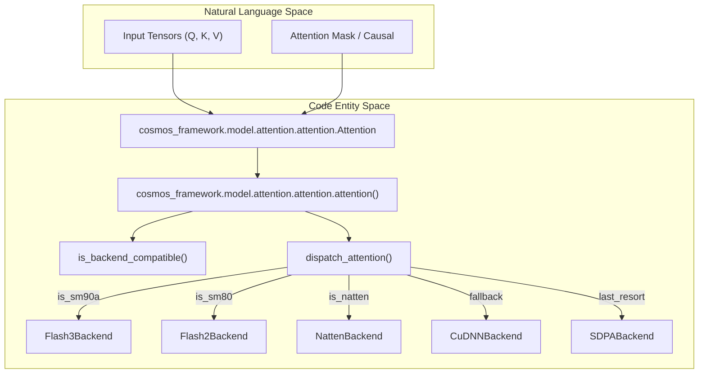
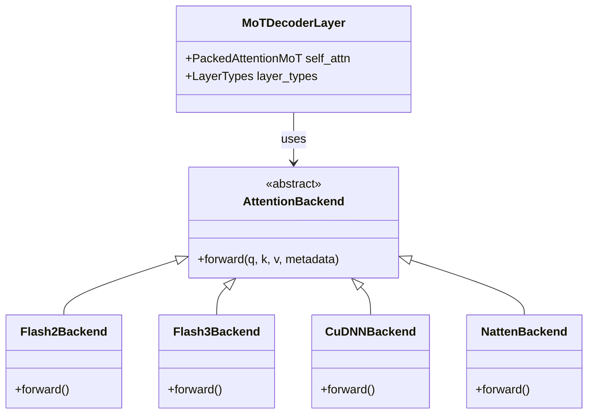

<!-- source: DeepWiki mcp.deepwiki.com · repo NVIDIA/cosmos-framework · extra page Attention Backends · fetched 2026-10-26 -->

# Attention Backends

Relevant source files

The following files were used as context for generating this wiki page:

- [cosmos_framework/inference/inference.py](cosmos_framework/inference/inference.py)
- [cosmos_framework/inference/transfer.py](cosmos_framework/inference/transfer.py)
- [cosmos_framework/model/vfm/mot/unified_mot.py](cosmos_framework/model/vfm/mot/unified_mot.py)
- [cosmos_framework/model/vfm/omni_mot_model.py](cosmos_framework/model/vfm/omni_mot_model.py)
- [cosmos_framework/model/vfm/vlm/qwen3_vl/qwen3_vl.py](cosmos_framework/model/vfm/vlm/qwen3_vl/qwen3_vl.py)

The Cosmos-Framework provides a unified attention frontend that abstracts various high-performance attention backends. This system automatically selects the most efficient kernel based on hardware capabilities, sequence properties (such as causal masking), and memory constraints. It supports advanced features including variable-length (varlen) sequences for efficient packing, context parallelism (CP), and specialized kernels like FlashAttention-3 and NATTEN.

## Unified Attention Frontend

The primary entry point for attention operations is the `Attention` class and its functional counterpart `attention`. These components handle the dispatch logic to specific backends while maintaining a consistent interface for the model layers. The `OmniMoTModel` and `Cosmos3VFMNetwork` rely on this unified interface to execute attention across different modalities [cosmos_framework/model/vfm/omni_mot_model.py:43-45]().

### Backend Selection Logic
The framework evaluates compatibility for multiple backends in a prioritized order. The selection is governed by the `is_backend_compatible` function, which checks hardware support (e.g., Hopper architecture for FlashAttention-3) and input requirements (e.g., causal vs. non-causal).

| Backend | Priority | Hardware/Requirement | File Reference |
| :--- | :--- | :--- | :--- |
| **Flash3** | High | NVIDIA Hopper (sm90a), Head Dim 64/128 | [cosmos_framework/model/attention/backend.py:101-118]() |
| **Flash2** | Medium | NVIDIA Ampere+ (sm80+), Head Dim <= 256 | [cosmos_framework/model/attention/backend.py:84-99]() |
| **NATTEN** | Specialized | Neighborhood Attention (Sliding Window) | [cosmos_framework/model/attention/backend.py:137-146]() |
| **cuDNN** | Fallback | General CUDA support | [cosmos_framework/model/attention/backend.py:120-135]() |
| **SDPA** | Baseline | PyTorch Native (Scaled Dot Product) | [cosmos_framework/model/attention/backend.py:148-154]() |

**Sources:**
- `cosmos_framework/model/attention/backend.py` [101-154]()
- `cosmos_framework/model/attention/attention.py` [220-256]()

---

## Implementation Architecture

The following diagram illustrates the flow from a high-level `Attention` module call down to the specific hardware kernels.

### Attention Dispatch Flow

**Sources:**
- `cosmos_framework/model/attention/attention.py` [113-218]() (Attention class)
- `cosmos_framework/model/attention/attention.py` [220-305]() (attention function)
- `cosmos_framework/model/vfm/mot/attention.py` [27-30]() (dispatch_attention)
- `cosmos_framework/model/attention/backend.py` [33-68]() (Backend definitions)

---

## Key Components and Features

### Variable-Length (Varlen) Support
To handle packed sequences efficiently without wasting computation on padding tokens, the framework implements `varlen` attention. This is critical for the `OmniMoTModel` which uses `SequencePacking` to combine multiple videos or text samples into a single batch [cosmos_framework/model/vfm/omni_mot_model.py:30-36]().

- **Implementation:** The `Flash2Backend` and `Flash3Backend` accept cumulative sequence lengths (`cu_seqlens`) [cosmos_framework/model/attention/backend.py:236-258]().
- **Metadata Logic:** The `Attention` module detects varlen inputs by checking for `cu_seqlens` in the `AttentionMetadata` object [cosmos_framework/model/attention/attention.py:11-35]().

### Causal Masking Types
The framework supports different masking strategies, defined via the `CausalType` enum [cosmos_framework/model/attention/masks.py:14]():
1. **None**: Standard bidirectional attention.
2. **Causal**: Standard auto-regressive masking.
3. **Prefix**: Specialized masking for prefix-LM or encoder-decoder styles.

In `OmniMoTModel`, the `SequencePlan` determines the specific masking requirements, such as whether to share temporal positions or apply specific condition frame indexes [cosmos_framework/inference/transfer.py:179-186]().

### Context Parallel (CP) Dispatch
For long-sequence modeling, the framework supports Context Parallelism. The `attention` function integrates with the `ParallelContext` to determine if the sequence is split across multiple GPUs. If CP is active, the framework handles the necessary communication and local attention computation [cosmos_framework/model/attention/attention.py:270-285](). The `context_parallel_broadcast_tensor_list` utility is used to sync states across CP ranks [cosmos_framework/model/vfm/mot/context_parallel_utils.py:42]().

**Sources:**
- `cosmos_framework/model/attention/attention.py` [11-35]() (Metadata)
- `cosmos_framework/model/attention/backend.py` [210-265]() (Flash2 implementation)
- `cosmos_framework/model/vfm/omni_mot_model.py` [42-45]() (CP utilities)

---

## Backend Comparison and Data Flow

The backends are implemented as subclasses of `AttentionBackend`, providing a standard `forward` method.

| Feature | Flash2 | Flash3 | cuDNN | NATTEN |
| :--- | :--- | :--- | :--- | :--- |
| **Causal Support** | Yes | Yes | Yes | No |
| **Varlen Support** | Yes | Yes | Yes | No |
| **GQA/MQA** | Yes | Yes | Yes | No |
| **FP8 Support** | No | Yes | Yes | No |

### Unified MoT Layer Integration
The `MoTDecoderLayer` in `unified_mot.py` uses these backends to implement the core transformer logic across different model variants (Qwen3-VL, Nemotron-3) [cosmos_framework/model/vfm/mot/unified_mot.py:85-96]().

**Sources:**
- `cosmos_framework/model/attention/backend.py` [33-68]() (Base and concrete classes)
- `cosmos_framework/model/vfm/mot/unified_mot.py` [99-131]() (LayerTypes and MoT integration)
- `cosmos_framework/model/attention/backend.py` [267-313]() (Flash3 specific logic)

### Neighborhood Attention (NATTEN)
Specialized for spatial/temporal locality, the `NattenBackend` is triggered when the `is_natten` flag is set in the metadata. It uses sliding window kernels which are significantly more efficient for local attention patterns in video or image processing than global attention [cosmos_framework/model/attention/backend.py:378-410]().

**Sources:**
- `cosmos_framework/model/attention/backend.py` [137-146]() (NATTEN compatibility check)
- `cosmos_framework/model/attention/backend.py` [378-410]() (NATTEN forward pass)

---

