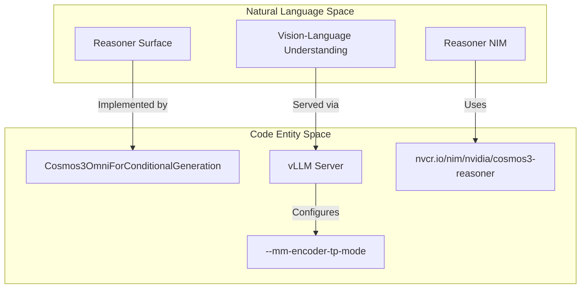

<!-- source: DeepWiki mcp.deepwiki.com · repo NVIDIA/cosmos · page 1 Overview · fetched 2026-10-26 -->

# Overview

<details>
<summary>Relevant source files</summary>

The following files were used as context for generating this wiki page:

- [.github/ISSUE_TEMPLATE/bug_report.md](.github/ISSUE_TEMPLATE/bug_report.md)
- [.github/ISSUE_TEMPLATE/feature_request.md](.github/ISSUE_TEMPLATE/feature_request.md)
- [.github/workflows/validate-notebooks.yml](.github/workflows/validate-notebooks.yml)
- [README.md](README.md)
- [SECURITY.md](SECURITY.md)
- [assets/brand/badge-website.svg](assets/brand/badge-website.svg)
- [assets/brand/cosmos-logo.png](assets/brand/cosmos-logo.png)
- [assets/demos/driving_sim_falling_rocks.gif](assets/demos/driving_sim_falling_rocks.gif)
- [assets/demos/fd_egocentric_repair_poses.gif](assets/demos/fd_egocentric_repair_poses.gif)
- [assets/demos/physics_newton_cradle.gif](assets/demos/physics_newton_cradle.gif)
- [assets/demos/policy_screwdriver.gif](assets/demos/policy_screwdriver.gif)
- [assets/demos/reasoner_driving_hazard.gif](assets/demos/reasoner_driving_hazard.gif)
- [assets/demos/transfer_worldscenario.gif](assets/demos/transfer_worldscenario.gif)
- [cookbooks/cosmos3/README.md](cookbooks/cosmos3/README.md)
- [cookbooks/cosmos3/generator/audiovisual/README.md](cookbooks/cosmos3/generator/audiovisual/README.md)
- [docs/reference/models.md](docs/reference/models.md)

</details>


NVIDIA Cosmos is an open platform of world models, datasets, and tools designed to build Physical AI for robots, autonomous vehicles, and smart infrastructure [README.md:10-11](). It unifies vision-language models, video generators, world simulators, and world-action models into a single framework [README.md:10-11]().

Cosmos 3 is built on a unified **Mixture-of-Transformers (MoT)** architecture that processes and generates language, images, video, audio, and action sequences within a single model [README.md:67-68]().

## Runtime Surfaces

The model family exposes two primary runtime surfaces, each optimized for specific interaction modes:

| Surface | Inputs | Outputs | Primary Use Cases |
|:---|:---|:---|:---|
| **Reasoner** | Text, Vision | Text | World understanding, grounding, task planning, embodied reasoning [README.md:73-74](). |
| **Generator** | Text, Vision, Sound, Action | Vision, Sound, Action | World simulation, future prediction, synthetic data, policy learning [README.md:74-75](). |

For a deep dive into the underlying MoT architecture, causal self-attention in Reasoner mode, and full attention in Generator mode, see **[Model Architecture](#1.1)**.

## Model Family

Cosmos 3 offers models in three primary tiers to balance performance and computational efficiency:

*   **Cosmos3-Super (64B):** A frontier-scale omnimodal world model [docs/reference/models.md:11]().
*   **Cosmos3-Nano (16B):** An omnimodal world model for understanding, simulation, prediction, and action reasoning on a single GPU [docs/reference/models.md:10]().
*   **Cosmos3-Edge (4B):** A compact omnimodal world model for on-device and low-latency deployment, including Jetson AGX Orin / Thor / RTX Pro 6000 [README.md:62-63](), [docs/reference/models.md:9]().
*   **Specialized Variants:** Includes post-trained example checkpoints such as `Cosmos3-Super-Text2Image`, `Cosmos3-Super-Image2Video`, and `Cosmos3-Nano-Policy-DROID` that demonstrate fine-tuning capabilities [docs/reference/models.md:14-22]().

## Integration Paths

Developers can integrate Cosmos 3 through several distinct paths depending on the use case:

1.  **Cosmos Framework:** Native PyTorch inference using `torchrun`. This path is ideal for research, custom post-training, and native performance using `cosmos_framework.scripts.inference` [cookbooks/cosmos3/README.md:9](), [cookbooks/cosmos3/generator/audiovisual/README.md:73-74]().
2.  **Diffusers:** Integration with the Hugging Face `diffusers` library via `Cosmos3OmniPipeline`, optimized for Python-first audiovisual generation [cookbooks/cosmos3/README.md:10](), [cookbooks/cosmos3/generator/audiovisual/README.md:115]().
3.  **vLLM / vLLM-Omni:** Production-grade serving with OpenAI-compatible APIs. Use **vLLM** for the Reasoner and **vLLM-Omni** for the Generator [cookbooks/cosmos3/README.md:14-15]().
4.  **SGLang:** OpenAI-compatible serving for both Reasoner and Generator tasks [cookbooks/cosmos3/README.md:14-15]().
5.  **TensorRT-LLM:** High-performance inference serving via `trtllm-serve` for VisualGen workloads [cookbooks/cosmos3/README.md:11-12]().
6.  **NIM:** Turnkey containers for Reasoner (`nvcr.io/nim/nvidia/cosmos3-reasoner`) and Generator (`nvcr.io/nim/nvidia/cosmos3-generator`) deployment [cookbooks/cosmos3/README.md:16-18]().

For details on hardware requirements and choosing an integration path, see **[Model Family and Integration Paths](#1.2)**.

## System Architecture Mapping

The following diagrams illustrate the relationship between high-level system concepts and the specific code entities or configurations used to invoke them.

### Reasoner Execution Mapping
This diagram maps the Reasoner surface to the specific vLLM architecture and serving configurations.


Sources: [cookbooks/cosmos3/README.md:13-17](), [cookbooks/cosmos3/README.md:38]()

### Generator Execution Mapping
This diagram maps the Generator surface to the primary inference entry points and pipelines.

```mermaid
graph TD
    subgraph "Natural Language Space"
        G["Generator Surface"]
        AV["Audiovisual Generation"]
        VT["Video Transfer"]
        AP["Action Policy"]
    end

    subgraph "Code Entity Space"
        IF["cosmos_framework.scripts.inference"]
        CP["Cosmos3OmniPipeline"]
        VOMNI["Cosmos3OmniDiffusersPipeline"]
        TR["torchrun"]
        NIM_G["nvcr.io/nim/nvidia/cosmos3-generator"]
    end

    G -->|Native Path| IF
    G -->|Library Path| CP
    G -->|Serving Path (vLLM-Omni)| VOMNI
    G -->|Serving Path (NIM)| NIM_G
    AV -->|Uses| IF
    AV -->|Uses| CP
    AV -->|Uses| VOMNI
    VT -->|Uses| IF
    AP -->|Uses| VOMNI
    IF -->|Invoked by| TR
```
Sources: [cookbooks/cosmos3/README.md:9-18](), [cookbooks/cosmos3/generator/audiovisual/README.md:73-74](), [cookbooks/cosmos3/generator/audiovisual/README.md:115]()

## Next Steps

*   **[Model Architecture](#1.1)**: Detailed look at MoT, mRoPE, and tokenization.
*   **[Model Family and Integration Paths](#1.2)**: Setup guides for Nano/Super/Edge and backend selection.

Sources: [README.md:1-188](), [cookbooks/cosmos3/README.md:1-140](), [cookbooks/cosmos3/generator/audiovisual/README.md:1-180](), [docs/reference/models.md:1-94]()

---

