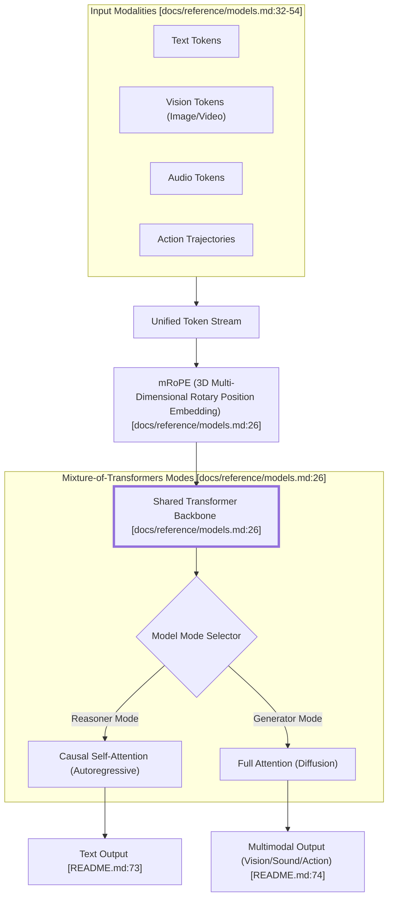
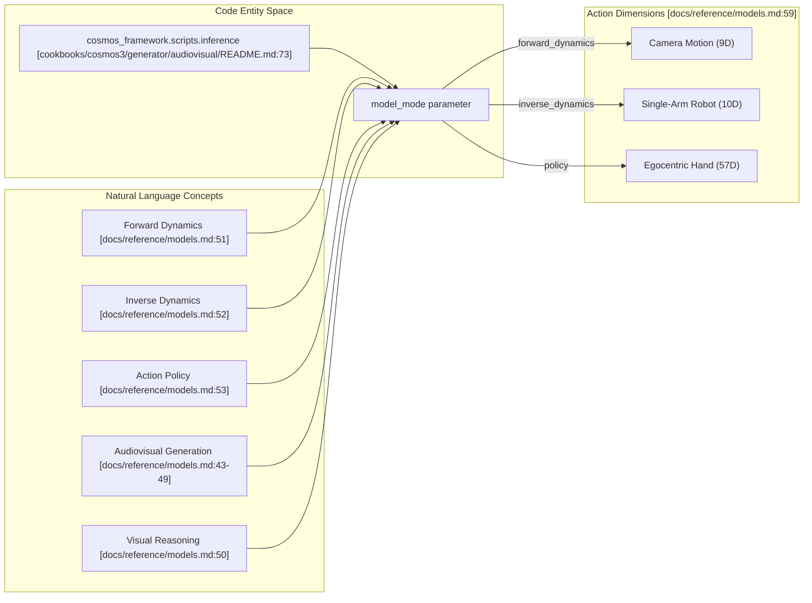

<!-- source: DeepWiki mcp.deepwiki.com · repo NVIDIA/cosmos · page 1.1 Model Architecture · fetched 2026-10-26 -->

# Model Architecture

Relevant source files

The following files were used as context for generating this wiki page:

- [README.md](README.md)
- [assets/brand/badge-website.svg](assets/brand/badge-website.svg)
- [assets/brand/cosmos-logo.png](assets/brand/cosmos-logo.png)
- [assets/demos/driving_sim_falling_rocks.gif](assets/demos/driving_sim_falling_rocks.gif)
- [assets/demos/fd_egocentric_repair_poses.gif](assets/demos/fd_egocentric_repair_poses.gif)
- [assets/demos/physics_newton_cradle.gif](assets/demos/physics_newton_cradle.gif)
- [assets/demos/policy_screwdriver.gif](assets/demos/policy_screwdriver.gif)
- [assets/demos/reasoner_driving_hazard.gif](assets/demos/reasoner_driving_hazard.gif)
- [assets/demos/transfer_worldscenario.gif](assets/demos/transfer_worldscenario.gif)
- [cookbooks/cosmos3/README.md](cookbooks/cosmos3/README.md)
- [cookbooks/cosmos3/generator/audiovisual/README.md](cookbooks/cosmos3/generator/audiovisual/README.md)
- [docs/reference/models.md](docs/reference/models.md)

NVIDIA Cosmos 3 is an omnimodal world model designed to process and generate language, images, video, audio, and action sequences within a unified framework. It utilizes a **Mixture-of-Transformers (MoT)** architecture that shares a common transformer backbone across two primary runtime surfaces: the **Reasoner** and the **Generator** [README.md:67-74]().

## Unified Mixture-of-Transformers (MoT)

The core of Cosmos 3 is a unified transformer architecture that adapts its attention mechanism and data flow based on the operating mode. This design allows the model to act as both a causal reasoner and a generative diffusion model using the same underlying weights and multimodal attention layers [docs/reference/models.md:26]().

### Reasoner Mode vs. Generator Mode

The MoT architecture toggles between two fundamental modes of operation:

| Feature | Reasoner Mode | Generator Mode |
| :--- | :--- | :--- |
| **Primary Task** | World understanding, grounding, task planning, embodied reasoning [README.md:73]() | World simulation, future prediction, synthetic data, policy learning [README.md:74]() |
| **Attention Mechanism** | **Causal Self-Attention**: Processes tokens autoregressively for next-token prediction [docs/reference/models.md:26]() | **Full Attention**: Denoises multimodal tokens through bidirectional context [docs/reference/models.md:26]() |
| **Model Type** | Autoregressive (AR) Transformer [docs/reference/models.md:26]() | Diffusion Transformer (DM) [docs/reference/models.md:26]() |
| **Outputs** | Text [README.md:73]() | Vision, Sound, Action [README.md:74]() |

### Data Flow and Modality Unification

Cosmos 3 unifies disparate modalities—text, vision (images/video), audio, and action—into a single token stream. This unification is achieved through specialized encoders that map each modality into a shared embedding space before processing by the transformer backbone [docs/reference/models.md:26]().

1.  **Text**: Processed via standard language tokenization for reasoning and instructions.
2.  **Vision**: Images and videos are encoded into visual tokens.
3.  **Audio**: Synchronized sound is handled as part of the unified stream, enabling audio-conditioned generation and output [docs/reference/models.md:44]().
4.  **Action**: Represented as multi-dimensional trajectories (e.g., 9D for camera motion/AV, 10D for single-arm robots, 57D for egocentric hand pose) [docs/reference/models.md:59]().

**Sources:** [README.md:67-74](), [docs/reference/models.md:26](), [docs/reference/models.md:44](), [docs/reference/models.md:59]()

---

## 3D Multi-Dimensional Rotary Position Embedding (mRoPE)

To maintain spatial and temporal coherence across different modalities, Cosmos 3 employs **mRoPE**. Unlike standard 1D RoPE used in text-only models, mRoPE encodes spatial and temporal structure across modalities into a unified representation [docs/reference/models.md:26]().

This allows the model to:
*   Understand the temporal sequence of video frames and audio samples.
*   Maintain spatial relationships (Height and Width) within an image or a single video frame.
*   Reason over action trajectories that occur across both time and space.

### Structural Diagram: MoT Architecture
The following diagram illustrates the relationship between the shared backbone and the mode-specific attention mechanisms, mapped to the system components.

**Sources:** [README.md:73-74](), [docs/reference/models.md:26](), [docs/reference/models.md:32-54]()

---

## Action Modeling Architecture

Cosmos 3 treats actions as first-class citizens in the token stream. This enables critical Physical AI workflows such as predicting policy actions, inverse dynamics, and forward dynamics [docs/reference/models.md:51-53]().

*   **Forward Dynamics**: Predicts future frames from a conditioning image and action trajectory [docs/reference/models.md:51]().
*   **Inverse Dynamics**: Predicts ego-motion trajectories from input video [docs/reference/models.md:52]().

### Action Representation Tiers
The model supports various action dimensions depending on the embodiment:
*   **9D**: Camera motion and Autonomous Vehicles (AV) [docs/reference/models.md:59]().
*   **10D**: Single-arm robot manipulation (DROID, UMI, Bridge, Fractal, AgiBotWorld, RoboMIND franka/franka_dual/ur) [docs/reference/models.md:59]().
*   **20D/29D/57D**: Dual-arm (DROID), Humanoid (AgiBot), and Egocentric Hand Pose configurations [docs/reference/models.md:59]().

### Code Entity Mapping: Inference Logic and Action Specs
The following diagram maps the logical concepts to the implementation entrypoints and parameters found in the `cosmos_framework`.

**Sources:** [docs/reference/models.md:43-53](), [docs/reference/models.md:59](), [cookbooks/cosmos3/generator/audiovisual/README.md:73]()

---

## Model Scale and Performance

The architecture is implemented in three primary tiers to balance performance and capability across different hardware profiles:

1.  **Cosmos3-Edge (4B)**: Optimized for edge and low-latency deployment on devices like Jetson AGX Orin/Thor or RTX Pro 6000. It supports 256p and 480p video resolutions [docs/reference/models.md:9]().
2.  **Cosmos3-Nano (16B)**: A balanced omnimodal world model for understanding, simulation, prediction, and action reasoning on a single GPU [docs/reference/models.md:10]().
3.  **Cosmos3-Super (64B)**: A frontier-scale omnimodal world model for high-quality synthetic data generation and state-of-the-art physical reasoning [docs/reference/models.md:11]().

### Precision and Hardware
The architecture is optimized for **BF16** precision and is compatible with NVIDIA **Ampere, Hopper, and Blackwell** architectures [docs/reference/models.md:73](). To serve these models, the platform supports integration with **vLLM** for reasoning and **vLLM-Omni**, **Diffusers**, or **TensorRT-LLM** for generation [cookbooks/cosmos3/README.md:7-16]().

**Sources:** [docs/reference/models.md:9-11](), [docs/reference/models.md:73](), [cookbooks/cosmos3/README.md:7-16]()

---

