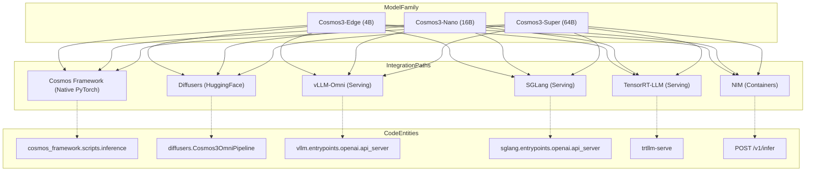
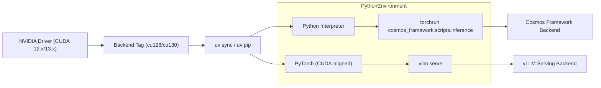

<!-- source: DeepWiki mcp.deepwiki.com · repo NVIDIA/cosmos · page 1.2 Model Family and Integration Paths · fetched 2026-10-26 -->

# Model Family and Integration Paths

<details>
<summary>Relevant source files</summary>

The following files were used as context for generating this wiki page:

- [README.md](README.md)
- [assets/brand/badge-website.svg](assets/brand/badge-website.svg)
- [assets/brand/cosmos-logo.png](assets/brand/cosmos-logo.png)
- [assets/demos/driving_sim_falling_rocks.gif](assets/demos/driving_sim_falling_rocks.gif)
- [assets/demos/fd_egocentric_repair_poses.gif](assets/demos/fd_egocentric_repair_poses.gif)
- [assets/demos/physics_newton_cradle.gif](assets/demos/physics_newton_cradle.gif)
- [assets/demos/policy_screwdriver.gif](assets/demos/policy_screwdriver.gif)
- [assets/demos/reasoner_driving_hazard.gif](assets/demos/reasoner_driving_hazard.gif)
- [assets/demos/transfer_worldscenario.gif](assets/demos/transfer_worldscenario.gif)
- [cookbooks/cosmos3/README.md](cookbooks/cosmos3/README.md)
- [cookbooks/cosmos3/generator/audiovisual/README.md](cookbooks/cosmos3/generator/audiovisual/README.md)
- [docs/reference/models.md](docs/reference/models.md)

</details>


This page describes the NVIDIA Cosmos 3 model family, including the **Nano**, **Super**, and **Edge** variants, and the technical integration paths available for different use cases. It covers hardware requirements, environment configuration via the `uv` package manager, and the selection of CUDA backends to ensure compatibility with NVIDIA drivers.

## Cosmos 3 Model Family

The Cosmos 3 family consists of omnimodal world models built on a unified Mixture-of-Transformers (MoT) architecture [README.md:79](). These models are designed to process and generate language, images, video, audio, and action sequences within a single framework [README.md:58]().

| Model | Size | Primary Capability |
| :--- | :--- | :--- |
| **[Cosmos3-Edge](https://huggingface.co/nvidia/Cosmos3-Edge)** | 4B | Compact omnimodal world model for on-device and low-latency deployment [docs/reference/models.md:9]() |
| **[Cosmos3-Nano](https://huggingface.co/nvidia/Cosmos3-Nano)** | 16B | Omnimodal world model — understanding, simulation, prediction, action reasoning on a single GPU [docs/reference/models.md:10]() |
| **[Cosmos3-Super](https://huggingface.co/nvidia/Cosmos3-Super)** | 64B | Frontier-scale omnimodal world model [docs/reference/models.md:11]() |

Post-trained example checkpoints demonstrate fine-tuning capabilities and are not part of the product line [docs/reference/models.md:13-14]():

| Example checkpoint | Base | Demonstrates |
| :--- | :--- | :--- |
| [Cosmos3-Super-Text2Image](https://huggingface.co/nvidia/Cosmos3-Super-Text2Image) | Super | Elite quality text-to-image [docs/reference/models.md:17]() |
| [Cosmos3-Super-Text2Image-4Step](https://huggingface.co/nvidia/Cosmos3-Super-Text2Image-4Step) | Super | Elite quality text-to-image, 17-25x faster [docs/reference/models.md:18]() |
| [Cosmos3-Super-Image2Video](https://huggingface.co/nvidia/Cosmos3-Super-Image2Video) | Super | Elite quality image-to-video [docs/reference/models.md:19]() |
| [Cosmos3-Super-Image2Video-4Step](https://huggingface.co/nvidia/Cosmos3-Super-Image2Video-4Step) | Super | Elite quality image-to-video, 17-25x faster [docs/reference/models.md:20]() |
| [Cosmos3-Nano-Policy-DROID](https://huggingface.co/nvidia/Cosmos3-Nano-Policy-DROID) | Nano | Open SOTA DROID robot policy, runs on RTX Pro 6000 [docs/reference/models.md:21]() |
| [Cosmos3-Edge-Policy-DROID](https://huggingface.co/nvidia/Cosmos3-Edge-Policy-DROID) | Edge | DROID robot policy at edge-deployable scale [docs/reference/models.md:22]() |

### Hardware and System Requirements

Cosmos 3 is optimized for modern NVIDIA GPU architectures and requires a Linux environment [cookbooks/cosmos3/README.md:21]().

*   **GPU Architectures:** NVIDIA Ampere, Hopper, and Blackwell [docs/reference/models.md:74]().
*   **Edge Platforms:** Cosmos3-Edge is designed for Jetson AGX Orin / Thor / RTX Pro 6000 [README.md:62]().
*   **Precision:** Models are benchmarked in BF16 and FP8 (for NIM) [docs/reference/models.md:73]().
*   **Storage:** Nano downloads plus CUDA dependencies can take tens of GiB; local disk space is required for `uv` and model caches [cookbooks/cosmos3/README.md:40-41]().

**Sources:** [README.md:58-79](), [README.md:62](), [cookbooks/cosmos3/README.md:21-41](), [docs/reference/models.md:9-22](), [docs/reference/models.md:73-74]()

---

## Integration Paths

Developers can choose from several integration paths based on whether they are performing research, local development, or production serving [README.md:41, 72]().

### 1. Cosmos Framework (Native PyTorch)

Native PyTorch inference launched with `torchrun`. Used for Reasoner, Generator (Audiovisual, Action), and Video Transfer [cookbooks/cosmos3/README.md:9]().
*   **Key Functionality:** Direct access to model internals and training recipes.
*   **Setup:** Requires cloning `cosmos-framework` into `packages/cosmos3` [cookbooks/cosmos3/README.md:63-69]().
*   **Example:** Generating a text-to-video with `Cosmos3-Nano` using `torchrun` [cookbooks/cosmos3/generator/audiovisual/README.md:72-78]().

### 2. Diffusers (HuggingFace)

Direct generation using the `Cosmos3OmniPipeline` for audiovisual tasks [cookbooks/cosmos3/README.md:10, cookbooks/cosmos3/generator/audiovisual/README.md:115]().
*   **Key Functionality:** Simplified API for generation workflows.
*   **Example:** Text-to-video generation with `Cosmos3OmniPipeline` [cookbooks/cosmos3/generator/audiovisual/README.md:119-142]().

### 3. vLLM and vLLM-Omni (Production Serving)

High-performance, OpenAI-compatible serving.
*   **vLLM:** Serves the Reasoner for image/video understanding [cookbooks/cosmos3/README.md:13]().
*   **vLLM-Omni:** Serves the Generator for image/video/audio/action/transfer tasks [cookbooks/cosmos3/README.md:14]().
*   **Example:** Sending a text-to-video request to a vLLM-Omni server [cookbooks/cosmos3/generator/audiovisual/README.md:172-180]().

### 4. SGLang and TensorRT-LLM

*   **SGLang:** OpenAI-compatible serving for Generator and Action modes [cookbooks/cosmos3/README.md:188-190]().
*   **TensorRT-LLM Generator:** OpenAI-compatible VisualGen server for image/video/audio/action/transfer generation [cookbooks/cosmos3/README.md:11]().
*   **TensorRT-LLM Reasoner:** OpenAI-compatible image/video reasoning server [cookbooks/cosmos3/README.md:12]().

### 5. NVIDIA NIM (Turnkey Containers)

Prebuilt, optimized containers for deployment.
*   **Reasoner NIM:** `nvcr.io/nim/nvidia/cosmos3-reasoner` [cookbooks/cosmos3/README.md:38]().
*   **Generator NIM:** `nvcr.io/nim/nvidia/cosmos3-generator` [cookbooks/cosmos3/README.md:38](). Supports `POST /v1/infer` with `b64_video` output [cookbooks/cosmos3/generator/audiovisual/README.md:8-10]().

### Integration Mapping
The following diagram illustrates the relationship between the model family and the integration surfaces.

**Model and Integration Surface Mapping**

**Sources:** [README.md:41](), [README.md:72](), [cookbooks/cosmos3/README.md:7-16](), [cookbooks/cosmos3/README.md:188-190](), [cookbooks/cosmos3/generator/audiovisual/README.md:8-10](), [cookbooks/cosmos3/generator/audiovisual/README.md:72-78](), [cookbooks/cosmos3/generator/audiovisual/README.md:115](), [cookbooks/cosmos3/generator/audiovisual/README.md:119-142](), [cookbooks/cosmos3/generator/audiovisual/README.md:172-180]()

---

## Environment Setup and CUDA Selection

Cosmos 3 utilizes `uv` for dependency management and requires alignment between the NVIDIA driver and the installed CUDA toolkit [cookbooks/cosmos3/README.md:21, 43]().

### CUDA Version Selection
Backends pin specific CUDA builds of `torch` or `vllm` to match the host driver [cookbooks/cosmos3/README.md:45-46]().

| Driver CUDA Version | Backend Tag | Notes |
| :--- | :--- | :--- |
| 13.x | `cu130` | Default in notebooks [cookbooks/cosmos3/README.md:50](). |
| 12.x | `cu128` | Use for compatible wheel availability [cookbooks/cosmos3/README.md:51](). |

### Installation via uv
For the Cosmos Framework, use the `*-train` dependency group as the inference path imports training modules [cookbooks/cosmos3/README.md:71-73]().

**Framework Installation Example:**
```bash
# For CUDA 13.x drivers
uv sync --all-extras --group=cu130-train
```
[cookbooks/cosmos3/README.md:81]()

### Data Flow: Environment to Execution
The following diagram traces how the environment configuration influences the execution of the model backends.

**Environment and Backend Data Flow**

**Sources:** [cookbooks/cosmos3/README.md:43-51]()

### Critical Environment Variables and Troubleshooting
*   `COSMOS3_UV_GROUP`: Set to `cu128-train` for CUDA 12.x systems [cookbooks/cosmos3/README.md:87-88]().
*   `GIT_LFS_SKIP_SMUDGE`: Set to `1` during `uv sync` to avoid failures from missing LFS blobs [cookbooks/cosmos3/README.md:78]().
*   `LD_LIBRARY_PATH`: Clear this when using the NGC PyTorch base image to avoid shadowing the venv [cookbooks/cosmos3/README.md:132-138]().
*   **System Packages:** `libgl1`, `libglib2.0-0`, and `libxcb1` are required for guardrails (OpenCV/RetinaFace) [cookbooks/cosmos3/README.md:108-119]().
*   **Guardrails:** Enable/disable via `enable_safety_checker=False` (Diffusers), `TRTLLM_DISABLE_COSMOS3_GUARDRAILS=1` or `use_guardrails: false` (TensorRT-LLM), `guardrails: false` (vLLM-Omni), or `--no-guardrails` (Cosmos Framework). For Generator NIM set `NIM_ENABLE_TEXT_GUARDRAILS=0 NIM_ENABLE_VIDEO_GUARDRAILS=0` [cookbooks/cosmos3/README.md:33-36](), [cookbooks/cosmos3/generator/audiovisual/README.md:17-24]().

**Sources:** [cookbooks/cosmos3/README.md:33-36](), [cookbooks/cosmos3/README.md:78](), [cookbooks/cosmos3/README.md:87-88](), [cookbooks/cosmos3/README.md:108-119](), [cookbooks/cosmos3/README.md:132-138](), [cookbooks/cosmos3/generator/audiovisual/README.md:17-24]()

---

