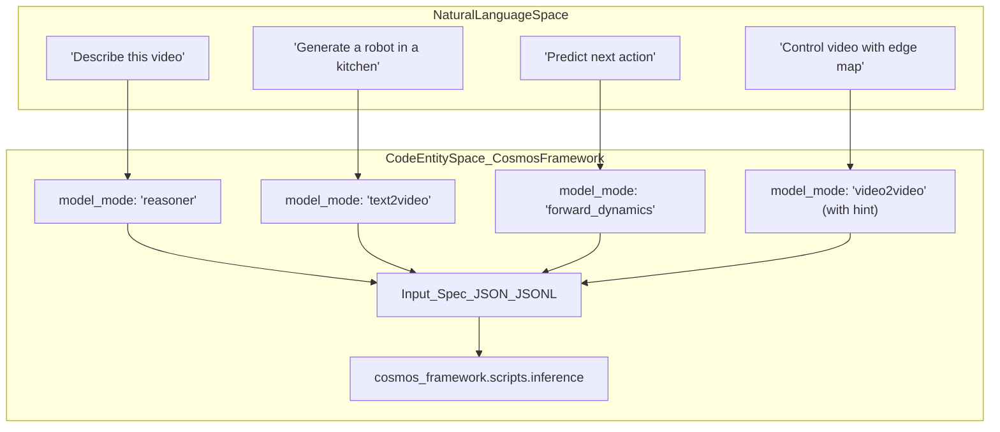
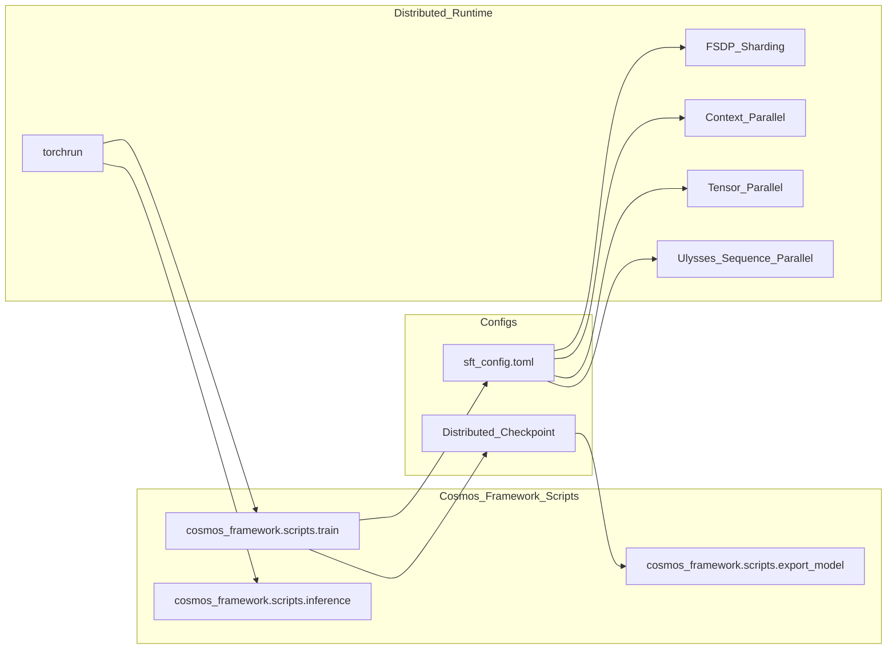

<!-- source: DeepWiki mcp.deepwiki.com · repo NVIDIA/cosmos · page 10 Glossary · fetched 2026-10-26 -->

# Glossary

Relevant source files

The following files were used as context for generating this wiki page:

- [README.md](README.md)
- [assets/brand/badge-website.svg](assets/brand/badge-website.svg)
- [assets/brand/cosmos-logo.png](assets/brand/cosmos-logo.png)
- [assets/demos/driving_sim_falling_rocks.gif](assets/demos/driving_sim_falling_rocks.gif)
- [assets/demos/fd_egocentric_repair_poses.gif](assets/demos/fd_egocentric_repair_poses.gif)
- [assets/demos/physics_newton_cradle.gif](assets/demos/physics_newton_cradle.gif)
- [assets/demos/policy_screwdriver.gif](assets/demos/policy_screwdriver.gif)
- [assets/demos/reasoner_driving_hazard.gif](assets/demos/reasoner_driving_hazard.gif)
- [assets/demos/transfer_worldscenario.gif](assets/demos/transfer_worldscenario.gif)
- [cookbooks/cosmos3/README.md](cookbooks/cosmos3/README.md)
- [cookbooks/cosmos3/generator/action/README.md](cookbooks/cosmos3/generator/action/README.md)
- [cookbooks/cosmos3/generator/audiovisual/README.md](cookbooks/cosmos3/generator/audiovisual/README.md)
- [cookbooks/cosmos3/generator/transfer/README.md](cookbooks/cosmos3/generator/transfer/README.md)
- [docs/reference/models.md](docs/reference/models.md)

This glossary defines technical terms, architectural components, and domain-specific concepts used throughout the NVIDIA Cosmos 3 codebase. It serves as a reference for onboarding engineers to understand the relationships between high-level Physical AI concepts and their specific implementations in the code.

## Core Concepts

| Term | Definition |
| :--- | :--- |
| **Omnimodal** | The ability of a single model architecture to process and generate multiple modalities (text, vision, audio, action) within a unified token stream [README.md:67-67](). |
| **Mixture-of-Transformers (MoT)** | The underlying architecture of Cosmos 3 that combines an autoregressive transformer (for reasoning) with a diffusion transformer (for generation) using a shared backbone [README.md:67-67](). |
| **Reasoner Mode** | A runtime configuration using causal self-attention for next-token prediction tasks like perception, planning, and world reasoning [README.md:71-73](). |
| **Generator Mode** | A runtime configuration using full attention to denoise multimodal tokens (image, video, audio, action) for content creation [README.md:74-74](). |
| **mRoPE** | 3D multi-dimensional Rotary Position Embedding used to encode spatial and temporal structures across all modalities. |
| **Flow Shift** | A parameter used in the `UniPCMultistepScheduler` for Diffusers pipelines, influencing the generation process [cookbooks/cosmos3/generator/audiovisual/README.md:125-125](). |

### Physical AI Modalities
Cosmos 3 unifies various inputs into a single framework to simulate and understand the physical world.

**Vision-Language-Action (VLA) Data Flow**
The following diagram illustrates how natural language concepts map to specific code entities and data structures within the Cosmos 3 ecosystem.

**Diagram: Natural Language to Code Entity Mapping**

Sources: [cookbooks/cosmos3/generator/action/README.md:5-7](), [cookbooks/cosmos3/generator/action/README.md:69-72](), [cookbooks/cosmos3/generator/transfer/README.md:26-26]()

---

## Architectural Components

### Model Surfaces
Cosmos 3 exposes two primary runtime surfaces, each mapped to specific classes and serving infrastructures.

1.  **Reasoner**: Focused on world understanding, grounding, physical reasoning, and task planning [README.md:71-73]().
    *   **Implementation**: `Cosmos3OmniForConditionalGeneration` (Hugging Face Transformers) [cookbooks/cosmos3/README.md:13-13]().
    *   **Serving**: vLLM, SGLang, TensorRT-LLM Reasoner, Hugging Face Transformers, or prebuilt NIM containers (`nvcr.io/nim/nvidia/cosmos3-reasoner`) [cookbooks/cosmos3/README.md:12-17]().
2.  **Generator**: Focused on world simulation, future prediction, and multimodal content creation [README.md:74-74]().
    *   **Implementation**: `Cosmos3OmniPipeline` (Diffusers) [cookbooks/cosmos3/generator/audiovisual/README.md:115-115]() or `Cosmos3OmniDiffusersPipeline` (vLLM-Omni).
    *   **Serving**: vLLM-Omni Docker container, SGLang, TensorRT-LLM VisualGen, Diffusers, or Cosmos Framework `torchrun` scripts [cookbooks/cosmos3/README.md:9-16]().

### Model Tiers
Cosmos 3 models are available in different sizes to accommodate various hardware and performance requirements.

| Model Name | Size | Description |
| :--- | :--- | :--- |
| **Cosmos3-Nano** | 16B | Smaller model for faster inference and lower resource usage [cookbooks/cosmos3/generator/audiovisual/README.md:4-4](). |
| **Cosmos3-Super** | 64B | Larger, more capable model, typically requiring multi-GPU setups [cookbooks/cosmos3/generator/audiovisual/README.md:4-4](). |
| **Cosmos3-Edge** | 4B | Optimized for on-device, real-time deployment on platforms like Jetson AGX Orin/Thor or RTX Pro 6000 [README.md:62-62](). |

### Inference Backends
Cosmos 3 supports multiple inference backends, each offering different performance characteristics and deployment options.

*   **Cosmos Framework**: Native PyTorch inference, launched with `torchrun` [cookbooks/cosmos3/README.md:9-9](). Provides direct access to model internals and full control.
*   **Diffusers**: Hugging Face library for direct generation using `Cosmos3OmniPipeline` [cookbooks/cosmos3/README.md:10-10]().
*   **vLLM**: Optimized serving engine for large language models, providing an OpenAI-compatible API for Reasoner tasks [cookbooks/cosmos3/README.md:14-14]().
*   **vLLM-Omni**: An extension of vLLM specifically for multimodal generation, offering an OpenAI-compatible API for Generator tasks [cookbooks/cosmos3/README.md:15-15]().
*   **SGLang**: A serving engine for LLMs that supports complex prompt structures and efficient batching.
*   **TensorRT-LLM (TRT-LLM)**: NVIDIA's high-performance inference library for LLMs.
    *   **TRT-LLM Reasoner**: OpenAI-compatible server for image/video reasoning [cookbooks/cosmos3/README.md:12-12]().
    *   **TRT-LLM VisualGen**: OpenAI-compatible server for image/video/audio/action/transfer generation [cookbooks/cosmos3/README.md:11-11]().
*   **NIM (NVIDIA Inference Microservice)**: Prebuilt NGC containers offering a turnkey solution for serving Cosmos 3 models with an OpenAI-compatible API [cookbooks/cosmos3/README.md:16-18]().

### Parallelism Dimensions
When running large models like **Cosmos3-Super** (64B), the framework employs multi-dimensional parallelism strategies to fit within GPU memory and optimize throughput.

| Strategy | Description |
| :--- | :--- |
| **FSDP / HSDP** | Fully Sharded Data Parallelism or Hybrid Sharded Data Parallelism for training [cookbooks/cosmos3/reasoner/finetune/toml/sft_config/videophy2_sft_nano.toml:71-71](), [cookbooks/cosmos3/reasoner/finetune/toml/sft_config/videophy2_sft_super.toml:9-11](). |
| **Tensor Parallelism** | Splits model weights across multiple GPUs, configured via `--tensor-parallel-size` [inference_benchmarks.md:94-94](). |
| **Context Parallelism** | Parallelizes along the sequence/context dimension, configured via `context_parallel_shard_degree` [cookbooks/cosmos3/reasoner/finetune/toml/sft_config/videophy2_sft_super.toml:48-48](). |
| **CFG Parallelism** | Parallelizes Classifier-Free Guidance computations across GPUs [cookbooks/cosmos3/reasoner/finetune/toml/sft_config/videophy2_sft_nano.toml:40-40](). |
| **Ulysses Sequence Parallelism** | A sequence parallelism technique for very long contexts. |
| **Parallel VAE** | Parallelization strategy for the Variational Autoencoder component. |
| **Layerwise Offload** | Offloading model layers to CPU memory to reduce GPU memory footprint. |
| **dp-shard-size** | Parameter controlling data parallelism sharding. |

**Diagram: Distributed Component Interaction**

Sources: [cookbooks/cosmos3/reasoner/finetune/README.md:16-18](), [cookbooks/cosmos3/reasoner/finetune/README.md:52-54](), [cookbooks/cosmos3/reasoner/finetune/toml/sft_config/videophy2_sft_super.toml:45-49]()

---

## Action Modeling Terms

Action modeling in Cosmos 3 uses a unified representation to handle different robotic and vehicle embodiments [cookbooks/cosmos3/generator/action/README.md:39-47]().

*   **Forward Dynamics (`fd`)**: Predicting future visual observations (frames) from a start image plus an action trajectory [cookbooks/cosmos3/generator/action/README.md:5-5]().
*   **Inverse Dynamics (`id`)**: Predicting ego-motion trajectories from input video [cookbooks/cosmos3/generator/action/README.md:6-6]().
*   **Policy (`policy`)**: Predicting future observations and action trajectories from a start image, task instruction, and state [cookbooks/cosmos3/generator/action/README.md:7-7]().
*   **9D Pose Delta**: A unified interface for ego and end-effector poses, consisting of 3D translation and a 6D continuous rotation representation [cookbooks/cosmos3/generator/action/README.md:43-44]().
*   **rot6d**: A 6-dimensional continuous rotation representation used for action modeling.
*   **57D Hand Pose**: A high-dimensional representation for human hand poses, including ego pose, wrist, and fingertip positions [cookbooks/cosmos3/generator/action/README.md:54-54]().
*   **quantile_rot**: A method for representing rotations, likely using quantiles for discretization or compression.

### Embodiment & Representation
| Embodiment | Representation | Dimensionality |
| :--- | :--- | :--- |
| **Autonomous Vehicle** | Ego pose (9D) | 9D [cookbooks/cosmos3/generator/action/README.md:51-51]() |
| **DROID / UMI** | End-effector (9D) + Gripper (1D) | 10D [cookbooks/cosmos3/generator/action/README.md:52-53]() |
| **Human Hand Pose** | Ego + Wrists + Fingertips | 57D [cookbooks/cosmos3/generator/action/README.md:54-54]() |

### Action Datasets
Cosmos 3 supports various action datasets for training and evaluation.

*   **LeRobot**: A framework for robotics datasets, with v3.0 examples bundled in the repo [cookbooks/cosmos3/generator/action/action_datasets_and_asset_formats.md:1-1]().
*   **DROID**: A robotics dataset for manipulation tasks [cookbooks/cosmos3/generator/action/action_datasets_and_asset_formats.md:1-1]().
*   **UMI**: A robotics dataset for manipulation tasks [cookbooks/cosmos3/generator/action/action_datasets_and_asset_formats.md:1-1]().
*   **Bridge**: A robotics dataset [cookbooks/cosmos3/generator/action/action_datasets_and_asset_formats.md:1-1]().
*   **Fractal**: A robotics dataset [cookbooks/cosmos3/generator/action/action_datasets_and_asset_formats.md:1-1]().
*   **AgiBotWorld**: A robotics dataset [cookbooks/cosmos3/generator/action/action_datasets_and_asset_formats.md:1-1]().
*   **RoboMIND**: A robotics dataset, including `franka` and `franka_dual` robot configurations [cookbooks/cosmos3/generator/action/action_datasets_and_asset_formats.md:1-1]().
*   **RoboCasa**: A robotics dataset for household tasks.
*   **LIBERO**: A robotics dataset, including `LIBERO-10` and `LIBERO-All` variants.

---

## Evaluation and Fine-Tuning Terms

### Evaluation Terms
*   **Physics IQ**: A benchmark suite for assessing physical reasoning in generated videos (I2V and V2V tasks) [README.md:87-87]().
*   **PAI-Bench**: Physical AI Benchmarks.
    *   **PAI-Bench-G**: For generative tasks (T2V/I2V) [evaluation/README.md:10-10]().
    *   **PAI-Bench-C**: For controlled generation tasks (e.g., with edge/blur/depth/seg specs) [evaluation/README.md:10-10]().
*   **RBench**: Robotics I2V evaluation benchmark [evaluation/README.md:10-10]().
*   **UniGenBench**: Text-to-image evaluation benchmark using an LLM-judge scorer [evaluation/README.md:10-10]().
*   **TAR (Temporal Action Recognition)**: A benchmark from the VLMEvalKit, specifically `AETCBench_all` [evaluation/README.md:10-10]().
*   **VANTAGE**: A Reasoner evaluation benchmark from the VLMEvalKit [evaluation/README.md:10-10]().
*   **TC (Temporal Consistency)**: An evaluation metric for video generation, measuring consistency over time.
*   **VQ (Video Quality)**: An evaluation metric for video generation, assessing visual fidelity.
*   **TS (Text-to-Video Score)**: An evaluation metric for text-to-video generation, measuring alignment between text and video.
*   **TTFT (Time To First Token)**: Serving metric for Reasoner models measuring latency to the start of text generation [inference_benchmarks.md:3-3]().

### Fine-Tuning Concepts
*   **SFT (Supervised Fine-Tuning)**: Post-training process adapted for vision, action, and reasoning workflows [README.md:76-76]().
    *   **Implementation**: Driven by `cosmos_framework.scripts.train` [cookbooks/cosmos3/reasoner/finetune/README.md:16-16]().
*   **DMD2 (Distribution Matching Distillation)**: A distillation method used to create few-step (e.g., 4-step) generator models [cookbooks/cosmos3/generator/audiovisual/distill/README.md:6-7]().
*   **DCP (Distributed Checkpoint)**: Native PyTorch format for sharded checkpoints containing model, optimizer, and scheduler states [cookbooks/cosmos3/reasoner/finetune/README.md:44-45]().
*   **LoRA (Low-Rank Adaptation)**: A parameter-efficient fine-tuning technique used for large models like Cosmos3-Super [README.md:76-76]().
*   **HSDP (Hybrid Sharded Data Parallelism)**: A parallelism strategy for training, combining data sharding with other techniques.

---

## Technical Infrastructure

### Dependency Management
*   **uv**: Fast Python package and environment manager used for all Cosmos 3 setups [cookbooks/cosmos3/README.md:21-21]().
*   **cu128 / cu130**: Backend tags for CUDA version alignment (12.x vs 13.x) to ensure compatible `torch` and `vllm` wheels [cookbooks/cosmos3/README.md:44-51]().
*   **LD_LIBRARY_PATH**: Must be managed carefully, especially in NGC containers, to prevent library shadowing (e.g., clearing it for venv imports) [cookbooks/cosmos3/README.md:132-139]().

### API & Protocols
*   **OpenAI-Compatible**: Standard API format used by vLLM, SGLang, and NIM for chat completions and multimodal generation [cookbooks/cosmos3/README.md:14-16]().
*   **Guardrails**: Safety mechanisms implemented to prevent the generation of harmful or inappropriate content. Can be toggled via `enable_safety_checker=False` (Diffusers), `TRTLLM_DISABLE_COSMOS3_GUARDRAILS=1` or `use_guardrails: false` (TensorRT-LLM), `guardrails: false` (vLLM-Omni), `--no-guardrails` (Cosmos Framework), or `NIM_ENABLE_TEXT_GUARDRAILS=0 NIM_ENABLE_VIDEO_GUARDRAILS=0` (NIM) [cookbooks/cosmos3/README.md:35-38]().

Sources: [README.md:62-90](), [cookbooks/cosmos3/README.md:1-140](), [cookbooks/cosmos3/generator/action/README.md:1-62](), [cookbooks/cosmos3/generator/audiovisual/README.md:1-159](), [cookbooks/cosmos3/generator/transfer/README.md:1-156](), [evaluation/README.md:1-10](), [cookbooks/cosmos3/reasoner/finetune/README.md:1-66](), [cookbooks/cosmos3/reasoner/finetune/toml/sft_config/videophy2_sft_nano.toml:40-71](), [cookbooks/cosmos3/reasoner/finetune/toml/sft_config/videophy2_sft_super.toml:9-48]().