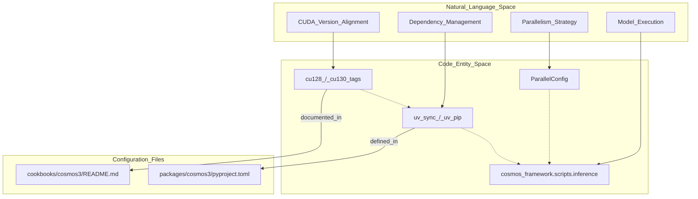
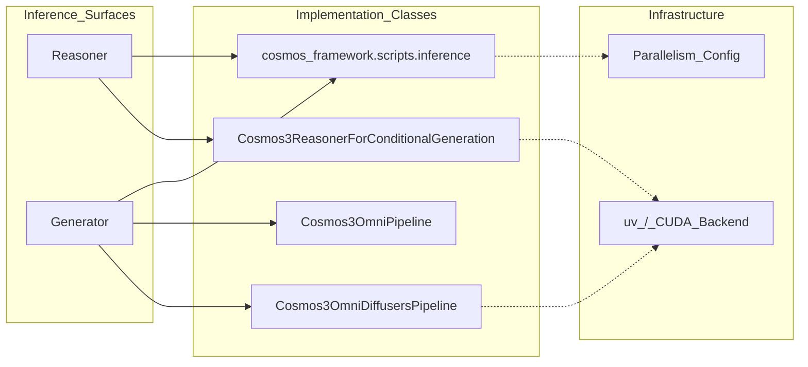

<!-- source: DeepWiki mcp.deepwiki.com · repo NVIDIA/cosmos · page 2 Environment Setup and Configuration · fetched 2026-10-26 -->

# Environment Setup and Configuration

Relevant source files

The following files were used as context for generating this wiki page:

- [.gitignore](.gitignore)
- [README.md](README.md)
- [cookbooks/cosmos3/README.md](cookbooks/cosmos3/README.md)
- [cookbooks/cosmos3/generator/audiovisual/README.md](cookbooks/cosmos3/generator/audiovisual/README.md)

This page provides a high-level overview of the environment requirements and configuration strategies for NVIDIA Cosmos 3. Setting up the environment correctly is critical for ensuring that the unified Mixture-of-Transformers (MoT) architecture—which powers both the **Reasoner** and **Generator** surfaces—functions efficiently across different hardware and CUDA versions [README.md:75-80]().

Cosmos 3 supports multiple primary integration paths, including the **Cosmos Framework** (native PyTorch), **Diffusers** (Hugging Face), and **vLLM/vLLM-Omni** (production serving) [cookbooks/cosmos3/README.md:7-16](). Each path requires specific dependency management and hardware alignment.

### Environment Overview and Dependency Mapping

The following diagram illustrates how the natural language requirements for "Environment Setup" map to specific code entities and configuration files within the Cosmos ecosystem.

**Diagram: Environment Setup to Code Entity Mapping**

Sources: [cookbooks/cosmos3/README.md:43-55](), [cookbooks/cosmos3/README.md:80-85]()

### Dependency Management with `uv`

Cosmos 3 utilizes `uv` for high-performance Python package management [cookbooks/cosmos3/README.md:21-21](). A key requirement for environment setup is aligning the `torch` and `vllm` builds with the host system's NVIDIA driver. This is handled via backend tags:
*   **cu130**: For CUDA 13.x drivers [cookbooks/cosmos3/README.md:50-50]().
*   **cu128**: For CUDA 12.x drivers [cookbooks/cosmos3/README.md:51-51]().

When using the Cosmos Framework, these tags are passed as dependency groups during synchronization (e.g., `uv sync --all-extras --group=cu130-train`) to ensure binary compatibility [cookbooks/cosmos3/README.md:80-81](). For details on installing the framework and troubleshooting common issues like `libxcb` or `FlashInfer` JIT compilation, see [Dependency Management with uv](#2.1).

Sources: [cookbooks/cosmos3/README.md:43-55](), [cookbooks/cosmos3/README.md:71-85]()

### GPU Parallelism Configuration

Running Cosmos 3—especially the 64B **Super** models—requires a multi-dimensional parallelism strategy to fit the model parameters and sequence lengths into GPU memory [README.md:101-104](). The configuration is defined by the product of several dimensions:
*   **Tensor Parallelism (TP)**: Splitting individual layers across GPUs, configured via `--tensor-parallel-size`.
*   **CFG Parallelism**: Parallelizing the Classifier-Free Guidance (CFG) branches via `--cfg-parallel-size`.
*   **Ulysses Sequence Parallelism**: Distributing the sequence dimension across GPUs via `--ulysses-degree`.
*   **Context Parallelism (CP)**: Managing long sequences via `--cp-size`.

The total number of GPUs utilized must equal the product of these dimensions. For large models on memory-constrained hardware, **Layerwise Offload** can be enabled via `--enable-layerwise-offload`. For details on calculating these dimensions and using the CLI arguments, see [GPU Parallelism Configuration](#2.2).

Sources: [cookbooks/cosmos3/README.md:9-16](), [README.md:82-90]()

### Deployment Backends

Cosmos 3 can be deployed via multiple backends depending on the use case. The environment setup varies slightly for each:

| Backend | Primary Use Case | Setup Requirement |
| :--- | :--- | :--- |
| **Cosmos Framework** | Native PyTorch research and custom inference | `git clone` of the framework and `uv sync` [cookbooks/cosmos3/README.md:63-85]() |
| **Diffusers** | High-level image/video generation | `uv pip install` of `diffusers` and `cosmos_guardrail` [cookbooks/cosmos3/generator/audiovisual/README.md:109-110]() |
| **vLLM / vLLM-Omni** | Production-grade serving and APIs | Installation of the `vllm` or `vllm-omni` backends [cookbooks/cosmos3/README.md:13-14]() |
| **NIM** | Prebuilt OpenAI-compatible server | `docker login nvcr.io` and NGC API key [cookbooks/cosmos3/README.md:37-38]() |

**Diagram: Backend Surface to Code Architecture**

Sources: [cookbooks/cosmos3/README.md:7-16](), [cookbooks/cosmos3/generator/audiovisual/README.md:109-110]()

### Hardware and OS Requirements

Before beginning the setup, ensure the host system meets the following specifications:
*   **Operating System**: Linux with NVIDIA GPU access [cookbooks/cosmos3/README.md:20-20]().
*   **GPU Architecture**: NVIDIA GPU with sufficient VRAM (e.g., H100, H200, B200, or Jetson for Edge) [README.md:101-105]().
*   **Storage**: Tens of GiB for model weights (Nano and Super variants) and CUDA dependencies [cookbooks/cosmos3/README.md:40-41]().
*   **System Libraries**: Headless servers require `libgl1`, `libglib2.0-0`, and `libxcb1` for OpenCV/guardrail support [cookbooks/cosmos3/README.md:118-119]().
*   **Video Codecs**: Environment must handle `torchcodec` and `av.libs` for video ingestion.

Sources: [cookbooks/cosmos3/README.md:18-41](), [cookbooks/cosmos3/README.md:118-119](), [README.md:101-105]()

---

