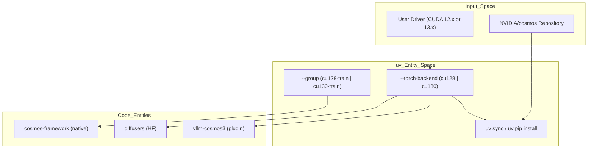
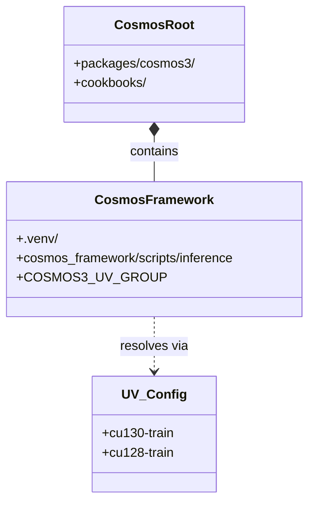
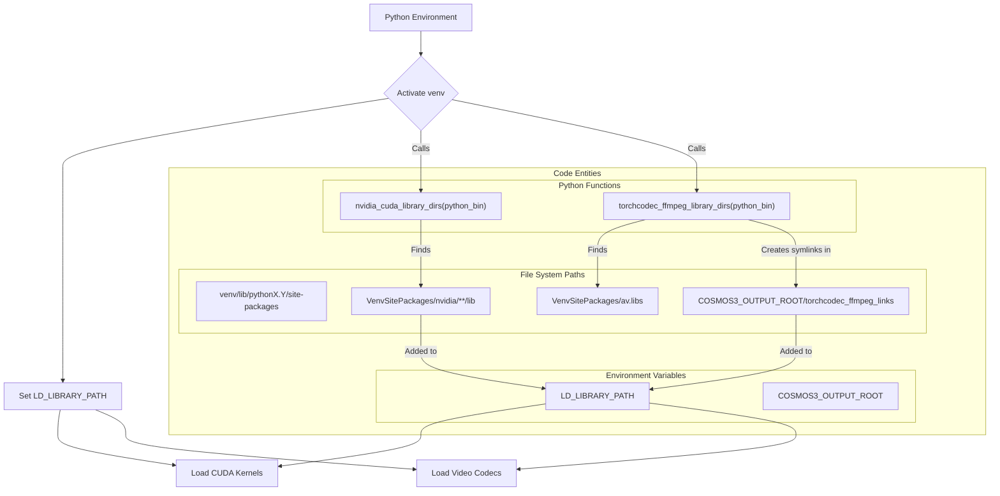

<!-- source: DeepWiki mcp.deepwiki.com · repo NVIDIA/cosmos · page 2.1 Dependency Management with uv · fetched 2026-10-26 -->

# Dependency Management with uv

Relevant source files

The following files were used as context for generating this wiki page:

- [README.md](README.md)
- [cookbooks/cosmos3/README.md](cookbooks/cosmos3/README.md)
- [cookbooks/cosmos3/generator/action/assets/umi_lerobot_example/meta/info.json](cookbooks/cosmos3/generator/action/assets/umi_lerobot_example/meta/info.json)
- [cookbooks/cosmos3/generator/action/run_id_with_cosmos_framework.ipynb](cookbooks/cosmos3/generator/action/run_id_with_cosmos_framework.ipynb)
- [cookbooks/cosmos3/generator/audiovisual/README.md](cookbooks/cosmos3/generator/audiovisual/README.md)
- [cookbooks/cosmos3/reasoner/run_with_cosmos_framework.ipynb](cookbooks/cosmos3/reasoner/run_with_cosmos_framework.ipynb)

NVIDIA Cosmos uses `uv` for high-performance Python package management and environment isolation. This page details the environment configuration strategy, the alignment between CUDA drivers and backend tags, the installation of the `cosmos-framework` package, and troubleshooting steps for common runtime issues involving system libraries and library path management.

## Environment Management Strategy

Cosmos leverages `uv` to manage virtual environments and dependencies across different integration paths, including native PyTorch (`cosmos-framework`), Hugging Face `diffusers`, and production serving via `vllm` and `vllm-omni` [cookbooks/cosmos3/README.md:1-14]().

### CUDA Version Alignment (cu128/cu130)

A critical aspect of the Cosmos setup is matching the Python environment's CUDA build of `torch` and `vllm` with the host's NVIDIA driver. The codebase defines two primary backend tags for this purpose [cookbooks/cosmos3/README.md:43-51]():

| Driver CUDA Version | Backend Tag | Notes |
| :--- | :--- | :--- |
| **13.x** | `cu130` | Default in the notebooks [cookbooks/cosmos3/README.md:50](). |
| **12.x** | `cu128` | Use when a compatible wheel is available for the selected package version [cookbooks/cosmos3/README.md:51](). |

vLLM does not publish a wheel for every minor CUDA version, so users must manually select the pair that matches their driver rather than relying on `--torch-backend=auto` [cookbooks/cosmos3/README.md:53-55]().

### Dependency Resolution Flow

The following diagram illustrates how `uv` resolves dependencies based on the selected integration path and CUDA backend.

**Title: Cosmos Dependency Resolution Logic**

Sources: [cookbooks/cosmos3/README.md:43-55](), [cookbooks/cosmos3/README.md:81-85]()

---

## Cosmos Framework Installation

The `cosmos-framework` is the core package for native PyTorch inference. It is installed from a separate repository into the `packages/cosmos3` directory [cookbooks/cosmos3/README.md:63-69]().

### Implementation Details
1.  **Clone**: The framework is cloned into `packages/cosmos3` [cookbooks/cosmos3/README.md:67]().
2.  **LFS Management**: To avoid failures from missing LFS blobs in the `uv` git mirror, `GIT_LFS_SKIP_SMUDGE=1` is exported before syncing [cookbooks/cosmos3/README.md:78]().
3.  **Group Selection**: The inference path currently imports modules from the training extras. Users must specify the `*-train` dependency group that matches their driver, such as `cu130-train` [cookbooks/cosmos3/README.md:71-73]().
4.  **Environment Variables**: Notebooks honor `COSMOS3_UV_GROUP` (default `cu130-train`) to select the correct dependency group at runtime [cookbooks/cosmos3/README.md:87-88]().

**Title: Cosmos Framework Environment Structure**

Sources: [cookbooks/cosmos3/README.md:63-69](), [cookbooks/cosmos3/README.md:81-88]()

---

## LD_LIBRARY_PATH and Shared Library Management

Correct management of `LD_LIBRARY_PATH` is essential for both CUDA kernel execution and video codec functionality.

### Video Codecs and Torchcodec (av.libs)
For action modeling and video processing, the framework relies on `torchcodec`. In notebook environments, specific logic is implemented to symlink FFmpeg libraries from the venv's `av.libs` directory to a known output path, which is then added to `LD_LIBRARY_PATH` [cookbooks/cosmos3/generator/action/run_id_with_cosmos_framework.ipynb:151-174](). This ensures `torchcodec` can locate `libavcodec.so.62`, `libavformat.so.62`, and other essential media libraries [cookbooks/cosmos3/generator/action/run_id_with_cosmos_framework.ipynb:161-169]().

### CUDA Library Search
The framework includes utility functions `nvidia_cuda_library_dirs` to locate NVIDIA CUDA library directories within the `site-packages/nvidia` directory of the virtual environment [cookbooks/cosmos3/generator/action/run_id_with_cosmos_framework.ipynb:138-148](). These paths are appended to `LD_LIBRARY_PATH` to ensure that CUDA kernels (e.g., for FlashInfer or custom operators) can link against the correct shared objects (`lib*.so*`) [cookbooks/cosmos3/generator/action/run_id_with_cosmos_framework.ipynb:146-147]().

**Title: LD_LIBRARY_PATH Management Flow**

Sources: [cookbooks/cosmos3/generator/action/run_id_with_cosmos_framework.ipynb:138-148](), [cookbooks/cosmos3/generator/action/run_id_with_cosmos_framework.ipynb:151-174]()

---

## Troubleshooting and Common Issues

### Missing System Libraries (`libxcb`)
Framework inference enables guardrails by default, which import `OpenCV` (via `RetinaFace`). This requires graphics libraries often missing on headless servers [cookbooks/cosmos3/README.md:106-110]().
-   **Symptom**: `ImportError: libxcb.so.1: cannot open shared object file` [cookbooks/cosmos3/README.md:129]().
-   **Fix**: Install system packages `libxcb1`, `libgl1`, and `libglib2.0-0` via `apt-get` [cookbooks/cosmos3/README.md:117-120]().

### Torch and CUDA Compatibility
-   **`torch.cuda.is_available()`**: If this returns `False`, the NVIDIA driver on the system is likely too old for the requirements [README.md:38]().
-   **NGC Container Conflict**: When using the recommended NGC PyTorch base images (25.09 for CUDA 13, 25.06 for CUDA 12), users must clear `LD_LIBRARY_PATH` after activating the venv to prevent the container's bundled libtorch from shadowing the venv's libraries [cookbooks/cosmos3/README.md:132-139]().

### FlashInfer JIT Compilation
Backends like `vLLM` perform just-in-time (JIT) compilation of kernels via FlashInfer.
-   **Path Requirement**: The `.venv/bin` directory must be in the system `PATH` because FlashInfer shells out to `ninja` for compilation.
-   **DeepGEMM**: If the vLLM build reports issues with DeepGEMM, it may need to be disabled via environment variables.

### `uv` and Resource Constraints
-   **Disk Space**: Nano downloads and CUDA dependencies can consume tens of GiB [cookbooks/cosmos3/README.md:40-41]().
-   **Authentication**: Accessing gated models (including the `Cosmos-1.0-Guardrail`) requires `uvx hf@latest auth login` or a valid `HF_TOKEN` [cookbooks/cosmos3/README.md:21-31]().

Sources: [README.md:35-40](), [cookbooks/cosmos3/README.md:18-41](), [cookbooks/cosmos3/README.md:106-139](), [cookbooks/cosmos3/generator/action/run_id_with_cosmos_framework.ipynb:138-174]()

---

