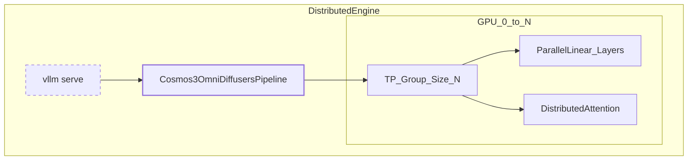
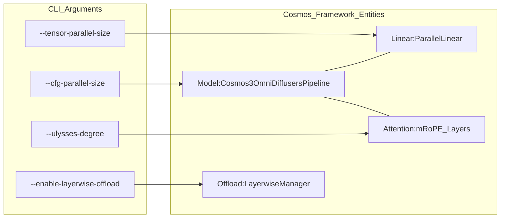

<!-- source: DeepWiki mcp.deepwiki.com · repo NVIDIA/cosmos · page 2.2 GPU Parallelism Configuration · fetched 2026-10-26 -->

# GPU Parallelism Configuration

Relevant source files

The following files were used as context for generating this wiki page:

- [README.md](README.md)
- [cookbooks/cosmos3/README.md](cookbooks/cosmos3/README.md)
- [cookbooks/cosmos3/generator/audiovisual/README.md](cookbooks/cosmos3/generator/audiovisual/README.md)
- [cookbooks/cosmos3/generator/audiovisual/assets/prompts/image2video/car_driving_edge.json](cookbooks/cosmos3/generator/audiovisual/assets/prompts/image2video/car_driving_edge.json)
- [cookbooks/cosmos3/generator/audiovisual/run_with_cosmos_framework.ipynb](cookbooks/cosmos3/generator/audiovisual/run_with_cosmos_framework.ipynb)
- [cookbooks/cosmos3/generator/audiovisual/run_with_diffusers.ipynb](cookbooks/cosmos3/generator/audiovisual/run_with_diffusers.ipynb)
- [cookbooks/cosmos3/generator/audiovisual/run_with_vllm_omni.ipynb](cookbooks/cosmos3/generator/audiovisual/run_with_vllm_omni.ipynb)

NVIDIA Cosmos 3 models, particularly the **Cosmos3-Super** (64B) variants, require sophisticated multi-dimensional parallelism strategies to fit within GPU memory and achieve performant inference latencies. This page documents the parallelism dimensions supported by the Cosmos Framework, vLLM, and TensorRT-LLM backends, including Tensor Parallelism, CFG Parallelism, Ulysses Sequence Parallelism, and Layerwise Offloading.

## Parallelism Dimensions Overview

The total number of GPUs allocated for a single inference task must exactly match the product of all enabled parallelism dimensions. This coordination is typically handled via `torchrun` in the Cosmos Framework or through the engine configuration in vLLM and TensorRT-LLM.

| Dimension | CLI Argument / Config | Purpose |
| :--- | :--- | :--- |
| **Tensor Parallelism (TP)** | `--tensor-parallel-size` | Splits model weights and activations across GPUs within a group. |
| **CFG Parallelism (CP)** | `--cfg-parallel-size` | Parallelizes the Classifier-Free Guidance (CFG) computation (conditional vs. unconditional branches). |
| **Ulysses Sequence Parallelism (USP)** | `--ulysses-degree` | Parallelizes the attention mechanism across the sequence length dimension. |
| **Layerwise Offload** | `--enable-layerwise-offload` | Offloads inactive layers to CPU/System RAM to reduce peak GPU memory usage. |
| **Context Parallelism (CP)** | `--cp-size` | Used during training/SFT to handle long sequences across multiple GPUs. |

### Configuration Constraint
For any distributed execution, the following identity must hold:
`Total GPUs = tensor_parallel_size * cfg_parallel_size * ulysses_degree`

Sources: [cookbooks/cosmos3/generator/audiovisual/run_with_vllm_omni.ipynb:99-100](), [cookbooks/cosmos3/generator/audiovisual/run_with_vllm_omni.ipynb:123-124]()

## Tensor Parallelism (TP)

Tensor Parallelism is the primary scaling dimension for Cosmos3-Super models. It partitions the linear layers and attention heads across multiple GPUs to reduce the memory footprint per device.

*   **Implementation:** TP is implemented natively within the Cosmos Framework and supported via the `vllm-omni` plugin for vLLM.
*   **Cosmos3-Nano (16B):** Typically runs with `tensor-parallel-size 1` on a single GPU.
*   **Cosmos3-Super (64B):** Recommended configuration is `tensor-parallel-size 4` or `8` depending on GPU VRAM (e.g., H100 80GB vs. H200 141GB) [cookbooks/cosmos3/generator/audiovisual/run_with_vllm_omni.ipynb:99]().
*   **vLLM MM Encoder TP:** vLLM allows specific TP modes for the multimodal encoder via `--mm-encoder-tp-mode`.

### Data Flow: Tensor Parallelism in vLLM
The following diagram illustrates how the `Cosmos3OmniDiffusersPipeline` architecture utilizes TP within the vLLM environment.

**vLLM Tensor Parallelism Mapping**

Sources: [cookbooks/cosmos3/generator/audiovisual/run_with_vllm_omni.ipynb:58-62](), [cookbooks/cosmos3/generator/audiovisual/run_with_vllm_omni.ipynb:96-98]()

## CFG Parallelism

In Generator Mode, Cosmos 3 utilizes Classifier-Free Guidance (CFG) to improve prompt adherence. This involves running two forward passes: one conditioned on the prompt and one unconditional (null prompt).

*   **Logic:** Since these two passes are independent, they can be computed in parallel on separate GPU groups.
*   **CLI Usage:** `--cfg-parallel-size 2` (or `cfg_size: 2` in TensorRT-LLM configs) splits the workload such that one group of GPUs handles the conditional branch and another handles the unconditional branch [cookbooks/cosmos3/generator/audiovisual/run_with_vllm_omni.ipynb:155-156]().
*   **Constraint:** If `cfg-parallel-size` is 2, the total GPU count must be doubled relative to the TP/USP requirements.

Sources: [cookbooks/cosmos3/generator/audiovisual/run_with_vllm_omni.ipynb:147-162]()

## Ulysses Sequence Parallelism (USP)

Ulysses Sequence Parallelism (USP) is used to handle long-context sequences, such as high-resolution video (720p) or high-frame-count generations (up to 189 frames), which might exceed the memory capacity of a single GPU's attention mechanism even with TP.

*   **Mechanism:** It partitions the sequence dimension across GPUs within the `ulysses-degree` group.
*   **Key Function:** This is integrated into the multimodal attention layers that process the unified token stream (mRoPE encoded).
*   **Usage:** In TensorRT-LLM, this is configured via `ulysses_size` in the YAML configuration.

Sources: [README.md:1.1]()

## Layerwise Offload

For environments with limited GPU VRAM but high system RAM, the Cosmos Framework and vLLM support layerwise offloading for inference.

*   **Implementation:** The `--enable-layerwise-offload` flag enables a mechanism where only the currently executing transformer layers are kept in GPU memory [cookbooks/cosmos3/generator/audiovisual/run_with_vllm_omni.ipynb:100]().
*   **Behavior:** As the inference progresses through the model's depth, weights are streamed from CPU to GPU. This significantly reduces the VRAM floor required to run the 64B Super models, albeit at a cost to inference latency.

Sources: [cookbooks/cosmos3/generator/audiovisual/run_with_vllm_omni.ipynb:100]()

## Training Parallelism: HSDP and dp-shard-size

For Super models during Supervised Fine-Tuning (SFT), the Cosmos Framework utilizes Hybrid Sharded Data Parallelism (HSDP).

*   **HSDP Implementation:** Combines Fully Sharded Data Parallelism (FSDP) within a node and Data Parallelism across nodes.
*   **dp-shard-size:** Controls the degree of sharding for the model states.
*   **Context Parallelism:** For Reasoner SFT on long video sequences, `--cp-size` is used to parallelize the sequence dimension during training.

Sources: [README.md:7.3](), [README.md:7.4]()

## Configuration Mapping

The following diagram bridges the high-level CLI configuration to the underlying model components and execution logic within the framework.

**CLI to Code Entity Mapping**

Sources: [cookbooks/cosmos3/generator/audiovisual/run_with_vllm_omni.ipynb:61](), [cookbooks/cosmos3/generator/audiovisual/run_with_vllm_omni.ipynb:99-100](), [cookbooks/cosmos3/generator/audiovisual/run_with_vllm_omni.ipynb:155-156]()

## Summary of Distributed Requirements

When launching with `torchrun` or `vllm serve`, ensure the environment variables and flags are aligned.

| Model | Total GPUs | Recommended Parallelism Config |
| :--- | :--- | :--- |
| **Cosmos3-Nano** | 1 | `TP=1, CFG=1, USP=1` |
| **Cosmos3-Super** (Reasoner) | 4-8 | `TP=4/8, CFG=1, USP=1` |
| **Cosmos3-Super** (Generator) | 4-8 | `TP=2, CFG=2, USP=1` (4 GPUs) OR `TP=4, CFG=2, USP=1` (8 GPUs) |

> **Note:** TensorRT-LLM for Cosmos3-Super specifically uses a configuration with `cfg_size=2`, `ulysses_size=2`, and `parallel_vae_size=4`, requiring exactly four processes.

Sources: [cookbooks/cosmos3/generator/audiovisual/run_with_vllm_omni.ipynb:99-100](), [cookbooks/cosmos3/generator/audiovisual/run_with_vllm_omni.ipynb:155-156]()

---

