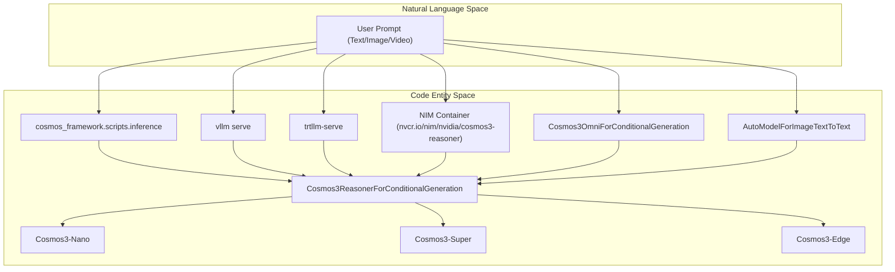
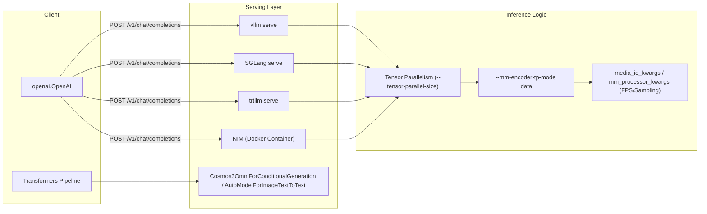

<!-- source: DeepWiki mcp.deepwiki.com · repo NVIDIA/cosmos · page 3 Reasoner: Vision-Language Understanding · fetched 2026-10-26 -->

# Reasoner: Vision-Language Understanding

Relevant source files

The following files were used as context for generating this wiki page:

- [cookbooks/cosmos3/reasoner/README.md](cookbooks/cosmos3/reasoner/README.md)
- [cookbooks/cosmos3/reasoner/run_with_tensorrt_llm.ipynb](cookbooks/cosmos3/reasoner/run_with_tensorrt_llm.ipynb)
- [cookbooks/cosmos3/reasoner/run_with_transformers.ipynb](cookbooks/cosmos3/reasoner/run_with_transformers.ipynb)
- [cookbooks/cosmos3/reasoner/run_with_vllm.ipynb](cookbooks/cosmos3/reasoner/run_with_vllm.ipynb)

The Cosmos 3 Reasoner is the vision-language understanding surface of the NVIDIA Cosmos 3 world model family. It enables sophisticated reasoning tasks across static images and temporal video sequences, including detailed captioning, 2D grounding, robot task planning, and action-trajectory prediction [cookbooks/cosmos3/reasoner/README.md:1-4](). The Reasoner utilizes a causal self-attention mechanism within the shared Mixture-of-Transformers (MoT) architecture to process interleaved multimodal tokens.

## Execution Backends

The Reasoner can be executed through four primary paths depending on the use case and memory constraints:

1.  **Cosmos Framework**: A native PyTorch-based execution path optimized for local inference and research. It loads the **full omni weights** (Reasoner plus the generator experts), using the most memory [cookbooks/cosmos3/reasoner/README.md:15-18](). For details, see [Reasoner with Cosmos Framework](#3.1).
2.  **vLLM**: A high-performance serving engine that provides an OpenAI-compatible API. It loads **only the Reasoner (VLM) weights**, significantly reducing the memory footprint (e.g., ~17GB for Nano vs ~34GB in Framework) [cookbooks/cosmos3/reasoner/README.md:19-27](). For details, see [Reasoner with vLLM, SGLang, TensorRT-LLM, Transformers, and NIM](#3.2).
3.  **TensorRT-LLM**: An optimized inference runtime for large language models, also loading **only the Reasoner (VLM) weights** for memory efficiency [cookbooks/cosmos3/reasoner/README.md:19-27](). For details, see [Reasoner with vLLM, SGLang, TensorRT-LLM, Transformers, and NIM](#3.2).
4.  **Transformers**: A Python-first path using the Hugging Face `transformers` library, specifically the `Cosmos3OmniForConditionalGeneration` or `AutoModelForImageTextToText` classes [cookbooks/cosmos3/reasoner/run_with_transformers.ipynb:23-29](). For details, see [Reasoner with vLLM, SGLang, TensorRT-LLM, Transformers, and NIM](#3.2).
5.  **NVIDIA NIM**: A prebuilt, optimized container that packages the Reasoner with an OpenAI-compatible server, requiring no manual Python environment or CUDA setup [cookbooks/cosmos3/reasoner/README.md:145-150](). For details, see [Reasoner with vLLM, SGLang, TensorRT-LLM, Transformers, and NIM](#3.2).

### Relationship Between Backends

The following diagram illustrates how the Reasoner logic is surfaced through different code entities and deployment surfaces:

**Reasoner Backend Architecture**

Sources: [cookbooks/cosmos3/reasoner/README.md:15-27](), [cookbooks/cosmos3/reasoner/README.md:63-67](), [cookbooks/cosmos3/reasoner/run_with_transformers.ipynb:23-29](), [cookbooks/cosmos3/reasoner/run_with_vllm.ipynb:16-17](), [cookbooks/cosmos3/reasoner/run_with_tensorrt_llm.ipynb:9-19]()

## Reasoner Capabilities

The Reasoner is designed for a broad spectrum of vision-language tasks. It processes input via a unified token stream, allowing it to "see" visual data and "reason" via text.

| Task | Description |
| :--- | :--- |
| **Captioning** | Generating detailed textual descriptions of images or video sequences [cookbooks/cosmos3/reasoner/reasoner_prompt_guide.md:105-147](). |
| **2D Grounding** | Identifying and localizing objects using normalized `0-1000` coordinates for `bbox_2d` and `point_2d` [cookbooks/cosmos3/reasoner/reasoner_prompt_guide.md:77-83](). |
| **Temporal Reasoning** | Understanding events over time, such as temporal localization in video with JSON output [cookbooks/cosmos3/reasoner/reasoner_prompt_guide.md:149-212](). |
| **Embodied Reasoning** | Planning robot tasks and predicting action-trajectory prompts from visual state [cookbooks/cosmos3/reasoner/README.md:79-81](). |
| **Physical Plausibility** | Evaluating if a visual scene or sequence follows physical laws [cookbooks/cosmos3/reasoner/README.md:135-136](). |
| **VQA** | Answering complex questions about visual content [cookbooks/cosmos3/reasoner/README.md:133-134](). |

Sources: [cookbooks/cosmos3/reasoner/README.md:131-136](), [cookbooks/cosmos3/reasoner/reasoner_prompt_guide.md:77-83](), [cookbooks/cosmos3/reasoner/reasoner_prompt_guide.md:149-160]()

## Reasoner with Cosmos Framework

The Cosmos Framework path provides a direct interface to the model using the `cosmos_framework.scripts.inference` module [cookbooks/cosmos3/reasoner/README.md:63-63](). This backend uses a JSON-based input specification where users define the `model_mode` as `reasoner` and provide a `vision_path` to the local asset [cookbooks/cosmos3/reasoner/README.md:47-56]().

Key features of this path include:
*   **Input Format**: Supports local file paths for images via the `vision_path` field; note that `enable_sound: false` is required as the Reasoner does not support audio [cookbooks/cosmos3/reasoner/README.md:43-55]().
*   **Distributed Execution**: Uses `torchrun` to scale `Cosmos3-Super` across multiple GPUs (e.g., 4 GPUs) [cookbooks/cosmos3/reasoner/README.md:82-83]().
*   **Output**: Generates a `reasoner_text.txt` file containing the model's response [cookbooks/cosmos3/reasoner/README.md:72-73]().

For implementation details and CLI usage, see [Reasoner with Cosmos Framework](#3.1).

Sources: [cookbooks/cosmos3/reasoner/README.md:43-56](), [cookbooks/cosmos3/reasoner/README.md:63-73](), [cookbooks/cosmos3/reasoner/README.md:82-83]()

## Reasoner with vLLM, SGLang, TensorRT-LLM, Transformers, and NIM

These backends are optimized for throughput and support standard API patterns. vLLM, TensorRT-LLM, and NIM all support the OpenAI Chat Completions API [cookbooks/cosmos3/reasoner/README.md:100-111](), [cookbooks/cosmos3/reasoner/run_with_tensorrt_llm.ipynb:15-16]().

**Serving and API Integration Flow**

Sources: [cookbooks/cosmos3/reasoner/README.md:100-111](), [cookbooks/cosmos3/reasoner/README.md:167-181](), [cookbooks/cosmos3/reasoner/run_with_vllm.ipynb:113-123](), [cookbooks/cosmos3/reasoner/reasoner_prompt_guide.md:29-33](), [cookbooks/cosmos3/reasoner/run_with_tensorrt_llm.ipynb:15-16](), [cookbooks/cosmos3/reasoner/run_with_transformers.ipynb:23-29]()

Key features of these paths include:
*   **Multimodal Ingestion**: Supports images via `image_url` and videos via `video_url`. NIM specifically requires local assets to be sent as base64 data URIs [cookbooks/cosmos3/reasoner/README.md:161-164](), [cookbooks/cosmos3/reasoner/reasoner_prompt_guide.md:61-62]().
*   **Parallelism**: Super models are typically served with `--tensor-parallel-size 4` and `--mm-encoder-tp-mode data` [cookbooks/cosmos3/reasoner/run_with_vllm.ipynb:122-123]().
*   **Media Controls**: Video frame sampling is controlled via `media_io_kwargs` or `mm_processor_kwargs` (e.g., setting FPS or `do_sample_frames`) [cookbooks/cosmos3/reasoner/reasoner_prompt_guide.md:29-33]().
*   **Chain-of-Thought**: Reasoning can be toggled by appending instructions to the user prompt, with the model outputting reasoning between `<think>` tags [cookbooks/cosmos3/reasoner/reasoner_prompt_guide.md:41-54]().

For server launch commands and API examples, see [Reasoner with vLLM, SGLang, TensorRT-LLM, Transformers, and NIM](#3.2). For prompt engineering techniques, see [Reasoner Prompt Guide](#3.3).

Sources: [cookbooks/cosmos3/reasoner/README.md:161-164](), [cookbooks/cosmos3/reasoner/run_with_vllm.ipynb:122-123](), [cookbooks/cosmos3/reasoner/reasoner_prompt_guide.md:29-33](), [cookbooks/cosmos3/reasoner/reasoner_prompt_guide.md:41-54]()

---

