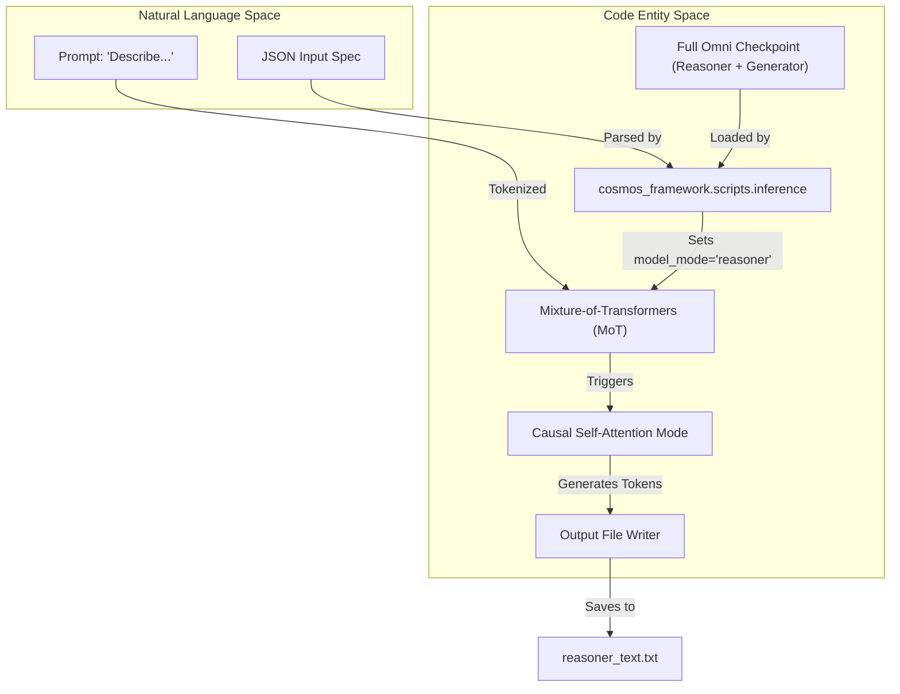
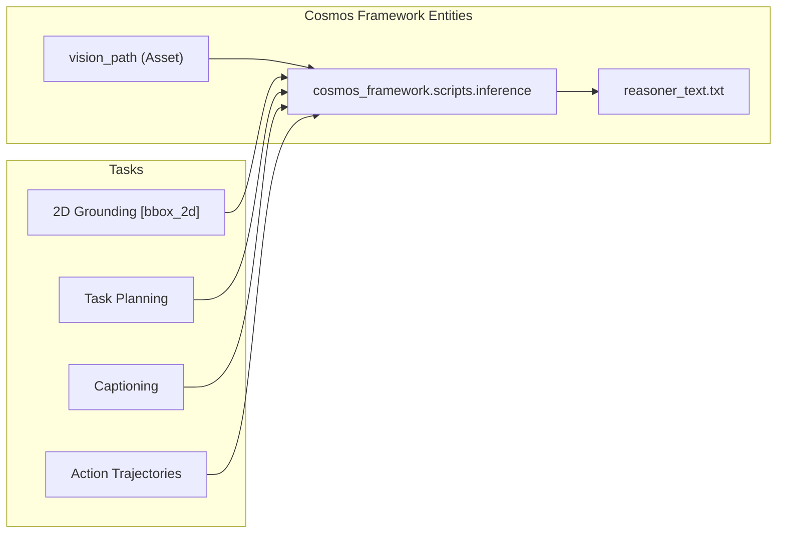

<!-- source: DeepWiki mcp.deepwiki.com · repo NVIDIA/cosmos · page 3.1 Reasoner with Cosmos Framework · fetched 2026-10-26 -->

# Reasoner with Cosmos Framework

<details>
<summary>Relevant source files</summary>

The following files were used as context for generating this wiki page:

- [cookbooks/cosmos3/generator/action/assets/umi_lerobot_example/meta/info.json](cookbooks/cosmos3/generator/action/assets/umi_lerobot_example/meta/info.json)
- [cookbooks/cosmos3/generator/action/run_id_with_cosmos_framework.ipynb](cookbooks/cosmos3/generator/action/run_id_with_cosmos_framework.ipynb)
- [cookbooks/cosmos3/reasoner/README.md](cookbooks/cosmos3/reasoner/README.md)
- [cookbooks/cosmos3/reasoner/run_with_cosmos_framework.ipynb](cookbooks/cosmos3/reasoner/run_with_cosmos_framework.ipynb)
- [cookbooks/cosmos3/reasoner/run_with_tensorrt_llm.ipynb](cookbooks/cosmos3/reasoner/run_with_tensorrt_llm.ipynb)
- [cookbooks/cosmos3/reasoner/run_with_transformers.ipynb](cookbooks/cosmos3/reasoner/run_with_transformers.ipynb)
- [cookbooks/cosmos3/reasoner/run_with_vllm.ipynb](cookbooks/cosmos3/reasoner/run_with_vllm.ipynb)

</details>


The Cosmos 3 Reasoner is a vision-language understanding surface designed for tasks such as detailed captioning, 2D grounding, temporal localization, and embodied planning. Within the **Cosmos Framework**, the Reasoner is executed natively via PyTorch using the `cosmos_framework.scripts.inference` module [cookbooks/cosmos3/reasoner/run_with_cosmos_framework.ipynb:16-22](). This integration path is ideal for research and development where direct control over distributed execution and model configurations is required.

## Inference Execution with torchrun

The primary entry point for running Reasoner inference is the `cosmos_framework.scripts.inference` script [cookbooks/cosmos3/reasoner/README.md:63-69](). For large-scale models like **Cosmos3-Super**, which require multi-GPU setups, the framework utilizes `torchrun` to manage distributed processes [cookbooks/cosmos3/reasoner/README.md:82-83]().

### CLI Arguments and Configuration
When executing the inference script, several key arguments define the behavior of the Reasoner:

| Argument | Description |
| :--- | :--- |
| `-i` / `--input-json` | Path to the JSON input specification file [cookbooks/cosmos3/reasoner/README.md:65](). |
| `-o` / `--output-dir` | Directory where the reasoning results will be saved [cookbooks/cosmos3/reasoner/README.md:66](). |
| `--checkpoint-path` | Path or Hugging Face identifier (e.g., `Cosmos3-Nano`, `Cosmos3-Super`) [cookbooks/cosmos3/reasoner/README.md:67](). |
| `--parallelism-preset` | Preset for GPU parallelism (e.g., `latency`) [cookbooks/cosmos3/reasoner/README.md:64](). |
| `--seed` | Random seed for reproducibility [cookbooks/cosmos3/reasoner/README.md:68](). |
| `--benchmark` | Enables performance benchmarking during the run [cookbooks/cosmos3/reasoner/README.md:69](). |

### Distributed Execution for Super Models
While **Cosmos3-Nano** can run on a single GPU using standard Python by setting `WORLD_SIZE=1` and manually configuring the environment variables [cookbooks/cosmos3/reasoner/README.md:61-70](), **Cosmos3-Super** typically requires 4 or more GPUs. The framework uses `.venv/bin/torchrun` to coordinate the distributed group for Super models [cookbooks/cosmos3/reasoner/README.md:82-83]().

Sources: [cookbooks/cosmos3/reasoner/README.md:61-70](), [cookbooks/cosmos3/reasoner/README.md:82-83](), [cookbooks/cosmos3/reasoner/run_with_cosmos_framework.ipynb:30-31]()

## Input Specification Format

The Reasoner expects a JSON input file that defines the task and the associated media. The `model_mode` must be set to `reasoner` to trigger the understanding logic of the architecture [cookbooks/cosmos3/reasoner/README.md:49]().

### JSON Payload Schema
```json
{
  "model_mode": "reasoner",
  "name": "robot_image",
  "prompt": "Describe what is happening in this image in one sentence.",
  "vision_path": "../../cookbooks/cosmos3/reasoner/assets/robot_153.jpg",
  "enable_sound": false
}
```
*   **model_mode**: Must be `reasoner` [cookbooks/cosmos3/reasoner/README.md:49]().
*   **name**: A unique identifier for the task, used to create the output subdirectory [cookbooks/cosmos3/reasoner/README.md:50]().
*   **prompt**: The text instruction for the model [cookbooks/cosmos3/reasoner/README.md:51]().
*   **vision_path**: Local path or URL to the image. Currently, the framework Reasoner path primarily expects image inputs via this field [cookbooks/cosmos3/reasoner/README.md:52](), [cookbooks/cosmos3/reasoner/README.md:83-85]().
*   **enable_sound**: Set to `false` to avoid a strict argument-validation failure in the current Reasoner path, as audio is not currently supported in this mode [cookbooks/cosmos3/reasoner/README.md:43](), [cookbooks/cosmos3/reasoner/README.md:53]().

Sources: [cookbooks/cosmos3/reasoner/README.md:43-56](), [cookbooks/cosmos3/reasoner/README.md:83-85]()

## Data Flow and Implementation

The following diagram illustrates how the Cosmos Framework processes a Reasoner request from the JSON input to the final text output. Note that the Cosmos Framework backend loads the **full omni weights** (Reasoner plus generator components like the video VAE and diffusion experts) [cookbooks/cosmos3/reasoner/README.md:15-18]().

### Reasoner Data Flow Diagram


Sources: [cookbooks/cosmos3/reasoner/README.md:15-18](), [cookbooks/cosmos3/reasoner/README.md:49-56](), [cookbooks/cosmos3/reasoner/README.md:63-73](), [cookbooks/cosmos3/reasoner/run_with_cosmos_framework.ipynb:16-22]()

## Reasoning Capabilities

The Reasoner surface supports several specialized vision-language tasks through prompt engineering. The framework allows for the visualization of results such as 2D grounding boxes and action trajectories in the accompanying notebooks [cookbooks/cosmos3/reasoner/run_with_cosmos_framework.ipynb:77-81]().

### Task Examples
1.  **Detailed Captioning**: Providing exhaustive descriptions of scenes [cookbooks/cosmos3/reasoner/run_with_cosmos_framework.ipynb:78]().
2.  **Robot Task Planning**: Generating step-by-step instructions based on visual state [cookbooks/cosmos3/reasoner/run_with_cosmos_framework.ipynb:78]().
3.  **2D Grounding**: Identifying and locating objects within an image using normalized `0-1000` coordinates [cookbooks/cosmos3/reasoner/run_with_cosmos_framework.ipynb:79]().
4.  **Action Trajectory Prediction**: Predicting future coordinates for embodied agents [cookbooks/cosmos3/reasoner/run_with_cosmos_framework.ipynb:79-80]().

### Entity Association Diagram
This diagram maps the high-level reasoning tasks to the specific assets and script outputs handled by the framework.



Sources: [cookbooks/cosmos3/reasoner/README.md:72-73](), [cookbooks/cosmos3/reasoner/run_with_cosmos_framework.ipynb:77-81]()

## Output Structure

Upon completion, the inference script generates a directory structure based on the `name` field provided in the input JSON. The primary result is a text file containing the model's response.

**Output File Path:**
`<output-dir>/<name>/reasoner_text.txt` [cookbooks/cosmos3/reasoner/README.md:72-73]()

For example, if the output directory is `outputs/cookbooks/cosmos3/reasoner/nano/cosmos_framework_image` and the name is `robot_image`, the result will be found at `outputs/cookbooks/cosmos3/reasoner/nano/cosmos_framework_image/robot_image/reasoner_text.txt` [cookbooks/cosmos3/reasoner/README.md:66-73]().

Sources: [cookbooks/cosmos3/reasoner/README.md:63-73]()

---

